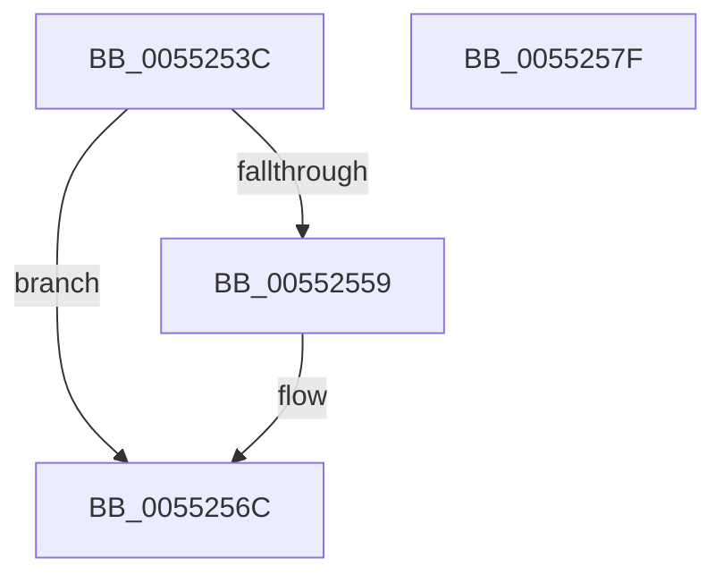

# HalpDmaIsAutomaticDomain

- RVA: `0x0055253C`–`0x00552580` (길이 `68` bytes)
- VA: `0x000000014055253C`
- 실행 섹션: `.text`
- PDB 이름 있음: `예`; PDB Function 태그: `아니요`
- unwind 정보 RVA: `0x00060BC4`
- 디코드: `21`개 명령, `68/68` bytes 표시
- 미해석 바이트: `0` (있으면 어셈블리에 `.byte`로 보존)

> 이 문서는 커널 이미지의 기계어와 PDB 기호를 분석해 생성했습니다. 4번과 5번은 함수 원형과 자료형을 바이너리 사용 방식에서 추정한 C 해석이며 원본 소스 복구 결과는 아닙니다.

## 1. Dependencies

- 직접 호출 지점: **2**; 고유 호출 대상: **2**
- 직접 호출자로 확인된 함수: **2**
- RIP 상대 이미지 참조: **0**

### Outgoing calls
- `0x00552550` → [HalpDmaReferenceDomainObject](../3E/HalpDmaReferenceDomainObject_function_003E9B08.md) (function, `0x003E9B08`)
- `0x00552560` → [HalpDmaDereferenceDomainObject](../3F/HalpDmaDereferenceDomainObject_function_003F69DC.md) (function, `0x003F69DC`)

### Direct callers
- [HalGetAdapterV3](../../page/70/HalGetAdapterV3_function_00709838.md) at `0x00709C90`
- [HalGetAdapterV2](../../page/70/HalGetAdapterV2_function_00709DD8.md) at `0x0070A06C`

### Static image references
- 디코드된 RIP-relative 메모리 참조가 없습니다.

## 2. Other-region calls and transfers

- 다른 실행 섹션으로 향하는 call: **0**
- 별도 외부 분기/꼬리 이동을 확인하지 못했습니다.

## 3. Assembly (complete function range)

```asm
0055253C  48 89 5C 24 08                  mov qword ptr [rsp + 8], rbx
00552541  48 89 74 24 10                  mov qword ptr [rsp + 0x10], rsi
00552546  57                              push rdi
00552547  48 83 EC 20                     sub rsp, 0x20
0055254B  48 8B F1                        mov rsi, rcx
0055254E  33 FF                           xor edi, edi
00552550  E8 B3 75 E9 FF                  call 0x1403e9b08
00552555  85 C0                           test eax, eax
00552557  78 13                           js 0x14055256c
00552559  48 8B 5E 38                     mov rbx, qword ptr [rsi + 0x38]
0055255D  48 8B CE                        mov rcx, rsi
00552560  E8 77 44 EA FF                  call 0x1403f69dc
00552565  48 85 DB                        test rbx, rbx
00552568  40 0F 95 C7                     setne dil
0055256C  48 8B 5C 24 30                  mov rbx, qword ptr [rsp + 0x30]
00552571  40 8A C7                        mov al, dil
00552574  48 8B 74 24 38                  mov rsi, qword ptr [rsp + 0x38]
00552579  48 83 C4 20                     add rsp, 0x20
0055257D  5F                              pop rdi
0055257E  C3                              ret
0055257F  CC                              int3
```

## 4. C-style interpretation (structured pseudocode)

```c
__int64 __fastcall HalpDmaIsAutomaticDomain(__int64 a1)
{
    __int64 result;
    __int64 v_rbx;
    __int64 v_rdi;
    __int64 v_rsp;
    unsigned __int64 v_stack_p10;
    unsigned __int64 v_stack_p8;

    v_stack_p8 = v_rbx;
    v_stack_p10 = v_rsi;
    v_rsp = (v_rsp) - (32);
    v_rdi = 0;
    result = HalpDmaReferenceDomainObject(a1, a2, a3, a4);
    if (!(sign_flag)) {
        v_rbx = *(unsigned __int64 *)(a1 + 56);
        a1 = a1;
        result = HalpDmaDereferenceDomainObject(a1, a2, a3, a4);
        v_rdi = (v_rbx != 0) ? 1 : 0;
    }
    v_rsp = (v_rsp) + (32);
    return (unsigned __int8)(v_rdi);
}
```

## 5. (Beta) C Style

```c
int64_t HalpDmaIsAutomaticDomain(void *Arg1)
{
    uint8_t *arg1 = (uint8_t *)Arg1;

    int64_t result;
    int64_t local_rbx;
    int64_t local_rdi;
    int64_t local_rsp;
    uint64_t v_stack_p10;
    uint64_t v_stack_p8;

    v_stack_p8 = local_rbx;
    v_stack_p10 = local_rsi;
    local_rsp = (local_rsp) - (32);
    local_rdi = 0;
    result = HalpDmaReferenceDomainObject(Arg1, a2, a3, a4);
    if (!(sign_flag)) {
        local_rbx = *(uint64_t *)(arg1 + 0x38);
        Arg1 = Arg1;
        result = HalpDmaDereferenceDomainObject(Arg1, a2, a3, a4);
        local_rdi = (local_rbx != 0) ? 1 : 0;
    }
    local_rsp = (local_rsp) + (32);
    return (uint8_t)(local_rdi);
}
```

### 관측된 메모리 오프셋

구조체 형식이 확인되지 않은 접근은 인자 기준의 오프셋으로만 기록했습니다.

| 기준 인자 | 오프셋 표현 | 폭 (bit) | 접근 |
|---|---:|---:|---|
| `Arg1` | `+ 0x38` | `64` | `R` |

## 6. Execution-region graph

[열기: 2D/3D 그래프와 함수 탐색 컨트롤 패널](../../../control-panel.html?section=text&rva=0x0055253C&view=graph)

- 2D 그래프는 위에서 아래로 흐르고, 3D 그래프는 빈 공간을 드래그해 회전합니다. Shift+드래그는 이동, 휠은 확대·축소, 함수 노드 선택은 대상 보고서 이동입니다.

### Static fallback


