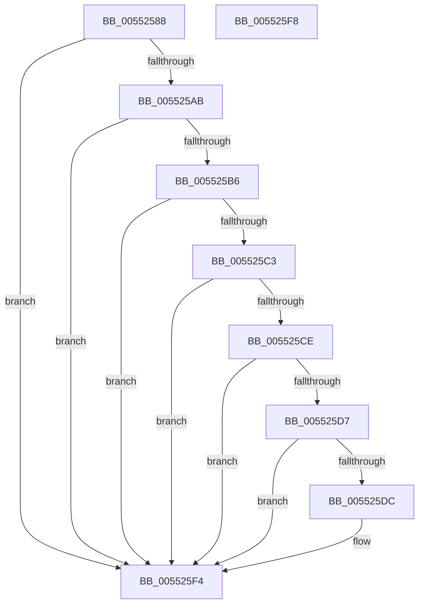

# HalpDmaIsDomainCompatible

- RVA: `0x00552588`–`0x005525F9` (길이 `113` bytes)
- VA: `0x0000000140552588`
- 실행 섹션: `.text`
- PDB 이름 있음: `예`; PDB Function 태그: `아니요`
- unwind 정보 RVA: `0x000DB714`
- 디코드: `33`개 명령, `113/113` bytes 표시
- 미해석 바이트: `0` (있으면 어셈블리에 `.byte`로 보존)

> 이 문서는 커널 이미지의 기계어와 PDB 기호를 분석해 생성했습니다. 4번과 5번은 함수 원형과 자료형을 바이너리 사용 방식에서 추정한 C 해석이며 원본 소스 복구 결과는 아닙니다.

## 1. Dependencies

- 직접 호출 지점: **0**; 고유 호출 대상: **0**
- 직접 호출자로 확인된 함수: **1**
- RIP 상대 이미지 참조: **0**

### Outgoing calls
- 직접 디코드된 call 명령이 없습니다.

### Direct callers
- [HalJoinDmaDomain](../4E/HalJoinDmaDomain_function_004E3320.md) at `0x004E337B`

### Static image references
- 디코드된 RIP-relative 메모리 참조가 없습니다.

## 2. Other-region calls and transfers

- 다른 실행 섹션으로 향하는 call: **0**
- 별도 외부 분기/꼬리 이동을 확인하지 못했습니다.

## 3. Assembly (complete function range)

```asm
00552588  8A 81 99 00 00 00               mov al, byte ptr [rcx + 0x99]
0055258E  45 33 C0                        xor r8d, r8d
00552591  F6 D8                           neg al
00552593  B8 00 00 FF FF                  mov eax, 0xffff0000
00552598  4D 1B C9                        sbb r9, r9
0055259B  4C 23 C8                        and r9, rax
0055259E  49 81 C1 00 00 01 00            add r9, 0x10000
005525A5  4C 39 42 38                     cmp qword ptr [rdx + 0x38], r8
005525A9  75 49                           jne 0x1405525f4
005525AB  8A 81 BD 01 00 00               mov al, byte ptr [rcx + 0x1bd]
005525B1  38 42 20                        cmp byte ptr [rdx + 0x20], al
005525B4  75 3E                           jne 0x1405525f4
005525B6  48 8B 81 90 00 00 00            mov rax, qword ptr [rcx + 0x90]
005525BD  48 39 42 10                     cmp qword ptr [rdx + 0x10], rax
005525C1  77 31                           ja 0x1405525f4
005525C3  8B 81 08 02 00 00               mov eax, dword ptr [rcx + 0x208]
005525C9  39 42 30                        cmp dword ptr [rdx + 0x30], eax
005525CC  75 26                           jne 0x1405525f4
005525CE  48 8B 4A 18                     mov rcx, qword ptr [rdx + 0x18]
005525D2  48 85 C9                        test rcx, rcx
005525D5  74 1D                           je 0x1405525f4
005525D7  4C 3B C9                        cmp r9, rcx
005525DA  72 18                           jb 0x1405525f4
005525DC  33 D2                           xor edx, edx
005525DE  45 0F B6 C0                     movzx r8d, r8b
005525E2  49 8B C1                        mov rax, r9
005525E5  48 F7 F1                        div rcx
005525E8  B9 01 00 00 00                  mov ecx, 1
005525ED  48 85 D2                        test rdx, rdx
005525F0  44 0F 44 C1                     cmove r8d, ecx
005525F4  41 8A C0                        mov al, r8b
005525F7  C3                              ret
005525F8  CC                              int3
```

## 4. C-style interpretation (structured pseudocode)

```c
__int64 __fastcall HalpDmaIsDomainCompatible(__int64 a1, __int64 a2, int a3, __int64 a4)
{
    __int64 result;

    a3 = 0;
    result = (unsigned __int8)(-(*(unsigned __int8 *)(a1 + 153)));
    a4 = (a4) & ((unsigned int)(0xFFFF0000ULL));
    a4 = (a4) + (0x10000ULL);
    if ((*(unsigned __int64 *)(a2 + 56)) != 0) goto loc_005525F4;
    if ((*(unsigned __int8 *)(a2 + 32)) != ((unsigned __int8)(*(unsigned __int8 *)(a1 + 445)))) goto loc_005525F4;
    if ((*(unsigned __int64 *)(a2 + 16)) > (*(unsigned __int64 *)(a1 + 144))) goto loc_005525F4;
    if ((*(unsigned int *)(a2 + 48)) != ((unsigned int)((unsigned int)(*(unsigned int *)(a1 + 520))))) goto loc_005525F4;
    if (*(unsigned __int64 *)(a2 + 24) == 0) goto loc_005525F4;
    result = (unsigned int)(*(unsigned int *)(a1 + 520));
    if (a4 >= (*(unsigned __int64 *)(a2 + 24))) {
        a2 = 0;
        a3 = 0;
        result = a4;
        a1 = 1;
        if (0 == 0) { a3 = (unsigned int)(a1); }
    }
    return (unsigned __int8)(a3);
}
```

## 5. (Beta) C Style

```c
int64_t HalpDmaIsDomainCompatible(void *Arg1, void *Arg2, int32_t Arg3, int64_t Arg4)
{
    uint8_t *arg1 = (uint8_t *)Arg1;
    uint8_t *arg2 = (uint8_t *)Arg2;

    int64_t result;

    Arg3 = 0;
    result = (uint8_t)(-(*(uint8_t *)(arg1 + 0x99)));
    Arg4 = (Arg4) & ((uint32_t)(0xFFFF0000ULL));
    Arg4 = (Arg4) + (0x10000ULL);
    if ((*(uint64_t *)(arg2 + 0x38)) != 0) goto loc_005525F4;
    if ((*(uint8_t *)(arg2 + 0x20)) != ((uint8_t)(*(uint8_t *)(arg1 + 0x1BD)))) goto loc_005525F4;
    if ((*(uint64_t *)(arg2 + 0x10)) > (*(uint64_t *)(arg1 + 0x90))) goto loc_005525F4;
    if ((*(uint32_t *)(arg2 + 0x30)) != ((uint32_t)((uint32_t)(*(uint32_t *)(arg1 + 0x208))))) goto loc_005525F4;
    if (*(uint64_t *)(arg2 + 0x18) == 0) goto loc_005525F4;
    result = (uint32_t)(*(uint32_t *)(arg1 + 0x208));
    if (Arg4 >= (*(uint64_t *)(arg2 + 0x18))) {
        Arg2 = 0;
        Arg3 = 0;
        result = Arg4;
        Arg1 = 1;
        if (0 == 0) { Arg3 = (uint32_t)(Arg1); }
    }
    return (uint8_t)(Arg3);
}
```

### 관측된 메모리 오프셋

구조체 형식이 확인되지 않은 접근은 인자 기준의 오프셋으로만 기록했습니다.

| 기준 인자 | 오프셋 표현 | 폭 (bit) | 접근 |
|---|---:|---:|---|
| `Arg1` | `+ 0x90` | `64` | `R` |
| `Arg1` | `+ 0x99` | `8` | `R` |
| `Arg1` | `+ 0x1BD` | `8` | `R` |
| `Arg1` | `+ 0x208` | `32` | `R` |
| `Arg2` | `+ 0x10` | `64` | `R` |
| `Arg2` | `+ 0x18` | `64` | `R` |
| `Arg2` | `+ 0x20` | `8` | `R` |
| `Arg2` | `+ 0x30` | `32` | `R` |
| `Arg2` | `+ 0x38` | `64` | `R` |

## 6. Execution-region graph

[열기: 2D/3D 그래프와 함수 탐색 컨트롤 패널](../../../control-panel.html?section=text&rva=0x00552588&view=graph)

- 2D 그래프는 위에서 아래로 흐르고, 3D 그래프는 빈 공간을 드래그해 회전합니다. Shift+드래그는 이동, 휠은 확대·축소, 함수 노드 선택은 대상 보고서 이동입니다.

### Static fallback


