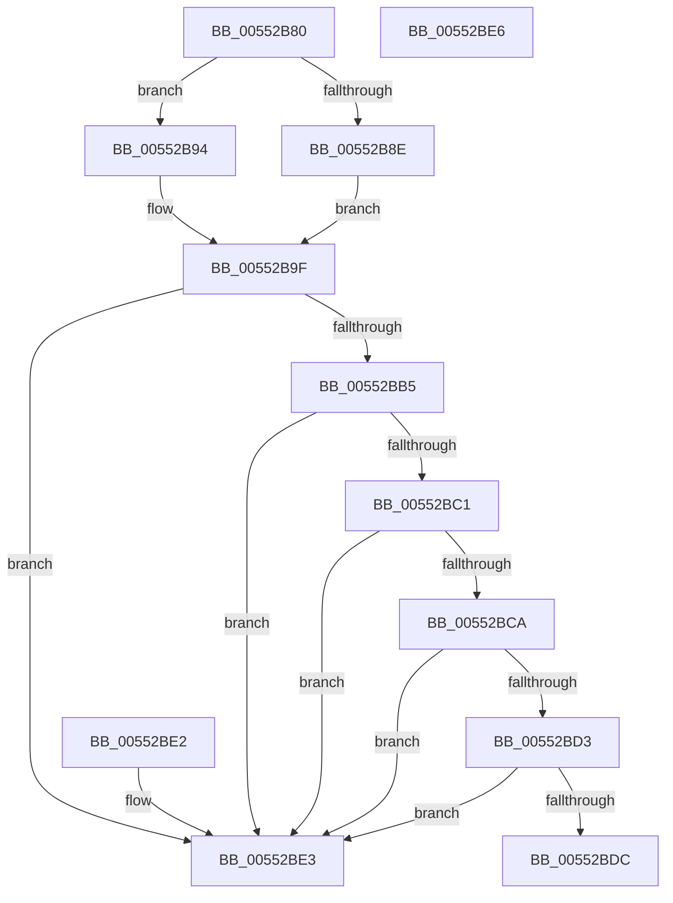

# HalpDmaIsThinDmaCapable

- RVA: `0x00552B80`–`0x00552BE7` (길이 `103` bytes)
- VA: `0x0000000140552B80`
- 실행 섹션: `.text`
- PDB 이름 있음: `예`; PDB Function 태그: `아니요`
- unwind 정보 RVA: `0x000DB714`
- 디코드: `29`개 명령, `103/103` bytes 표시
- 미해석 바이트: `0` (있으면 어셈블리에 `.byte`로 보존)

> 이 문서는 커널 이미지의 기계어와 PDB 기호를 분석해 생성했습니다. 4번과 5번은 함수 원형과 자료형을 바이너리 사용 방식에서 추정한 C 해석이며 원본 소스 복구 결과는 아닙니다.

## 1. Dependencies

- 직접 호출 지점: **0**; 고유 호출 대상: **0**
- 직접 호출자로 확인된 함수: **1**
- RIP 상대 이미지 참조: **2**

### Outgoing calls
- 직접 디코드된 call 명령이 없습니다.

### Direct callers
- [HalpDmaAllocateChildAdapterV3](../../page/70/HalpDmaAllocateChildAdapterV3_function_007066A0.md) at `0x00706DFD`

### Static image references
- `0x00552B9F` → RVA `0x00FC3C08` (`.data`; read)
- `0x00552BAC` → RVA `0x00FC18A0` (`.data`; read)

## 2. Other-region calls and transfers

- 다른 실행 섹션으로 향하는 call: **0**
- 별도 외부 분기/꼬리 이동을 확인하지 못했습니다.

## 3. Assembly (complete function range)

```asm
00552B80  48 8B D1                        mov rdx, rcx
00552B83  8B 89 C0 01 00 00               mov ecx, dword ptr [rcx + 0x1c0]
00552B89  83 F9 40                        cmp ecx, 0x40
00552B8C  72 06                           jb 0x140552b94
00552B8E  48 83 C8 FF                     or rax, 0xffffffffffffffff
00552B92  EB 0B                           jmp 0x140552b9f
00552B94  B8 01 00 00 00                  mov eax, 1
00552B99  48 D3 E0                        shl rax, cl
00552B9C  48 FF C8                        dec rax
00552B9F  48 3B 05 62 10 A7 00            cmp rax, qword ptr [rip + 0xa71062]
00552BA6  0F 93 C1                        setae cl
00552BA9  45 33 C0                        xor r8d, r8d
00552BAC  44 38 05 ED EC A6 00            cmp byte ptr [rip + 0xa6eced], r8b
00552BB3  75 2E                           jne 0x140552be3
00552BB5  F7 82 08 02 00 00 FD FF FF FF   test dword ptr [rdx + 0x208], 0xfffffffd
00552BBF  75 22                           jne 0x140552be3
00552BC1  44 38 82 BD 01 00 00            cmp byte ptr [rdx + 0x1bd], r8b
00552BC8  74 19                           je 0x140552be3
00552BCA  44 38 82 B9 01 00 00            cmp byte ptr [rdx + 0x1b9], r8b
00552BD1  74 10                           je 0x140552be3
00552BD3  44 38 82 BA 01 00 00            cmp byte ptr [rdx + 0x1ba], r8b
00552BDA  74 07                           je 0x140552be3
00552BDC  84 C9                           test cl, cl
00552BDE  0F 95 C0                        setne al
00552BE1  C3                              ret
00552BE2  CC                              int3
00552BE3  32 C0                           xor al, al
00552BE5  C3                              ret
00552BE6  CC                              int3
```

## 4. C-style interpretation (structured pseudocode)

```c
__int64 __fastcall HalpDmaIsThinDmaCapable(__int64 a1, __int64 a2, int a3)
{
    __int64 result;

    if (((unsigned int)((unsigned int)(*(unsigned int *)(a1 + 448)))) < 64) goto loc_00552B94;
    result = (result) | (-1);
    goto loc_00552B9F;
loc_00552B94:
    result = (1) << ((unsigned __int8)((unsigned int)(*(unsigned int *)(a1 + 448))));
    result = (result) - 1;
loc_00552B9F:
    a1 = (result >= (*(unsigned __int64 *)(v_rip + 10948706))) ? 1 : 0;
    a3 = 0;
    if ((*(unsigned __int8 *)(v_rip + 10939629)) != 0) goto loc_00552BE3;
    if (((*(unsigned int *)(a1 + 520)) & (0xFFFFFFFDULL)) != 0) goto loc_00552BE3;
    if ((*(unsigned __int8 *)(a1 + 445)) == 0) goto loc_00552BE3;
    if ((*(unsigned __int8 *)(a1 + 441)) == 0) goto loc_00552BE3;
    if ((*(unsigned __int8 *)(a1 + 442)) == 0) goto loc_00552BE3;
    result = ((unsigned __int8)(a1) != 0) ? 1 : 0;
    return result;
loc_00552BE3:
    result = 0;
    return result;
}
```

## 5. (Beta) C Style

```c
int64_t HalpDmaIsThinDmaCapable(void *Arg1, int64_t Arg2, int32_t Arg3)
{
    uint8_t *arg1 = (uint8_t *)Arg1;

    int64_t result;

    if (((uint32_t)((uint32_t)(*(uint32_t *)(arg1 + 0x1C0)))) < 64) goto loc_00552B94;
    result = (result) | (-1);
    goto loc_00552B9F;
loc_00552B94:
    result = (1) << ((uint8_t)((uint32_t)(*(uint32_t *)(arg1 + 0x1C0))));
    result = (result) - 1;
loc_00552B9F:
    Arg1 = (result >= (*(uint64_t *)(v_rip + 0xA71062))) ? 1 : 0;
    Arg3 = 0;
    if ((*(uint8_t *)(v_rip + 0xA6ECED)) != 0) goto loc_00552BE3;
    if (((*(uint32_t *)(arg1 + 0x208)) & (0xFFFFFFFDULL)) != 0) goto loc_00552BE3;
    if ((*(uint8_t *)(arg1 + 0x1BD)) == 0) goto loc_00552BE3;
    if ((*(uint8_t *)(arg1 + 0x1B9)) == 0) goto loc_00552BE3;
    if ((*(uint8_t *)(arg1 + 0x1BA)) == 0) goto loc_00552BE3;
    result = ((uint8_t)(Arg1) != 0) ? 1 : 0;
    return result;
loc_00552BE3:
    result = 0;
    return result;
}
```

### 관측된 메모리 오프셋

구조체 형식이 확인되지 않은 접근은 인자 기준의 오프셋으로만 기록했습니다.

| 기준 인자 | 오프셋 표현 | 폭 (bit) | 접근 |
|---|---:|---:|---|
| `Arg1` | `+ 0x1B9` | `8` | `R` |
| `Arg1` | `+ 0x1BA` | `8` | `R` |
| `Arg1` | `+ 0x1BD` | `8` | `R` |
| `Arg1` | `+ 0x1C0` | `32` | `R` |
| `Arg1` | `+ 0x208` | `32` | `R` |

## 6. Execution-region graph

[열기: 2D/3D 그래프와 함수 탐색 컨트롤 패널](../../../control-panel.html?section=text&rva=0x00552B80&view=graph)

- 2D 그래프는 위에서 아래로 흐르고, 3D 그래프는 빈 공간을 드래그해 회전합니다. Shift+드래그는 이동, 휠은 확대·축소, 함수 노드 선택은 대상 보고서 이동입니다.

### Static fallback


