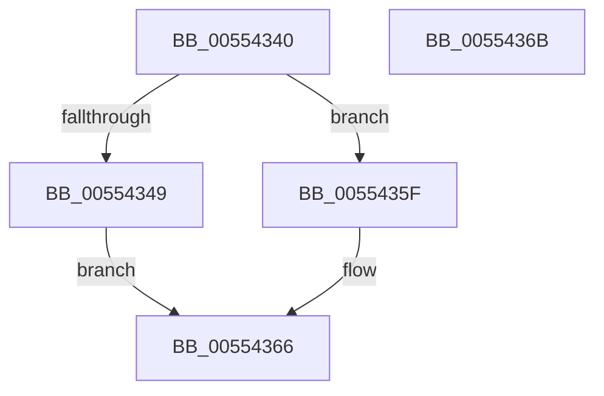

# HalpDmaPowerCriticalTransitionCallback

- RVA: `0x00554340`–`0x0055436C` (길이 `44` bytes)
- VA: `0x0000000140554340`
- 실행 섹션: `.text`
- PDB 이름 있음: `예`; PDB Function 태그: `아니요`
- unwind 정보 RVA: `0x0005C788`
- 디코드: `12`개 명령, `44/44` bytes 표시
- 미해석 바이트: `0` (있으면 어셈블리에 `.byte`로 보존)

> 이 문서는 커널 이미지의 기계어와 PDB 기호를 분석해 생성했습니다. 4번과 5번은 함수 원형과 자료형을 바이너리 사용 방식에서 추정한 C 해석이며 원본 소스 복구 결과는 아닙니다.

## 1. Dependencies

- 직접 호출 지점: **1**; 고유 호출 대상: **1**
- 직접 호출자로 확인된 함수: **0**
- RIP 상대 이미지 참조: **0**

### Outgoing calls
- `0x00554358` → [guard_dispatch_icall](../6B/guard_dispatch_icall_function_006BAAD0.md) (function, `0x006BAAD0`)

### Direct callers
- 이 함수 시작 RVA로 연결되는 직접 call은 확인되지 않았습니다. 간접 호출은 완전히 역산할 수 없습니다.

### Static image references
- 디코드된 RIP-relative 메모리 참조가 없습니다.

## 2. Other-region calls and transfers

- 다른 실행 섹션으로 향하는 call: **0**
- 별도 외부 분기/꼬리 이동을 확인하지 못했습니다.

## 3. Assembly (complete function range)

```asm
00554340  48 83 EC 28                     sub rsp, 0x28
00554344  45 84 C0                        test r8b, r8b
00554347  74 16                           je 0x14055435f
00554349  48 8B 41 50                     mov rax, qword ptr [rcx + 0x50]
0055434D  C6 81 D8 00 00 00 01            mov byte ptr [rcx + 0xd8], 1
00554354  48 8B 49 40                     mov rcx, qword ptr [rcx + 0x40]
00554358  E8 73 67 16 00                  call 0x1406baad0
0055435D  EB 07                           jmp 0x140554366
0055435F  C6 81 D8 00 00 00 00            mov byte ptr [rcx + 0xd8], 0
00554366  48 83 C4 28                     add rsp, 0x28
0055436A  C3                              ret
0055436B  CC                              int3
```

## 4. C-style interpretation (structured pseudocode)

```c
__int64 __fastcall HalpDmaPowerCriticalTransitionCallback(__int64 a1, __int64 a2, unsigned __int8 a3)
{
    __int64 result;
    __int64 v_rsp;

    v_rsp = (v_rsp) - (40);
    if (a3 == 0) goto loc_0055435F;
    *(unsigned __int8 *)(a1 + 216) = 1;
    result = guard_dispatch_icall(*(unsigned __int64 *)(a1 + 64), a2, a3, a4);
    goto loc_00554366;
loc_0055435F:
    *(unsigned __int8 *)(*(unsigned __int64 *)(a1 + 64) + 216) = 0;
loc_00554366:
    v_rsp = (v_rsp) + (40);
    return result;
}
```

## 5. (Beta) C Style

```c
int64_t HalpDmaPowerCriticalTransitionCallback(void *Arg1, int64_t Arg2, uint8_t Arg3)
{
    uint8_t *arg1 = (uint8_t *)Arg1;

    int64_t result;
    int64_t local_rsp;

    local_rsp = (local_rsp) - (40);
    if (Arg3 == 0) goto loc_0055435F;
    *(uint8_t *)(arg1 + 0xD8) = 1;
    result = guard_dispatch_icall(*(uint64_t *)(arg1 + 0x40), Arg2, Arg3, a4);
    goto loc_00554366;
loc_0055435F:
    *(uint8_t *)(*(uint64_t *)(arg1 + 0x40) + 0xD8) = 0;
loc_00554366:
    local_rsp = (local_rsp) + (40);
    return result;
}
```

### 관측된 메모리 오프셋

구조체 형식이 확인되지 않은 접근은 인자 기준의 오프셋으로만 기록했습니다.

| 기준 인자 | 오프셋 표현 | 폭 (bit) | 접근 |
|---|---:|---:|---|
| `Arg1` | `+ 0x40` | `64` | `R` |
| `Arg1` | `+ 0x50` | `64` | `R` |
| `Arg1` | `+ 0xD8` | `8` | `W` |

## 6. Execution-region graph

[열기: 2D/3D 그래프와 함수 탐색 컨트롤 패널](../../../control-panel.html?section=text&rva=0x00554340&view=graph)

- 2D 그래프는 위에서 아래로 흐르고, 3D 그래프는 빈 공간을 드래그해 회전합니다. Shift+드래그는 이동, 휠은 확대·축소, 함수 노드 선택은 대상 보고서 이동입니다.

### Static fallback


