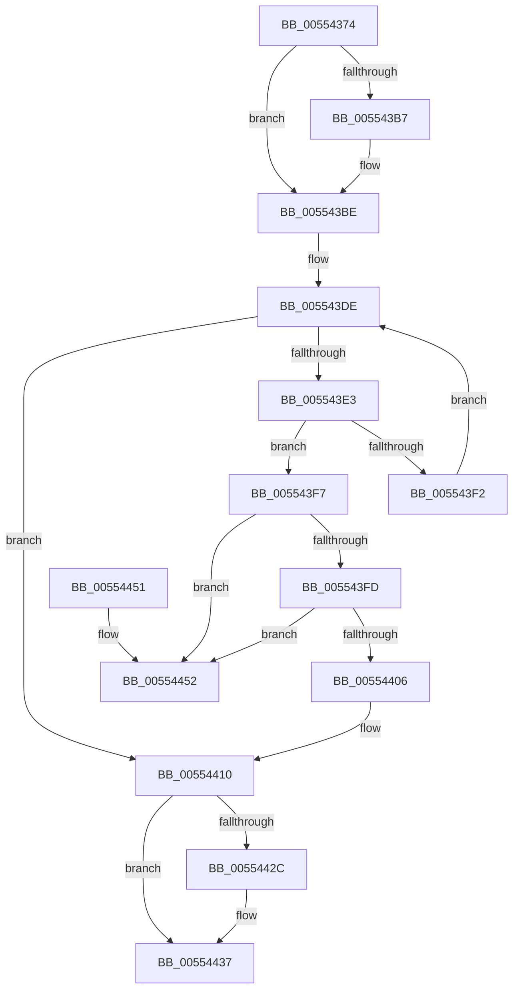

# HalpDmaRemoveAdapterFromChannelQueue

- RVA: `0x00554374`–`0x00554459` (길이 `229` bytes)
- VA: `0x0000000140554374`
- 실행 섹션: `.text`
- PDB 이름 있음: `예`; PDB Function 태그: `아니요`
- unwind 정보 RVA: `0x0006383C`
- 디코드: `58`개 명령, `229/229` bytes 표시
- 미해석 바이트: `0` (있으면 어셈블리에 `.byte`로 보존)

> 이 문서는 커널 이미지의 기계어와 PDB 기호를 분석해 생성했습니다. 4번과 5번은 함수 원형과 자료형을 바이너리 사용 방식에서 추정한 C 해석이며 원본 소스 복구 결과는 아닙니다.

## 1. Dependencies

- 직접 호출 지점: **4**; 고유 호출 대상: **4**
- 직접 호출자로 확인된 함수: **4**
- RIP 상대 이미지 참조: **1**

### Outgoing calls
- `0x005543B9` → [KiRaiseIrqlProcessIrqlFlags](../4F/KiRaiseIrqlProcessIrqlFlags_function_004F56FC.md) (function, `0x004F56FC`)
- `0x005543CC` → [KeAcquireSpinLockAtDpcLevel](../20/KeAcquireSpinLockAtDpcLevel_function_00208430.md) (function, `0x00208430`)
- `0x0055441E` → [KxReleaseSpinLock](../20/KxReleaseSpinLock_function_00206670.md) (function, `0x00206670`)
- `0x00554432` → [KiLowerIrqlProcessIrqlFlags](../4F/KiLowerIrqlProcessIrqlFlags_function_004F5698.md) (function, `0x004F5698`)

### Direct callers
- [HalpAllocateDmaResourcesInternal](../3D/HalpAllocateDmaResourcesInternal_function_003DA7C4.md) at `0x003DA9CF`
- [HalCancelAdapterChannel](HalCancelAdapterChannel_function_005502A0.md) at `0x00550305`
- [HalCancelAdapterChannelDmarThin](HalCancelAdapterChannelDmarThin_function_00552CD0.md) at `0x00552D6A`
- [sub_006F9BD4](../6F/Unknown_function_006F9BD4.md) at `0x006F9C28`

### Static image references
- `0x005543AE` → RVA `0x00FC6D20` (`ALMOSTRO`; read)

## 2. Other-region calls and transfers

- 다른 실행 섹션으로 향하는 call: **0**
- 별도 외부 분기/꼬리 이동을 확인하지 못했습니다.

## 3. Assembly (complete function range)

```asm
00554374  48 89 5C 24 08                  mov qword ptr [rsp + 8], rbx
00554379  48 89 74 24 10                  mov qword ptr [rsp + 0x10], rsi
0055437E  57                              push rdi
0055437F  48 83 EC 20                     sub rsp, 0x20
00554383  48 8B 91 70 01 00 00            mov rdx, qword ptr [rcx + 0x170]
0055438A  48 8B F9                        mov rdi, rcx
0055438D  8B 81 7C 01 00 00               mov eax, dword ptr [rcx + 0x17c]
00554393  48 8D 34 80                     lea rsi, [rax + rax*4]
00554397  48 C1 E6 05                     shl rsi, 5
0055439B  48 03 72 38                     add rsi, qword ptr [rdx + 0x38]
0055439F  0F B6 92 B0 00 00 00            movzx edx, byte ptr [rdx + 0xb0]
005543A6  44 0F 20 C3                     mov rbx, cr8
005543AA  44 0F 22 C2                     mov cr8, rdx
005543AE  83 3D 6B 29 A7 00 00            cmp dword ptr [rip + 0xa7296b], 0
005543B5  74 07                           je 0x1405543be
005543B7  8A CB                           mov cl, bl
005543B9  E8 3E 13 FA FF                  call 0x1404f56fc
005543BE  48 8B 8F 70 01 00 00            mov rcx, qword ptr [rdi + 0x170]
005543C5  48 81 C1 A8 00 00 00            add rcx, 0xa8
005543CC  E8 5F 40 CB FF                  call 0x140208430
005543D1  4C 8D 86 90 00 00 00            lea r8, [rsi + 0x90]
005543D8  40 32 F6                        xor sil, sil
005543DB  49 8B 08                        mov rcx, qword ptr [r8]
005543DE  49 3B C8                        cmp rcx, r8
005543E1  74 2D                           je 0x140554410
005543E3  48 8B 11                        mov rdx, qword ptr [rcx]
005543E6  48 8D 87 D0 00 00 00            lea rax, [rdi + 0xd0]
005543ED  48 3B C8                        cmp rcx, rax
005543F0  74 05                           je 0x1405543f7
005543F2  48 8B CA                        mov rcx, rdx
005543F5  EB E7                           jmp 0x1405543de
005543F7  48 39 4A 08                     cmp qword ptr [rdx + 8], rcx
005543FB  75 55                           jne 0x140554452
005543FD  48 8B 41 08                     mov rax, qword ptr [rcx + 8]
00554401  48 39 08                        cmp qword ptr [rax], rcx
00554404  75 4C                           jne 0x140554452
00554406  48 89 10                        mov qword ptr [rax], rdx
00554409  40 B6 01                        mov sil, 1
0055440C  48 89 42 08                     mov qword ptr [rdx + 8], rax
00554410  48 8B 8F 70 01 00 00            mov rcx, qword ptr [rdi + 0x170]
00554417  48 81 C1 A8 00 00 00            add rcx, 0xa8
0055441E  E8 4D 22 CB FF                  call 0x140206670
00554423  83 3D F6 28 A7 00 00            cmp dword ptr [rip + 0xa728f6], 0
0055442A  74 0B                           je 0x140554437
0055442C  44 0F 20 C1                     mov rcx, cr8
00554430  8A D3                           mov dl, bl
00554432  E8 61 12 FA FF                  call 0x1404f5698
00554437  0F B6 CB                        movzx ecx, bl
0055443A  44 0F 22 C1                     mov cr8, rcx
0055443E  48 8B 5C 24 30                  mov rbx, qword ptr [rsp + 0x30]
00554443  40 8A C6                        mov al, sil
00554446  48 8B 74 24 38                  mov rsi, qword ptr [rsp + 0x38]
0055444B  48 83 C4 20                     add rsp, 0x20
0055444F  5F                              pop rdi
00554450  C3                              ret
00554451  CC                              int3
00554452  B9 03 00 00 00                  mov ecx, 3
00554457  CD 29                           int 0x29
```

## 4. C-style interpretation (structured pseudocode)

```c
__int64 __fastcall HalpDmaRemoveAdapterFromChannelQueue(__int64 a1)
{
    __int64 result;
    __int64 v_rsi;
    __int64 v_rsp;
    unsigned __int64 v_stack_p10;
    unsigned __int64 v_stack_p8;

    v_stack_p8 = v_rbx;
    v_stack_p10 = v_rsi;
    v_rsp = (v_rsp) - (32);
    v_rsi = ((unsigned int)(*(unsigned int *)(a1 + 380)) + (unsigned int)(*(unsigned int *)(a1 + 380)) * 4) << (5);
    v_rsi = (v_rsi) + (*(unsigned __int64 *)(*(unsigned __int64 *)(a1 + 368) + 56));
    result = (unsigned int)(*(unsigned int *)(a1 + 380));
    if ((*(unsigned int *)(v_rip + 10955115)) != 0) {
        a1 = (unsigned __int8)(v_cr8);
        result = KiRaiseIrqlProcessIrqlFlags(a1, *(unsigned __int8 *)(*(unsigned __int64 *)(a1 + 368) + 176), a3, a4);
    }
    a1 = (*(unsigned __int64 *)(a1 + 368)) + (168);
    result = KeAcquireSpinLockAtDpcLevel(a1, *(unsigned __int8 *)(*(unsigned __int64 *)(a1 + 368) + 176), a3, a4);
    v_rsi = 0;
loc_005543DE:
    if ((*(unsigned __int64 *)(v_rsi + 144)) == (v_rsi + 144)) goto loc_00554410;
    if ((*(unsigned __int64 *)(v_rsi + 144)) == (a1 + 208)) goto loc_005543F7;
    goto loc_005543DE;
loc_005543F7:
    if ((*(unsigned __int64 *)(*(unsigned __int64 *)(*(unsigned __int64 *)(v_rsi + 144)) + 8)) != (*(unsigned __int64 *)(*(unsigned __int64 *)(v_rsi + 144)))) goto loc_00554452;
    if ((*(unsigned __int64 *)(*(unsigned __int64 *)(*(unsigned __int64 *)(*(unsigned __int64 *)(v_rsi + 144)) + 8))) != (*(unsigned __int64 *)(*(unsigned __int64 *)(v_rsi + 144)))) goto loc_00554452;
    *(unsigned __int64 *)(*(unsigned __int64 *)(*(unsigned __int64 *)(*(unsigned __int64 *)(v_rsi + 144)) + 8)) = *(unsigned __int64 *)(*(unsigned __int64 *)(v_rsi + 144));
    *(unsigned __int64 *)(*(unsigned __int64 *)(*(unsigned __int64 *)(v_rsi + 144)) + 8) = *(unsigned __int64 *)(*(unsigned __int64 *)(*(unsigned __int64 *)(v_rsi + 144)) + 8);
loc_00554410:
    a1 = (*(unsigned __int64 *)(a1 + 368)) + (168);
    result = KxReleaseSpinLock(a1, *(unsigned __int64 *)(*(unsigned __int64 *)(v_rsi + 144)), v_rsi + 144, a4);
    if ((*(unsigned int *)(v_rip + 10954998)) != 0) {
        a1 = *(unsigned __int8 *)(*(unsigned __int64 *)(a1 + 368) + 176);
        a2 = (unsigned __int8)(v_cr8);
        result = KiLowerIrqlProcessIrqlFlags(a1, a2, v_rsi + 144, a4);
    }
    v_rsp = (v_rsp) + (32);
    return 1;
loc_00554452:
    return 1;
}
```

## 5. (Beta) C Style

```c
int64_t HalpDmaRemoveAdapterFromChannelQueue(void *Arg1)
{
    uint8_t *arg1 = (uint8_t *)Arg1;

    int64_t result;
    int64_t local_rsi;
    int64_t local_rsp;
    uint64_t v_stack_p10;
    uint64_t v_stack_p8;

    v_stack_p8 = local_rbx;
    v_stack_p10 = local_rsi;
    local_rsp = (local_rsp) - (32);
    local_rsi = ((uint32_t)(*(uint32_t *)(arg1 + 0x17C)) + (uint32_t)(*(uint32_t *)(arg1 + 0x17C)) * 4) << (5);
    local_rsi = (local_rsi) + (*(uint64_t *)(*(uint64_t *)(arg1 + 0x170) + 0x38));
    result = (uint32_t)(*(uint32_t *)(arg1 + 0x17C));
    if ((*(uint32_t *)(v_rip + 0xA7296B)) != 0) {
        Arg1 = (uint8_t)(v_cr8);
        result = KiRaiseIrqlProcessIrqlFlags(Arg1, *(uint8_t *)(*(uint64_t *)(arg1 + 0x170) + 0xB0), a3, a4);
    }
    Arg1 = (*(uint64_t *)(arg1 + 0x170)) + (168);
    result = KeAcquireSpinLockAtDpcLevel(Arg1, *(uint8_t *)(*(uint64_t *)(arg1 + 0x170) + 0xB0), a3, a4);
    local_rsi = 0;
loc_005543DE:
    if ((*(uint64_t *)(local_rsi + 0x90)) == (local_rsi + 144)) goto loc_00554410;
    if ((*(uint64_t *)(local_rsi + 0x90)) == (Arg1 + 208)) goto loc_005543F7;
    goto loc_005543DE;
loc_005543F7:
    if ((*(uint64_t *)(*(uint64_t *)(*(uint64_t *)(local_rsi + 0x90)) + 0x8)) != (*(uint64_t *)(*(uint64_t *)(local_rsi + 0x90)))) goto loc_00554452;
    if ((*(uint64_t *)(*(uint64_t *)(*(uint64_t *)(*(uint64_t *)(local_rsi + 0x90)) + 0x8))) != (*(uint64_t *)(*(uint64_t *)(local_rsi + 0x90)))) goto loc_00554452;
    *(uint64_t *)(*(uint64_t *)(*(uint64_t *)(*(uint64_t *)(local_rsi + 0x90)) + 0x8)) = *(uint64_t *)(*(uint64_t *)(local_rsi + 0x90));
    *(uint64_t *)(*(uint64_t *)(*(uint64_t *)(local_rsi + 0x90)) + 0x8) = *(uint64_t *)(*(uint64_t *)(*(uint64_t *)(local_rsi + 0x90)) + 0x8);
loc_00554410:
    Arg1 = (*(uint64_t *)(arg1 + 0x170)) + (168);
    result = KxReleaseSpinLock(Arg1, *(uint64_t *)(*(uint64_t *)(local_rsi + 0x90)), local_rsi + 144, a4);
    if ((*(uint32_t *)(v_rip + 0xA728F6)) != 0) {
        Arg1 = *(uint8_t *)(*(uint64_t *)(arg1 + 0x170) + 0xB0);
        a2 = (uint8_t)(v_cr8);
        result = KiLowerIrqlProcessIrqlFlags(Arg1, a2, local_rsi + 144, a4);
    }
    local_rsp = (local_rsp) + (32);
    return 1;
loc_00554452:
    return 1;
}
```

### 관측된 메모리 오프셋

구조체 형식이 확인되지 않은 접근은 인자 기준의 오프셋으로만 기록했습니다.

| 기준 인자 | 오프셋 표현 | 폭 (bit) | 접근 |
|---|---:|---:|---|
| `Arg1` | `+ 0xD0` | `64` | `R` |
| `Arg1` | `+ 0x170` | `64` | `R` |
| `Arg1` | `+ 0x17C` | `32` | `R` |

## 6. Execution-region graph

[열기: 2D/3D 그래프와 함수 탐색 컨트롤 패널](../../../control-panel.html?section=text&rva=0x00554374&view=graph)

- 2D 그래프는 위에서 아래로 흐르고, 3D 그래프는 빈 공간을 드래그해 회전합니다. Shift+드래그는 이동, 휠은 확대·축소, 함수 노드 선택은 대상 보고서 이동입니다.

### Static fallback


