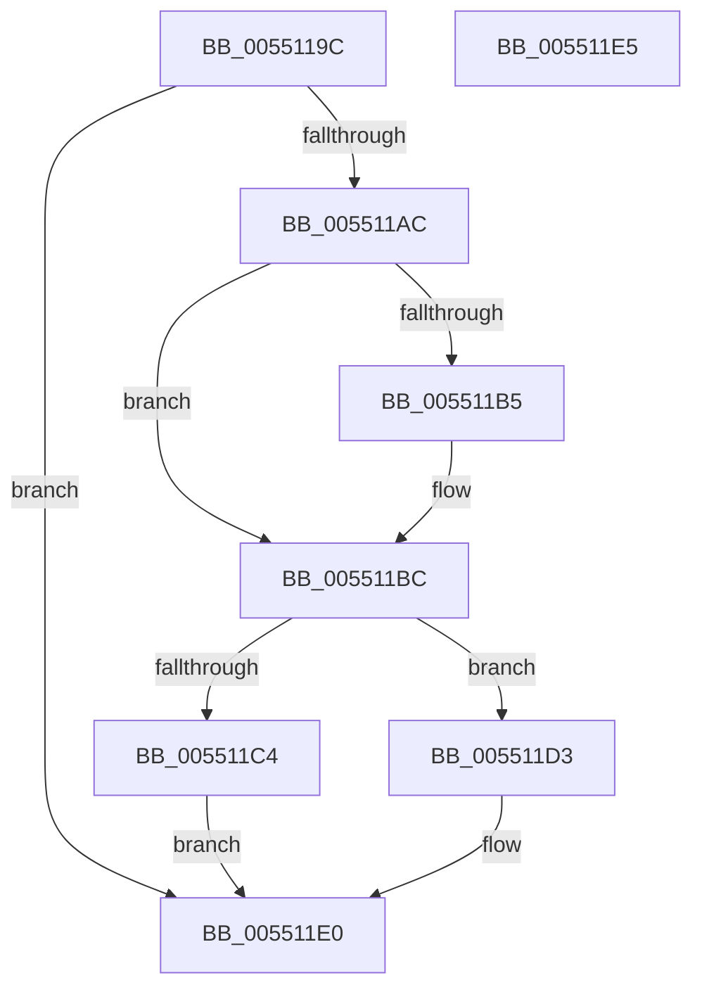

# HalpDmaReturnPageToSource

- RVA: `0x0055119C`–`0x005511E6` (길이 `74` bytes)
- VA: `0x000000014055119C`
- 실행 섹션: `.text`
- PDB 이름 있음: `예`; PDB Function 태그: `아니요`
- unwind 정보 RVA: `0x0005C788`
- 디코드: `21`개 명령, `74/74` bytes 표시
- 미해석 바이트: `0` (있으면 어셈블리에 `.byte`로 보존)

> 이 문서는 커널 이미지의 기계어와 PDB 기호를 분석해 생성했습니다. 4번과 5번은 함수 원형과 자료형을 바이너리 사용 방식에서 추정한 C 해석이며 원본 소스 복구 결과는 아닙니다.

## 1. Dependencies

- 직접 호출 지점: **2**; 고유 호출 대상: **2**
- 직접 호출자로 확인된 함수: **2**
- RIP 상대 이미지 참조: **0**

### Outgoing calls
- `0x005511CC` → [HalpDmaReturnToScatterPool](../3D/HalpDmaReturnToScatterPool_function_003DFD00.md) (function, `0x003DFD00`)
- `0x005511DB` → [HalpDmaReturnToContiguousPool](../3E/HalpDmaReturnToContiguousPool_function_003E1758.md) (function, `0x003E1758`)

### Direct callers
- [HalpDmaFreeChildAdapter](HalpDmaFreeChildAdapter_function_00550E30.md) at `0x00550FEF`
- [HalpDmaFreeChildAdapter](HalpDmaFreeChildAdapter_function_00550E30.md) at `0x0055102B`
- [HalpDmaAllocateLocalContiguousPool](../../page/70/HalpDmaAllocateLocalContiguousPool_function_00708EE4.md) at `0x00709158`

### Static image references
- 디코드된 RIP-relative 메모리 참조가 없습니다.

## 2. Other-region calls and transfers

- 다른 실행 섹션으로 향하는 call: **0**
- 별도 외부 분기/꼬리 이동을 확인하지 못했습니다.

## 3. Assembly (complete function range)

```asm
0055119C  48 83 EC 28                     sub rsp, 0x28
005511A0  48 8B 42 30                     mov rax, qword ptr [rdx + 0x30]
005511A4  41 B0 01                        mov r8b, 1
005511A7  41 84 C0                        test r8b, al
005511AA  74 34                           je 0x1405511e0
005511AC  80 B9 98 00 00 00 00            cmp byte ptr [rcx + 0x98], 0
005511B3  75 07                           jne 0x1405511bc
005511B5  48 8B 89 A0 00 00 00            mov rcx, qword ptr [rcx + 0xa0]
005511BC  48 83 C8 04                     or rax, 4
005511C0  A8 02                           test al, 2
005511C2  74 0F                           je 0x1405511d3
005511C4  48 83 C8 08                     or rax, 8
005511C8  48 89 42 30                     mov qword ptr [rdx + 0x30], rax
005511CC  E8 2F EB E8 FF                  call 0x1403dfd00
005511D1  EB 0D                           jmp 0x1405511e0
005511D3  48 83 E0 F7                     and rax, 0xfffffffffffffff7
005511D7  48 89 42 30                     mov qword ptr [rdx + 0x30], rax
005511DB  E8 78 05 E9 FF                  call 0x1403e1758
005511E0  48 83 C4 28                     add rsp, 0x28
005511E4  C3                              ret
005511E5  CC                              int3
```

## 4. C-style interpretation (structured pseudocode)

```c
__int64 __fastcall HalpDmaReturnPageToSource(__int64 a1, __int64 a2)
{
    __int64 result;
    __int64 v_rsp;

    v_rsp = (v_rsp) - (40);
    if (((1) & ((unsigned __int8)(*(unsigned __int64 *)(a2 + 48)))) == 0) goto loc_005511E0;
    if ((*(unsigned __int8 *)(a1 + 152)) == 0) {
        a1 = *(unsigned __int64 *)(a1 + 160);
    }
    result = (*(unsigned __int64 *)(a2 + 48)) | (4);
    if ((((unsigned __int8)(result)) & (2)) == 0) goto loc_005511D3;
    result = (result) | (8);
    *(unsigned __int64 *)(a2 + 48) = result;
    result = HalpDmaReturnToScatterPool(a1, a2, 1, a4);
    goto loc_005511E0;
loc_005511D3:
    result = (result) & (-9);
    *(unsigned __int64 *)(a2 + 48) = result;
    result = HalpDmaReturnToContiguousPool(a1, a2, 1, a4);
loc_005511E0:
    v_rsp = (v_rsp) + (40);
    return result;
}
```

## 5. (Beta) C Style

```c
int64_t HalpDmaReturnPageToSource(void *Arg1, void *Arg2)
{
    uint8_t *arg1 = (uint8_t *)Arg1;
    uint8_t *arg2 = (uint8_t *)Arg2;

    int64_t result;
    int64_t local_rsp;

    local_rsp = (local_rsp) - (40);
    if (((1) & ((uint8_t)(*(uint64_t *)(arg2 + 0x30)))) == 0) goto loc_005511E0;
    if ((*(uint8_t *)(arg1 + 0x98)) == 0) {
        Arg1 = *(uint64_t *)(arg1 + 0xA0);
    }
    result = (*(uint64_t *)(arg2 + 0x30)) | (4);
    if ((((uint8_t)(result)) & (2)) == 0) goto loc_005511D3;
    result = (result) | (8);
    *(uint64_t *)(arg2 + 0x30) = result;
    result = HalpDmaReturnToScatterPool(Arg1, Arg2, 1, a4);
    goto loc_005511E0;
loc_005511D3:
    result = (result) & (-9);
    *(uint64_t *)(arg2 + 0x30) = result;
    result = HalpDmaReturnToContiguousPool(Arg1, Arg2, 1, a4);
loc_005511E0:
    local_rsp = (local_rsp) + (40);
    return result;
}
```

### 관측된 메모리 오프셋

구조체 형식이 확인되지 않은 접근은 인자 기준의 오프셋으로만 기록했습니다.

| 기준 인자 | 오프셋 표현 | 폭 (bit) | 접근 |
|---|---:|---:|---|
| `Arg1` | `+ 0x98` | `8` | `R` |
| `Arg1` | `+ 0xA0` | `64` | `R` |
| `Arg2` | `+ 0x30` | `64` | `R` |
| `Arg2` | `+ 0x30` | `64` | `W` |

## 6. Execution-region graph

[열기: 2D/3D 그래프와 함수 탐색 컨트롤 패널](../../../control-panel.html?section=text&rva=0x0055119C&view=graph)

- 2D 그래프는 위에서 아래로 흐르고, 3D 그래프는 빈 공간을 드래그해 회전합니다. Shift+드래그는 이동, 휠은 확대·축소, 함수 노드 선택은 대상 보고서 이동입니다.

### Static fallback


