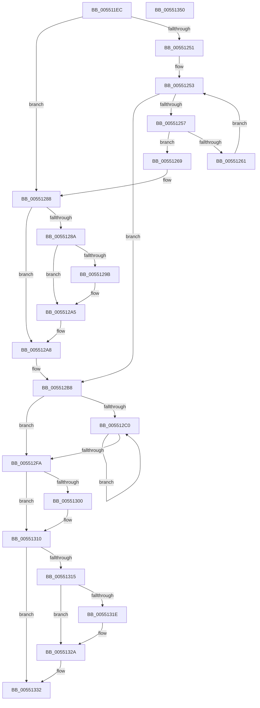

# HalpDmaZeroMapBuffers

- RVA: `0x005511EC`–`0x00551351` (길이 `357` bytes)
- VA: `0x00000001405511EC`
- 실행 섹션: `.text`
- PDB 이름 있음: `예`; PDB Function 태그: `아니요`
- unwind 정보 RVA: `0x000C4294`
- 디코드: `104`개 명령, `357/357` bytes 표시
- 미해석 바이트: `0` (있으면 어셈블리에 `.byte`로 보존)

> 이 문서는 커널 이미지의 기계어와 PDB 기호를 분석해 생성했습니다. 4번과 5번은 함수 원형과 자료형을 바이너리 사용 방식에서 추정한 C 해석이며 원본 소스 복구 결과는 아닙니다.

## 1. Dependencies

- 직접 호출 지점: **6**; 고유 호출 대상: **6**
- 직접 호출자로 확인된 함수: **4**
- RIP 상대 이미지 참조: **1**

### Outgoing calls
- `0x00551282` → [KeBugCheckEx](../4F/KeBugCheckEx_function_004FD660.md) (function, `0x004FD660`)
- `0x005512A0` → [KiRaiseIrqlProcessIrqlFlags](../4F/KiRaiseIrqlProcessIrqlFlags_function_004F56FC.md) (function, `0x004F56FC`)
- `0x005512B3` → [HalpDmaAcquireBufferMappings](../3D/HalpDmaAcquireBufferMappings_function_003DF38C.md) (function, `0x003DF38C`)
- `0x005512E9` → [memset](../6C/memset_function_006C6C40.md) (function, `0x006C6C40`)
- `0x0055130B` → [HalpDmaReleaseBufferMappings](../46/HalpDmaReleaseBufferMappings_function_004637A0.md) (function, `0x004637A0`)
- `0x00551325` → [KiLowerIrqlProcessIrqlFlags](../4F/KiLowerIrqlProcessIrqlFlags_function_004F5698.md) (function, `0x004F5698`)

### Direct callers
- [IoMapTransferInternal](../3D/IoMapTransferInternal_function_003DC910.md) at `0x003DCC9A`
- [HalpMapTransferV3](../3D/HalpMapTransferV3_function_003DCCAC.md) at `0x003DCD71`
- [IopMapTransfer](../3D/IopMapTransfer_function_003DCD80.md) at `0x003DD10B`
- [sub_003DE181](../3D/Unknown_function_003DE181.md) at `0x003DE391`

### Static image references
- `0x00551292` → RVA `0x00FC6D20` (`ALMOSTRO`; read)

## 2. Other-region calls and transfers

- 다른 실행 섹션으로 향하는 call: **0**
- 별도 외부 분기/꼬리 이동을 확인하지 못했습니다.

## 3. Assembly (complete function range)

```asm
005511EC  4C 8B DC                        mov r11, rsp
005511EF  49 89 5B 08                     mov qword ptr [r11 + 8], rbx
005511F3  49 89 6B 10                     mov qword ptr [r11 + 0x10], rbp
005511F7  49 89 73 18                     mov qword ptr [r11 + 0x18], rsi
005511FB  57                              push rdi
005511FC  41 54                           push r12
005511FE  41 55                           push r13
00551200  41 56                           push r14
00551202  41 57                           push r15
00551204  48 83 EC 70                     sub rsp, 0x70
00551208  0F 57 C0                        xorps xmm0, xmm0
0055120B  45 8B F1                        mov r14d, r9d
0055120E  33 C0                           xor eax, eax
00551210  45 8B E0                        mov r12d, r8d
00551213  0F 11 44 24 30                  movups xmmword ptr [rsp + 0x30], xmm0
00551218  48 8B F2                        mov rsi, rdx
0055121B  0F 11 44 24 40                  movups xmmword ptr [rsp + 0x40], xmm0
00551220  0F 11 44 24 50                  movups xmmword ptr [rsp + 0x50], xmm0
00551225  49 89 43 C8                     mov qword ptr [r11 - 0x38], rax
00551229  44 0F 20 C7                     mov rdi, cr8
0055122D  41 8B C8                        mov ecx, r8d
00551230  49 8D AE FF 0F 00 00            lea rbp, [r14 + 0xfff]
00551237  81 E1 FF 0F 00 00               and ecx, 0xfff
0055123D  45 32 FF                        xor r15b, r15b
00551240  48 03 E9                        add rbp, rcx
00551243  B8 02 00 00 00                  mov eax, 2
00551248  48 C1 ED 0C                     shr rbp, 0xc
0055124C  40 3A F8                        cmp dil, al
0055124F  76 37                           jbe 0x140551288
00551251  33 C9                           xor ecx, ecx
00551253  3B CD                           cmp ecx, ebp
00551255  73 61                           jae 0x1405512b8
00551257  48 F7 42 30 00 F0 FF FF         test qword ptr [rdx + 0x30], -0x1000
0055125F  74 08                           je 0x140551269
00551261  48 8B 52 08                     mov rdx, qword ptr [rdx + 8]
00551265  FF C1                           inc ecx
00551267  EB EA                           jmp 0x140551253
00551269  48 83 64 24 20 00               and qword ptr [rsp + 0x20], 0
0055126F  45 33 C9                        xor r9d, r9d
00551272  BA 00 10 00 00                  mov edx, 0x1000
00551277  B9 AC 00 00 00                  mov ecx, 0xac
0055127C  41 B8 06 EF 00 00               mov r8d, 0xef06
00551282  E8 D9 C3 FA FF                  call 0x1404fd660
00551287  CC                              int3
00551288  73 1E                           jae 0x1405512a8
0055128A  44 0F 20 C7                     mov rdi, cr8
0055128E  44 0F 22 C0                     mov cr8, rax
00551292  83 3D 87 5A A7 00 00            cmp dword ptr [rip + 0xa75a87], 0
00551299  74 0A                           je 0x1405512a5
0055129B  8A D0                           mov dl, al
0055129D  40 8A CF                        mov cl, dil
005512A0  E8 57 44 FA FF                  call 0x1404f56fc
005512A5  41 B7 01                        mov r15b, 1
005512A8  4C 8D 4C 24 30                  lea r9, [rsp + 0x30]
005512AD  44 8B C5                        mov r8d, ebp
005512B0  48 8B D6                        mov rdx, rsi
005512B3  E8 D4 E0 E8 FF                  call 0x1403df38c
005512B8  4C 8B EE                        mov r13, rsi
005512BB  45 85 F6                        test r14d, r14d
005512BE  74 3A                           je 0x1405512fa
005512C0  B9 00 10 00 00                  mov ecx, 0x1000
005512C5  41 8B C6                        mov eax, r14d
005512C8  41 2B CC                        sub ecx, r12d
005512CB  44 3B F1                        cmp r14d, ecx
005512CE  0F 43 C1                        cmovae eax, ecx
005512D1  49 8B 4D 30                     mov rcx, qword ptr [r13 + 0x30]
005512D5  8B D8                           mov ebx, eax
005512D7  48 81 E1 00 F0 FF FF            and rcx, 0xfffffffffffff000
005512DE  44 8B C0                        mov r8d, eax
005512E1  33 D2                           xor edx, edx
005512E3  41 8B C4                        mov eax, r12d
005512E6  48 03 C8                        add rcx, rax
005512E9  E8 52 59 17 00                  call 0x1406c6c40
005512EE  4D 8B 6D 08                     mov r13, qword ptr [r13 + 8]
005512F2  45 33 E4                        xor r12d, r12d
005512F5  44 2B F3                        sub r14d, ebx
005512F8  75 C6                           jne 0x1405512c0
005512FA  40 80 FF 02                     cmp dil, 2
005512FE  77 10                           ja 0x140551310
00551300  4C 8D 4C 24 30                  lea r9, [rsp + 0x30]
00551305  44 8B C5                        mov r8d, ebp
00551308  48 8B D6                        mov rdx, rsi
0055130B  E8 90 24 F1 FF                  call 0x1404637a0
00551310  45 84 FF                        test r15b, r15b
00551313  74 1D                           je 0x140551332
00551315  83 3D 04 5A A7 00 00            cmp dword ptr [rip + 0xa75a04], 0
0055131C  74 0C                           je 0x14055132a
0055131E  44 0F 20 C1                     mov rcx, cr8
00551322  40 8A D7                        mov dl, dil
00551325  E8 6E 43 FA FF                  call 0x1404f5698
0055132A  40 0F B6 C7                     movzx eax, dil
0055132E  44 0F 22 C0                     mov cr8, rax
00551332  4C 8D 5C 24 70                  lea r11, [rsp + 0x70]
00551337  49 8B 5B 30                     mov rbx, qword ptr [r11 + 0x30]
0055133B  49 8B 6B 38                     mov rbp, qword ptr [r11 + 0x38]
0055133F  49 8B 73 40                     mov rsi, qword ptr [r11 + 0x40]
00551343  49 8B E3                        mov rsp, r11
00551346  41 5F                           pop r15
00551348  41 5E                           pop r14
0055134A  41 5D                           pop r13
0055134C  41 5C                           pop r12
0055134E  5F                              pop rdi
0055134F  C3                              ret
00551350  CC                              int3
```

## 4. C-style interpretation (structured pseudocode)

```c
__int64 __fastcall HalpDmaZeroMapBuffers(__int64 a1, __int64 a2, int a3, int a4)
{
    __int64 result;
    __int64 v_r12;
    __int64 v_r14;
    __int64 v_r15;
    __int64 v_rbp;
    __int64 v_rsp;
    unsigned __int64 v_stack_m28;
    unsigned __int64 v_stack_m48;
    unsigned __int64 v_stack_m58;
    unsigned __int64 v_stack_m68;
    unsigned __int64 v_stack_m78;

    *(unsigned __int64 *)(v_rsp + 8) = v_rbx;
    *(unsigned __int64 *)(v_rsp + 16) = v_rbp;
    *(unsigned __int64 *)(v_rsp + 24) = v_rsi;
    v_rsp = (v_rsp) - (112);
    result = 0;
    v_stack_m68 = v_xmm0;
    v_stack_m58 = v_xmm0;
    v_stack_m48 = v_xmm0;
    *(unsigned __int64 *)(v_rsp - 56) = 0;
    a1 = (unsigned int)(((unsigned int)(a3)) & (0xFFFULL));
    v_r15 = 0;
    v_rbp = ((unsigned int)(a4) + 4095) + (a1);
    v_rbp = (v_rbp) >> (12);
    if (((unsigned __int8)(v_cr8)) <= 2) goto loc_00551288;
    a1 = 0;
loc_00551253:
    if (0 >= ((unsigned int)(v_rbp))) goto loc_005512B8;
    if (((*(unsigned __int64 *)(a2 + 48)) & (0xFFFFFFFFFFFFF000ULL)) == 0) goto loc_00551269;
    a1 = (unsigned int)((a1) + 1);
    goto loc_00551253;
loc_00551269:
    a4 = 0;
    result = KeBugCheckEx(172, (unsigned int)(0x1000ULL), (unsigned int)(0xEF06ULL), a4);
loc_00551288:
    if (condition_is_above_or_equal) goto loc_005512A8;
    if ((*(unsigned int *)(v_rip + 10967687)) != 0) {
        a2 = (unsigned __int8)(result);
        a1 = (unsigned __int8)(v_cr8);
        result = KiRaiseIrqlProcessIrqlFlags(a1, a2, (unsigned int)(0xEF06ULL), a4);
    }
loc_005512A8:
    result = HalpDmaAcquireBufferMappings(a1, a2, (unsigned int)((unsigned int)(v_rbp)), v_stack_m68);
loc_005512B8:
    if ((unsigned int)((unsigned int)(a4)) == 0) goto loc_005512FA;
loc_005512C0:
    a1 = (unsigned int)(((unsigned int)(0x1000ULL)) - ((unsigned int)((unsigned int)(a3))));
    result = (unsigned int)((unsigned int)((unsigned int)(a4)));
    if (((unsigned int)((unsigned int)(a4))) >= ((unsigned int)(a1))) { result = (unsigned int)(a1); }
    a1 = (*(unsigned __int64 *)(a2 + 48)) & (0xFFFFFFFFFFFFF000ULL);
    a2 = 0;
    a1 = (a1) + ((unsigned int)((unsigned int)((unsigned int)(a3))));
    result = memset(a1, a2, (unsigned int)((unsigned int)(result)), v_stack_m68);
    v_r12 = 0;
    v_r14 = (unsigned int)(((unsigned int)(a4)) - ((unsigned int)((unsigned int)((unsigned int)(result)))));
    if (condition_is_not_equal) goto loc_005512C0;
loc_005512FA:
    if (((unsigned __int8)(v_cr8)) <= 2) {
        a4 = v_stack_m68;
        a3 = (unsigned int)(v_rbp);
        a2 = 0;
        result = HalpDmaReleaseBufferMappings(a1, a2, a3, a4);
    }
    if (1 == 0) goto loc_00551332;
    if ((*(unsigned int *)(v_rip + 10967556)) != 0) {
        a1 = result;
        a2 = (unsigned __int8)(v_cr8);
        result = KiLowerIrqlProcessIrqlFlags(a1, a2, a3, a4);
    }
loc_00551332:
    return (unsigned __int8)(v_cr8);
}
```

## 5. (Beta) C Style

```c
int64_t HalpDmaZeroMapBuffers(int64_t Arg1, int64_t Arg2, int32_t Arg3, void *Arg4)
{
    uint8_t *arg4 = (uint8_t *)Arg4;

    int64_t result;
    int64_t local_r12;
    int64_t local_r14;
    int64_t local_r15;
    int64_t local_rbp;
    int64_t local_rsp;
    uint64_t v_stack_m28;
    uint64_t v_stack_m48;
    uint64_t v_stack_m58;
    uint64_t v_stack_m68;
    uint64_t v_stack_m78;

    *(uint64_t *)(local_rsp + 0x8) = local_rbx;
    *(uint64_t *)(local_rsp + 0x10) = local_rbp;
    *(uint64_t *)(local_rsp + 0x18) = local_rsi;
    local_rsp = (local_rsp) - (112);
    result = 0;
    v_stack_m68 = v_xmm0;
    v_stack_m58 = v_xmm0;
    v_stack_m48 = v_xmm0;
    *(uint64_t *)(local_rsp - 0x38) = 0;
    Arg1 = (uint32_t)(((uint32_t)(Arg3)) & (0xFFFULL));
    local_r15 = 0;
    local_rbp = ((uint32_t)(Arg4) + 4095) + (Arg1);
    local_rbp = (local_rbp) >> (12);
    if (((uint8_t)(v_cr8)) <= 2) goto loc_00551288;
    Arg1 = 0;
loc_00551253:
    if (0 >= ((uint32_t)(local_rbp))) goto loc_005512B8;
    if (((*(uint64_t *)(Arg2 + 0x30)) & (0xFFFFFFFFFFFFF000ULL)) == 0) goto loc_00551269;
    Arg1 = (uint32_t)((Arg1) + 1);
    goto loc_00551253;
loc_00551269:
    Arg4 = 0;
    result = KeBugCheckEx(172, (uint32_t)(0x1000ULL), (uint32_t)(0xEF06ULL), Arg4);
loc_00551288:
    if (condition_is_above_or_equal) goto loc_005512A8;
    if ((*(uint32_t *)(v_rip + 0xA75A87)) != 0) {
        Arg2 = (uint8_t)(result);
        Arg1 = (uint8_t)(v_cr8);
        result = KiRaiseIrqlProcessIrqlFlags(Arg1, Arg2, (uint32_t)(0xEF06ULL), Arg4);
    }
loc_005512A8:
    result = HalpDmaAcquireBufferMappings(Arg1, Arg2, (uint32_t)((uint32_t)(local_rbp)), v_stack_m68);
loc_005512B8:
    if ((uint32_t)((uint32_t)(Arg4)) == 0) goto loc_005512FA;
loc_005512C0:
    Arg1 = (uint32_t)(((uint32_t)(0x1000ULL)) - ((uint32_t)((uint32_t)(Arg3))));
    result = (uint32_t)((uint32_t)((uint32_t)(Arg4)));
    if (((uint32_t)((uint32_t)(Arg4))) >= ((uint32_t)(Arg1))) { result = (uint32_t)(Arg1); }
    Arg1 = (*(uint64_t *)(Arg2 + 0x30)) & (0xFFFFFFFFFFFFF000ULL);
    Arg2 = 0;
    Arg1 = (Arg1) + ((uint32_t)((uint32_t)((uint32_t)(Arg3))));
    result = memset(Arg1, Arg2, (uint32_t)((uint32_t)(result)), v_stack_m68);
    local_r12 = 0;
    local_r14 = (uint32_t)(((uint32_t)(Arg4)) - ((uint32_t)((uint32_t)((uint32_t)(result)))));
    if (condition_is_not_equal) goto loc_005512C0;
loc_005512FA:
    if (((uint8_t)(v_cr8)) <= 2) {
        Arg4 = v_stack_m68;
        Arg3 = (uint32_t)(local_rbp);
        Arg2 = 0;
        result = HalpDmaReleaseBufferMappings(Arg1, Arg2, Arg3, Arg4);
    }
    if (1 == 0) goto loc_00551332;
    if ((*(uint32_t *)(v_rip + 0xA75A04)) != 0) {
        Arg1 = result;
        Arg2 = (uint8_t)(v_cr8);
        result = KiLowerIrqlProcessIrqlFlags(Arg1, Arg2, Arg3, Arg4);
    }
loc_00551332:
    return (uint8_t)(v_cr8);
}
```

### 관측된 메모리 오프셋

구조체 형식이 확인되지 않은 접근은 인자 기준의 오프셋으로만 기록했습니다.

| 기준 인자 | 오프셋 표현 | 폭 (bit) | 접근 |
|---|---:|---:|---|
| `Arg4` | `+ 0xFFF` | `64` | `R` |

## 6. Execution-region graph

[열기: 2D/3D 그래프와 함수 탐색 컨트롤 패널](../../../control-panel.html?section=text&rva=0x005511EC&view=graph)

- 2D 그래프는 위에서 아래로 흐르고, 3D 그래프는 빈 공간을 드래그해 회전합니다. Shift+드래그는 이동, 휠은 확대·축소, 함수 노드 선택은 대상 보고서 이동입니다.

### Static fallback


