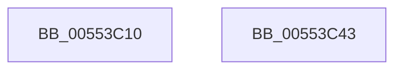

# HalpECmosWriteByte

- RVA: `0x00553C10`–`0x00553C44` (길이 `52` bytes)
- VA: `0x0000000140553C10`
- 실행 섹션: `.text`
- PDB 이름 있음: `예`; PDB Function 태그: `아니요`
- unwind 정보 RVA: `0x0005CF00`
- 디코드: `18`개 명령, `52/52` bytes 표시
- 미해석 바이트: `0` (있으면 어셈블리에 `.byte`로 보존)

> 이 문서는 커널 이미지의 기계어와 PDB 기호를 분석해 생성했습니다. 4번과 5번은 함수 원형과 자료형을 바이너리 사용 방식에서 추정한 C 해석이며 원본 소스 복구 결과는 아닙니다.

## 1. Dependencies

- 직접 호출 지점: **3**; 고유 호출 대상: **2**
- 직접 호출자로 확인된 함수: **0**
- RIP 상대 이미지 참조: **0**

### Outgoing calls
- `0x00553C24` → [WRITE_PORT_USHORT_PAIR](../54/WRITE_PORT_USHORT_PAIR_function_00545C48.md) (function, `0x00545C48`)
- `0x00553C29` → [HalpIoDelay](../6A/HalpIoDelay_function_006AC7E0.md) (function, `0x006AC7E0`)
- `0x00553C38` → [HalpIoDelay](../6A/HalpIoDelay_function_006AC7E0.md) (function, `0x006AC7E0`)

### Direct callers
- 이 함수 시작 RVA로 연결되는 직접 call은 확인되지 않았습니다. 간접 호출은 완전히 역산할 수 없습니다.

### Static image references
- 디코드된 RIP-relative 메모리 참조가 없습니다.

## 2. Other-region calls and transfers

- 다른 실행 섹션으로 향하는 call: **0**
- 별도 외부 분기/꼬리 이동을 확인하지 못했습니다.

## 3. Assembly (complete function range)

```asm
00553C10  40 53                           push rbx
00553C12  48 83 EC 20                     sub rsp, 0x20
00553C16  8A DA                           mov bl, dl
00553C18  44 0F B7 C1                     movzx r8d, cx
00553C1C  BA 75 00 00 00                  mov edx, 0x75
00553C21  8D 4A FF                        lea ecx, [rdx - 1]
00553C24  E8 1F 20 FF FF                  call 0x140545c48
00553C29  E8 B2 8B 15 00                  call 0x1406ac7e0
00553C2E  90                              nop
00553C2F  BA 76 00 00 00                  mov edx, 0x76
00553C34  8A C3                           mov al, bl
00553C36  EE                              out dx, al
00553C37  90                              nop
00553C38  E8 A3 8B 15 00                  call 0x1406ac7e0
00553C3D  48 83 C4 20                     add rsp, 0x20
00553C41  5B                              pop rbx
00553C42  C3                              ret
00553C43  CC                              int3
```

## 4. C-style interpretation (structured pseudocode)

```c
__int64 __fastcall HalpECmosWriteByte(unsigned __int16 a1, unsigned __int8 a2)
{
    __int64 result;
    __int64 v_rsp;

    v_rsp = (v_rsp) - (32);
    result = WRITE_PORT_USHORT_PAIR(117 - 1, 117, a1, a4);
    result = HalpIoDelay(117 - 1, 117, a1, a4);
    result = HalpIoDelay(117 - 1, 118, a1, a4);
    v_rsp = (v_rsp) + (32);
    return result;
}
```

## 5. (Beta) C Style

```c
int64_t HalpECmosWriteByte(uint16_t Arg1, uint8_t Arg2)
{
    int64_t result;
    int64_t local_rsp;

    local_rsp = (local_rsp) - (32);
    result = WRITE_PORT_USHORT_PAIR(117 - 1, 117, Arg1, a4);
    result = HalpIoDelay(117 - 1, 117, Arg1, a4);
    result = HalpIoDelay(117 - 1, 118, Arg1, a4);
    local_rsp = (local_rsp) + (32);
    return result;
}
```

## 6. Execution-region graph

[열기: 2D/3D 그래프와 함수 탐색 컨트롤 패널](../../../control-panel.html?section=text&rva=0x00553C10&view=graph)

- 2D 그래프는 위에서 아래로 흐르고, 3D 그래프는 빈 공간을 드래그해 회전합니다. Shift+드래그는 이동, 휠은 확대·축소, 함수 노드 선택은 대상 보고서 이동입니다.

### Static fallback


