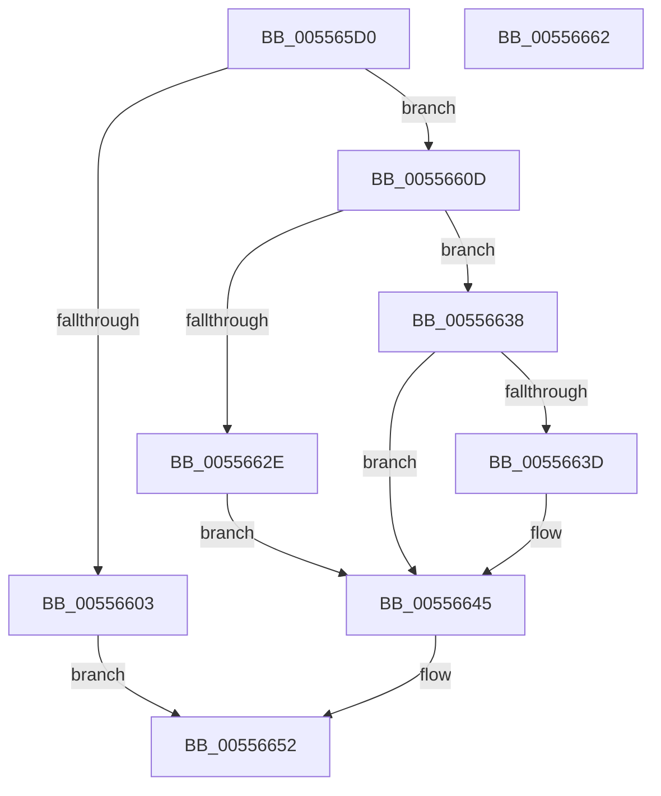

# HalpErrorDeferredHandler

- RVA: `0x005565D0`–`0x00556663` (길이 `147` bytes)
- VA: `0x00000001405565D0`
- 실행 섹션: `.text`
- PDB 이름 있음: `예`; PDB Function 태그: `아니요`
- unwind 정보 RVA: `0x00060BC4`
- 디코드: `41`개 명령, `147/147` bytes 표시
- 미해석 바이트: `0` (있으면 어셈블리에 `.byte`로 보존)

> 이 문서는 커널 이미지의 기계어와 PDB 기호를 분석해 생성했습니다. 4번과 5번은 함수 원형과 자료형을 바이너리 사용 방식에서 추정한 C 해석이며 원본 소스 복구 결과는 아닙니다.

## 1. Dependencies

- 직접 호출 지점: **7**; 고유 호출 대상: **6**
- 직접 호출자로 확인된 함수: **0**
- RIP 상대 이미지 참조: **0**

### Outgoing calls
- `0x005565F6` → [ExAllocatePool2](../../poolcode/B8/ExAllocatePool2_function_00B820F0.md) (function, `0x00B820F0`)
- `0x00556606` → [HalpFreeDrsPool](HalpFreeDrsPool_function_0055666C.md) (function, `0x0055666C`)
- `0x00556619` → [memcpy](../6C/memcpy_function_006C6840.md) (function, `0x006C6840`)
- `0x00556621` → [HalpFreeDrsPool](HalpFreeDrsPool_function_0055666C.md) (function, `0x0055666C`)
- `0x00556631` → [HalpMemoryErrorDeferredHandler](HalpMemoryErrorDeferredHandler_function_0055686C.md) (function, `0x0055686C`)
- `0x00556640` → [HalpPmemErrorDeferredHandler](HalpPmemErrorDeferredHandler_function_00556A30.md) (function, `0x00556A30`)
- `0x0055664D` → [ExFreePoolWithTag](../../poolcode/B8/ExFreePoolWithTag_function_00B82870.md) (function, `0x00B82870`)

### Direct callers
- 이 함수 시작 RVA로 연결되는 직접 call은 확인되지 않았습니다. 간접 호출은 완전히 역산할 수 없습니다.

### Static image references
- 디코드된 RIP-relative 메모리 참조가 없습니다.

## 2. Other-region calls and transfers

- 다른 실행 섹션으로 향하는 call: **2**
  - `0x005565F6` → [ExAllocatePool2](../../poolcode/B8/ExAllocatePool2_function_00B820F0.md) (`.text` → `POOLCODE`)
  - `0x0055664D` → [ExFreePoolWithTag](../../poolcode/B8/ExFreePoolWithTag_function_00B82870.md) (`.text` → `POOLCODE`)
- 별도 외부 분기/꼬리 이동을 확인하지 못했습니다.

## 3. Assembly (complete function range)

```asm
005565D0  48 89 5C 24 08                  mov qword ptr [rsp + 8], rbx
005565D5  48 89 74 24 10                  mov qword ptr [rsp + 0x10], rsi
005565DA  57                              push rdi
005565DB  48 83 EC 20                     sub rsp, 0x20
005565DF  48 8B F2                        mov rsi, rdx
005565E2  48 8D 79 F8                     lea rdi, [rcx - 8]
005565E6  BA 28 18 00 00                  mov edx, 0x1828
005565EB  B9 00 01 00 00                  mov ecx, 0x100
005565F0  41 B8 57 68 65 61               mov r8d, 0x61656857
005565F6  E8 F5 BA 62 00                  call 0x140b820f0
005565FB  48 8B D8                        mov rbx, rax
005565FE  48 85 C0                        test rax, rax
00556601  75 0A                           jne 0x14055660d
00556603  48 8B CF                        mov rcx, rdi
00556606  E8 61 00 00 00                  call 0x14055666c
0055660B  EB 45                           jmp 0x140556652
0055660D  41 B8 28 18 00 00               mov r8d, 0x1828
00556613  48 8B D6                        mov rdx, rsi
00556616  48 8B CB                        mov rcx, rbx
00556619  E8 22 02 17 00                  call 0x1406c6840
0055661E  48 8B CF                        mov rcx, rdi
00556621  E8 46 00 00 00                  call 0x14055666c
00556626  8B 43 1C                        mov eax, dword ptr [rbx + 0x1c]
00556629  83 F8 01                        cmp eax, 1
0055662C  75 0A                           jne 0x140556638
0055662E  48 8B CB                        mov rcx, rbx
00556631  E8 36 02 00 00                  call 0x14055686c
00556636  EB 0D                           jmp 0x140556645
00556638  83 F8 02                        cmp eax, 2
0055663B  75 08                           jne 0x140556645
0055663D  48 8B CB                        mov rcx, rbx
00556640  E8 EB 03 00 00                  call 0x140556a30
00556645  BA 57 68 65 61                  mov edx, 0x61656857
0055664A  48 8B CB                        mov rcx, rbx
0055664D  E8 1E C2 62 00                  call 0x140b82870
00556652  48 8B 5C 24 30                  mov rbx, qword ptr [rsp + 0x30]
00556657  48 8B 74 24 38                  mov rsi, qword ptr [rsp + 0x38]
0055665C  48 83 C4 20                     add rsp, 0x20
00556660  5F                              pop rdi
00556661  C3                              ret
00556662  CC                              int3
```

## 4. C-style interpretation (structured pseudocode)

```c
__int64 __fastcall HalpErrorDeferredHandler(__int64 a1, __int64 a2)
{
    __int64 result;
    __int64 v_rsp;
    unsigned __int64 v_stack_p10;
    unsigned __int64 v_stack_p8;

    v_stack_p8 = v_rbx;
    v_stack_p10 = v_rsi;
    v_rsp = (v_rsp) - (32);
    result = ExAllocatePool2(256, (unsigned int)(0x1828ULL), (unsigned int)(0x61656857ULL), a4);
    if (result != 0) goto loc_0055660D;
    result = HalpFreeDrsPool(a1 - 8, (unsigned int)(0x1828ULL), (unsigned int)(0x61656857ULL), a4);
    goto loc_00556652;
loc_0055660D:
    result = memcpy(result, a2, (unsigned int)(0x1828ULL), a4);
    result = HalpFreeDrsPool(a1 - 8, a2, (unsigned int)(0x1828ULL), a4);
    if (((unsigned int)((unsigned int)(*(unsigned int *)(result + 28)))) != 1) goto loc_00556638;
    result = HalpMemoryErrorDeferredHandler(result, a2, (unsigned int)(0x1828ULL), a4);
    goto loc_00556645;
loc_00556638:
    if (((unsigned int)(result)) == 2) {
        a1 = result;
        result = HalpPmemErrorDeferredHandler(a1, a2, (unsigned int)(0x1828ULL), a4);
    }
    result = ExFreePoolWithTag(result, (unsigned int)(0x61656857ULL), (unsigned int)(0x1828ULL), a4);
loc_00556652:
    v_rsp = (v_rsp) + (32);
    return result;
}
```

## 5. (Beta) C Style

```c
int64_t HalpErrorDeferredHandler(void *Arg1, int64_t Arg2)
{
    uint8_t *arg1 = (uint8_t *)Arg1;

    int64_t result;
    int64_t local_rsp;
    uint64_t v_stack_p10;
    uint64_t v_stack_p8;

    v_stack_p8 = local_rbx;
    v_stack_p10 = local_rsi;
    local_rsp = (local_rsp) - (32);
    result = ExAllocatePool2(256, (uint32_t)(0x1828ULL), (uint32_t)(0x61656857ULL), a4);
    if (result != 0) goto loc_0055660D;
    result = HalpFreeDrsPool(Arg1 - 8, (uint32_t)(0x1828ULL), (uint32_t)(0x61656857ULL), a4);
    goto loc_00556652;
loc_0055660D:
    result = memcpy(result, Arg2, (uint32_t)(0x1828ULL), a4);
    result = HalpFreeDrsPool(Arg1 - 8, Arg2, (uint32_t)(0x1828ULL), a4);
    if (((uint32_t)((uint32_t)(*(uint32_t *)(result + 0x1C)))) != 1) goto loc_00556638;
    result = HalpMemoryErrorDeferredHandler(result, Arg2, (uint32_t)(0x1828ULL), a4);
    goto loc_00556645;
loc_00556638:
    if (((uint32_t)(result)) == 2) {
        Arg1 = result;
        result = HalpPmemErrorDeferredHandler(Arg1, Arg2, (uint32_t)(0x1828ULL), a4);
    }
    result = ExFreePoolWithTag(result, (uint32_t)(0x61656857ULL), (uint32_t)(0x1828ULL), a4);
loc_00556652:
    local_rsp = (local_rsp) + (32);
    return result;
}
```

### 관측된 메모리 오프셋

구조체 형식이 확인되지 않은 접근은 인자 기준의 오프셋으로만 기록했습니다.

| 기준 인자 | 오프셋 표현 | 폭 (bit) | 접근 |
|---|---:|---:|---|
| `Arg1` | `- 0x8` | `64` | `R` |

## 6. Execution-region graph

[열기: 2D/3D 그래프와 함수 탐색 컨트롤 패널](../../../control-panel.html?section=text&rva=0x005565D0&view=graph)

- 2D 그래프는 위에서 아래로 흐르고, 3D 그래프는 빈 공간을 드래그해 회전합니다. Shift+드래그는 이동, 휠은 확대·축소, 함수 노드 선택은 대상 보고서 이동입니다.

### Static fallback


