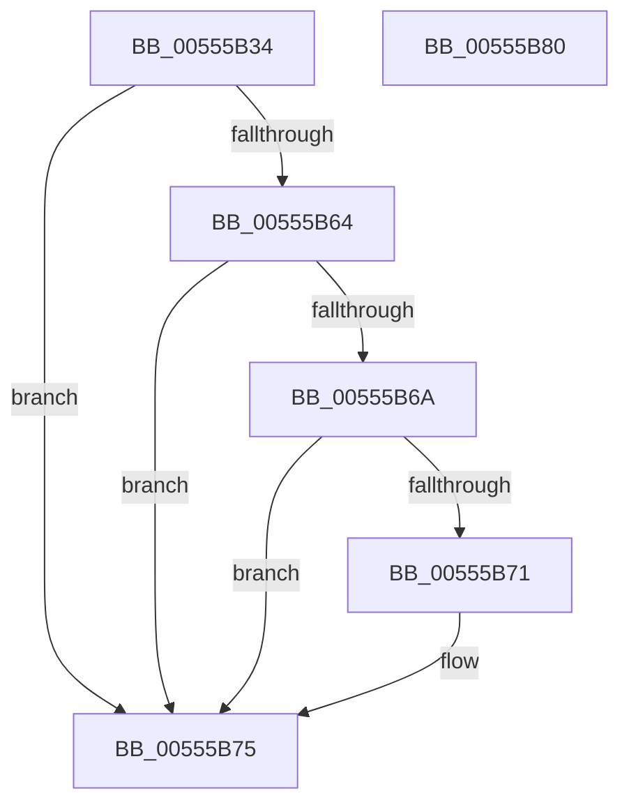

# HalpExtractGenericErrorData

- RVA: `0x00555B34`–`0x00555B81` (길이 `77` bytes)
- VA: `0x0000000140555B34`
- 실행 섹션: `.text`
- PDB 이름 있음: `예`; PDB Function 태그: `아니요`
- unwind 정보 RVA: `0x0005CAAC`
- 디코드: `24`개 명령, `77/77` bytes 표시
- 미해석 바이트: `0` (있으면 어셈블리에 `.byte`로 보존)

> 이 문서는 커널 이미지의 기계어와 PDB 기호를 분석해 생성했습니다. 4번과 5번은 함수 원형과 자료형을 바이너리 사용 방식에서 추정한 C 해석이며 원본 소스 복구 결과는 아닙니다.

## 1. Dependencies

- 직접 호출 지점: **1**; 고유 호출 대상: **1**
- 직접 호출자로 확인된 함수: **1**
- RIP 상대 이미지 참조: **0**

### Outgoing calls
- `0x00555B59` → [memcpy](../6C/memcpy_function_006C6840.md) (function, `0x006C6840`)

### Direct callers
- [HalpReadGenericErrorInfo](../4A/HalpReadGenericErrorInfo_function_004A9D38.md) at `0x004A9D95`
- [HalpReadGenericErrorInfo](../4A/HalpReadGenericErrorInfo_function_004A9D38.md) at `0x004A9DAF`

### Static image references
- 디코드된 RIP-relative 메모리 참조가 없습니다.

## 2. Other-region calls and transfers

- 다른 실행 섹션으로 향하는 call: **0**
- 별도 외부 분기/꼬리 이동을 확인하지 못했습니다.

## 3. Assembly (complete function range)

```asm
00555B34  48 89 5C 24 08                  mov qword ptr [rsp + 8], rbx
00555B39  57                              push rdi
00555B3A  48 83 EC 20                     sub rsp, 0x20
00555B3E  48 8B 51 38                     mov rdx, qword ptr [rcx + 0x38]
00555B42  48 8B D9                        mov rbx, rcx
00555B45  48 8B 79 18                     mov rdi, qword ptr [rcx + 0x18]
00555B49  44 8B 41 30                     mov r8d, dword ptr [rcx + 0x30]
00555B4D  8B 42 10                        mov eax, dword ptr [rdx + 0x10]
00555B50  8B 4F 40                        mov ecx, dword ptr [rdi + 0x40]
00555B53  48 03 CF                        add rcx, rdi
00555B56  89 47 14                        mov dword ptr [rdi + 0x14], eax
00555B59  E8 E2 0C 17 00                  call 0x1406c6840
00555B5E  83 7B 60 0C                     cmp dword ptr [rbx + 0x60], 0xc
00555B62  75 11                           jne 0x140555b75
00555B64  83 7F 14 00                     cmp dword ptr [rdi + 0x14], 0
00555B68  75 0B                           jne 0x140555b75
00555B6A  48 83 7F 30 00                  cmp qword ptr [rdi + 0x30], 0
00555B6F  75 04                           jne 0x140555b75
00555B71  48 89 7F 30                     mov qword ptr [rdi + 0x30], rdi
00555B75  48 8B 5C 24 30                  mov rbx, qword ptr [rsp + 0x30]
00555B7A  48 83 C4 20                     add rsp, 0x20
00555B7E  5F                              pop rdi
00555B7F  C3                              ret
00555B80  CC                              int3
```

## 4. C-style interpretation (structured pseudocode)

```c
__int64 __fastcall HalpExtractGenericErrorData(__int64 a1)
{
    __int64 result;
    __int64 v_rsp;
    unsigned __int64 v_stack_p8;

    v_stack_p8 = v_rbx;
    v_rsp = (v_rsp) - (32);
    a1 = ((unsigned int)(*(unsigned int *)(*(unsigned __int64 *)(a1 + 24) + 64))) + (*(unsigned __int64 *)(a1 + 24));
    *(unsigned int *)(*(unsigned __int64 *)(a1 + 24) + 20) = (unsigned int)((unsigned int)(*(unsigned int *)(*(unsigned __int64 *)(a1 + 56) + 16)));
    result = memcpy(a1, *(unsigned __int64 *)(a1 + 56), (unsigned int)(*(unsigned int *)(a1 + 48)), a4);
    if ((*(unsigned int *)(a1 + 96)) != 12) goto loc_00555B75;
    if ((*(unsigned int *)(*(unsigned __int64 *)(a1 + 24) + 20)) != 0) goto loc_00555B75;
    if ((*(unsigned __int64 *)(*(unsigned __int64 *)(a1 + 24) + 48)) == 0) {
        *(unsigned __int64 *)(*(unsigned __int64 *)(a1 + 24) + 48) = *(unsigned __int64 *)(a1 + 24);
    }
    v_rsp = (v_rsp) + (32);
    return result;
}
```

## 5. (Beta) C Style

```c
int64_t HalpExtractGenericErrorData(void *Arg1)
{
    uint8_t *arg1 = (uint8_t *)Arg1;

    int64_t result;
    int64_t local_rsp;
    uint64_t v_stack_p8;

    v_stack_p8 = local_rbx;
    local_rsp = (local_rsp) - (32);
    Arg1 = ((uint32_t)(*(uint32_t *)(*(uint64_t *)(arg1 + 0x18) + 0x40))) + (*(uint64_t *)(arg1 + 0x18));
    *(uint32_t *)(*(uint64_t *)(arg1 + 0x18) + 0x14) = (uint32_t)((uint32_t)(*(uint32_t *)(*(uint64_t *)(arg1 + 0x38) + 0x10)));
    result = memcpy(Arg1, *(uint64_t *)(arg1 + 0x38), (uint32_t)(*(uint32_t *)(arg1 + 0x30)), a4);
    if ((*(uint32_t *)(arg1 + 0x60)) != 12) goto loc_00555B75;
    if ((*(uint32_t *)(*(uint64_t *)(arg1 + 0x18) + 0x14)) != 0) goto loc_00555B75;
    if ((*(uint64_t *)(*(uint64_t *)(arg1 + 0x18) + 0x30)) == 0) {
        *(uint64_t *)(*(uint64_t *)(arg1 + 0x18) + 0x30) = *(uint64_t *)(arg1 + 0x18);
    }
    local_rsp = (local_rsp) + (32);
    return result;
}
```

### 관측된 메모리 오프셋

구조체 형식이 확인되지 않은 접근은 인자 기준의 오프셋으로만 기록했습니다.

| 기준 인자 | 오프셋 표현 | 폭 (bit) | 접근 |
|---|---:|---:|---|
| `Arg1` | `+ 0x18` | `64` | `R` |
| `Arg1` | `+ 0x30` | `32` | `R` |
| `Arg1` | `+ 0x38` | `64` | `R` |
| `Arg1` | `+ 0x60` | `32` | `R` |

## 6. Execution-region graph

[열기: 2D/3D 그래프와 함수 탐색 컨트롤 패널](../../../control-panel.html?section=text&rva=0x00555B34&view=graph)

- 2D 그래프는 위에서 아래로 흐르고, 3D 그래프는 빈 공간을 드래그해 회전합니다. Shift+드래그는 이동, 휠은 확대·축소, 함수 노드 선택은 대상 보고서 이동입니다.

### Static fallback


