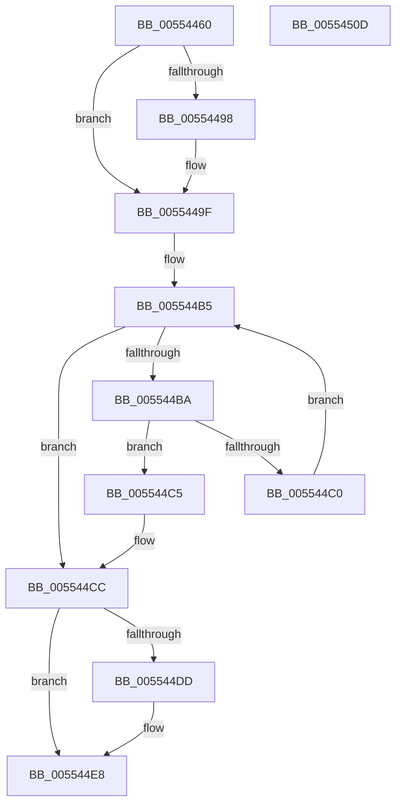

# HalpFindAdapterByRequestLine

- RVA: `0x00554460`–`0x0055450E` (길이 `174` bytes)
- VA: `0x0000000140554460`
- 실행 섹션: `.text`
- PDB 이름 있음: `예`; PDB Function 태그: `아니요`
- unwind 정보 RVA: `0x0005E6B4`
- 디코드: `47`개 명령, `174/174` bytes 표시
- 미해석 바이트: `0` (있으면 어셈블리에 `.byte`로 보존)

> 이 문서는 커널 이미지의 기계어와 PDB 기호를 분석해 생성했습니다. 4번과 5번은 함수 원형과 자료형을 바이너리 사용 방식에서 추정한 C 해석이며 원본 소스 복구 결과는 아닙니다.

## 1. Dependencies

- 직접 호출 지점: **4**; 고유 호출 대상: **4**
- 직접 호출자로 확인된 함수: **1**
- RIP 상대 이미지 참조: **1**

### Outgoing calls
- `0x0055449A` → [KiRaiseIrqlProcessIrqlFlags](../4F/KiRaiseIrqlProcessIrqlFlags_function_004F56FC.md) (function, `0x004F56FC`)
- `0x005544A9` → [KeAcquireSpinLockAtDpcLevel](../20/KeAcquireSpinLockAtDpcLevel_function_00208430.md) (function, `0x00208430`)
- `0x005544CF` → [KxReleaseSpinLock](../20/KxReleaseSpinLock_function_00206670.md) (function, `0x00206670`)
- `0x005544E3` → [KiLowerIrqlProcessIrqlFlags](../4F/KiLowerIrqlProcessIrqlFlags_function_004F5698.md) (function, `0x004F5698`)

### Direct callers
- [HalGetAdapterV3](../../page/70/HalGetAdapterV3_function_00709838.md) at `0x0070991B`
- [HalGetAdapterV3](../../page/70/HalGetAdapterV3_function_00709838.md) at `0x00709B19`

### Static image references
- `0x00554490` → RVA `0x00FC6D20` (`ALMOSTRO`; read)

## 2. Other-region calls and transfers

- 다른 실행 섹션으로 향하는 call: **0**
- 별도 외부 분기/꼬리 이동을 확인하지 못했습니다.

## 3. Assembly (complete function range)

```asm
00554460  48 8B C4                        mov rax, rsp
00554463  48 89 58 08                     mov qword ptr [rax + 8], rbx
00554467  48 89 68 10                     mov qword ptr [rax + 0x10], rbp
0055446B  48 89 70 18                     mov qword ptr [rax + 0x18], rsi
0055446F  48 89 78 20                     mov qword ptr [rax + 0x20], rdi
00554473  41 56                           push r14
00554475  48 83 EC 20                     sub rsp, 0x20
00554479  44 8B F2                        mov r14d, edx
0055447C  48 8B F9                        mov rdi, rcx
0055447F  0F B6 91 B0 00 00 00            movzx edx, byte ptr [rcx + 0xb0]
00554486  33 F6                           xor esi, esi
00554488  44 0F 20 C3                     mov rbx, cr8
0055448C  44 0F 22 C2                     mov cr8, rdx
00554490  39 35 8A 28 A7 00               cmp dword ptr [rip + 0xa7288a], esi
00554496  74 07                           je 0x14055449f
00554498  8A CB                           mov cl, bl
0055449A  E8 5D 12 FA FF                  call 0x1404f56fc
0055449F  48 8D AF A8 00 00 00            lea rbp, [rdi + 0xa8]
005544A6  48 8B CD                        mov rcx, rbp
005544A9  E8 82 3F CB FF                  call 0x140208430
005544AE  48 83 C7 10                     add rdi, 0x10
005544B2  48 8B 07                        mov rax, qword ptr [rdi]
005544B5  48 3B C7                        cmp rax, rdi
005544B8  74 12                           je 0x1405544cc
005544BA  44 39 70 B0                     cmp dword ptr [rax - 0x50], r14d
005544BE  74 05                           je 0x1405544c5
005544C0  48 8B 00                        mov rax, qword ptr [rax]
005544C3  EB F0                           jmp 0x1405544b5
005544C5  48 8D B0 30 FE FF FF            lea rsi, [rax - 0x1d0]
005544CC  48 8B CD                        mov rcx, rbp
005544CF  E8 9C 21 CB FF                  call 0x140206670
005544D4  83 3D 45 28 A7 00 00            cmp dword ptr [rip + 0xa72845], 0
005544DB  74 0B                           je 0x1405544e8
005544DD  44 0F 20 C1                     mov rcx, cr8
005544E1  8A D3                           mov dl, bl
005544E3  E8 B0 11 FA FF                  call 0x1404f5698
005544E8  0F B6 CB                        movzx ecx, bl
005544EB  44 0F 22 C1                     mov cr8, rcx
005544EF  48 8B 5C 24 30                  mov rbx, qword ptr [rsp + 0x30]
005544F4  48 8B C6                        mov rax, rsi
005544F7  48 8B 74 24 40                  mov rsi, qword ptr [rsp + 0x40]
005544FC  48 8B 6C 24 38                  mov rbp, qword ptr [rsp + 0x38]
00554501  48 8B 7C 24 48                  mov rdi, qword ptr [rsp + 0x48]
00554506  48 83 C4 20                     add rsp, 0x20
0055450A  41 5E                           pop r14
0055450C  C3                              ret
0055450D  CC                              int3
```

## 4. C-style interpretation (structured pseudocode)

```c
__int64 __fastcall HalpFindAdapterByRequestLine(__int64 a1, int a2)
{
    __int64 result;
    __int64 v_rdi;
    __int64 v_rsi;
    __int64 v_rsp;
    unsigned __int64 v_stack_p10;
    unsigned __int64 v_stack_p18;
    unsigned __int64 v_stack_p20;
    unsigned __int64 v_stack_p8;

    *(unsigned __int64 *)(v_rsp + 8) = v_rbx;
    *(unsigned __int64 *)(v_rsp + 16) = v_rbp;
    *(unsigned __int64 *)(v_rsp + 24) = v_rsi;
    *(unsigned __int64 *)(v_rsp + 32) = v_rdi;
    v_rsp = (v_rsp) - (32);
    v_rsi = 0;
    result = v_rsp;
    if ((*(unsigned int *)(v_rip + 10954890)) != 0) {
        a1 = (unsigned __int8)(v_cr8);
        result = KiRaiseIrqlProcessIrqlFlags(a1, *(unsigned __int8 *)(a1 + 176), a3, a4);
    }
    result = KeAcquireSpinLockAtDpcLevel(a1 + 168, *(unsigned __int8 *)(a1 + 176), a3, a4);
    v_rdi = (a1) + (16);
loc_005544B5:
    if ((*(unsigned __int64 *)(v_rdi)) == v_rdi) goto loc_005544CC;
    if ((*(unsigned int *)(*(unsigned __int64 *)(v_rdi) - 80)) == ((unsigned int)((unsigned int)(a2)))) goto loc_005544C5;
    goto loc_005544B5;
loc_005544C5:
loc_005544CC:
    result = KxReleaseSpinLock(a1 + 168, *(unsigned __int8 *)(a1 + 176), a3, a4);
    if ((*(unsigned int *)(v_rip + 10954821)) != 0) {
        a1 = *(unsigned __int8 *)(a1 + 176);
        a2 = (unsigned __int8)(v_cr8);
        result = KiLowerIrqlProcessIrqlFlags(a1, a2, a3, a4);
    }
    v_rsp = (v_rsp) + (32);
    return *(unsigned __int64 *)(*(unsigned __int64 *)(v_rdi)) - 464;
}
```

## 5. (Beta) C Style

```c
int64_t HalpFindAdapterByRequestLine(void *Arg1, int32_t Arg2)
{
    uint8_t *arg1 = (uint8_t *)Arg1;

    int64_t result;
    int64_t local_rdi;
    int64_t local_rsi;
    int64_t local_rsp;
    uint64_t v_stack_p10;
    uint64_t v_stack_p18;
    uint64_t v_stack_p20;
    uint64_t v_stack_p8;

    *(uint64_t *)(local_rsp + 0x8) = local_rbx;
    *(uint64_t *)(local_rsp + 0x10) = local_rbp;
    *(uint64_t *)(local_rsp + 0x18) = local_rsi;
    *(uint64_t *)(local_rsp + 0x20) = local_rdi;
    local_rsp = (local_rsp) - (32);
    local_rsi = 0;
    result = local_rsp;
    if ((*(uint32_t *)(v_rip + 0xA7288A)) != 0) {
        Arg1 = (uint8_t)(v_cr8);
        result = KiRaiseIrqlProcessIrqlFlags(Arg1, *(uint8_t *)(arg1 + 0xB0), a3, a4);
    }
    result = KeAcquireSpinLockAtDpcLevel(Arg1 + 168, *(uint8_t *)(arg1 + 0xB0), a3, a4);
    local_rdi = (Arg1) + (16);
loc_005544B5:
    if ((*(uint64_t *)(local_rdi)) == local_rdi) goto loc_005544CC;
    if ((*(uint32_t *)(*(uint64_t *)(local_rdi) - 0x50)) == ((uint32_t)((uint32_t)(Arg2)))) goto loc_005544C5;
    goto loc_005544B5;
loc_005544C5:
loc_005544CC:
    result = KxReleaseSpinLock(Arg1 + 168, *(uint8_t *)(arg1 + 0xB0), a3, a4);
    if ((*(uint32_t *)(v_rip + 0xA72845)) != 0) {
        Arg1 = *(uint8_t *)(arg1 + 0xB0);
        Arg2 = (uint8_t)(v_cr8);
        result = KiLowerIrqlProcessIrqlFlags(Arg1, Arg2, a3, a4);
    }
    local_rsp = (local_rsp) + (32);
    return *(uint64_t *)(*(uint64_t *)(local_rdi)) - 464;
}
```

### 관측된 메모리 오프셋

구조체 형식이 확인되지 않은 접근은 인자 기준의 오프셋으로만 기록했습니다.

| 기준 인자 | 오프셋 표현 | 폭 (bit) | 접근 |
|---|---:|---:|---|
| `Arg1` | `+ 0x0` | `64` | `R` |
| `Arg1` | `+ 0xA8` | `64` | `R` |
| `Arg1` | `+ 0xB0` | `8` | `R` |

## 6. Execution-region graph

[열기: 2D/3D 그래프와 함수 탐색 컨트롤 패널](../../../control-panel.html?section=text&rva=0x00554460&view=graph)

- 2D 그래프는 위에서 아래로 흐르고, 3D 그래프는 빈 공간을 드래그해 회전합니다. Shift+드래그는 이동, 휠은 확대·축소, 함수 노드 선택은 대상 보고서 이동입니다.

### Static fallback


