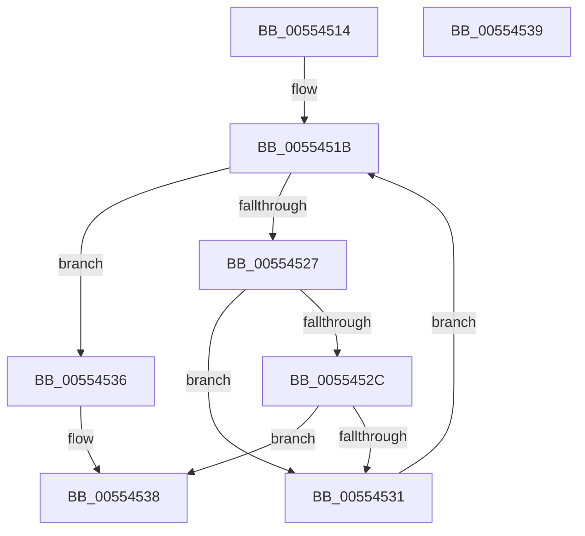

# HalpFindDmaControllerByRequestLine

- RVA: `0x00554514`–`0x0055453A` (길이 `38` bytes)
- VA: `0x0000000140554514`
- 실행 섹션: `.text`
- PDB 이름 있음: `예`; PDB Function 태그: `아니요`
- unwind 정보 RVA: `0x000DB714`
- 디코드: `13`개 명령, `38/38` bytes 표시
- 미해석 바이트: `0` (있으면 어셈블리에 `.byte`로 보존)

> 이 문서는 커널 이미지의 기계어와 PDB 기호를 분석해 생성했습니다. 4번과 5번은 함수 원형과 자료형을 바이너리 사용 방식에서 추정한 C 해석이며 원본 소스 복구 결과는 아닙니다.

## 1. Dependencies

- 직접 호출 지점: **0**; 고유 호출 대상: **0**
- 직접 호출자로 확인된 함수: **1**
- RIP 상대 이미지 참조: **1**

### Outgoing calls
- 직접 디코드된 call 명령이 없습니다.

### Direct callers
- [HalGetAdapterV3](../../page/70/HalGetAdapterV3_function_00709838.md) at `0x00709901`

### Static image references
- `0x00554514` → RVA `0x00FC16F0` (`.data`; read)

## 2. Other-region calls and transfers

- 다른 실행 섹션으로 향하는 call: **0**
- 별도 외부 분기/꼬리 이동을 확인하지 못했습니다.

## 3. Assembly (complete function range)

```asm
00554514  48 8B 05 D5 D1 A6 00            mov rax, qword ptr [rip + 0xa6d1d5]
0055451B  48 8D 15 CE D1 A6 00            lea rdx, [rip + 0xa6d1ce]
00554522  48 3B C2                        cmp rax, rdx
00554525  74 0F                           je 0x140554536
00554527  39 48 24                        cmp dword ptr [rax + 0x24], ecx
0055452A  77 05                           ja 0x140554531
0055452C  39 48 28                        cmp dword ptr [rax + 0x28], ecx
0055452F  73 07                           jae 0x140554538
00554531  48 8B 00                        mov rax, qword ptr [rax]
00554534  EB E5                           jmp 0x14055451b
00554536  33 C0                           xor eax, eax
00554538  C3                              ret
00554539  CC                              int3
```

## 4. C-style interpretation (structured pseudocode)

```c
__int64 __fastcall HalpFindDmaControllerByRequestLine(int a1)
{
    __int64 result;

loc_0055451B:
    if ((*(unsigned __int64 *)(v_rip + 10932693)) == (v_rip + 10932686)) goto loc_00554536;
    if ((*(unsigned int *)(*(unsigned __int64 *)(v_rip + 10932693) + 36)) > a1) goto loc_00554531;
    if ((*(unsigned int *)(*(unsigned __int64 *)(v_rip + 10932693) + 40)) >= a1) goto loc_00554538;
loc_00554531:
    goto loc_0055451B;
loc_00554536:
    result = 0;
loc_00554538:
    return result;
}
```

## 5. (Beta) C Style

```c
int64_t HalpFindDmaControllerByRequestLine(int32_t Arg1)
{
    int64_t result;

loc_0055451B:
    if ((*(uint64_t *)(v_rip + 0xA6D1D5)) == (v_rip + 10932686)) goto loc_00554536;
    if ((*(uint32_t *)(*(uint64_t *)(v_rip + 0xA6D1D5) + 0x24)) > Arg1) goto loc_00554531;
    if ((*(uint32_t *)(*(uint64_t *)(v_rip + 0xA6D1D5) + 0x28)) >= Arg1) goto loc_00554538;
loc_00554531:
    goto loc_0055451B;
loc_00554536:
    result = 0;
loc_00554538:
    return result;
}
```

## 6. Execution-region graph

[열기: 2D/3D 그래프와 함수 탐색 컨트롤 패널](../../../control-panel.html?section=text&rva=0x00554514&view=graph)

- 2D 그래프는 위에서 아래로 흐르고, 3D 그래프는 빈 공간을 드래그해 회전합니다. Shift+드래그는 이동, 휠은 확대·축소, 함수 노드 선택은 대상 보고서 이동입니다.

### Static fallback


