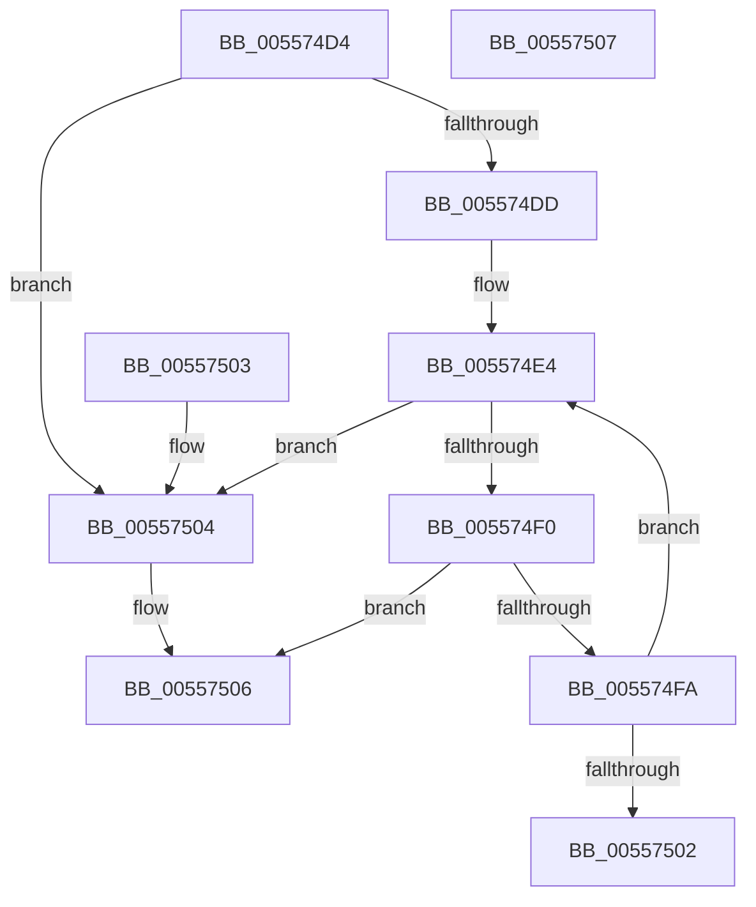

# HalpFindInterruptController

- RVA: `0x005574D4`–`0x00557508` (길이 `52` bytes)
- VA: `0x00000001405574D4`
- 실행 섹션: `.text`
- PDB 이름 있음: `예`; PDB Function 태그: `아니요`
- unwind 정보 RVA: `0x000DB714`
- 디코드: `17`개 명령, `52/52` bytes 표시
- 미해석 바이트: `0` (있으면 어셈블리에 `.byte`로 보존)

> 이 문서는 커널 이미지의 기계어와 PDB 기호를 분석해 생성했습니다. 4번과 5번은 함수 원형과 자료형을 바이너리 사용 방식에서 추정한 C 해석이며 원본 소스 복구 결과는 아닙니다.

## 1. Dependencies

- 직접 호출 지점: **0**; 고유 호출 대상: **0**
- 직접 호출자로 확인된 함수: **1**
- RIP 상대 이미지 참조: **2**

### Outgoing calls
- 직접 디코드된 call 명령이 없습니다.

### Direct callers
- [HalpInterruptSelectController](HalpInterruptSelectController_function_005587A8.md) at `0x005587BA`
- [HalpInterruptSelectController](HalpInterruptSelectController_function_005587A8.md) at `0x005587D8`

### Static image references
- `0x005574D4` → RVA `0x00E101D0` (`.data`; read)
- `0x005574DD` → RVA `0x00FC38F0` (`.data`; read)

## 2. Other-region calls and transfers

- 다른 실행 섹션으로 향하는 call: **0**
- 별도 외부 분기/꼬리 이동을 확인하지 못했습니다.

## 3. Assembly (complete function range)

```asm
005574D4  83 3D F5 8C 8B 00 00            cmp dword ptr [rip + 0x8b8cf5], 0
005574DB  74 27                           je 0x140557504
005574DD  48 8B 15 0C C4 A6 00            mov rdx, qword ptr [rip + 0xa6c40c]
005574E4  48 8D 05 05 C4 A6 00            lea rax, [rip + 0xa6c405]
005574EB  48 3B D0                        cmp rdx, rax
005574EE  74 14                           je 0x140557504
005574F0  48 8B C2                        mov rax, rdx
005574F3  48 8B 12                        mov rdx, qword ptr [rdx]
005574F6  85 C9                           test ecx, ecx
005574F8  74 0C                           je 0x140557506
005574FA  39 88 F0 00 00 00               cmp dword ptr [rax + 0xf0], ecx
00557500  75 E2                           jne 0x1405574e4
00557502  C3                              ret
00557503  CC                              int3
00557504  33 C0                           xor eax, eax
00557506  C3                              ret
00557507  CC                              int3
```

## 4. C-style interpretation (structured pseudocode)

```c
__int64 __fastcall HalpFindInterruptController(int a1)
{
    __int64 result;

    if ((*(unsigned int *)(v_rip + 9145589)) == 0) goto loc_00557504;
loc_005574E4:
    if ((*(unsigned __int64 *)(v_rip + 10929164)) == (v_rip + 10929157)) goto loc_00557504;
    if (a1 == 0) goto loc_00557506;
    if ((*(unsigned int *)(*(unsigned __int64 *)(v_rip + 10929164) + 240)) != a1) goto loc_005574E4;
    return *(unsigned __int64 *)(v_rip + 10929164);
loc_00557504:
    result = 0;
loc_00557506:
    return result;
}
```

## 5. (Beta) C Style

```c
int64_t HalpFindInterruptController(int32_t Arg1)
{
    int64_t result;

    if ((*(uint32_t *)(v_rip + 0x8B8CF5)) == 0) goto loc_00557504;
loc_005574E4:
    if ((*(uint64_t *)(v_rip + 0xA6C40C)) == (v_rip + 10929157)) goto loc_00557504;
    if (Arg1 == 0) goto loc_00557506;
    if ((*(uint32_t *)(*(uint64_t *)(v_rip + 0xA6C40C) + 0xF0)) != Arg1) goto loc_005574E4;
    return *(uint64_t *)(v_rip + 0xA6C40C);
loc_00557504:
    result = 0;
loc_00557506:
    return result;
}
```

## 6. Execution-region graph

[열기: 2D/3D 그래프와 함수 탐색 컨트롤 패널](../../../control-panel.html?section=text&rva=0x005574D4&view=graph)

- 2D 그래프는 위에서 아래로 흐르고, 3D 그래프는 빈 공간을 드래그해 회전합니다. Shift+드래그는 이동, 휠은 확대·축소, 함수 노드 선택은 대상 보고서 이동입니다.

### Static fallback


