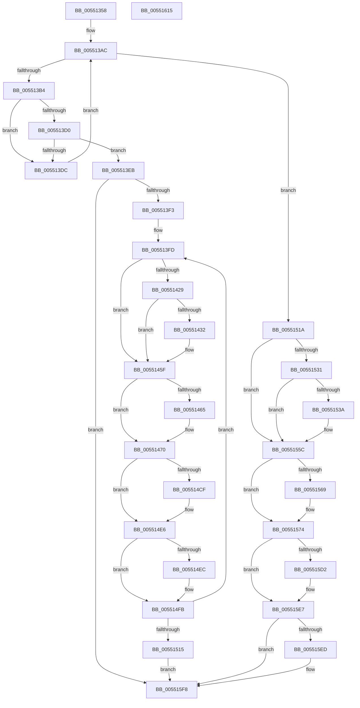

# HalpFlushMapBuffers

- RVA: `0x00551358`–`0x00551616` (길이 `702` bytes)
- VA: `0x0000000140551358`
- 실행 섹션: `.text`
- PDB 이름 있음: `예`; PDB Function 태그: `아니요`
- unwind 정보 RVA: `0x00075C18`
- 디코드: `190`개 명령, `702/702` bytes 표시
- 미해석 바이트: `0` (있으면 어셈블리에 `.byte`로 보존)

> 이 문서는 커널 이미지의 기계어와 PDB 기호를 분석해 생성했습니다. 4번과 5번은 함수 원형과 자료형을 바이너리 사용 방식에서 추정한 C 해석이며 원본 소스 복구 결과는 아닙니다.

## 1. Dependencies

- 직접 호출 지점: **9**; 고유 호출 대상: **5**
- 직접 호출자로 확인된 함수: **2**
- RIP 상대 이미지 참조: **0**

### Outgoing calls
- `0x00551380` → [HalpDmaGetAdapterCacheAlignment](../3D/HalpDmaGetAdapterCacheAlignment_function_003DC150.md) (function, `0x003DC150`)
- `0x00551465` → [KeAcquireSpinLockRaiseToDpc](../20/KeAcquireSpinLockRaiseToDpc_function_00208470.md) (function, `0x00208470`)
- `0x005514C3` → [MmBuildMdlForNonPagedPool](../23/MmBuildMdlForNonPagedPool_function_0023A870.md) (function, `0x0023A870`)
- `0x005514E1` → [KeFlushIoBuffers](../3D/KeFlushIoBuffers_function_003DA340.md) (function, `0x003DA340`)
- `0x005514F6` → [KeReleaseSpinLock](../39/KeReleaseSpinLock_function_00392BA0.md) (function, `0x00392BA0`)
- `0x0055156C` → [KeAcquireSpinLockRaiseToDpc](../20/KeAcquireSpinLockRaiseToDpc_function_00208470.md) (function, `0x00208470`)
- `0x005515C6` → [MmBuildMdlForNonPagedPool](../23/MmBuildMdlForNonPagedPool_function_0023A870.md) (function, `0x0023A870`)
- `0x005515E2` → [KeFlushIoBuffers](../3D/KeFlushIoBuffers_function_003DA340.md) (function, `0x003DA340`)
- `0x005515F3` → [KeReleaseSpinLock](../39/KeReleaseSpinLock_function_00392BA0.md) (function, `0x00392BA0`)

### Direct callers
- [sub_003DF2F5](../3D/Unknown_function_003DF2F5.md) at `0x003DF320`
- [sub_003DF335](../3D/Unknown_function_003DF335.md) at `0x003DF35B`

### Static image references
- 디코드된 RIP-relative 메모리 참조가 없습니다.

## 2. Other-region calls and transfers

- 다른 실행 섹션으로 향하는 call: **0**
- 별도 외부 분기/꼬리 이동을 확인하지 못했습니다.

## 3. Assembly (complete function range)

```asm
00551358  48 89 5C 24 08                  mov qword ptr [rsp + 8], rbx
0055135D  48 89 6C 24 10                  mov qword ptr [rsp + 0x10], rbp
00551362  48 89 74 24 18                  mov qword ptr [rsp + 0x18], rsi
00551367  57                              push rdi
00551368  41 54                           push r12
0055136A  41 55                           push r13
0055136C  41 56                           push r14
0055136E  41 57                           push r15
00551370  48 83 EC 20                     sub rsp, 0x20
00551374  41 8B F1                        mov esi, r9d
00551377  49 8B E8                        mov rbp, r8
0055137A  4C 8B CA                        mov r9, rdx
0055137D  48 8B F9                        mov rdi, rcx
00551380  E8 CB AD E8 FF                  call 0x1403dc150
00551385  41 81 E1 FF 0F 00 00            and r9d, 0xfff
0055138C  89 44 24 68                     mov dword ptr [rsp + 0x68], eax
00551390  45 33 ED                        xor r13d, r13d
00551393  4D 8B D8                        mov r11, r8
00551396  45 8B C5                        mov r8d, r13d
00551399  8B CE                           mov ecx, esi
0055139B  41 8B D1                        mov edx, r9d
0055139E  45 0F 20 C7                     mov r15, cr8
005513A2  45 8A E7                        mov r12b, r15b
005513A5  49 C7 C6 00 F0 FF FF            mov r14, 0xfffffffffffff000
005513AC  85 C9                           test ecx, ecx
005513AE  0F 84 66 01 00 00               je 0x14055151a
005513B4  B8 00 10 00 00                  mov eax, 0x1000
005513B9  44 8B D1                        mov r10d, ecx
005513BC  2B C2                           sub eax, edx
005513BE  49 8B 53 30                     mov rdx, qword ptr [r11 + 0x30]
005513C2  3B C8                           cmp ecx, eax
005513C4  44 0F 43 D0                     cmovae r10d, eax
005513C8  49 23 D6                        and rdx, r14
005513CB  4D 85 C0                        test r8, r8
005513CE  74 0C                           je 0x1405513dc
005513D0  49 8D 80 00 10 00 00            lea rax, [r8 + 0x1000]
005513D7  48 3B D0                        cmp rdx, rax
005513DA  75 0F                           jne 0x1405513eb
005513DC  4D 8B 5B 08                     mov r11, qword ptr [r11 + 8]
005513E0  4C 8B C2                        mov r8, rdx
005513E3  41 8B D5                        mov edx, r13d
005513E6  41 2B CA                        sub ecx, r10d
005513E9  EB C1                           jmp 0x1405513ac
005513EB  85 F6                           test esi, esi
005513ED  0F 84 05 02 00 00               je 0x1405515f8
005513F3  48 8D 8F 38 01 00 00            lea rcx, [rdi + 0x138]
005513FA  45 33 DB                        xor r11d, r11d
005513FD  48 8B 5D 30                     mov rbx, qword ptr [rbp + 0x30]
00551401  B8 00 10 00 00                  mov eax, 0x1000
00551406  41 2B C1                        sub eax, r9d
00551409  44 8B F6                        mov r14d, esi
0055140C  3B F0                           cmp esi, eax
0055140E  44 0F 43 F0                     cmovae r14d, eax
00551412  48 81 E3 00 F0 FF FF            and rbx, 0xfffffffffffff000
00551419  41 8B C1                        mov eax, r9d
0055141C  45 8B EE                        mov r13d, r14d
0055141F  48 03 D8                        add rbx, rax
00551422  44 38 5C 24 70                  cmp byte ptr [rsp + 0x70], r11b
00551427  75 36                           jne 0x14055145f
00551429  44 38 9F BD 01 00 00            cmp byte ptr [rdi + 0x1bd], r11b
00551430  75 2D                           jne 0x14055145f
00551432  44 8B 44 24 68                  mov r8d, dword ptr [rsp + 0x68]
00551437  8B C3                           mov eax, ebx
00551439  8B CB                           mov ecx, ebx
0055143B  41 8D 50 FF                     lea edx, [r8 - 1]
0055143F  F7 D2                           not edx
00551441  23 C2                           and eax, edx
00551443  2B C8                           sub ecx, eax
00551445  8B C1                           mov eax, ecx
00551447  48 2B D8                        sub rbx, rax
0055144A  43 8D 04 06                     lea eax, [r14 + r8]
0055144E  44 8D 69 FF                     lea r13d, [rcx - 1]
00551452  44 03 E8                        add r13d, eax
00551455  48 8D 8F 38 01 00 00            lea rcx, [rdi + 0x138]
0055145C  44 23 EA                        and r13d, edx
0055145F  41 80 FF 02                     cmp r15b, 2
00551463  77 0B                           ja 0x140551470
00551465  E8 06 70 CB FF                  call 0x140208470
0055146A  44 8A E0                        mov r12b, al
0055146D  45 33 DB                        xor r11d, r11d
00551470  4C 8B 97 30 01 00 00            mov r10, qword ptr [rdi + 0x130]
00551477  44 8B CB                        mov r9d, ebx
0055147A  B8 FF 0F 00 00                  mov eax, 0xfff
0055147F  45 8B C1                        mov r8d, r9d
00551482  4C 23 C0                        and r8, rax
00551485  44 23 C8                        and r9d, eax
00551488  4C 03 C0                        add r8, rax
0055148B  48 81 E3 00 F0 FF FF            and rbx, 0xfffffffffffff000
00551492  4D 03 C5                        add r8, r13
00551495  4D 89 1A                        mov qword ptr [r10], r11
00551498  49 C1 E8 0C                     shr r8, 0xc
0055149C  66 41 83 C0 06                  add r8w, 6
005514A1  66 45 89 5A 0A                  mov word ptr [r10 + 0xa], r11w
005514A6  66 41 C1 E0 03                  shl r8w, 3
005514AB  66 45 89 42 08                  mov word ptr [r10 + 8], r8w
005514B0  49 89 5A 20                     mov qword ptr [r10 + 0x20], rbx
005514B4  45 89 4A 2C                     mov dword ptr [r10 + 0x2c], r9d
005514B8  45 89 6A 28                     mov dword ptr [r10 + 0x28], r13d
005514BC  48 8B 8F 30 01 00 00            mov rcx, qword ptr [rdi + 0x130]
005514C3  E8 A8 93 CE FF                  call 0x14023a870
005514C8  80 7C 24 78 00                  cmp byte ptr [rsp + 0x78], 0
005514CD  75 17                           jne 0x1405514e6
005514CF  80 7C 24 70 00                  cmp byte ptr [rsp + 0x70], 0
005514D4  41 B0 01                        mov r8b, 1
005514D7  48 8B 8F 30 01 00 00            mov rcx, qword ptr [rdi + 0x130]
005514DE  0F 94 C2                        sete dl
005514E1  E8 5A 8E E8 FF                  call 0x1403da340
005514E6  41 80 FF 02                     cmp r15b, 2
005514EA  77 0F                           ja 0x1405514fb
005514EC  41 8A D4                        mov dl, r12b
005514EF  48 8D 8F 38 01 00 00            lea rcx, [rdi + 0x138]
005514F6  E8 A5 16 E4 FF                  call 0x140392ba0
005514FB  48 8B 6D 08                     mov rbp, qword ptr [rbp + 8]
005514FF  48 8D 8F 38 01 00 00            lea rcx, [rdi + 0x138]
00551506  45 33 DB                        xor r11d, r11d
00551509  45 8B CB                        mov r9d, r11d
0055150C  41 2B F6                        sub esi, r14d
0055150F  0F 85 E8 FE FF FF               jne 0x1405513fd
00551515  E9 DE 00 00 00                  jmp 0x1405515f8
0055151A  48 8B 5D 30                     mov rbx, qword ptr [rbp + 0x30]
0055151E  49 23 DE                        and rbx, r14
00551521  41 8B C1                        mov eax, r9d
00551524  44 8A 74 24 70                  mov r14b, byte ptr [rsp + 0x70]
00551529  48 03 D8                        add rbx, rax
0055152C  45 84 F6                        test r14b, r14b
0055152F  75 2B                           jne 0x14055155c
00551531  44 38 AF BD 01 00 00            cmp byte ptr [rdi + 0x1bd], r13b
00551538  75 22                           jne 0x14055155c
0055153A  44 8B 54 24 68                  mov r10d, dword ptr [rsp + 0x68]
0055153F  8B C3                           mov eax, ebx
00551541  8B CB                           mov ecx, ebx
00551543  FF CE                           dec esi
00551545  41 8D 52 FF                     lea edx, [r10 - 1]
00551549  F7 D2                           not edx
0055154B  23 C2                           and eax, edx
0055154D  2B C8                           sub ecx, eax
0055154F  8B C1                           mov eax, ecx
00551551  48 2B D8                        sub rbx, rax
00551554  41 8D 04 0A                     lea eax, [r10 + rcx]
00551558  03 F0                           add esi, eax
0055155A  23 F2                           and esi, edx
0055155C  48 8D AF 38 01 00 00            lea rbp, [rdi + 0x138]
00551563  41 80 FF 02                     cmp r15b, 2
00551567  77 0B                           ja 0x140551574
00551569  48 8B CD                        mov rcx, rbp
0055156C  E8 FF 6E CB FF                  call 0x140208470
00551571  44 8A E0                        mov r12b, al
00551574  4C 8B 8F 30 01 00 00            mov r9, qword ptr [rdi + 0x130]
0055157B  44 8B C3                        mov r8d, ebx
0055157E  41 BA FF 0F 00 00               mov r10d, 0xfff
00551584  41 8B D0                        mov edx, r8d
00551587  49 23 D2                        and rdx, r10
0055158A  45 23 C2                        and r8d, r10d
0055158D  49 03 D2                        add rdx, r10
00551590  48 81 E3 00 F0 FF FF            and rbx, 0xfffffffffffff000
00551597  48 03 D6                        add rdx, rsi
0055159A  4D 89 29                        mov qword ptr [r9], r13
0055159D  48 C1 EA 0C                     shr rdx, 0xc
005515A1  66 83 C2 06                     add dx, 6
005515A5  66 45 89 69 0A                  mov word ptr [r9 + 0xa], r13w
005515AA  66 C1 E2 03                     shl dx, 3
005515AE  66 41 89 51 08                  mov word ptr [r9 + 8], dx
005515B3  49 89 59 20                     mov qword ptr [r9 + 0x20], rbx
005515B7  45 89 41 2C                     mov dword ptr [r9 + 0x2c], r8d
005515BB  41 89 71 28                     mov dword ptr [r9 + 0x28], esi
005515BF  48 8B 8F 30 01 00 00            mov rcx, qword ptr [rdi + 0x130]
005515C6  E8 A5 92 CE FF                  call 0x14023a870
005515CB  44 38 6C 24 78                  cmp byte ptr [rsp + 0x78], r13b
005515D0  75 15                           jne 0x1405515e7
005515D2  48 8B 8F 30 01 00 00            mov rcx, qword ptr [rdi + 0x130]
005515D9  45 84 F6                        test r14b, r14b
005515DC  41 B0 01                        mov r8b, 1
005515DF  0F 94 C2                        sete dl
005515E2  E8 59 8D E8 FF                  call 0x1403da340
005515E7  41 80 FF 02                     cmp r15b, 2
005515EB  77 0B                           ja 0x1405515f8
005515ED  41 8A D4                        mov dl, r12b
005515F0  48 8B CD                        mov rcx, rbp
005515F3  E8 A8 15 E4 FF                  call 0x140392ba0
005515F8  48 8B 5C 24 50                  mov rbx, qword ptr [rsp + 0x50]
005515FD  48 8B 6C 24 58                  mov rbp, qword ptr [rsp + 0x58]
00551602  48 8B 74 24 60                  mov rsi, qword ptr [rsp + 0x60]
00551607  48 83 C4 20                     add rsp, 0x20
0055160B  41 5F                           pop r15
0055160D  41 5E                           pop r14
0055160F  41 5D                           pop r13
00551611  41 5C                           pop r12
00551613  5F                              pop rdi
00551614  C3                              ret
00551615  CC                              int3
```

## 4. C-style interpretation (structured pseudocode)

```c
__int64 __fastcall HalpFlushMapBuffers(__int64 a1, __int64 a2, __int64 a3, int a4, unsigned __int8 a5, unsigned __int8 a6)
{
    __int64 result;
    __int64 v_r10;
    __int64 v_r11;
    __int64 v_r12;
    __int64 v_r13;
    __int64 v_r14;
    __int64 v_rbx;
    __int64 v_rsi;
    __int64 v_rsp;
    unsigned __int64 v_stack_p10;
    unsigned __int64 v_stack_p18;
    unsigned int v_stack_p20;
    unsigned __int64 v_stack_p8;

    v_stack_p8 = v_rbx;
    v_stack_p10 = v_rbp;
    v_stack_p18 = v_rsi;
    v_rsp = (v_rsp) - (32);
    result = HalpDmaGetAdapterCacheAlignment(a1, a2, a3, a2);
    a4 = (unsigned int)((a2) & (0xFFFULL));
    v_stack_p20 = (unsigned int)(result);
    v_r13 = 0;
loc_005513AC:
    if ((unsigned int)((unsigned int)((unsigned int)((unsigned int)(a4)))) == 0) goto loc_0055151A;
    result = (unsigned int)(((unsigned int)(0x1000ULL)) - ((unsigned int)((unsigned int)(a4))));
    v_r10 = (unsigned int)((unsigned int)((unsigned int)((unsigned int)((unsigned int)(a4)))));
    if (((unsigned int)((unsigned int)((unsigned int)((unsigned int)(a4))))) >= ((unsigned int)(result))) { v_r10 = (unsigned int)(result); }
    a2 = (*(unsigned __int64 *)(a3 + 48)) & (0xFFFFFFFFFFFFF000ULL);
    if (0 == 0) goto loc_005513DC;
    if (a2 != (0 + 4096)) goto loc_005513EB;
loc_005513DC:
    a1 = (unsigned int)(((unsigned int)((unsigned int)((unsigned int)(a4)))) - ((unsigned int)(v_r10)));
    goto loc_005513AC;
loc_005513EB:
    if ((unsigned int)((unsigned int)(a4)) == 0) goto loc_005515F8;
    v_r11 = 0;
loc_005513FD:
    result = (unsigned int)(((unsigned int)(0x1000ULL)) - (a4));
    v_r14 = (unsigned int)((unsigned int)((unsigned int)(a4)));
    if (((unsigned int)((unsigned int)(a4))) >= ((unsigned int)(result))) { v_r14 = (unsigned int)(result); }
    v_rbx = (*(unsigned __int64 *)(a3 + 48)) & (0xFFFFFFFFFFFFF000ULL);
    v_rbx = (v_rbx) + ((unsigned int)(a4));
    if (a5 != 0) goto loc_0055145F;
    result = (unsigned int)(a4);
    v_r13 = (unsigned int)((unsigned int)(v_r14));
    if ((*(unsigned __int8 *)(a1 + 445)) == 0) {
        a3 = v_stack_p20;
        result = (unsigned int)(v_rbx);
        a1 = (unsigned int)(v_rbx);
        a2 = a3 - 1;
        a2 = (unsigned int)(~(a2));
        result = (unsigned int)((result) & ((unsigned int)(a2)));
        a1 = (unsigned int)((a1) - ((unsigned int)(result)));
        result = (unsigned int)(a1);
        v_rbx = (v_rbx) - (result);
        result = v_r14 + a3 * 1;
        v_r13 = a1 - 1;
        v_r13 = (unsigned int)((v_r13) + ((unsigned int)(result)));
        a1 = a1 + 312;
        v_r13 = (unsigned int)((v_r13) & ((unsigned int)(a2)));
    }
    v_r12 = (unsigned __int8)(v_cr8);
    if (((unsigned __int8)(v_cr8)) <= 2) {
        result = KeAcquireSpinLockRaiseToDpc(a1, a2, a3, a4);
        v_r12 = (unsigned __int8)(result);
        v_r11 = 0;
    }
    a3 = ((unsigned int)((unsigned int)((unsigned int)((unsigned int)(v_rbx))))) & ((unsigned int)(0xFFFULL));
    a4 = (unsigned int)(((unsigned int)((unsigned int)(v_rbx))) & ((unsigned int)((unsigned int)(0xFFFULL))));
    a3 = (a3) + ((unsigned int)(0xFFFULL));
    v_rbx = (v_rbx) & (0xFFFFFFFFFFFFF000ULL);
    a3 = (a3) + (v_r13);
    *(unsigned __int64 *)(*(unsigned __int64 *)(a1 + 304)) = 0;
    a3 = (a3) >> (12);
    a3 = (unsigned __int16)((a3) + (6));
    *(unsigned __int16 *)(*(unsigned __int64 *)(a1 + 304) + 10) = 0;
    a3 = (unsigned __int16)((a3) << (3));
    *(unsigned __int16 *)(*(unsigned __int64 *)(a1 + 304) + 8) = (unsigned __int16)(a3);
    *(unsigned __int64 *)(*(unsigned __int64 *)(a1 + 304) + 32) = v_rbx;
    *(unsigned int *)(*(unsigned __int64 *)(a1 + 304) + 44) = a4;
    *(unsigned int *)(*(unsigned __int64 *)(a1 + 304) + 40) = (unsigned int)(v_r13);
    result = MmBuildMdlForNonPagedPool(*(unsigned __int64 *)(a1 + 304), a2, a3, a4);
    if (a6 == 0) {
        a3 = 1;
        a1 = *(unsigned __int64 *)(a1 + 304);
        a2 = (a5 == 0) ? 1 : 0;
        result = KeFlushIoBuffers(a1, a2, a3, a4);
    }
    if (((unsigned __int8)(v_cr8)) <= 2) {
        a2 = (unsigned __int8)(v_r12);
        a1 = a1 + 312;
        result = KeReleaseSpinLock(a1, a2, a3, a4);
    }
    v_r11 = 0;
    v_rsi = (unsigned int)(((unsigned int)(a4)) - ((unsigned int)(v_r14)));
    if (condition_is_not_equal) goto loc_005513FD;
    goto loc_005515F8;
loc_0055151A:
    v_rbx = (*(unsigned __int64 *)(*(unsigned __int64 *)(a3 + 8) + 48)) & (v_r14);
    v_rbx = (v_rbx) + (0);
    if (a5 != 0) goto loc_0055155C;
    result = 0;
    v_r10 = *(unsigned __int64 *)(a1 + 304);
    if ((*(unsigned __int8 *)(a1 + 445)) == ((unsigned __int8)(v_r13))) {
        v_r10 = v_stack_p20;
        result = (unsigned int)(v_rbx);
        a1 = (unsigned int)(v_rbx);
        v_rsi = (unsigned int)((v_rsi) - 1);
        a2 = v_r10 - 1;
        a2 = (unsigned int)(~(a2));
        result = (unsigned int)((result) & ((unsigned int)(a2)));
        a1 = (unsigned int)((a1) - ((unsigned int)(result)));
        result = (unsigned int)(a1);
        v_rbx = (v_rbx) - (result);
        result = v_r10 + a1 * 1;
        v_rsi = (unsigned int)((v_rsi) + ((unsigned int)(result)));
        v_rsi = (unsigned int)((v_rsi) & ((unsigned int)(a2)));
    }
    if (((unsigned __int8)(v_cr8)) <= 2) {
        a1 = a1 + 312;
        result = KeAcquireSpinLockRaiseToDpc(a1, a2, a3, 0);
        v_r12 = (unsigned __int8)(result);
    }
    a2 = ((unsigned int)((unsigned int)((unsigned int)((unsigned int)(v_rbx))))) & ((unsigned int)(0xFFFULL));
    a3 = (unsigned int)(((unsigned int)((unsigned int)(v_rbx))) & ((unsigned int)((unsigned int)(0xFFFULL))));
    a2 = (a2) + ((unsigned int)(0xFFFULL));
    v_rbx = (v_rbx) & (0xFFFFFFFFFFFFF000ULL);
    a2 = (a2) + (v_rsi);
    *(unsigned __int64 *)(*(unsigned __int64 *)(a1 + 304)) = v_r13;
    a2 = (a2) >> (12);
    a2 = (unsigned __int16)((a2) + (6));
    *(unsigned __int16 *)(*(unsigned __int64 *)(a1 + 304) + 10) = (unsigned __int16)(v_r13);
    a2 = (unsigned __int16)((a2) << (3));
    *(unsigned __int16 *)(*(unsigned __int64 *)(a1 + 304) + 8) = (unsigned __int16)(a2);
    *(unsigned __int64 *)(*(unsigned __int64 *)(a1 + 304) + 32) = v_rbx;
    *(unsigned int *)(*(unsigned __int64 *)(a1 + 304) + 44) = (unsigned int)(a3);
    *(unsigned int *)(*(unsigned __int64 *)(a1 + 304) + 40) = (unsigned int)(v_rsi);
    result = MmBuildMdlForNonPagedPool(*(unsigned __int64 *)(a1 + 304), a2, a3, *(unsigned __int64 *)(a1 + 304));
    if (a6 == ((unsigned __int8)(v_r13))) {
        a1 = *(unsigned __int64 *)(a1 + 304);
        a3 = 1;
        a2 = (a5 == 0) ? 1 : 0;
        result = KeFlushIoBuffers(a1, a2, a3, *(unsigned __int64 *)(a1 + 304));
    }
    if (((unsigned __int8)(v_cr8)) <= 2) {
        a2 = (unsigned __int8)(v_r12);
        a1 = a1 + 312;
        result = KeReleaseSpinLock(a1, a2, a3, *(unsigned __int64 *)(a1 + 304));
    }
    v_rsp = (v_rsp) + (32);
    return result;
}
```

## 5. (Beta) C Style

```c
int64_t HalpFlushMapBuffers(void *Arg1, int64_t Arg2, void *Arg3, int32_t Arg4, uint8_t Arg5, uint8_t Arg6)
{
    uint8_t *arg1 = (uint8_t *)Arg1;
    uint8_t *arg3 = (uint8_t *)Arg3;

    int64_t result;
    int64_t local_r10;
    int64_t local_r11;
    int64_t local_r12;
    int64_t local_r13;
    int64_t local_r14;
    int64_t local_rbx;
    int64_t local_rsi;
    int64_t local_rsp;
    uint64_t v_stack_p10;
    uint64_t v_stack_p18;
    uint32_t v_stack_p20;
    uint64_t v_stack_p8;

    v_stack_p8 = local_rbx;
    v_stack_p10 = local_rbp;
    v_stack_p18 = local_rsi;
    local_rsp = (local_rsp) - (32);
    result = HalpDmaGetAdapterCacheAlignment(Arg1, Arg2, Arg3, Arg2);
    Arg4 = (uint32_t)((Arg2) & (0xFFFULL));
    v_stack_p20 = (uint32_t)(result);
    local_r13 = 0;
loc_005513AC:
    if ((uint32_t)((uint32_t)((uint32_t)((uint32_t)(Arg4)))) == 0) goto loc_0055151A;
    result = (uint32_t)(((uint32_t)(0x1000ULL)) - ((uint32_t)((uint32_t)(Arg4))));
    local_r10 = (uint32_t)((uint32_t)((uint32_t)((uint32_t)((uint32_t)(Arg4)))));
    if (((uint32_t)((uint32_t)((uint32_t)((uint32_t)(Arg4))))) >= ((uint32_t)(result))) { local_r10 = (uint32_t)(result); }
    Arg2 = (*(uint64_t *)(arg3 + 0x30)) & (0xFFFFFFFFFFFFF000ULL);
    if (0 == 0) goto loc_005513DC;
    if (Arg2 != (0 + 4096)) goto loc_005513EB;
loc_005513DC:
    Arg1 = (uint32_t)(((uint32_t)((uint32_t)((uint32_t)(Arg4)))) - ((uint32_t)(local_r10)));
    goto loc_005513AC;
loc_005513EB:
    if ((uint32_t)((uint32_t)(Arg4)) == 0) goto loc_005515F8;
    local_r11 = 0;
loc_005513FD:
    result = (uint32_t)(((uint32_t)(0x1000ULL)) - (Arg4));
    local_r14 = (uint32_t)((uint32_t)((uint32_t)(Arg4)));
    if (((uint32_t)((uint32_t)(Arg4))) >= ((uint32_t)(result))) { local_r14 = (uint32_t)(result); }
    local_rbx = (*(uint64_t *)(arg3 + 0x30)) & (0xFFFFFFFFFFFFF000ULL);
    local_rbx = (local_rbx) + ((uint32_t)(Arg4));
    if (Arg5 != 0) goto loc_0055145F;
    result = (uint32_t)(Arg4);
    local_r13 = (uint32_t)((uint32_t)(local_r14));
    if ((*(uint8_t *)(arg1 + 0x1BD)) == 0) {
        Arg3 = v_stack_p20;
        result = (uint32_t)(local_rbx);
        Arg1 = (uint32_t)(local_rbx);
        Arg2 = Arg3 - 1;
        Arg2 = (uint32_t)(~(Arg2));
        result = (uint32_t)((result) & ((uint32_t)(Arg2)));
        Arg1 = (uint32_t)((Arg1) - ((uint32_t)(result)));
        result = (uint32_t)(Arg1);
        local_rbx = (local_rbx) - (result);
        result = local_r14 + Arg3 * 1;
        local_r13 = Arg1 - 1;
        local_r13 = (uint32_t)((local_r13) + ((uint32_t)(result)));
        Arg1 = Arg1 + 312;
        local_r13 = (uint32_t)((local_r13) & ((uint32_t)(Arg2)));
    }
    local_r12 = (uint8_t)(v_cr8);
    if (((uint8_t)(v_cr8)) <= 2) {
        result = KeAcquireSpinLockRaiseToDpc(Arg1, Arg2, Arg3, Arg4);
        local_r12 = (uint8_t)(result);
        local_r11 = 0;
    }
    Arg3 = ((uint32_t)((uint32_t)((uint32_t)((uint32_t)(local_rbx))))) & ((uint32_t)(0xFFFULL));
    Arg4 = (uint32_t)(((uint32_t)((uint32_t)(local_rbx))) & ((uint32_t)((uint32_t)(0xFFFULL))));
    Arg3 = (Arg3) + ((uint32_t)(0xFFFULL));
    local_rbx = (local_rbx) & (0xFFFFFFFFFFFFF000ULL);
    Arg3 = (Arg3) + (local_r13);
    *(uint64_t *)(*(uint64_t *)(arg1 + 0x130)) = 0;
    Arg3 = (Arg3) >> (12);
    Arg3 = (uint16_t)((Arg3) + (6));
    *(uint16_t *)(*(uint64_t *)(arg1 + 0x130) + 0xA) = 0;
    Arg3 = (uint16_t)((Arg3) << (3));
    *(uint16_t *)(*(uint64_t *)(arg1 + 0x130) + 0x8) = (uint16_t)(Arg3);
    *(uint64_t *)(*(uint64_t *)(arg1 + 0x130) + 0x20) = local_rbx;
    *(uint32_t *)(*(uint64_t *)(arg1 + 0x130) + 0x2C) = Arg4;
    *(uint32_t *)(*(uint64_t *)(arg1 + 0x130) + 0x28) = (uint32_t)(local_r13);
    result = MmBuildMdlForNonPagedPool(*(uint64_t *)(arg1 + 0x130), Arg2, Arg3, Arg4);
    if (Arg6 == 0) {
        Arg3 = 1;
        Arg1 = *(uint64_t *)(arg1 + 0x130);
        Arg2 = (Arg5 == 0) ? 1 : 0;
        result = KeFlushIoBuffers(Arg1, Arg2, Arg3, Arg4);
    }
    if (((uint8_t)(v_cr8)) <= 2) {
        Arg2 = (uint8_t)(local_r12);
        Arg1 = Arg1 + 312;
        result = KeReleaseSpinLock(Arg1, Arg2, Arg3, Arg4);
    }
    local_r11 = 0;
    local_rsi = (uint32_t)(((uint32_t)(Arg4)) - ((uint32_t)(local_r14)));
    if (condition_is_not_equal) goto loc_005513FD;
    goto loc_005515F8;
loc_0055151A:
    local_rbx = (*(uint64_t *)(*(uint64_t *)(arg3 + 0x8) + 0x30)) & (local_r14);
    local_rbx = (local_rbx) + (0);
    if (Arg5 != 0) goto loc_0055155C;
    result = 0;
    local_r10 = *(uint64_t *)(arg1 + 0x130);
    if ((*(uint8_t *)(arg1 + 0x1BD)) == ((uint8_t)(local_r13))) {
        local_r10 = v_stack_p20;
        result = (uint32_t)(local_rbx);
        Arg1 = (uint32_t)(local_rbx);
        local_rsi = (uint32_t)((local_rsi) - 1);
        Arg2 = local_r10 - 1;
        Arg2 = (uint32_t)(~(Arg2));
        result = (uint32_t)((result) & ((uint32_t)(Arg2)));
        Arg1 = (uint32_t)((Arg1) - ((uint32_t)(result)));
        result = (uint32_t)(Arg1);
        local_rbx = (local_rbx) - (result);
        result = local_r10 + Arg1 * 1;
        local_rsi = (uint32_t)((local_rsi) + ((uint32_t)(result)));
        local_rsi = (uint32_t)((local_rsi) & ((uint32_t)(Arg2)));
    }
    if (((uint8_t)(v_cr8)) <= 2) {
        Arg1 = Arg1 + 312;
        result = KeAcquireSpinLockRaiseToDpc(Arg1, Arg2, Arg3, 0);
        local_r12 = (uint8_t)(result);
    }
    Arg2 = ((uint32_t)((uint32_t)((uint32_t)((uint32_t)(local_rbx))))) & ((uint32_t)(0xFFFULL));
    Arg3 = (uint32_t)(((uint32_t)((uint32_t)(local_rbx))) & ((uint32_t)((uint32_t)(0xFFFULL))));
    Arg2 = (Arg2) + ((uint32_t)(0xFFFULL));
    local_rbx = (local_rbx) & (0xFFFFFFFFFFFFF000ULL);
    Arg2 = (Arg2) + (local_rsi);
    *(uint64_t *)(*(uint64_t *)(arg1 + 0x130)) = local_r13;
    Arg2 = (Arg2) >> (12);
    Arg2 = (uint16_t)((Arg2) + (6));
    *(uint16_t *)(*(uint64_t *)(arg1 + 0x130) + 0xA) = (uint16_t)(local_r13);
    Arg2 = (uint16_t)((Arg2) << (3));
    *(uint16_t *)(*(uint64_t *)(arg1 + 0x130) + 0x8) = (uint16_t)(Arg2);
    *(uint64_t *)(*(uint64_t *)(arg1 + 0x130) + 0x20) = local_rbx;
    *(uint32_t *)(*(uint64_t *)(arg1 + 0x130) + 0x2C) = (uint32_t)(Arg3);
    *(uint32_t *)(*(uint64_t *)(arg1 + 0x130) + 0x28) = (uint32_t)(local_rsi);
    result = MmBuildMdlForNonPagedPool(*(uint64_t *)(arg1 + 0x130), Arg2, Arg3, *(uint64_t *)(arg1 + 0x130));
    if (Arg6 == ((uint8_t)(local_r13))) {
        Arg1 = *(uint64_t *)(arg1 + 0x130);
        Arg3 = 1;
        Arg2 = (Arg5 == 0) ? 1 : 0;
        result = KeFlushIoBuffers(Arg1, Arg2, Arg3, *(uint64_t *)(arg1 + 0x130));
    }
    if (((uint8_t)(v_cr8)) <= 2) {
        Arg2 = (uint8_t)(local_r12);
        Arg1 = Arg1 + 312;
        result = KeReleaseSpinLock(Arg1, Arg2, Arg3, *(uint64_t *)(arg1 + 0x130));
    }
    local_rsp = (local_rsp) + (32);
    return result;
}
```

### 관측된 메모리 오프셋

구조체 형식이 확인되지 않은 접근은 인자 기준의 오프셋으로만 기록했습니다.

| 기준 인자 | 오프셋 표현 | 폭 (bit) | 접근 |
|---|---:|---:|---|
| `Arg1` | `+ 0x130` | `64` | `R` |
| `Arg1` | `+ 0x138` | `64` | `R` |
| `Arg1` | `+ 0x1BD` | `8` | `R` |
| `Arg3` | `+ 0x30` | `64` | `R` |

## 6. Execution-region graph

[열기: 2D/3D 그래프와 함수 탐색 컨트롤 패널](../../../control-panel.html?section=text&rva=0x00551358&view=graph)

- 2D 그래프는 위에서 아래로 흐르고, 3D 그래프는 빈 공간을 드래그해 회전합니다. Shift+드래그는 이동, 휠은 확대·축소, 함수 노드 선택은 대상 보고서 이동입니다.

### Static fallback


