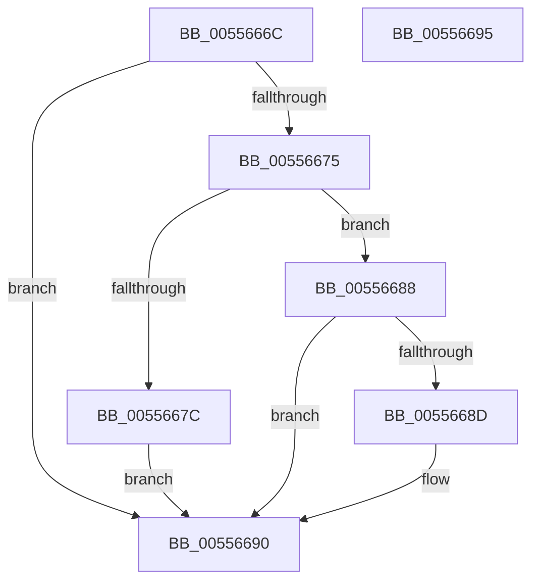

# HalpFreeDrsPool

- RVA: `0x0055666C`–`0x00556696` (길이 `42` bytes)
- VA: `0x000000014055666C`
- 실행 섹션: `.text`
- PDB 이름 있음: `예`; PDB Function 태그: `아니요`
- unwind 정보 RVA: `0x0005C788`
- 디코드: `15`개 명령, `42/42` bytes 표시
- 미해석 바이트: `0` (있으면 어셈블리에 `.byte`로 보존)

> 이 문서는 커널 이미지의 기계어와 PDB 기호를 분석해 생성했습니다. 4번과 5번은 함수 원형과 자료형을 바이너리 사용 방식에서 추정한 C 해석이며 원본 소스 복구 결과는 아닙니다.

## 1. Dependencies

- 직접 호출 지점: **1**; 고유 호출 대상: **1**
- 직접 호출자로 확인된 함수: **3**
- RIP 상대 이미지 참조: **0**

### Outgoing calls
- `0x00556681` → [ExFreePoolWithTag](../../poolcode/B8/ExFreePoolWithTag_function_00B82870.md) (function, `0x00B82870`)

### Direct callers
- [HalpErrorDeferredHandler](HalpErrorDeferredHandler_function_005565D0.md) at `0x00556606`
- [HalpErrorDeferredHandler](HalpErrorDeferredHandler_function_005565D0.md) at `0x00556621`
- [HalpMemoryErrorDeferredRecovery](HalpMemoryErrorDeferredRecovery_function_00556918.md) at `0x00556995`
- [HalpMemoryErrorDeferredRecovery](HalpMemoryErrorDeferredRecovery_function_00556918.md) at `0x005569FD`
- [HalpPmemErrorDeferredRecovery](HalpPmemErrorDeferredRecovery_function_00556B24.md) at `0x00556BCB`

### Static image references
- 디코드된 RIP-relative 메모리 참조가 없습니다.

## 2. Other-region calls and transfers

- 다른 실행 섹션으로 향하는 call: **1**
  - `0x00556681` → [ExFreePoolWithTag](../../poolcode/B8/ExFreePoolWithTag_function_00B82870.md) (`.text` → `POOLCODE`)
- 별도 외부 분기/꼬리 이동을 확인하지 못했습니다.

## 3. Assembly (complete function range)

```asm
0055666C  48 83 EC 28                     sub rsp, 0x28
00556670  48 85 C9                        test rcx, rcx
00556673  74 1B                           je 0x140556690
00556675  8B 01                           mov eax, dword ptr [rcx]
00556677  83 F8 FF                        cmp eax, -1
0055667A  75 0C                           jne 0x140556688
0055667C  BA 57 68 65 61                  mov edx, 0x61656857
00556681  E8 EA C1 62 00                  call 0x140b82870
00556686  EB 08                           jmp 0x140556690
00556688  83 F8 01                        cmp eax, 1
0055668B  75 03                           jne 0x140556690
0055668D  83 21 00                        and dword ptr [rcx], 0
00556690  48 83 C4 28                     add rsp, 0x28
00556694  C3                              ret
00556695  CC                              int3
```

## 4. C-style interpretation (structured pseudocode)

```c
__int64 __fastcall HalpFreeDrsPool(__int64 a1)
{
    __int64 result;
    __int64 v_rsp;

    v_rsp = (v_rsp) - (40);
    if (a1 == 0) goto loc_00556690;
    if (((unsigned int)((unsigned int)(*(unsigned int *)(a1)))) != -1) goto loc_00556688;
    result = ExFreePoolWithTag(a1, (unsigned int)(0x61656857ULL), a3, a4);
    goto loc_00556690;
loc_00556688:
    if (((unsigned int)(result)) == 1) {
    }
    v_rsp = (v_rsp) + (40);
    return result;
}
```

## 5. (Beta) C Style

```c
int64_t HalpFreeDrsPool(int64_t Arg1)
{
    int64_t result;
    int64_t local_rsp;

    local_rsp = (local_rsp) - (40);
    if (Arg1 == 0) goto loc_00556690;
    if (((uint32_t)((uint32_t)(*(uint32_t *)(Arg1)))) != -1) goto loc_00556688;
    result = ExFreePoolWithTag(Arg1, (uint32_t)(0x61656857ULL), a3, a4);
    goto loc_00556690;
loc_00556688:
    if (((uint32_t)(result)) == 1) {
    }
    local_rsp = (local_rsp) + (40);
    return result;
}
```

## 6. Execution-region graph

[열기: 2D/3D 그래프와 함수 탐색 컨트롤 패널](../../../control-panel.html?section=text&rva=0x0055666C&view=graph)

- 2D 그래프는 위에서 아래로 흐르고, 3D 그래프는 빈 공간을 드래그해 회전합니다. Shift+드래그는 이동, 휠은 확대·축소, 함수 노드 선택은 대상 보고서 이동입니다.

### Static fallback


