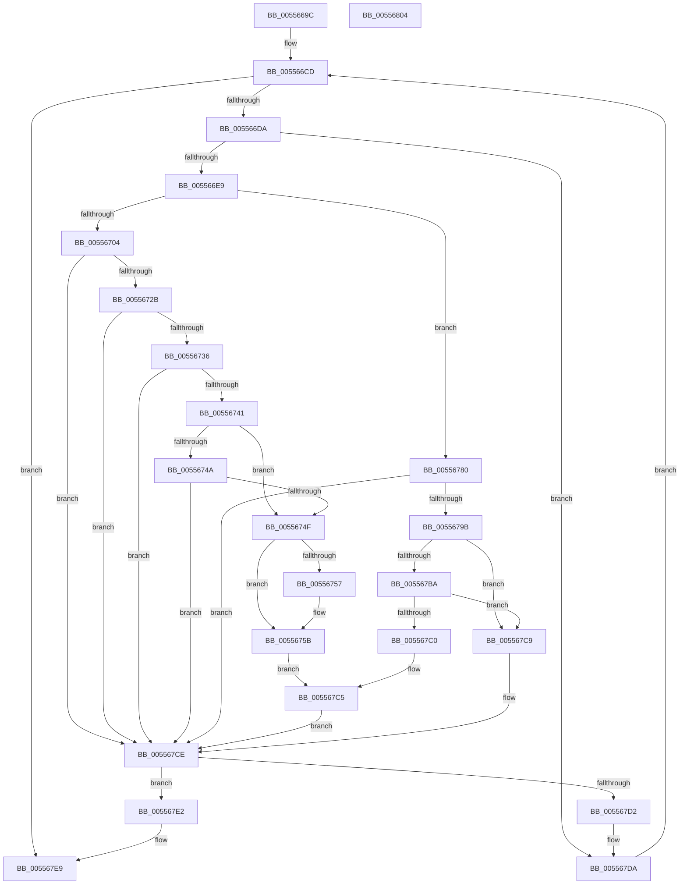

# HalpGenericErrorSourceRecovery

- RVA: `0x0055669C`–`0x00556805` (길이 `361` bytes)
- VA: `0x000000014055669C`
- 실행 섹션: `.text`
- PDB 이름 있음: `예`; PDB Function 태그: `아니요`
- unwind 정보 RVA: `0x00093E28`
- 디코드: `99`개 명령, `361/361` bytes 표시
- 미해석 바이트: `0` (있으면 어셈블리에 `.byte`로 보존)

> 이 문서는 커널 이미지의 기계어와 PDB 기호를 분석해 생성했습니다. 4번과 5번은 함수 원형과 자료형을 바이너리 사용 방식에서 추정한 C 해석이며 원본 소스 복구 결과는 아닙니다.

## 1. Dependencies

- 직접 호출 지점: **4**; 고유 호출 대상: **3**
- 직접 호출자로 확인된 함수: **1**
- RIP 상대 이미지 참조: **2**

### Outgoing calls
- `0x005566F9` → [RtlCompareMemory](../6B/RtlCompareMemory_function_006BA670.md) (function, `0x006BA670`)
- `0x00556779` → [HalpMemoryErrorDeferredRecovery](HalpMemoryErrorDeferredRecovery_function_00556918.md) (function, `0x00556918`)
- `0x00556790` → [RtlCompareMemory](../6B/RtlCompareMemory_function_006BA670.md) (function, `0x006BA670`)
- `0x005567C0` → [HalpPmemErrorDeferredRecovery](HalpPmemErrorDeferredRecovery_function_00556B24.md) (function, `0x00556B24`)

### Direct callers
- [HalpRequestGenericErrorRecovery](HalpRequestGenericErrorRecovery_function_00556C10.md) at `0x00556C14`

### Static image references
- `0x005566EF` → RVA `0x0001A738` (`.rdata`; read)
- `0x00556786` → RVA `0x00024818` (`.rdata`; read)

## 2. Other-region calls and transfers

- 다른 실행 섹션으로 향하는 call: **0**
- 별도 외부 분기/꼬리 이동을 확인하지 못했습니다.

## 3. Assembly (complete function range)

```asm
0055669C  48 89 5C 24 08                  mov qword ptr [rsp + 8], rbx
005566A1  48 89 6C 24 10                  mov qword ptr [rsp + 0x10], rbp
005566A6  48 89 74 24 18                  mov qword ptr [rsp + 0x18], rsi
005566AB  57                              push rdi
005566AC  41 56                           push r14
005566AE  41 57                           push r15
005566B0  48 83 EC 40                     sub rsp, 0x40
005566B4  48 8D A9 80 00 00 00            lea rbp, [rcx + 0x80]
005566BB  4C 8B FA                        mov r15, rdx
005566BE  48 8D 7D 10                     lea rdi, [rbp + 0x10]
005566C2  48 8B F1                        mov rsi, rcx
005566C5  BB BB 00 00 C0                  mov ebx, 0xc00000bb
005566CA  45 33 F6                        xor r14d, r14d
005566CD  0F B7 46 0A                     movzx eax, word ptr [rsi + 0xa]
005566D1  44 3B F0                        cmp r14d, eax
005566D4  0F 83 0F 01 00 00               jae 0x1405567e9
005566DA  8B 47 20                        mov eax, dword ptr [rdi + 0x20]
005566DD  83 E8 02                        sub eax, 2
005566E0  83 F8 01                        cmp eax, 1
005566E3  0F 86 F1 00 00 00               jbe 0x1405567da
005566E9  41 B8 10 00 00 00               mov r8d, 0x10
005566EF  48 8D 15 42 40 AC FF            lea rdx, [rip - 0x53bfbe]
005566F6  48 8B CF                        mov rcx, rdi
005566F9  E8 72 3F 16 00                  call 0x1406ba670
005566FE  48 83 F8 10                     cmp rax, 0x10
00556702  75 7C                           jne 0x140556780
00556704  8B 4D 00                        mov ecx, dword ptr [rbp]
00556707  45 33 C0                        xor r8d, r8d
0055670A  8B 57 F4                        mov edx, dword ptr [rdi - 0xc]
0055670D  BB BB 00 00 C0                  mov ebx, 0xc00000bb
00556712  8B 46 14                        mov eax, dword ptr [rsi + 0x14]
00556715  48 03 D1                        add rdx, rcx
00556718  48 03 CE                        add rcx, rsi
0055671B  48 3B C2                        cmp rax, rdx
0055671E  4C 0F 43 C1                     cmovae r8, rcx
00556722  4D 85 C0                        test r8, r8
00556725  0F 84 A3 00 00 00               je 0x1405567ce
0055672B  49 8B 00                        mov rax, qword ptr [r8]
0055672E  A8 02                           test al, 2
00556730  0F 84 98 00 00 00               je 0x1405567ce
00556736  48 0F BA E0 0E                  bt rax, 0xe
0055673B  0F 83 8D 00 00 00               jae 0x1405567ce
00556741  41 8A 48 09                     mov cl, byte ptr [r8 + 9]
00556745  80 F9 04                        cmp cl, 4
00556748  74 05                           je 0x14055674f
0055674A  80 F9 1A                        cmp cl, 0x1a
0055674D  75 7F                           jne 0x1405567ce
0055674F  49 8B 48 10                     mov rcx, qword ptr [r8 + 0x10]
00556753  A8 04                           test al, 4
00556755  74 04                           je 0x14055675b
00556757  49 23 48 18                     and rcx, qword ptr [r8 + 0x18]
0055675B  83 64 24 38 00                  and dword ptr [rsp + 0x38], 0
00556760  45 33 C9                        xor r9d, r9d
00556763  C6 44 24 30 01                  mov byte ptr [rsp + 0x30], 1
00556768  45 33 C0                        xor r8d, r8d
0055676B  C6 44 24 28 00                  mov byte ptr [rsp + 0x28], 0
00556770  33 D2                           xor edx, edx
00556772  66 C7 44 24 20 00 EF            mov word ptr [rsp + 0x20], 0xef00
00556779  E8 9A 01 00 00                  call 0x140556918
0055677E  EB 45                           jmp 0x1405567c5
00556780  41 B8 10 00 00 00               mov r8d, 0x10
00556786  48 8D 15 8B E0 AC FF            lea rdx, [rip - 0x531f75]
0055678D  48 8B CF                        mov rcx, rdi
00556790  E8 DB 3E 16 00                  call 0x1406ba670
00556795  48 83 F8 10                     cmp rax, 0x10
00556799  75 33                           jne 0x1405567ce
0055679B  8B 4D 00                        mov ecx, dword ptr [rbp]
0055679E  44 8B 47 F4                     mov r8d, dword ptr [rdi - 0xc]
005567A2  8B 46 14                        mov eax, dword ptr [rsi + 0x14]
005567A5  4C 03 C1                        add r8, rcx
005567A8  48 8D 14 31                     lea rdx, [rcx + rsi]
005567AC  33 C9                           xor ecx, ecx
005567AE  49 3B C0                        cmp rax, r8
005567B1  48 0F 43 CA                     cmovae rcx, rdx
005567B5  48 85 C9                        test rcx, rcx
005567B8  74 0F                           je 0x1405567c9
005567BA  83 79 54 00                     cmp dword ptr [rcx + 0x54], 0
005567BE  74 09                           je 0x1405567c9
005567C0  E8 5F 03 00 00                  call 0x140556b24
005567C5  8B D8                           mov ebx, eax
005567C7  EB 05                           jmp 0x1405567ce
005567C9  BB BB 00 00 C0                  mov ebx, 0xc00000bb
005567CE  85 DB                           test ebx, ebx
005567D0  79 10                           jns 0x1405567e2
005567D2  48 83 C5 48                     add rbp, 0x48
005567D6  48 83 C7 48                     add rdi, 0x48
005567DA  41 FF C6                        inc r14d
005567DD  E9 EB FE FF FF                  jmp 0x1405566cd
005567E2  41 C7 07 02 00 00 00            mov dword ptr [r15], 2
005567E9  48 8B 6C 24 68                  mov rbp, qword ptr [rsp + 0x68]
005567EE  8B C3                           mov eax, ebx
005567F0  48 8B 5C 24 60                  mov rbx, qword ptr [rsp + 0x60]
005567F5  48 8B 74 24 70                  mov rsi, qword ptr [rsp + 0x70]
005567FA  48 83 C4 40                     add rsp, 0x40
005567FE  41 5F                           pop r15
00556800  41 5E                           pop r14
00556802  5F                              pop rdi
00556803  C3                              ret
00556804  CC                              int3
```

## 4. C-style interpretation (structured pseudocode)

```c
__int64 __fastcall HalpGenericErrorSourceRecovery(__int64 a1, __int64 a2, __int64 a3, int a4)
{
    __int64 result;
    __int64 v_r14;
    __int64 v_rbp;
    __int64 v_rdi;
    __int64 v_rsp;
    unsigned int v_stack_m20;
    unsigned __int8 v_stack_m28;
    unsigned __int8 v_stack_m30;
    unsigned __int16 v_stack_m38;
    unsigned __int64 v_stack_p10;
    unsigned __int64 v_stack_p18;
    unsigned __int64 v_stack_p8;

    v_stack_p8 = v_rbx;
    v_stack_p10 = v_rbp;
    v_stack_p18 = v_rsi;
    v_rsp = (v_rsp) - (64);
    v_r14 = 0;
loc_005566CD:
    if (0 >= ((unsigned int)(*(unsigned __int16 *)(a1 + 10)))) goto loc_005567E9;
    result = (unsigned int)(((unsigned int)(*(unsigned int *)(a1 + 128 + 16 + 32))) - (2));
    if (((unsigned int)(result)) <= 1) goto loc_005567DA;
    result = RtlCompareMemory(a1 + 128 + 16, v_rip - 5488574, 16, a4);
    if (result != 16) goto loc_00556780;
    a3 = 0;
    a2 = ((unsigned int)(*(unsigned int *)(a1 + 128 + 16 - 12))) + ((unsigned int)(*(unsigned int *)(a1 + 128)));
    a1 = ((unsigned int)(*(unsigned int *)(a1 + 128))) + (a1);
    if (((unsigned int)(*(unsigned int *)(a1 + 20))) >= a2) { a3 = a1; }
    if (a3 == 0) goto loc_005567CE;
    if ((((unsigned __int8)(*(unsigned __int64 *)(a3))) & (2)) == 0) goto loc_005567CE;
    if (condition_is_above_or_equal) goto loc_005567CE;
    if (((unsigned __int8)(*(unsigned __int8 *)(a3 + 9))) == 4) goto loc_0055674F;
    if (((unsigned __int8)(*(unsigned __int8 *)(a3 + 9))) != 26) goto loc_005567CE;
loc_0055674F:
    if ((((unsigned __int8)(*(unsigned __int64 *)(a3))) & (4)) != 0) {
        a1 = (*(unsigned __int64 *)(a3 + 16)) & (*(unsigned __int64 *)(a3 + 24));
    }
    a4 = 0;
    v_stack_m28 = 1;
    a3 = 0;
    v_stack_m30 = 0;
    a2 = 0;
    v_stack_m38 = 0xEF00ULL;
    result = HalpMemoryErrorDeferredRecovery(a1, a2, a3, a4);
    goto loc_005567C5;
loc_00556780:
    result = RtlCompareMemory(a1 + 128 + 16, v_rip - 5447541, 16, a4);
    if (result != 16) goto loc_005567CE;
    a3 = ((unsigned int)(*(unsigned int *)(a1 + 128 + 16 - 12))) + ((unsigned int)(*(unsigned int *)(a1 + 128)));
    a1 = 0;
    if (((unsigned int)(*(unsigned int *)(a1 + 20))) >= a3) { a1 = (unsigned int)(*(unsigned int *)(a1 + 128)) + a1 * 1; }
    if (a1 == 0) goto loc_005567C9;
    if ((*(unsigned int *)(a1 + 84)) == 0) goto loc_005567C9;
    result = HalpPmemErrorDeferredRecovery(a1, (unsigned int)(*(unsigned int *)(a1 + 128)) + a1 * 1, a3, a4);
loc_005567C5:
    goto loc_005567CE;
loc_005567C9:
loc_005567CE:
    if (!sign_flag) goto loc_005567E2;
    v_rbp = (a1 + 128) + (72);
    v_rdi = (a1 + 128 + 16) + (72);
loc_005567DA:
    v_r14 = (unsigned int)((v_r14) + 1);
    goto loc_005566CD;
loc_005567E2:
    *(unsigned int *)(a2) = 2;
loc_005567E9:
    v_rsp = (v_rsp) + (64);
    return (unsigned int)((unsigned int)((unsigned int)(0xC00000BBULL)));
}
```

## 5. (Beta) C Style

```c
int64_t HalpGenericErrorSourceRecovery(void *Arg1, void *Arg2, int64_t Arg3, int32_t Arg4)
{
    uint8_t *arg1 = (uint8_t *)Arg1;
    uint8_t *arg2 = (uint8_t *)Arg2;

    int64_t result;
    int64_t local_r14;
    int64_t local_rbp;
    int64_t local_rdi;
    int64_t local_rsp;
    uint32_t v_stack_m20;
    uint8_t v_stack_m28;
    uint8_t v_stack_m30;
    uint16_t v_stack_m38;
    uint64_t v_stack_p10;
    uint64_t v_stack_p18;
    uint64_t v_stack_p8;

    v_stack_p8 = local_rbx;
    v_stack_p10 = local_rbp;
    v_stack_p18 = local_rsi;
    local_rsp = (local_rsp) - (64);
    local_r14 = 0;
loc_005566CD:
    if (0 >= ((uint32_t)(*(uint16_t *)(arg1 + 0xA)))) goto loc_005567E9;
    result = (uint32_t)(((uint32_t)(*(uint32_t *)(arg1 + 0x80 + 0x10 + 0x20))) - (2));
    if (((uint32_t)(result)) <= 1) goto loc_005567DA;
    result = RtlCompareMemory(Arg1 + 128 + 16, v_rip - 5488574, 16, Arg4);
    if (result != 16) goto loc_00556780;
    Arg3 = 0;
    Arg2 = ((uint32_t)(*(uint32_t *)(arg1 + 0x80 + 0x10 - 0xC))) + ((uint32_t)(*(uint32_t *)(arg1 + 0x80)));
    Arg1 = ((uint32_t)(*(uint32_t *)(arg1 + 0x80))) + (Arg1);
    if (((uint32_t)(*(uint32_t *)(arg1 + 0x14))) >= Arg2) { Arg3 = Arg1; }
    if (Arg3 == 0) goto loc_005567CE;
    if ((((uint8_t)(*(uint64_t *)(Arg3))) & (2)) == 0) goto loc_005567CE;
    if (condition_is_above_or_equal) goto loc_005567CE;
    if (((uint8_t)(*(uint8_t *)(Arg3 + 0x9))) == 4) goto loc_0055674F;
    if (((uint8_t)(*(uint8_t *)(Arg3 + 0x9))) != 26) goto loc_005567CE;
loc_0055674F:
    if ((((uint8_t)(*(uint64_t *)(Arg3))) & (4)) != 0) {
        Arg1 = (*(uint64_t *)(Arg3 + 0x10)) & (*(uint64_t *)(Arg3 + 0x18));
    }
    Arg4 = 0;
    v_stack_m28 = 1;
    Arg3 = 0;
    v_stack_m30 = 0;
    Arg2 = 0;
    v_stack_m38 = 0xEF00ULL;
    result = HalpMemoryErrorDeferredRecovery(Arg1, Arg2, Arg3, Arg4);
    goto loc_005567C5;
loc_00556780:
    result = RtlCompareMemory(Arg1 + 128 + 16, v_rip - 5447541, 16, Arg4);
    if (result != 16) goto loc_005567CE;
    Arg3 = ((uint32_t)(*(uint32_t *)(arg1 + 0x80 + 0x10 - 0xC))) + ((uint32_t)(*(uint32_t *)(arg1 + 0x80)));
    Arg1 = 0;
    if (((uint32_t)(*(uint32_t *)(arg1 + 0x14))) >= Arg3) { Arg1 = (uint32_t)(*(uint32_t *)(arg1 + 0x80)) + Arg1 * 1; }
    if (Arg1 == NULL) goto loc_005567C9;
    if ((*(uint32_t *)(arg1 + 0x54)) == 0) goto loc_005567C9;
    result = HalpPmemErrorDeferredRecovery(Arg1, (uint32_t)(*(uint32_t *)(arg1 + 0x80)) + Arg1 * 1, Arg3, Arg4);
loc_005567C5:
    goto loc_005567CE;
loc_005567C9:
loc_005567CE:
    if (!sign_flag) goto loc_005567E2;
    local_rbp = (Arg1 + 128) + (72);
    local_rdi = (Arg1 + 128 + 16) + (72);
loc_005567DA:
    local_r14 = (uint32_t)((local_r14) + 1);
    goto loc_005566CD;
loc_005567E2:
    *(uint32_t *)(arg2) = 2;
loc_005567E9:
    local_rsp = (local_rsp) + (64);
    return (uint32_t)((uint32_t)((uint32_t)(0xC00000BBULL)));
}
```

### 관측된 메모리 오프셋

구조체 형식이 확인되지 않은 접근은 인자 기준의 오프셋으로만 기록했습니다.

| 기준 인자 | 오프셋 표현 | 폭 (bit) | 접근 |
|---|---:|---:|---|
| `Arg1` | `- 0xC` | `32` | `R` |
| `Arg1` | `+ 0x0` | `32` | `R` |
| `Arg1` | `+ 0xA` | `16` | `R` |
| `Arg1` | `+ 0x10` | `64` | `R` |
| `Arg1` | `+ 0x14` | `32` | `R` |
| `Arg1` | `+ 0x20` | `32` | `R` |
| `Arg1` | `+ 0x80` | `64` | `R` |
| `Arg2` | `+ 0x0` | `32` | `W` |

## 6. Execution-region graph

[열기: 2D/3D 그래프와 함수 탐색 컨트롤 패널](../../../control-panel.html?section=text&rva=0x0055669C&view=graph)

- 2D 그래프는 위에서 아래로 흐르고, 3D 그래프는 빈 공간을 드래그해 회전합니다. Shift+드래그는 이동, 휠은 확대·축소, 함수 노드 선택은 대상 보고서 이동입니다.

### Static fallback


