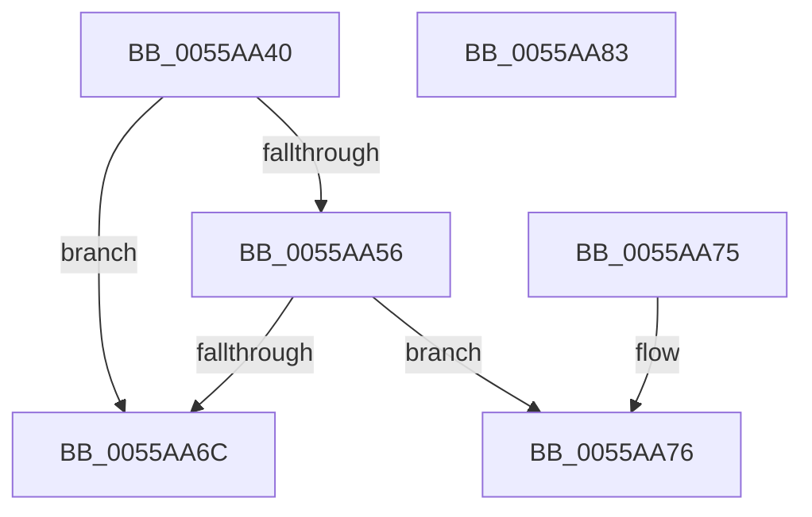

# HalpGetCurrentMicrocodePlatform

- RVA: `0x0055AA40`–`0x0055AA84` (길이 `68` bytes)
- VA: `0x000000014055AA40`
- 실행 섹션: `.text`
- PDB 이름 있음: `예`; PDB Function 태그: `아니요`
- unwind 정보 RVA: `0x000DB714`
- 디코드: `16`개 명령, `68/68` bytes 표시
- 미해석 바이트: `0` (있으면 어셈블리에 `.byte`로 보존)

> 이 문서는 커널 이미지의 기계어와 PDB 기호를 분석해 생성했습니다. 4번과 5번은 함수 원형과 자료형을 바이너리 사용 방식에서 추정한 C 해석이며 원본 소스 복구 결과는 아닙니다.

## 1. Dependencies

- 직접 호출 지점: **0**; 고유 호출 대상: **0**
- 직접 호출자로 확인된 함수: **2**
- RIP 상대 이미지 참조: **2**

### Outgoing calls
- 직접 디코드된 call 명령이 없습니다.

### Direct callers
- [HalpGetMicrocodePatchRecord](HalpGetMicrocodePatchRecord_function_0055AA8C.md) at `0x0055AABE`
- [HalpMcUpdateInitializeBSP](HalpMcUpdateInitializeBSP_function_0055B22C.md) at `0x0055B29B`

### Static image references
- `0x0055AA6C` → RVA `0x00F9053C` (`.data`; write)
- `0x0055AA76` → RVA `0x00F9053C` (`.data`; read/write)

## 2. Other-region calls and transfers

- 다른 실행 섹션으로 향하는 call: **0**
- 별도 외부 분기/꼬리 이동을 확인하지 못했습니다.

## 3. Assembly (complete function range)

```asm
0055AA40  65 48 8B 04 25 20 00 00 00      mov rax, qword ptr gs:[0x20]
0055AA49  B9 01 00 00 00                  mov ecx, 1
0055AA4E  38 88 8D 00 00 00               cmp byte ptr [rax + 0x8d], cl
0055AA54  74 16                           je 0x14055aa6c
0055AA56  65 48 8B 04 25 20 00 00 00      mov rax, qword ptr gs:[0x20]
0055AA5F  B9 02 00 00 00                  mov ecx, 2
0055AA64  38 88 8D 00 00 00               cmp byte ptr [rax + 0x8d], cl
0055AA6A  75 0A                           jne 0x14055aa76
0055AA6C  89 0D CA 5A A3 00               mov dword ptr [rip + 0xa35aca], ecx
0055AA72  33 C0                           xor eax, eax
0055AA74  C3                              ret
0055AA75  CC                              int3
0055AA76  83 25 BF 5A A3 00 00            and dword ptr [rip + 0xa35abf], 0
0055AA7D  B8 BB 00 00 C0                  mov eax, 0xc00000bb
0055AA82  C3                              ret
0055AA83  CC                              int3
```

## 4. C-style interpretation (structured pseudocode)

```c
__int64 __fastcall HalpGetCurrentMicrocodePlatform(void)
{
    __int64 result;

    if ((*(unsigned __int8 *)(*(unsigned __int64 *)(gs_base + (0 + 32)) + 141)) == 1) goto loc_0055AA6C;
    if ((*(unsigned __int8 *)(*(unsigned __int64 *)(gs_base + (0 + 32)) + 141)) != 2) goto loc_0055AA76;
loc_0055AA6C:
    *(unsigned int *)(v_rip + 10705610) = 2;
    result = 0;
    return result;
loc_0055AA76:
    return (unsigned int)(0xC00000BBULL);
}
```

## 5. (Beta) C Style

```c
void HalpGetCurrentMicrocodePlatform(void)
{
    int64_t result;

    if ((*(uint8_t *)(*(uint64_t *)(gs_base + (0 + 0x20)) + 0x8D)) == 1) goto loc_0055AA6C;
    if ((*(uint8_t *)(*(uint64_t *)(gs_base + (0 + 0x20)) + 0x8D)) != 2) goto loc_0055AA76;
loc_0055AA6C:
    *(uint32_t *)(v_rip + 0xA35ACA) = 2;
    result = 0;
    return result;
loc_0055AA76:
    return (uint32_t)(0xC00000BBULL);
}
```

## 6. Execution-region graph

[열기: 2D/3D 그래프와 함수 탐색 컨트롤 패널](../../../control-panel.html?section=text&rva=0x0055AA40&view=graph)

- 2D 그래프는 위에서 아래로 흐르고, 3D 그래프는 빈 공간을 드래그해 회전합니다. Shift+드래그는 이동, 휠은 확대·축소, 함수 노드 선택은 대상 보고서 이동입니다.

### Static fallback


