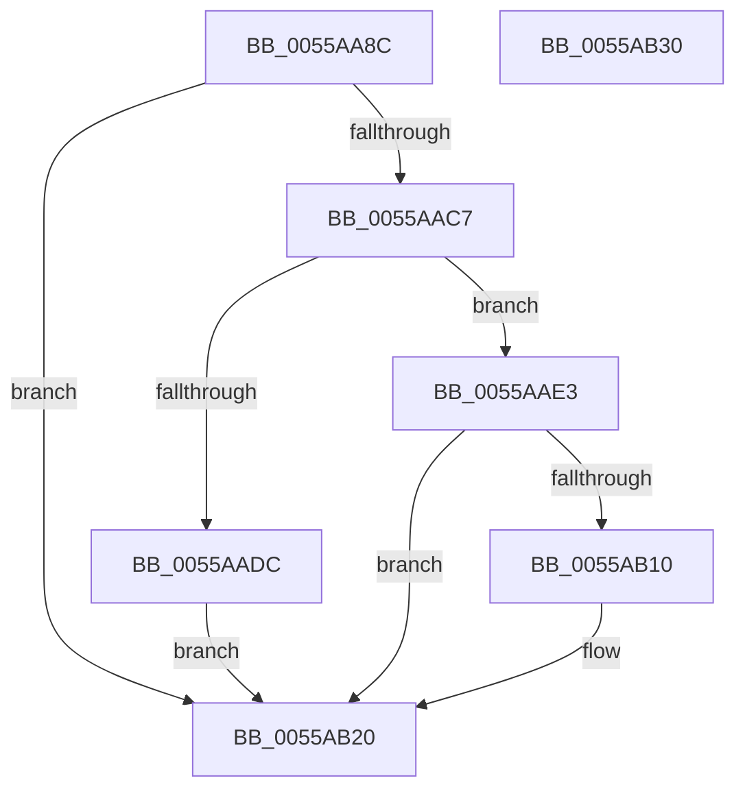

# HalpGetMicrocodePatchRecord

- RVA: `0x0055AA8C`–`0x0055AB31` (길이 `165` bytes)
- VA: `0x000000014055AA8C`
- 실행 섹션: `.text`
- PDB 이름 있음: `예`; PDB Function 태그: `아니요`
- unwind 정보 RVA: `0x000C47A0`
- 디코드: `47`개 명령, `165/165` bytes 표시
- 미해석 바이트: `0` (있으면 어셈블리에 `.byte`로 보존)

> 이 문서는 커널 이미지의 기계어와 PDB 기호를 분석해 생성했습니다. 4번과 5번은 함수 원형과 자료형을 바이너리 사용 방식에서 추정한 C 해석이며 원본 소스 복구 결과는 아닙니다.

## 1. Dependencies

- 직접 호출 지점: **3**; 고유 호출 대상: **3**
- 직접 호출자로 확인된 함수: **1**
- RIP 상대 이미지 참조: **0**

### Outgoing calls
- `0x0055AABE` → [HalpGetCurrentMicrocodePlatform](HalpGetCurrentMicrocodePlatform_function_0055AA40.md) (function, `0x0055AA40`)
- `0x0055AAD3` → [PrExtExtractDataRecordTable](../66/PrExtExtractDataRecordTable_function_00666C4C.md) (function, `0x00666C4C`)
- `0x0055AB00` → [PrExtGetRecord](../66/PrExtGetRecord_function_00666CE8.md) (function, `0x00666CE8`)

### Direct callers
- [HalpLoadMicrocode](../../page/70/HalpLoadMicrocode_function_0070B200.md) at `0x0070B29B`

### Static image references
- 디코드된 RIP-relative 메모리 참조가 없습니다.

## 2. Other-region calls and transfers

- 다른 실행 섹션으로 향하는 call: **0**
- 별도 외부 분기/꼬리 이동을 확인하지 못했습니다.

## 3. Assembly (complete function range)

```asm
0055AA8C  48 89 5C 24 08                  mov qword ptr [rsp + 8], rbx
0055AA91  48 89 7C 24 10                  mov qword ptr [rsp + 0x10], rdi
0055AA96  55                              push rbp
0055AA97  48 8B EC                        mov rbp, rsp
0055AA9A  48 83 EC 50                     sub rsp, 0x50
0055AA9E  48 83 65 E8 00                  and qword ptr [rbp - 0x18], 0
0055AAA3  49 8B D8                        mov rbx, r8
0055AAA6  83 65 28 00                     and dword ptr [rbp + 0x28], 0
0055AAAA  48 8B FA                        mov rdi, rdx
0055AAAD  83 65 E0 00                     and dword ptr [rbp - 0x20], 0
0055AAB1  4C 8B C9                        mov r9, rcx
0055AAB4  48 83 65 F0 00                  and qword ptr [rbp - 0x10], 0
0055AAB9  48 83 65 F8 00                  and qword ptr [rbp - 8], 0
0055AABE  E8 7D FF FF FF                  call 0x14055aa40
0055AAC3  85 C0                           test eax, eax
0055AAC5  78 59                           js 0x14055ab20
0055AAC7  49 8B 49 30                     mov rcx, qword ptr [r9 + 0x30]
0055AACB  4C 8D 45 28                     lea r8, [rbp + 0x28]
0055AACF  48 8D 55 E8                     lea rdx, [rbp - 0x18]
0055AAD3  E8 74 C1 10 00                  call 0x140666c4c
0055AAD8  85 C0                           test eax, eax
0055AADA  79 07                           jns 0x14055aae3
0055AADC  B8 01 00 00 C0                  mov eax, 0xc0000001
0055AAE1  EB 3D                           jmp 0x14055ab20
0055AAE3  8B 55 28                        mov edx, dword ptr [rbp + 0x28]
0055AAE6  48 8D 45 E0                     lea rax, [rbp - 0x20]
0055AAEA  48 8B 4D E8                     mov rcx, qword ptr [rbp - 0x18]
0055AAEE  4C 8D 4D F0                     lea r9, [rbp - 0x10]
0055AAF2  48 89 44 24 28                  mov qword ptr [rsp + 0x28], rax
0055AAF7  48 8D 45 F8                     lea rax, [rbp - 8]
0055AAFB  48 89 44 24 20                  mov qword ptr [rsp + 0x20], rax
0055AB00  E8 E3 C1 10 00                  call 0x140666ce8
0055AB05  8B C8                           mov ecx, eax
0055AB07  B8 0D 00 00 C0                  mov eax, 0xc000000d
0055AB0C  3B C8                           cmp ecx, eax
0055AB0E  74 10                           je 0x14055ab20
0055AB10  48 8B 45 F0                     mov rax, qword ptr [rbp - 0x10]
0055AB14  48 89 07                        mov qword ptr [rdi], rax
0055AB17  48 8B 45 F8                     mov rax, qword ptr [rbp - 8]
0055AB1B  48 89 03                        mov qword ptr [rbx], rax
0055AB1E  8B C1                           mov eax, ecx
0055AB20  48 8B 5C 24 60                  mov rbx, qword ptr [rsp + 0x60]
0055AB25  48 8B 7C 24 68                  mov rdi, qword ptr [rsp + 0x68]
0055AB2A  48 83 C4 50                     add rsp, 0x50
0055AB2E  5D                              pop rbp
0055AB2F  C3                              ret
0055AB30  CC                              int3
```

## 4. C-style interpretation (structured pseudocode)

```c
__int64 __fastcall HalpGetMicrocodePatchRecord(__int64 a1, __int64 a2, __int64 a3)
{
    __int64 result;
    __int64 v_rsp;
    unsigned __int64 v_stack_m10;
    unsigned __int64 v_stack_m18;
    unsigned __int64 v_stack_m20;
    unsigned int v_stack_m28;
    unsigned __int64 v_stack_m30;
    unsigned __int64 v_stack_m38;
    unsigned __int64 v_stack_p10;
    unsigned int v_stack_p20;
    unsigned __int64 v_stack_p8;

    v_stack_p8 = v_rbx;
    v_stack_p10 = v_rdi;
    v_rsp = (v_rsp) - (80);
    result = HalpGetCurrentMicrocodePlatform(a1, a2, a3, a1);
    if (sign_flag) goto loc_0055AB20;
    result = PrExtExtractDataRecordTable(*(unsigned __int64 *)(a1 + 48), v_stack_m20, v_stack_p20, a1);
    if (!sign_flag) goto loc_0055AAE3;
    goto loc_0055AB20;
loc_0055AAE3:
    v_stack_m30 = v_stack_m28;
    v_stack_m38 = v_stack_m10;
    result = PrExtGetRecord(v_stack_m20, (unsigned int)(v_stack_p20), v_stack_p20, v_stack_m18);
    result = (unsigned int)(0xC000000DULL);
    if (((unsigned int)((unsigned int)((unsigned int)(result)))) != ((unsigned int)((unsigned int)(0xC000000DULL)))) {
        result = v_stack_m18;
        *(unsigned __int64 *)(a2) = result;
        result = v_stack_m10;
        *(unsigned __int64 *)(a3) = result;
        result = (unsigned int)((unsigned int)((unsigned int)(result)));
    }
    v_rsp = (v_rsp) + (80);
    return result;
}
```

## 5. (Beta) C Style

```c
int64_t HalpGetMicrocodePatchRecord(int64_t Arg1, void *Arg2, void *Arg3)
{
    uint8_t *arg2 = (uint8_t *)Arg2;
    uint8_t *arg3 = (uint8_t *)Arg3;

    int64_t result;
    int64_t local_rsp;
    uint64_t v_stack_m10;
    uint64_t v_stack_m18;
    uint64_t v_stack_m20;
    uint32_t v_stack_m28;
    uint64_t v_stack_m30;
    uint64_t v_stack_m38;
    uint64_t v_stack_p10;
    uint32_t v_stack_p20;
    uint64_t v_stack_p8;

    v_stack_p8 = local_rbx;
    v_stack_p10 = local_rdi;
    local_rsp = (local_rsp) - (80);
    result = HalpGetCurrentMicrocodePlatform(Arg1, Arg2, Arg3, Arg1);
    if (sign_flag) goto loc_0055AB20;
    result = PrExtExtractDataRecordTable(*(uint64_t *)(Arg1 + 0x30), v_stack_m20, v_stack_p20, Arg1);
    if (!sign_flag) goto loc_0055AAE3;
    goto loc_0055AB20;
loc_0055AAE3:
    v_stack_m30 = v_stack_m28;
    v_stack_m38 = v_stack_m10;
    result = PrExtGetRecord(v_stack_m20, (uint32_t)(v_stack_p20), v_stack_p20, v_stack_m18);
    result = (uint32_t)(0xC000000DULL);
    if (((uint32_t)((uint32_t)((uint32_t)(result)))) != ((uint32_t)((uint32_t)(0xC000000DULL)))) {
        result = v_stack_m18;
        *(uint64_t *)(arg2) = result;
        result = v_stack_m10;
        *(uint64_t *)(arg3) = result;
        result = (uint32_t)((uint32_t)((uint32_t)(result)));
    }
    local_rsp = (local_rsp) + (80);
    return result;
}
```

### 관측된 메모리 오프셋

구조체 형식이 확인되지 않은 접근은 인자 기준의 오프셋으로만 기록했습니다.

| 기준 인자 | 오프셋 표현 | 폭 (bit) | 접근 |
|---|---:|---:|---|
| `Arg2` | `+ 0x0` | `64` | `W` |
| `Arg3` | `+ 0x0` | `64` | `W` |

## 6. Execution-region graph

[열기: 2D/3D 그래프와 함수 탐색 컨트롤 패널](../../../control-panel.html?section=text&rva=0x0055AA8C&view=graph)

- 2D 그래프는 위에서 아래로 흐르고, 3D 그래프는 빈 공간을 드래그해 회전합니다. Shift+드래그는 이동, 휠은 확대·축소, 함수 노드 선택은 대상 보고서 이동입니다.

### Static fallback


