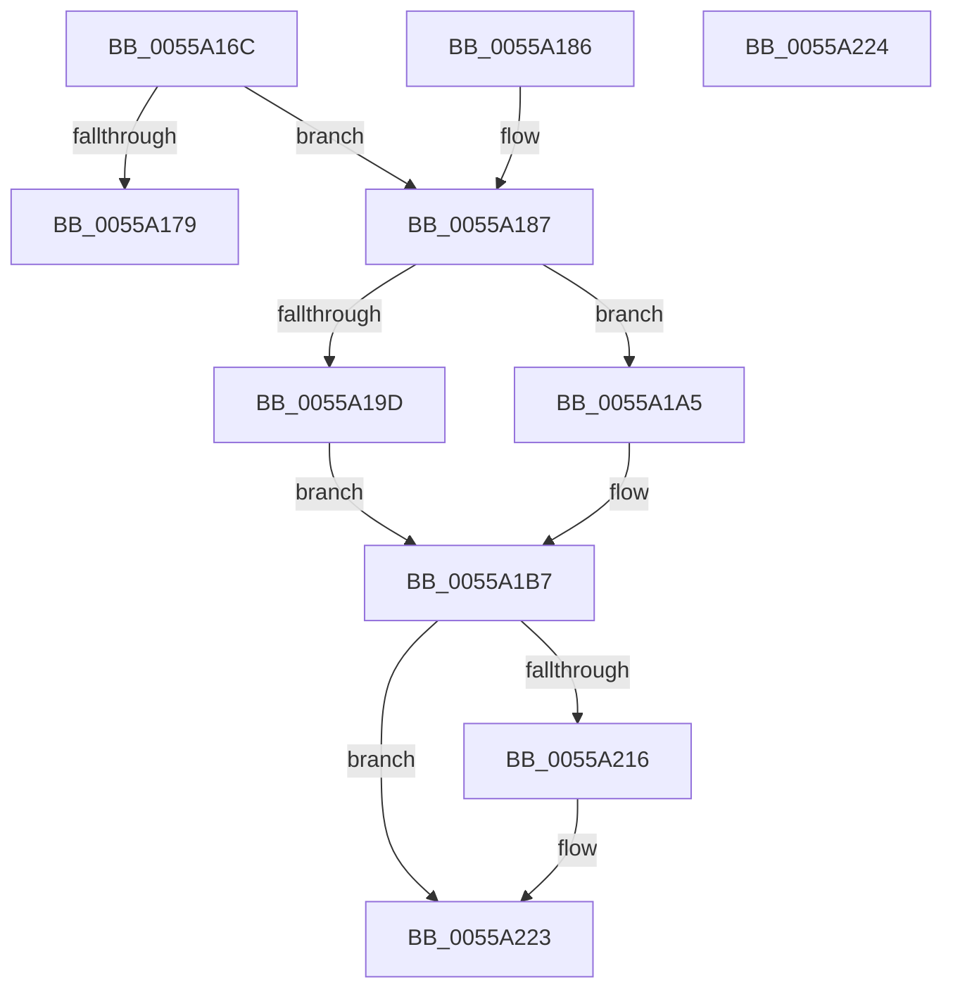

# HalpHvInitSegRegister

- RVA: `0x0055A16C`–`0x0055A225` (길이 `185` bytes)
- VA: `0x000000014055A16C`
- 실행 섹션: `.text`
- PDB 이름 있음: `예`; PDB Function 태그: `아니요`
- unwind 정보 RVA: `0x000DB714`
- 디코드: `47`개 명령, `185/185` bytes 표시
- 미해석 바이트: `0` (있으면 어셈블리에 `.byte`로 보존)

> 이 문서는 커널 이미지의 기계어와 PDB 기호를 분석해 생성했습니다. 4번과 5번은 함수 원형과 자료형을 바이너리 사용 방식에서 추정한 C 해석이며 원본 소스 복구 결과는 아닙니다.

## 1. Dependencies

- 직접 호출 지점: **0**; 고유 호출 대상: **0**
- 직접 호출자로 확인된 함수: **1**
- RIP 상대 이미지 참조: **0**

### Outgoing calls
- 직접 디코드된 call 명령이 없습니다.

### Direct callers
- [HalpHvStartProcessor](HalpHvStartProcessor_function_0055A23C.md) at `0x0055A2EE`
- [HalpHvStartProcessor](HalpHvStartProcessor_function_0055A23C.md) at `0x0055A302`
- [HalpHvStartProcessor](HalpHvStartProcessor_function_0055A23C.md) at `0x0055A316`
- [HalpHvStartProcessor](HalpHvStartProcessor_function_0055A23C.md) at `0x0055A32A`
- [HalpHvStartProcessor](HalpHvStartProcessor_function_0055A23C.md) at `0x0055A33D`
- [HalpHvStartProcessor](HalpHvStartProcessor_function_0055A23C.md) at `0x0055A350`
- [HalpHvStartProcessor](HalpHvStartProcessor_function_0055A23C.md) at `0x0055A363`
- [HalpHvStartProcessor](HalpHvStartProcessor_function_0055A23C.md) at `0x0055A37A`

### Static image references
- 디코드된 RIP-relative 메모리 참조가 없습니다.

## 2. Other-region calls and transfers

- 다른 실행 섹션으로 향하는 call: **0**
- 별도 외부 분기/꼬리 이동을 확인하지 못했습니다.

## 3. Assembly (complete function range)

```asm
0055A16C  45 33 D2                        xor r10d, r10d
0055A16F  66 41 89 50 0C                  mov word ptr [r8 + 0xc], dx
0055A174  66 85 D2                        test dx, dx
0055A177  75 0E                           jne 0x14055a187
0055A179  4D 89 10                        mov qword ptr [r8], r10
0055A17C  45 89 50 08                     mov dword ptr [r8 + 8], r10d
0055A180  66 45 89 50 0E                  mov word ptr [r8 + 0xe], r10w
0055A185  C3                              ret
0055A186  CC                              int3
0055A187  4C 8B 49 08                     mov r9, qword ptr [rcx + 8]
0055A18B  0F B7 D2                        movzx edx, dx
0055A18E  48 C1 EA 03                     shr rdx, 3
0055A192  41 F7 44 D1 04 00 10 00 00      test dword ptr [r9 + rdx*8 + 4], 0x1000
0055A19B  74 08                           je 0x14055a1a5
0055A19D  41 0F B6 4C D1 07               movzx ecx, byte ptr [r9 + rdx*8 + 7]
0055A1A3  EB 12                           jmp 0x14055a1b7
0055A1A5  41 8B 4C D1 08                  mov ecx, dword ptr [r9 + rdx*8 + 8]
0055A1AA  41 0F B6 44 D1 07               movzx eax, byte ptr [r9 + rdx*8 + 7]
0055A1B0  48 C1 E1 08                     shl rcx, 8
0055A1B4  48 0B C8                        or rcx, rax
0055A1B7  41 0F B6 44 D1 04               movzx eax, byte ptr [r9 + rdx*8 + 4]
0055A1BD  48 C1 E1 08                     shl rcx, 8
0055A1C1  48 0B C8                        or rcx, rax
0055A1C4  41 0F B7 44 D1 02               movzx eax, word ptr [r9 + rdx*8 + 2]
0055A1CA  48 C1 E1 10                     shl rcx, 0x10
0055A1CE  48 0B C8                        or rcx, rax
0055A1D1  49 89 08                        mov qword ptr [r8], rcx
0055A1D4  41 0F B7 04 D1                  movzx eax, word ptr [r9 + rdx*8]
0055A1D9  41 8B 4C D1 04                  mov ecx, dword ptr [r9 + rdx*8 + 4]
0055A1DE  66 45 89 50 0E                  mov word ptr [r8 + 0xe], r10w
0055A1E3  81 E1 00 00 0F 00               and ecx, 0xf0000
0055A1E9  0B C8                           or ecx, eax
0055A1EB  41 89 48 08                     mov dword ptr [r8 + 8], ecx
0055A1EF  41 0F B6 44 D1 05               movzx eax, byte ptr [r9 + rdx*8 + 5]
0055A1F5  66 41 89 40 0E                  mov word ptr [r8 + 0xe], ax
0055A1FA  41 0F B6 54 D1 06               movzx edx, byte ptr [r9 + rdx*8 + 6]
0055A200  66 C1 E2 08                     shl dx, 8
0055A204  66 0B D0                        or dx, ax
0055A207  B8 FF F0 00 00                  mov eax, 0xf0ff
0055A20C  66 23 D0                        and dx, ax
0055A20F  66 41 89 50 0E                  mov word ptr [r8 + 0xe], dx
0055A214  7D 0D                           jge 0x14055a223
0055A216  C1 E1 0C                        shl ecx, 0xc
0055A219  81 C1 FF 0F 00 00               add ecx, 0xfff
0055A21F  41 89 48 08                     mov dword ptr [r8 + 8], ecx
0055A223  C3                              ret
0055A224  CC                              int3
```

## 4. C-style interpretation (structured pseudocode)

```c
__int64 __fastcall HalpHvInitSegRegister(__int64 a1, unsigned __int16 a2, __int64 a3)
{
    __int64 v_r10;

    v_r10 = 0;
    *(unsigned __int16 *)(a3 + 12) = a2;
    if (a2 != 0) goto loc_0055A187;
    *(unsigned __int64 *)(a3) = 0;
    *(unsigned int *)(a3 + 8) = 0;
    *(unsigned __int16 *)(a3 + 14) = 0;
    return result;
loc_0055A187:
    a2 = (a2) >> (3);
    if (((*(unsigned int *)(*(unsigned __int64 *)(a1 + 8) + a2 * 8 + 4)) & (0x1000ULL)) == 0) goto loc_0055A1A5;
    goto loc_0055A1B7;
loc_0055A1A5:
    a1 = ((unsigned int)(*(unsigned int *)(*(unsigned __int64 *)(a1 + 8) + a2 * 8 + 8))) << (8);
    a1 = (a1) | (*(unsigned __int8 *)(*(unsigned __int64 *)(a1 + 8) + a2 * 8 + 7));
loc_0055A1B7:
    a1 = (a1) << (8);
    a1 = (a1) | (*(unsigned __int8 *)(*(unsigned __int64 *)(a1 + 8) + a2 * 8 + 4));
    a1 = (a1) << (16);
    a1 = (a1) | (*(unsigned __int16 *)(*(unsigned __int64 *)(a1 + 8) + a2 * 8 + 2));
    *(unsigned __int64 *)(a3) = a1;
    *(unsigned __int16 *)(a3 + 14) = 0;
    a1 = (unsigned int)(((unsigned int)(*(unsigned int *)(*(unsigned __int64 *)(a1 + 8) + a2 * 8 + 4))) & (0xF0000ULL));
    a1 = (unsigned int)((a1) | ((unsigned int)(*(unsigned __int16 *)(*(unsigned __int64 *)(a1 + 8) + a2 * 8))));
    *(unsigned int *)(a3 + 8) = (unsigned int)(a1);
    *(unsigned __int16 *)(a3 + 14) = (unsigned __int16)(*(unsigned __int8 *)(*(unsigned __int64 *)(a1 + 8) + a2 * 8 + 5));
    a2 = (unsigned __int16)((*(unsigned __int8 *)(*(unsigned __int64 *)(a1 + 8) + a2 * 8 + 6)) << (8));
    a2 = (unsigned __int16)((a2) | ((unsigned __int16)(*(unsigned __int8 *)(*(unsigned __int64 *)(a1 + 8) + a2 * 8 + 5))));
    a2 = (unsigned __int16)((a2) & ((unsigned __int16)((unsigned int)(0xF0FFULL))));
    *(unsigned __int16 *)(a3 + 14) = a2;
    if (!(condition_is_greater_or_equal)) {
        a1 = (unsigned int)((a1) << (12));
        a1 = (unsigned int)((a1) + (0xFFFULL));
        *(unsigned int *)(a3 + 8) = (unsigned int)(a1);
    }
    return (unsigned int)(0xF0FFULL);
}
```

## 5. (Beta) C Style

```c
int64_t HalpHvInitSegRegister(void *Arg1, uint16_t Arg2, void *Arg3)
{
    uint8_t *arg1 = (uint8_t *)Arg1;
    uint8_t *arg3 = (uint8_t *)Arg3;

    int64_t local_r10;

    local_r10 = 0;
    *(uint16_t *)(arg3 + 0xC) = Arg2;
    if (Arg2 != 0) goto loc_0055A187;
    *(uint64_t *)(arg3) = 0;
    *(uint32_t *)(arg3 + 0x8) = 0;
    *(uint16_t *)(arg3 + 0xE) = 0;
    return result;
loc_0055A187:
    Arg2 = (Arg2) >> (3);
    if (((*(uint32_t *)(*(uint64_t *)(arg1 + 0x8) + Arg2 * 8 + 0x4)) & (0x1000ULL)) == 0) goto loc_0055A1A5;
    goto loc_0055A1B7;
loc_0055A1A5:
    Arg1 = ((uint32_t)(*(uint32_t *)(*(uint64_t *)(arg1 + 0x8) + Arg2 * 8 + 0x8))) << (8);
    Arg1 = (Arg1) | (*(uint8_t *)(*(uint64_t *)(arg1 + 0x8) + Arg2 * 8 + 0x7));
loc_0055A1B7:
    Arg1 = (Arg1) << (8);
    Arg1 = (Arg1) | (*(uint8_t *)(*(uint64_t *)(arg1 + 0x8) + Arg2 * 8 + 0x4));
    Arg1 = (Arg1) << (16);
    Arg1 = (Arg1) | (*(uint16_t *)(*(uint64_t *)(arg1 + 0x8) + Arg2 * 8 + 0x2));
    *(void **)(arg3) = Arg1;
    *(uint16_t *)(arg3 + 0xE) = 0;
    Arg1 = (uint32_t)(((uint32_t)(*(uint32_t *)(*(uint64_t *)(arg1 + 0x8) + Arg2 * 8 + 0x4))) & (0xF0000ULL));
    Arg1 = (uint32_t)((Arg1) | ((uint32_t)(*(uint16_t *)(*(uint64_t *)(arg1 + 0x8) + Arg2 * 8))));
    *(uint32_t *)(arg3 + 0x8) = (uint32_t)(Arg1);
    *(uint16_t *)(arg3 + 0xE) = (uint16_t)(*(uint8_t *)(*(uint64_t *)(arg1 + 0x8) + Arg2 * 8 + 0x5));
    Arg2 = (uint16_t)((*(uint8_t *)(*(uint64_t *)(arg1 + 0x8) + Arg2 * 8 + 0x6)) << (8));
    Arg2 = (uint16_t)((Arg2) | ((uint16_t)(*(uint8_t *)(*(uint64_t *)(arg1 + 0x8) + Arg2 * 8 + 0x5))));
    Arg2 = (uint16_t)((Arg2) & ((uint16_t)((uint32_t)(0xF0FFULL))));
    *(uint16_t *)(arg3 + 0xE) = Arg2;
    if (!(condition_is_greater_or_equal)) {
        Arg1 = (uint32_t)((Arg1) << (12));
        Arg1 = (uint32_t)((Arg1) + (0xFFFULL));
        *(uint32_t *)(arg3 + 0x8) = (uint32_t)(Arg1);
    }
    return (uint32_t)(0xF0FFULL);
}
```

### 관측된 메모리 오프셋

구조체 형식이 확인되지 않은 접근은 인자 기준의 오프셋으로만 기록했습니다.

| 기준 인자 | 오프셋 표현 | 폭 (bit) | 접근 |
|---|---:|---:|---|
| `Arg1` | `+ 0x8` | `64` | `R` |
| `Arg3` | `+ 0x0` | `64` | `W` |
| `Arg3` | `+ 0x8` | `32` | `W` |
| `Arg3` | `+ 0xC` | `16` | `W` |
| `Arg3` | `+ 0xE` | `16` | `W` |

## 6. Execution-region graph

[열기: 2D/3D 그래프와 함수 탐색 컨트롤 패널](../../../control-panel.html?section=text&rva=0x0055A16C&view=graph)

- 2D 그래프는 위에서 아래로 흐르고, 3D 그래프는 빈 공간을 드래그해 회전합니다. Shift+드래그는 이동, 휠은 확대·축소, 함수 노드 선택은 대상 보고서 이동입니다.

### Static fallback


