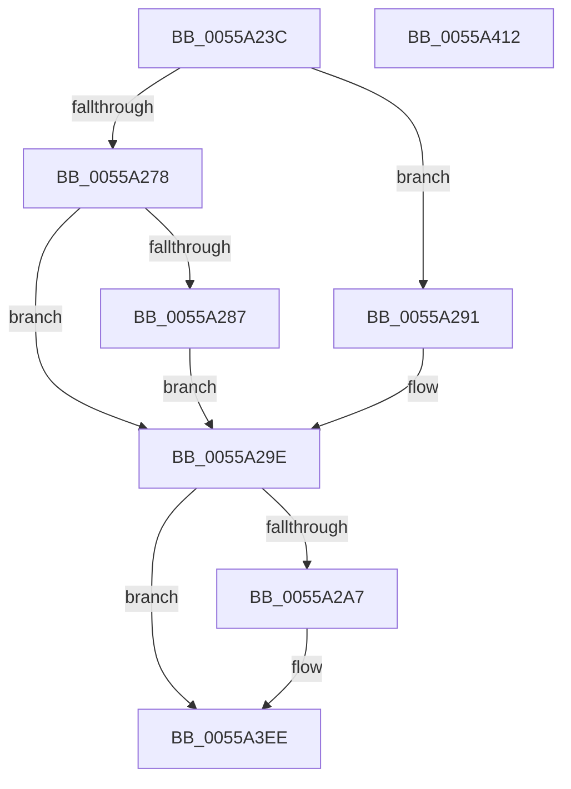

# HalpHvStartProcessor

- RVA: `0x0055A23C`–`0x0055A413` (길이 `471` bytes)
- VA: `0x000000014055A23C`
- 실행 섹션: `.text`
- PDB 이름 있음: `예`; PDB Function 태그: `아니요`
- unwind 정보 RVA: `0x000C475C`
- 디코드: `103`개 명령, `471/471` bytes 표시
- 미해석 바이트: `0` (있으면 어셈블리에 `.byte`로 보존)

> 이 문서는 커널 이미지의 기계어와 PDB 기호를 분석해 생성했습니다. 4번과 5번은 함수 원형과 자료형을 바이너리 사용 방식에서 추정한 C 해석이며 원본 소스 복구 결과는 아닙니다.

## 1. Dependencies

- 직접 호출 지점: **13**; 고유 호출 대상: **6**
- 직접 호출자로 확인된 함수: **1**
- RIP 상대 이미지 참조: **3**

### Outgoing calls
- `0x0055A27E` → [HalpIsXboxNanovisorPresent](../54/HalpIsXboxNanovisorPresent_function_0054C3C0.md) (function, `0x0054C3C0`)
- `0x0055A296` → [guard_dispatch_icall](../6B/guard_dispatch_icall_function_006BAAD0.md) (function, `0x006BAAD0`)
- `0x0055A2B4` → [memset](../6C/memset_function_006C6C40.md) (function, `0x006C6C40`)
- `0x0055A2EE` → [HalpHvInitSegRegister](HalpHvInitSegRegister_function_0055A16C.md) (function, `0x0055A16C`)
- `0x0055A302` → [HalpHvInitSegRegister](HalpHvInitSegRegister_function_0055A16C.md) (function, `0x0055A16C`)
- `0x0055A316` → [HalpHvInitSegRegister](HalpHvInitSegRegister_function_0055A16C.md) (function, `0x0055A16C`)
- `0x0055A32A` → [HalpHvInitSegRegister](HalpHvInitSegRegister_function_0055A16C.md) (function, `0x0055A16C`)
- `0x0055A33D` → [HalpHvInitSegRegister](HalpHvInitSegRegister_function_0055A16C.md) (function, `0x0055A16C`)
- `0x0055A350` → [HalpHvInitSegRegister](HalpHvInitSegRegister_function_0055A16C.md) (function, `0x0055A16C`)
- `0x0055A363` → [HalpHvInitSegRegister](HalpHvInitSegRegister_function_0055A16C.md) (function, `0x0055A16C`)
- `0x0055A37A` → [HalpHvInitSegRegister](HalpHvInitSegRegister_function_0055A16C.md) (function, `0x0055A16C`)
- `0x0055A3E6` → [HalpHvStartVirtualProcessor](../54/HalpHvStartVirtualProcessor_function_0054CF98.md) (function, `0x0054CF98`)
- `0x0055A3F8` → [_security_check_cookie](../6A/_security_check_cookie_function_006AC640.md) (function, `0x006AC640`)

### Direct callers
- [HalpInterruptStartProcessor](../../pagelk/B5/HalpInterruptStartProcessor_function_00B5BEF0.md) at `0x00B5C00A`

### Static image references
- `0x0055A253` → RVA `0x00E0A740` (`.data`; read)
- `0x0055A269` → RVA `0x00FC1D40` (`.data`; read)
- `0x0055A2C0` → RVA `0x006AC810` (`HalpLMStubForVM`; read)

## 2. Other-region calls and transfers

- 다른 실행 섹션으로 향하는 call: **0**
- 별도 외부 분기/꼬리 이동을 확인하지 못했습니다.

## 3. Assembly (complete function range)

```asm
0055A23C  48 89 5C 24 10                  mov qword ptr [rsp + 0x10], rbx
0055A241  48 89 7C 24 20                  mov qword ptr [rsp + 0x20], rdi
0055A246  55                              push rbp
0055A247  48 8D 6C 24 E0                  lea rbp, [rsp - 0x20]
0055A24C  48 81 EC 20 01 00 00            sub rsp, 0x120
0055A253  48 8B 05 E6 04 8B 00            mov rax, qword ptr [rip + 0x8b04e6]
0055A25A  48 33 C4                        xor rax, rsp
0055A25D  48 89 45 10                     mov qword ptr [rbp + 0x10], rax
0055A261  83 64 24 20 00                  and dword ptr [rsp + 0x20], 0
0055A266  49 8B D8                        mov rbx, r8
0055A269  48 8B 05 D0 7A A6 00            mov rax, qword ptr [rip + 0xa67ad0]
0055A270  44 8B D9                        mov r11d, ecx
0055A273  48 85 C0                        test rax, rax
0055A276  75 19                           jne 0x14055a291
0055A278  41 BA 01 00 00 C0               mov r10d, 0xc0000001
0055A27E  E8 3D 21 FF FF                  call 0x14054c3c0
0055A283  84 C0                           test al, al
0055A285  74 17                           je 0x14055a29e
0055A287  44 89 5C 24 20                  mov dword ptr [rsp + 0x20], r11d
0055A28C  45 33 D2                        xor r10d, r10d
0055A28F  EB 0D                           jmp 0x14055a29e
0055A291  48 8D 54 24 20                  lea rdx, [rsp + 0x20]
0055A296  E8 35 08 16 00                  call 0x1406baad0
0055A29B  44 8B D0                        mov r10d, eax
0055A29E  45 85 D2                        test r10d, r10d
0055A2A1  0F 88 47 01 00 00               js 0x14055a3ee
0055A2A7  33 D2                           xor edx, edx
0055A2A9  48 8D 4C 24 48                  lea rcx, [rsp + 0x48]
0055A2AE  41 B8 C8 00 00 00               mov r8d, 0xc8
0055A2B4  E8 87 C9 16 00                  call 0x1406c6c40
0055A2B9  0F B7 93 B8 01 00 00            movzx edx, word ptr [rbx + 0x1b8]
0055A2C0  48 8D 05 49 25 15 00            lea rax, [rip + 0x152549]
0055A2C7  48 89 44 24 30                  mov qword ptr [rsp + 0x30], rax
0055A2CC  4C 8D 9B E0 00 00 00            lea r11, [rbx + 0xe0]
0055A2D3  48 8B 43 78                     mov rax, qword ptr [rbx + 0x78]
0055A2D7  4C 8D 44 24 48                  lea r8, [rsp + 0x48]
0055A2DC  BF 02 00 00 00                  mov edi, 2
0055A2E1  48 89 44 24 38                  mov qword ptr [rsp + 0x38], rax
0055A2E6  49 8B CB                        mov rcx, r11
0055A2E9  48 89 7C 24 40                  mov qword ptr [rsp + 0x40], rdi
0055A2EE  E8 79 FE FF FF                  call 0x14055a16c
0055A2F3  0F B7 93 BA 01 00 00            movzx edx, word ptr [rbx + 0x1ba]
0055A2FA  4C 8D 44 24 58                  lea r8, [rsp + 0x58]
0055A2FF  49 8B CB                        mov rcx, r11
0055A302  E8 65 FE FF FF                  call 0x14055a16c
0055A307  0F B7 93 BC 01 00 00            movzx edx, word ptr [rbx + 0x1bc]
0055A30E  4C 8D 44 24 68                  lea r8, [rsp + 0x68]
0055A313  49 8B CB                        mov rcx, r11
0055A316  E8 51 FE FF FF                  call 0x14055a16c
0055A31B  0F B7 93 BE 01 00 00            movzx edx, word ptr [rbx + 0x1be]
0055A322  4C 8D 44 24 78                  lea r8, [rsp + 0x78]
0055A327  49 8B CB                        mov rcx, r11
0055A32A  E8 3D FE FF FF                  call 0x14055a16c
0055A32F  0F B7 93 C0 01 00 00            movzx edx, word ptr [rbx + 0x1c0]
0055A336  4C 8D 45 88                     lea r8, [rbp - 0x78]
0055A33A  49 8B CB                        mov rcx, r11
0055A33D  E8 2A FE FF FF                  call 0x14055a16c
0055A342  0F B7 93 C2 01 00 00            movzx edx, word ptr [rbx + 0x1c2]
0055A349  4C 8D 45 98                     lea r8, [rbp - 0x68]
0055A34D  49 8B CB                        mov rcx, r11
0055A350  E8 17 FE FF FF                  call 0x14055a16c
0055A355  0F B7 93 00 01 00 00            movzx edx, word ptr [rbx + 0x100]
0055A35C  4C 8D 45 A8                     lea r8, [rbp - 0x58]
0055A360  49 8B CB                        mov rcx, r11
0055A363  E8 04 FE FF FF                  call 0x14055a16c
0055A368  0F B7 93 02 01 00 00            movzx edx, word ptr [rbx + 0x102]
0055A36F  4C 8D 45 B8                     lea r8, [rbp - 0x48]
0055A373  66 09 7D B6                     or word ptr [rbp - 0x4a], di
0055A377  49 8B CB                        mov rcx, r11
0055A37A  E8 ED FD FF FF                  call 0x14055a16c
0055A37F  0F B7 83 F6 00 00 00            movzx eax, word ptr [rbx + 0xf6]
0055A386  48 8D 54 24 30                  lea rdx, [rsp + 0x30]
0055A38B  4C 8B 83 F8 00 00 00            mov r8, qword ptr [rbx + 0xf8]
0055A392  8B 4C 24 20                     mov ecx, dword ptr [rsp + 0x20]
0055A396  66 89 45 CE                     mov word ptr [rbp - 0x32], ax
0055A39A  49 8B 43 08                     mov rax, qword ptr [r11 + 8]
0055A39E  48 89 45 E0                     mov qword ptr [rbp - 0x20], rax
0055A3A2  41 0F B7 43 06                  movzx eax, word ptr [r11 + 6]
0055A3A7  66 89 45 DE                     mov word ptr [rbp - 0x22], ax
0055A3AB  48 8B 83 90 00 00 00            mov rax, qword ptr [rbx + 0x90]
0055A3B2  48 89 45 F0                     mov qword ptr [rbp - 0x10], rax
0055A3B6  48 8B 83 A0 00 00 00            mov rax, qword ptr [rbx + 0xa0]
0055A3BD  48 89 45 F8                     mov qword ptr [rbp - 8], rax
0055A3C1  48 8B 83 A8 00 00 00            mov rax, qword ptr [rbx + 0xa8]
0055A3C8  48 89 45 00                     mov qword ptr [rbp], rax
0055A3CC  48 8B 83 88 00 00 00            mov rax, qword ptr [rbx + 0x88]
0055A3D3  48 89 45 E8                     mov qword ptr [rbp - 0x18], rax
0055A3D7  48 8B 83 80 00 00 00            mov rax, qword ptr [rbx + 0x80]
0055A3DE  48 89 45 08                     mov qword ptr [rbp + 8], rax
0055A3E2  4C 89 45 D0                     mov qword ptr [rbp - 0x30], r8
0055A3E6  E8 AD 2B FF FF                  call 0x14054cf98
0055A3EB  44 8B D0                        mov r10d, eax
0055A3EE  41 8B C2                        mov eax, r10d
0055A3F1  48 8B 4D 10                     mov rcx, qword ptr [rbp + 0x10]
0055A3F5  48 33 CC                        xor rcx, rsp
0055A3F8  E8 43 22 15 00                  call 0x1406ac640
0055A3FD  4C 8D 9C 24 20 01 00 00         lea r11, [rsp + 0x120]
0055A405  49 8B 5B 18                     mov rbx, qword ptr [r11 + 0x18]
0055A409  49 8B 7B 28                     mov rdi, qword ptr [r11 + 0x28]
0055A40D  49 8B E3                        mov rsp, r11
0055A410  5D                              pop rbp
0055A411  C3                              ret
0055A412  CC                              int3
```

## 4. C-style interpretation (structured pseudocode)

```c
__int64 __fastcall HalpHvStartProcessor(int a1, __int64 a2, __int64 a3)
{
    __int64 result;
    __int64 v_r10;
    __int64 v_r11;
    __int64 v_rdi;
    __int64 v_rsp;
    unsigned int v_stack_m108;
    unsigned __int64 v_stack_m18;
    unsigned __int64 v_stack_m20;
    unsigned __int64 v_stack_m28;
    unsigned __int64 v_stack_m30;
    unsigned __int64 v_stack_m38;
    unsigned __int64 v_stack_m40;
    unsigned __int64 v_stack_m48;
    unsigned __int16 v_stack_m4A;
    unsigned __int64 v_stack_m58;
    unsigned __int16 v_stack_m5A;
    unsigned __int64 v_stack_m70;
    unsigned __int16 v_stack_m72;
    unsigned __int64 v_stack_m8;
    unsigned __int64 v_stack_m80;
    unsigned __int64 v_stack_m90;
    unsigned __int64 v_stack_mA0;
    unsigned __int64 v_stack_mB0;
    unsigned __int64 v_stack_mC0;
    unsigned __int64 v_stack_mD0;
    unsigned __int64 v_stack_mE0;
    unsigned __int64 v_stack_mE8;
    unsigned __int64 v_stack_mF0;
    unsigned __int64 v_stack_mF8;
    unsigned __int64 v_stack_p10;
    unsigned __int64 v_stack_p20;

    v_stack_p10 = v_rbx;
    v_stack_p20 = v_rdi;
    v_rsp = (v_rsp) - (288);
    result = (*(unsigned __int64 *)(v_rip + 9110758)) ^ (v_rsp);
    v_stack_m18 = result;
    if (*(unsigned __int64 *)(v_rip + 10910416) != 0) goto loc_0055A291;
    result = HalpIsXboxNanovisorPresent(a1, a2, a3, a4);
    if ((unsigned __int8)(result) == 0) goto loc_0055A29E;
    v_stack_m108 = (unsigned int)((unsigned int)(a1));
    v_r10 = 0;
    goto loc_0055A29E;
loc_0055A291:
    result = guard_dispatch_icall(a1, v_stack_m108, a3, a4);
loc_0055A29E:
    v_r10 = (unsigned int)((unsigned int)(result));
    v_r11 = (unsigned int)(a1);
    if (!(sign_flag)) {
        a2 = 0;
        a1 = v_stack_mE0;
        a3 = 200;
        result = memset(a1, a2, a3, a4);
        a2 = *(unsigned __int16 *)(a3 + 440);
        result = v_rip + 1385801;
        v_stack_mF8 = result;
        v_r11 = a3 + 224;
        result = *(unsigned __int64 *)(a3 + 120);
        a3 = v_stack_mE0;
        v_rdi = 2;
        v_stack_mF0 = result;
        a1 = v_r11;
        v_stack_mE8 = v_rdi;
        result = HalpHvInitSegRegister(a1, a2, a3, a4);
        a2 = *(unsigned __int16 *)(a3 + 442);
        a3 = v_stack_mD0;
        a1 = v_r11;
        result = HalpHvInitSegRegister(a1, a2, a3, a4);
        a2 = *(unsigned __int16 *)(a3 + 444);
        a3 = v_stack_mC0;
        a1 = v_r11;
        result = HalpHvInitSegRegister(a1, a2, a3, a4);
        a2 = *(unsigned __int16 *)(a3 + 446);
        a3 = v_stack_mB0;
        a1 = v_r11;
        result = HalpHvInitSegRegister(a1, a2, a3, a4);
        a2 = *(unsigned __int16 *)(a3 + 448);
        a3 = v_stack_mA0;
        a1 = v_r11;
        result = HalpHvInitSegRegister(a1, a2, a3, a4);
        a2 = *(unsigned __int16 *)(a3 + 450);
        a3 = v_stack_m90;
        a1 = v_r11;
        result = HalpHvInitSegRegister(a1, a2, a3, a4);
        a2 = *(unsigned __int16 *)(a3 + 256);
        a3 = v_stack_m80;
        a1 = v_r11;
        result = HalpHvInitSegRegister(a1, a2, a3, a4);
        a2 = *(unsigned __int16 *)(a3 + 258);
        a3 = v_stack_m70;
        a1 = v_r11;
        result = HalpHvInitSegRegister(a1, a2, a3, a4);
        result = *(unsigned __int16 *)(a3 + 246);
        a2 = v_stack_mF8;
        a3 = *(unsigned __int64 *)(a3 + 248);
        a1 = v_stack_m108;
        v_stack_m5A = (unsigned __int16)(result);
        result = *(unsigned __int64 *)(v_r11 + 8);
        v_stack_m48 = result;
        result = *(unsigned __int16 *)(v_r11 + 6);
        v_stack_m4A = (unsigned __int16)(result);
        result = *(unsigned __int64 *)(a3 + 144);
        v_stack_m38 = result;
        result = *(unsigned __int64 *)(a3 + 160);
        v_stack_m30 = result;
        result = *(unsigned __int64 *)(a3 + 168);
        v_stack_m28 = result;
        result = *(unsigned __int64 *)(a3 + 136);
        v_stack_m40 = result;
        result = *(unsigned __int64 *)(a3 + 128);
        v_stack_m20 = result;
        v_stack_m58 = a3;
        result = HalpHvStartVirtualProcessor(a1, a2, a3, a4);
        v_r10 = (unsigned int)(result);
    }
    a1 = (v_stack_m18) ^ (v_rsp);
    result = _security_check_cookie(a1, a2, a3, a4);
    return result;
}
```

## 5. (Beta) C Style

```c
int64_t HalpHvStartProcessor(int32_t Arg1, int64_t Arg2, void *Arg3)
{
    uint8_t *arg3 = (uint8_t *)Arg3;

    int64_t result;
    int64_t local_r10;
    int64_t local_r11;
    int64_t local_rdi;
    int64_t local_rsp;
    uint32_t v_stack_m108;
    uint64_t v_stack_m18;
    uint64_t v_stack_m20;
    uint64_t v_stack_m28;
    uint64_t v_stack_m30;
    uint64_t v_stack_m38;
    uint64_t v_stack_m40;
    uint64_t v_stack_m48;
    uint16_t v_stack_m4A;
    uint64_t v_stack_m58;
    uint16_t v_stack_m5A;
    uint64_t v_stack_m70;
    uint16_t v_stack_m72;
    uint64_t v_stack_m8;
    uint64_t v_stack_m80;
    uint64_t v_stack_m90;
    uint64_t v_stack_mA0;
    uint64_t v_stack_mB0;
    uint64_t v_stack_mC0;
    uint64_t v_stack_mD0;
    uint64_t v_stack_mE0;
    uint64_t v_stack_mE8;
    uint64_t v_stack_mF0;
    uint64_t v_stack_mF8;
    uint64_t v_stack_p10;
    uint64_t v_stack_p20;

    v_stack_p10 = local_rbx;
    v_stack_p20 = local_rdi;
    local_rsp = (local_rsp) - (288);
    result = (*(uint64_t *)(v_rip + 0x8B04E6)) ^ (local_rsp);
    v_stack_m18 = result;
    if (*(uint64_t *)(v_rip + 0xA67AD0) != 0) goto loc_0055A291;
    result = HalpIsXboxNanovisorPresent(Arg1, Arg2, Arg3, a4);
    if ((uint8_t)(result) == 0) goto loc_0055A29E;
    v_stack_m108 = (uint32_t)((uint32_t)(Arg1));
    local_r10 = 0;
    goto loc_0055A29E;
loc_0055A291:
    result = guard_dispatch_icall(Arg1, v_stack_m108, Arg3, a4);
loc_0055A29E:
    local_r10 = (uint32_t)((uint32_t)(result));
    local_r11 = (uint32_t)(Arg1);
    if (!(sign_flag)) {
        Arg2 = 0;
        Arg1 = v_stack_mE0;
        Arg3 = 200;
        result = memset(Arg1, Arg2, Arg3, a4);
        Arg2 = *(uint16_t *)(arg3 + 0x1B8);
        result = v_rip + 1385801;
        v_stack_mF8 = result;
        local_r11 = Arg3 + 224;
        result = *(uint64_t *)(arg3 + 0x78);
        Arg3 = v_stack_mE0;
        local_rdi = 2;
        v_stack_mF0 = result;
        Arg1 = local_r11;
        v_stack_mE8 = local_rdi;
        result = HalpHvInitSegRegister(Arg1, Arg2, Arg3, a4);
        Arg2 = *(uint16_t *)(arg3 + 0x1BA);
        Arg3 = v_stack_mD0;
        Arg1 = local_r11;
        result = HalpHvInitSegRegister(Arg1, Arg2, Arg3, a4);
        Arg2 = *(uint16_t *)(arg3 + 0x1BC);
        Arg3 = v_stack_mC0;
        Arg1 = local_r11;
        result = HalpHvInitSegRegister(Arg1, Arg2, Arg3, a4);
        Arg2 = *(uint16_t *)(arg3 + 0x1BE);
        Arg3 = v_stack_mB0;
        Arg1 = local_r11;
        result = HalpHvInitSegRegister(Arg1, Arg2, Arg3, a4);
        Arg2 = *(uint16_t *)(arg3 + 0x1C0);
        Arg3 = v_stack_mA0;
        Arg1 = local_r11;
        result = HalpHvInitSegRegister(Arg1, Arg2, Arg3, a4);
        Arg2 = *(uint16_t *)(arg3 + 0x1C2);
        Arg3 = v_stack_m90;
        Arg1 = local_r11;
        result = HalpHvInitSegRegister(Arg1, Arg2, Arg3, a4);
        Arg2 = *(uint16_t *)(arg3 + 0x100);
        Arg3 = v_stack_m80;
        Arg1 = local_r11;
        result = HalpHvInitSegRegister(Arg1, Arg2, Arg3, a4);
        Arg2 = *(uint16_t *)(arg3 + 0x102);
        Arg3 = v_stack_m70;
        Arg1 = local_r11;
        result = HalpHvInitSegRegister(Arg1, Arg2, Arg3, a4);
        result = *(uint16_t *)(arg3 + 0xF6);
        Arg2 = v_stack_mF8;
        Arg3 = *(uint64_t *)(arg3 + 0xF8);
        Arg1 = v_stack_m108;
        v_stack_m5A = (uint16_t)(result);
        result = *(uint64_t *)(local_r11 + 0x8);
        v_stack_m48 = result;
        result = *(uint16_t *)(local_r11 + 0x6);
        v_stack_m4A = (uint16_t)(result);
        result = *(uint64_t *)(arg3 + 0x90);
        v_stack_m38 = result;
        result = *(uint64_t *)(arg3 + 0xA0);
        v_stack_m30 = result;
        result = *(uint64_t *)(arg3 + 0xA8);
        v_stack_m28 = result;
        result = *(uint64_t *)(arg3 + 0x88);
        v_stack_m40 = result;
        result = *(uint64_t *)(arg3 + 0x80);
        v_stack_m20 = result;
        v_stack_m58 = Arg3;
        result = HalpHvStartVirtualProcessor(Arg1, Arg2, Arg3, a4);
        local_r10 = (uint32_t)(result);
    }
    Arg1 = (v_stack_m18) ^ (local_rsp);
    result = _security_check_cookie(Arg1, Arg2, Arg3, a4);
    return result;
}
```

### 관측된 메모리 오프셋

구조체 형식이 확인되지 않은 접근은 인자 기준의 오프셋으로만 기록했습니다.

| 기준 인자 | 오프셋 표현 | 폭 (bit) | 접근 |
|---|---:|---:|---|
| `Arg3` | `+ 0x78` | `64` | `R` |
| `Arg3` | `+ 0x80` | `64` | `R` |
| `Arg3` | `+ 0x88` | `64` | `R` |
| `Arg3` | `+ 0x90` | `64` | `R` |
| `Arg3` | `+ 0xA0` | `64` | `R` |
| `Arg3` | `+ 0xA8` | `64` | `R` |
| `Arg3` | `+ 0xE0` | `64` | `R` |
| `Arg3` | `+ 0xF6` | `16` | `R` |
| `Arg3` | `+ 0xF8` | `64` | `R` |
| `Arg3` | `+ 0x100` | `16` | `R` |
| `Arg3` | `+ 0x102` | `16` | `R` |
| `Arg3` | `+ 0x1B8` | `16` | `R` |
| `Arg3` | `+ 0x1BA` | `16` | `R` |
| `Arg3` | `+ 0x1BC` | `16` | `R` |
| `Arg3` | `+ 0x1BE` | `16` | `R` |
| `Arg3` | `+ 0x1C0` | `16` | `R` |
| `Arg3` | `+ 0x1C2` | `16` | `R` |

## 6. Execution-region graph

[열기: 2D/3D 그래프와 함수 탐색 컨트롤 패널](../../../control-panel.html?section=text&rva=0x0055A23C&view=graph)

- 2D 그래프는 위에서 아래로 흐르고, 3D 그래프는 빈 공간을 드래그해 회전합니다. Shift+드래그는 이동, 휠은 확대·축소, 함수 노드 선택은 대상 보고서 이동입니다.

### Static fallback


