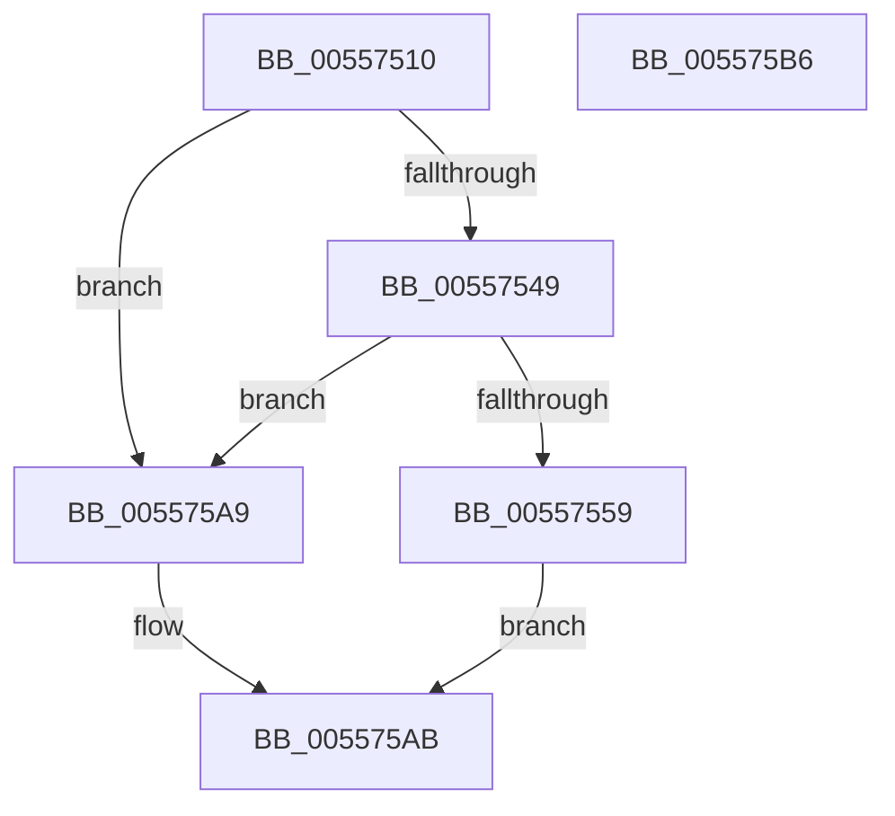

# HalpInitializeCmciVector

- RVA: `0x00557510`–`0x005575B7` (길이 `167` bytes)
- VA: `0x0000000140557510`
- 실행 섹션: `.text`
- PDB 이름 있음: `예`; PDB Function 태그: `아니요`
- unwind 정보 RVA: `0x000C4610`
- 디코드: `45`개 명령, `167/167` bytes 표시
- 미해석 바이트: `0` (있으면 어셈블리에 `.byte`로 보존)

> 이 문서는 커널 이미지의 기계어와 PDB 기호를 분석해 생성했습니다. 4번과 5번은 함수 원형과 자료형을 바이너리 사용 방식에서 추정한 C 해석이며 원본 소스 복구 결과는 아닙니다.

## 1. Dependencies

- 직접 호출 지점: **3**; 고유 호출 대상: **3**
- 직접 호출자로 확인된 함수: **1**
- RIP 상대 이미지 참조: **0**

### Outgoing calls
- `0x0055754F` → [HalpInterruptFindLines](../2D/HalpInterruptFindLines_function_002D2C88.md) (function, `0x002D2C88`)
- `0x0055758F` → [HalpInterruptGetPriority](../2D/HalpInterruptGetPriority_function_002D3558.md) (function, `0x002D3558`)
- `0x005575A2` → [HalpInterruptSetLineStateInternal](../2D/HalpInterruptSetLineStateInternal_function_002D2104.md) (function, `0x002D2104`)

### Direct callers
- [HalpInterruptInitializeLocalUnit](HalpInterruptInitializeLocalUnit_function_00557A2C.md) at `0x00557C3C`

### Static image references
- 디코드된 RIP-relative 메모리 참조가 없습니다.

## 2. Other-region calls and transfers

- 다른 실행 섹션으로 향하는 call: **0**
- 별도 외부 분기/꼬리 이동을 확인하지 못했습니다.

## 3. Assembly (complete function range)

```asm
00557510  48 89 5C 24 10                  mov qword ptr [rsp + 0x10], rbx
00557515  55                              push rbp
00557516  48 8B EC                        mov rbp, rsp
00557519  48 83 EC 60                     sub rsp, 0x60
0055751D  83 65 C4 00                     and dword ptr [rbp - 0x3c], 0
00557521  0F 57 C0                        xorps xmm0, xmm0
00557524  83 65 EC 00                     and dword ptr [rbp - 0x14], 0
00557528  48 8B D9                        mov rbx, rcx
0055752B  83 B9 F0 00 00 00 02            cmp dword ptr [rcx + 0xf0], 2
00557532  8B 81 00 01 00 00               mov eax, dword ptr [rcx + 0x100]
00557538  F3 0F 7F 45 DC                  movdqu xmmword ptr [rbp - 0x24], xmm0
0055753D  89 45 10                        mov dword ptr [rbp + 0x10], eax
00557540  C7 45 14 F9 FF FF FF            mov dword ptr [rbp + 0x14], 0xfffffff9
00557547  75 60                           jne 0x1405575a9
00557549  33 D2                           xor edx, edx
0055754B  48 8D 4D 10                     lea rcx, [rbp + 0x10]
0055754F  E8 34 B7 D7 FF                  call 0x1402d2c88
00557554  48 85 C0                        test rax, rax
00557557  74 50                           je 0x1405575a9
00557559  83 65 C4 00                     and dword ptr [rbp - 0x3c], 0
0055755D  B8 01 00 00 00                  mov eax, 1
00557562  83 65 EC 00                     and dword ptr [rbp - 0x14], 0
00557566  48 8B CB                        mov rcx, rbx
00557569  83 4D D0 FF                     or dword ptr [rbp - 0x30], 0xffffffff
0055756D  F3 0F 7F 45 DC                  movdqu xmmword ptr [rbp - 0x24], xmm0
00557572  8D 50 34                        lea edx, [rax + 0x34]
00557575  89 45 C0                        mov dword ptr [rbp - 0x40], eax
00557578  89 55 F0                        mov dword ptr [rbp - 0x10], edx
0055757B  89 45 C8                        mov dword ptr [rbp - 0x38], eax
0055757E  C7 45 CC 10 00 00 00            mov dword ptr [rbp - 0x34], 0x10
00557585  89 45 D4                        mov dword ptr [rbp - 0x2c], eax
00557588  C7 45 D8 03 00 00 00            mov dword ptr [rbp - 0x28], 3
0055758F  E8 C4 BF D7 FF                  call 0x1402d3558
00557594  4C 8D 45 C0                     lea r8, [rbp - 0x40]
00557598  89 45 F4                        mov dword ptr [rbp - 0xc], eax
0055759B  48 8D 55 10                     lea rdx, [rbp + 0x10]
0055759F  48 8B CB                        mov rcx, rbx
005575A2  E8 5D AB D7 FF                  call 0x1402d2104
005575A7  EB 02                           jmp 0x1405575ab
005575A9  33 C0                           xor eax, eax
005575AB  48 8B 5C 24 78                  mov rbx, qword ptr [rsp + 0x78]
005575B0  48 83 C4 60                     add rsp, 0x60
005575B4  5D                              pop rbp
005575B5  C3                              ret
005575B6  CC                              int3
```

## 4. C-style interpretation (structured pseudocode)

```c
__int64 __fastcall HalpInitializeCmciVector(__int64 a1, int a2)
{
    __int64 result;
    __int64 v_rsp;
    unsigned int v_stack_m14;
    unsigned int v_stack_m18;
    unsigned int v_stack_m1C;
    unsigned __int64 v_stack_m2C;
    unsigned int v_stack_m30;
    unsigned int v_stack_m34;
    unsigned int v_stack_m38;
    unsigned int v_stack_m3C;
    unsigned int v_stack_m40;
    unsigned int v_stack_m44;
    unsigned int v_stack_m48;
    unsigned __int64 v_stack_p10;
    unsigned int v_stack_p8;
    unsigned int v_stack_pC;

    v_stack_p10 = v_rbx;
    v_rsp = (v_rsp) - (96);
    v_stack_m2C = v_xmm0;
    v_stack_p8 = (unsigned int)((unsigned int)(*(unsigned int *)(a1 + 256)));
    v_stack_pC = 0xFFFFFFF9ULL;
    if ((*(unsigned int *)(a1 + 240)) != 2) goto loc_005575A9;
    a2 = 0;
    result = HalpInterruptFindLines(v_stack_p8, a2, a3, a4);
    if (result == 0) goto loc_005575A9;
    v_stack_m2C = v_xmm0;
    v_stack_m48 = 1;
    v_stack_m18 = (unsigned int)(1 + 52);
    v_stack_m40 = 1;
    v_stack_m3C = 16;
    v_stack_m34 = 1;
    v_stack_m30 = 3;
    result = HalpInterruptGetPriority(a1, 1 + 52, a3, a4);
    v_stack_m14 = (unsigned int)(result);
    result = HalpInterruptSetLineStateInternal(a1, v_stack_p8, v_stack_m48, a4);
    goto loc_005575AB;
loc_005575A9:
    result = 0;
loc_005575AB:
    v_rsp = (v_rsp) + (96);
    return result;
}
```

## 5. (Beta) C Style

```c
int64_t HalpInitializeCmciVector(void *Arg1, int32_t Arg2)
{
    uint8_t *arg1 = (uint8_t *)Arg1;

    int64_t result;
    int64_t local_rsp;
    uint32_t v_stack_m14;
    uint32_t v_stack_m18;
    uint32_t v_stack_m1C;
    uint64_t v_stack_m2C;
    uint32_t v_stack_m30;
    uint32_t v_stack_m34;
    uint32_t v_stack_m38;
    uint32_t v_stack_m3C;
    uint32_t v_stack_m40;
    uint32_t v_stack_m44;
    uint32_t v_stack_m48;
    uint64_t v_stack_p10;
    uint32_t v_stack_p8;
    uint32_t v_stack_pC;

    v_stack_p10 = local_rbx;
    local_rsp = (local_rsp) - (96);
    v_stack_m2C = v_xmm0;
    v_stack_p8 = (uint32_t)((uint32_t)(*(uint32_t *)(arg1 + 0x100)));
    v_stack_pC = 0xFFFFFFF9ULL;
    if ((*(uint32_t *)(arg1 + 0xF0)) != 2) goto loc_005575A9;
    Arg2 = 0;
    result = HalpInterruptFindLines(v_stack_p8, Arg2, a3, a4);
    if (result == 0) goto loc_005575A9;
    v_stack_m2C = v_xmm0;
    v_stack_m48 = 1;
    v_stack_m18 = (uint32_t)(1 + 52);
    v_stack_m40 = 1;
    v_stack_m3C = 16;
    v_stack_m34 = 1;
    v_stack_m30 = 3;
    result = HalpInterruptGetPriority(Arg1, 1 + 52, a3, a4);
    v_stack_m14 = (uint32_t)(result);
    result = HalpInterruptSetLineStateInternal(Arg1, v_stack_p8, v_stack_m48, a4);
    goto loc_005575AB;
loc_005575A9:
    result = 0;
loc_005575AB:
    local_rsp = (local_rsp) + (96);
    return result;
}
```

### 관측된 메모리 오프셋

구조체 형식이 확인되지 않은 접근은 인자 기준의 오프셋으로만 기록했습니다.

| 기준 인자 | 오프셋 표현 | 폭 (bit) | 접근 |
|---|---:|---:|---|
| `Arg1` | `+ 0xF0` | `32` | `R` |
| `Arg1` | `+ 0x100` | `32` | `R` |

## 6. Execution-region graph

[열기: 2D/3D 그래프와 함수 탐색 컨트롤 패널](../../../control-panel.html?section=text&rva=0x00557510&view=graph)

- 2D 그래프는 위에서 아래로 흐르고, 3D 그래프는 빈 공간을 드래그해 회전합니다. Shift+드래그는 이동, 휠은 확대·축소, 함수 노드 선택은 대상 보고서 이동입니다.

### Static fallback


