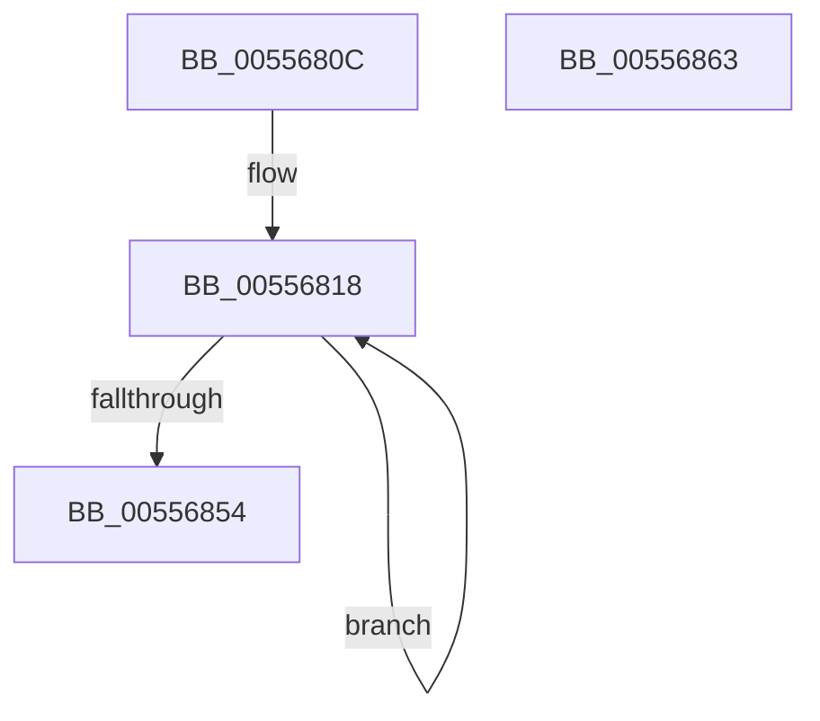

# HalpInitializeGhesRecovery

- RVA: `0x0055680C`–`0x00556864` (길이 `88` bytes)
- VA: `0x000000014055680C`
- 실행 섹션: `.text`
- PDB 이름 있음: `예`; PDB Function 태그: `아니요`
- unwind 정보 RVA: `0x000DB714`
- 디코드: `17`개 명령, `88/88` bytes 표시
- 미해석 바이트: `0` (있으면 어셈블리에 `.byte`로 보존)

> 이 문서는 커널 이미지의 기계어와 PDB 기호를 분석해 생성했습니다. 4번과 5번은 함수 원형과 자료형을 바이너리 사용 방식에서 추정한 C 해석이며 원본 소스 복구 결과는 아닙니다.

## 1. Dependencies

- 직접 호출 지점: **0**; 고유 호출 대상: **0**
- 직접 호출자로 확인된 함수: **1**
- RIP 상대 이미지 참조: **4**

### Outgoing calls
- 직접 디코드된 call 명령이 없습니다.

### Direct callers
- [HalpInitializeMce](../../pagelk/B5/HalpInitializeMce_function_00B5BC04.md) at `0x00B5BC56`

### Static image references
- `0x0055680C` → RVA `0x00F90A60` (`.data`; read)
- `0x00556839` → RVA `0x005565D0` (`HalpErrorDeferredHandler`; read)
- `0x00556854` → RVA `0x00556C10` (`HalpRequestGenericErrorRecovery`; read)
- `0x0055685B` → RVA `0x00E00C38` (`.data`; write)

## 2. Other-region calls and transfers

- 다른 실행 섹션으로 향하는 call: **0**
- 별도 외부 분기/꼬리 이동을 확인하지 못했습니다.

## 3. Assembly (complete function range)

```asm
0055680C  48 8D 05 4D A2 A3 00            lea rax, [rip + 0xa3a24d]
00556813  B9 20 00 00 00                  mov ecx, 0x20
00556818  33 D2                           xor edx, edx
0055681A  48 8D 80 58 18 00 00            lea rax, [rax + 0x1858]
00556821  0F 57 C0                        xorps xmm0, xmm0
00556824  0F 11 80 90 E7 FF FF            movups xmmword ptr [rax - 0x1870], xmm0
0055682B  0F 11 80 A0 E7 FF FF            movups xmmword ptr [rax - 0x1860], xmm0
00556832  48 89 90 B0 E7 FF FF            mov qword ptr [rax - 0x1850], rdx
00556839  48 8D 15 90 FD FF FF            lea rdx, [rip - 0x270]
00556840  48 89 90 A0 E7 FF FF            mov qword ptr [rax - 0x1860], rdx
00556847  83 A0 88 E7 FF FF 00            and dword ptr [rax - 0x1878], 0
0055684E  48 83 E9 01                     sub rcx, 1
00556852  75 C4                           jne 0x140556818
00556854  48 8D 05 B5 03 00 00            lea rax, [rip + 0x3b5]
0055685B  48 89 05 D6 A3 8A 00            mov qword ptr [rip + 0x8aa3d6], rax
00556862  C3                              ret
00556863  CC                              int3
```

## 4. C-style interpretation (structured pseudocode)

```c
__int64 __fastcall HalpInitializeGhesRecovery(__int64 a1, int a2)
{
loc_00556818:
    a2 = 0;
    *(unsigned __int64 *)(v_rip + 10723917 + 6232 - 6256) = v_xmm0;
    *(unsigned __int64 *)(v_rip + 10723917 + 6232 - 6240) = v_xmm0;
    *(unsigned __int64 *)(v_rip + 10723917 + 6232 - 6224) = 0;
    *(unsigned __int64 *)(v_rip + 10723917 + 6232 - 6240) = v_rip - 624;
    a1 = (32) - (1);
    if (condition_is_not_equal) goto loc_00556818;
    *(unsigned __int64 *)(v_rip + 9085910) = v_rip + 949;
    return v_rip + 949;
}
```

## 5. (Beta) C Style

```c
int64_t HalpInitializeGhesRecovery(int64_t Arg1, int32_t Arg2)
{
loc_00556818:
    Arg2 = 0;
    *(uint64_t *)(v_rip + 0xA3A24D + 0x1858 - 0x1870) = v_xmm0;
    *(uint64_t *)(v_rip + 0xA3A24D + 0x1858 - 0x1860) = v_xmm0;
    *(uint64_t *)(v_rip + 0xA3A24D + 0x1858 - 0x1850) = 0;
    *(uint64_t *)(v_rip + 0xA3A24D + 0x1858 - 0x1860) = v_rip - 624;
    Arg1 = (32) - (1);
    if (condition_is_not_equal) goto loc_00556818;
    *(uint64_t *)(v_rip + 0x8AA3D6) = v_rip + 949;
    return v_rip + 949;
}
```

## 6. Execution-region graph

[열기: 2D/3D 그래프와 함수 탐색 컨트롤 패널](../../../control-panel.html?section=text&rva=0x0055680C&view=graph)

- 2D 그래프는 위에서 아래로 흐르고, 3D 그래프는 빈 공간을 드래그해 회전합니다. Shift+드래그는 이동, 휠은 확대·축소, 함수 노드 선택은 대상 보고서 이동입니다.

### Static fallback


