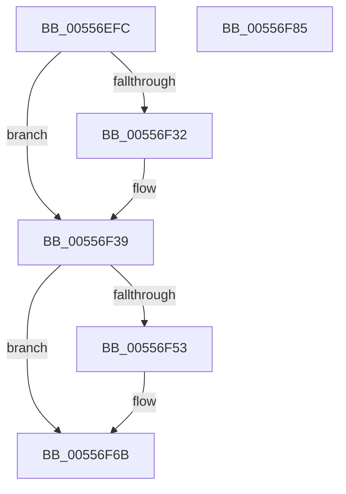

# HalpInsertSecondarySignalList

- RVA: `0x00556EFC`–`0x00556F86` (길이 `138` bytes)
- VA: `0x0000000140556EFC`
- 실행 섹션: `.text`
- PDB 이름 있음: `예`; PDB Function 태그: `아니요`
- unwind 정보 RVA: `0x0005CAAC`
- 디코드: `33`개 명령, `138/138` bytes 표시
- 미해석 바이트: `0` (있으면 어셈블리에 `.byte`로 보존)

> 이 문서는 커널 이미지의 기계어와 PDB 기호를 분석해 생성했습니다. 4번과 5번은 함수 원형과 자료형을 바이너리 사용 방식에서 추정한 C 해석이며 원본 소스 복구 결과는 아닙니다.

## 1. Dependencies

- 직접 호출 지점: **3**; 고유 호출 대상: **3**
- 직접 호출자로 확인된 함수: **2**
- RIP 상대 이미지 참조: **7**

### Outgoing calls
- `0x00556F10` → [HalpAcquireHighLevelLock](../2D/HalpAcquireHighLevelLock_function_002D2390.md) (function, `0x002D2390`)
- `0x00556F66` → [KeInsertQueueDpc](../20/KeInsertQueueDpc_function_00207C50.md) (function, `0x00207C50`)
- `0x00556F75` → [HalpReleaseHighLevelLock](../2D/HalpReleaseHighLevelLock_function_002D1C58.md) (function, `0x002D1C58`)

### Direct callers
- [HalpHandleMaskUnmaskSecondaryInterrupt](../2D/HalpHandleMaskUnmaskSecondaryInterrupt_function_002D1C8C.md) at `0x002D1D5F`
- [HalpReleaseSecondaryIcEntryShared](../48/HalpReleaseSecondaryIcEntryShared_function_00488FD0.md) at `0x00489008`

### Static image references
- `0x00556F09` → RVA `0x00F90A38` (`.data`; read)
- `0x00556F15` → RVA `0x00F90A28` (`.data`; read)
- `0x00556F26` → RVA `0x00F90A20` (`.data`; read)
- `0x00556F39` → RVA `0x00F909D8` (`.data`; read)
- `0x00556F4A` → RVA `0x00F90A28` (`.data`; write)
- `0x00556F56` → RVA `0x00F909D8` (`.data`; write)
- `0x00556F5F` → RVA `0x00F909E0` (`.data`; read)

## 2. Other-region calls and transfers

- 다른 실행 섹션으로 향하는 call: **0**
- 별도 외부 분기/꼬리 이동을 확인하지 못했습니다.

## 3. Assembly (complete function range)

```asm
00556EFC  48 89 5C 24 08                  mov qword ptr [rsp + 8], rbx
00556F01  57                              push rdi
00556F02  48 83 EC 20                     sub rsp, 0x20
00556F06  48 8B D9                        mov rbx, rcx
00556F09  48 8D 0D 28 9B A3 00            lea rcx, [rip + 0xa39b28]
00556F10  E8 7B B4 D7 FF                  call 0x1402d2390
00556F15  48 8B 0D 0C 9B A3 00            mov rcx, qword ptr [rip + 0xa39b0c]
00556F1C  40 8A F8                        mov dil, al
00556F1F  48 81 C3 90 00 00 00            add rbx, 0x90
00556F26  48 8D 05 F3 9A A3 00            lea rax, [rip + 0xa39af3]
00556F2D  48 39 01                        cmp qword ptr [rcx], rax
00556F30  74 07                           je 0x140556f39
00556F32  B9 03 00 00 00                  mov ecx, 3
00556F37  CD 29                           int 0x29
00556F39  80 3D 98 9A A3 00 00            cmp byte ptr [rip + 0xa39a98], 0
00556F40  48 89 03                        mov qword ptr [rbx], rax
00556F43  48 89 4B 08                     mov qword ptr [rbx + 8], rcx
00556F47  48 89 19                        mov qword ptr [rcx], rbx
00556F4A  48 89 1D D7 9A A3 00            mov qword ptr [rip + 0xa39ad7], rbx
00556F51  75 18                           jne 0x140556f6b
00556F53  45 33 C0                        xor r8d, r8d
00556F56  C6 05 7B 9A A3 00 01            mov byte ptr [rip + 0xa39a7b], 1
00556F5D  33 D2                           xor edx, edx
00556F5F  48 8D 0D 7A 9A A3 00            lea rcx, [rip + 0xa39a7a]
00556F66  E8 E5 0C CB FF                  call 0x140207c50
00556F6B  40 8A D7                        mov dl, dil
00556F6E  48 8D 0D C3 9A A3 00            lea rcx, [rip + 0xa39ac3]
00556F75  E8 DE AC D7 FF                  call 0x1402d1c58
00556F7A  48 8B 5C 24 30                  mov rbx, qword ptr [rsp + 0x30]
00556F7F  48 83 C4 20                     add rsp, 0x20
00556F83  5F                              pop rdi
00556F84  C3                              ret
00556F85  CC                              int3
```

## 4. C-style interpretation (structured pseudocode)

```c
__int64 __fastcall HalpInsertSecondarySignalList(__int64 a1, int a2, int a3)
{
    __int64 result;
    __int64 v_rbx;
    __int64 v_rsp;
    unsigned __int64 v_stack_p8;

    v_stack_p8 = v_rbx;
    v_rsp = (v_rsp) - (32);
    result = HalpAcquireHighLevelLock(v_rip + 10722088, a2, a3, a4);
    v_rbx = (a1) + (144);
    if ((*(unsigned __int64 *)(*(unsigned __int64 *)(v_rip + 10722060))) != (v_rip + 10722035)) {
        a1 = 3;
    }
    *(unsigned __int64 *)(v_rbx) = v_rip + 10722035;
    *(unsigned __int64 *)(v_rbx + 8) = a1;
    *(unsigned __int64 *)(a1) = v_rbx;
    *(unsigned __int64 *)(v_rip + 10722007) = v_rbx;
    result = v_rip + 10722035;
    if ((*(unsigned __int8 *)(v_rip + 10721944)) == 0) {
        a3 = 0;
        *(unsigned __int8 *)(v_rip + 10721915) = 1;
        a2 = 0;
        a1 = v_rip + 10721914;
        result = KeInsertQueueDpc(a1, a2, a3, a4);
    }
    result = HalpReleaseHighLevelLock(v_rip + 10721987, (unsigned __int8)((unsigned __int8)(result)), a3, a4);
    v_rsp = (v_rsp) + (32);
    return result;
}
```

## 5. (Beta) C Style

```c
int64_t HalpInsertSecondarySignalList(void *Arg1, int32_t Arg2, int32_t Arg3)
{
    uint8_t *arg1 = (uint8_t *)Arg1;

    int64_t result;
    int64_t local_rbx;
    int64_t local_rsp;
    uint64_t v_stack_p8;

    v_stack_p8 = local_rbx;
    local_rsp = (local_rsp) - (32);
    result = HalpAcquireHighLevelLock(v_rip + 10722088, Arg2, Arg3, a4);
    local_rbx = (Arg1) + (144);
    if ((*(uint64_t *)(*(uint64_t *)(v_rip + 0xA39B0C))) != (v_rip + 10722035)) {
        Arg1 = 3;
    }
    *(uint64_t *)(local_rbx) = v_rip + 10722035;
    *(void **)(local_rbx + 0x8) = Arg1;
    *(uint64_t *)(arg1) = local_rbx;
    *(uint64_t *)(v_rip + 0xA39AD7) = local_rbx;
    result = v_rip + 10722035;
    if ((*(uint8_t *)(v_rip + 0xA39A98)) == 0) {
        Arg3 = 0;
        *(uint8_t *)(v_rip + 0xA39A7B) = 1;
        Arg2 = 0;
        Arg1 = v_rip + 10721914;
        result = KeInsertQueueDpc(Arg1, Arg2, Arg3, a4);
    }
    result = HalpReleaseHighLevelLock(v_rip + 10721987, (uint8_t)((uint8_t)(result)), Arg3, a4);
    local_rsp = (local_rsp) + (32);
    return result;
}
```

### 관측된 메모리 오프셋

구조체 형식이 확인되지 않은 접근은 인자 기준의 오프셋으로만 기록했습니다.

| 기준 인자 | 오프셋 표현 | 폭 (bit) | 접근 |
|---|---:|---:|---|
| `Arg1` | `+ 0x0` | `64` | `W` |
| `Arg1` | `+ 0x8` | `64` | `W` |

## 6. Execution-region graph

[열기: 2D/3D 그래프와 함수 탐색 컨트롤 패널](../../../control-panel.html?section=text&rva=0x00556EFC&view=graph)

- 2D 그래프는 위에서 아래로 흐르고, 3D 그래프는 빈 공간을 드래그해 회전합니다. Shift+드래그는 이동, 휠은 확대·축소, 함수 노드 선택은 대상 보고서 이동입니다.

### Static fallback


