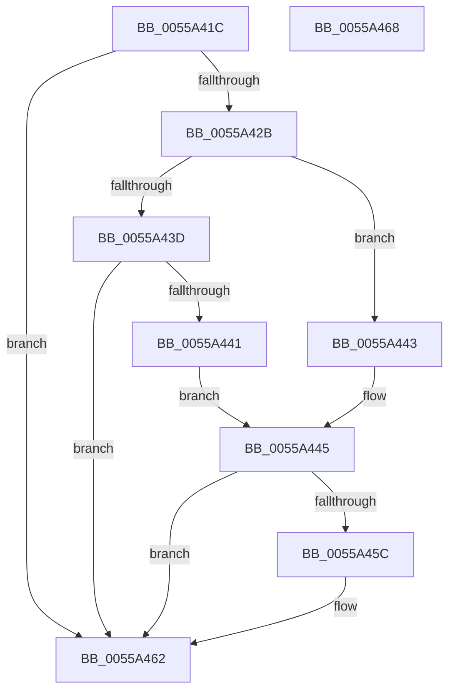

# HalpInterruptAllocateCacheDomainTable

- RVA: `0x0055A41C`–`0x0055A469` (길이 `77` bytes)
- VA: `0x000000014055A41C`
- 실행 섹션: `.text`
- PDB 이름 있음: `예`; PDB Function 태그: `아니요`
- unwind 정보 RVA: `0x0005CF00`
- 디코드: `26`개 명령, `77/77` bytes 표시
- 미해석 바이트: `0` (있으면 어셈블리에 `.byte`로 보존)

> 이 문서는 커널 이미지의 기계어와 PDB 기호를 분석해 생성했습니다. 4번과 5번은 함수 원형과 자료형을 바이너리 사용 방식에서 추정한 C 해석이며 원본 소스 복구 결과는 아닙니다.

## 1. Dependencies

- 직접 호출 지점: **3**; 고유 호출 대상: **3**
- 직접 호출자로 확인된 함수: **1**
- RIP 상대 이미지 참조: **2**

### Outgoing calls
- `0x0055A422` → [HalpInterruptIsProcessorCacheFlushOptimizationSupported](HalpInterruptIsProcessorCacheFlushOptimizationSupported_function_0055A884.md) (function, `0x0055A884`)
- `0x0055A42B` → [HalQueryMaximumProcessorCount](../4A/HalQueryMaximumProcessorCount_function_004AC9A0.md) (function, `0x004AC9A0`)
- `0x0055A44B` → [HalpMmAllocCtxAlloc](../3E/HalpMmAllocCtxAlloc_function_003E10B8.md) (function, `0x003E10B8`)

### Direct callers
- [HalpInterruptInitSystem](../../pagelk/B5/HalpInterruptInitSystem_function_00B5D550.md) at `0x00B5D67F`

### Static image references
- `0x0055A450` → RVA `0x00F905F8` (`.data`; write)
- `0x0055A45C` → RVA `0x00F905F0` (`.data`; write)

## 2. Other-region calls and transfers

- 다른 실행 섹션으로 향하는 call: **0**
- 별도 외부 분기/꼬리 이동을 확인하지 못했습니다.

## 3. Assembly (complete function range)

```asm
0055A41C  40 53                           push rbx
0055A41E  48 83 EC 20                     sub rsp, 0x20
0055A422  E8 5D 04 00 00                  call 0x14055a884
0055A427  84 C0                           test al, al
0055A429  74 37                           je 0x14055a462
0055A42B  E8 70 25 F5 FF                  call 0x1404ac9a0
0055A430  8B D8                           mov ebx, eax
0055A432  B8 00 01 00 00                  mov eax, 0x100
0055A437  D1 EB                           shr ebx, 1
0055A439  3B D8                           cmp ebx, eax
0055A43B  73 06                           jae 0x14055a443
0055A43D  85 DB                           test ebx, ebx
0055A43F  74 21                           je 0x14055a462
0055A441  EB 02                           jmp 0x14055a445
0055A443  8B D8                           mov ebx, eax
0055A445  8B D3                           mov edx, ebx
0055A447  48 C1 E2 03                     shl rdx, 3
0055A44B  E8 68 6C E8 FF                  call 0x1403e10b8
0055A450  48 89 05 A1 61 A3 00            mov qword ptr [rip + 0xa361a1], rax
0055A457  48 85 C0                        test rax, rax
0055A45A  74 06                           je 0x14055a462
0055A45C  89 1D 8E 61 A3 00               mov dword ptr [rip + 0xa3618e], ebx
0055A462  48 83 C4 20                     add rsp, 0x20
0055A466  5B                              pop rbx
0055A467  C3                              ret
0055A468  CC                              int3
```

## 4. C-style interpretation (structured pseudocode)

```c
__int64 __fastcall HalpInterruptAllocateCacheDomainTable(void)
{
    __int64 result;
    __int64 v_rbx;
    __int64 v_rsp;

    v_rsp = (v_rsp) - (32);
    result = HalpInterruptIsProcessorCacheFlushOptimizationSupported(a1, a2, a3, a4);
    if ((unsigned __int8)(result) == 0) goto loc_0055A462;
    result = HalQueryMaximumProcessorCount(a1, a2, a3, a4);
    v_rbx = (unsigned int)(((unsigned int)((unsigned int)(result))) >> (1));
    if (((unsigned int)(v_rbx)) >= 256) goto loc_0055A443;
    if ((unsigned int)(v_rbx) == 0) goto loc_0055A462;
    goto loc_0055A445;
loc_0055A443:
loc_0055A445:
    a2 = (256) << (3);
    result = HalpMmAllocCtxAlloc(a1, a2, a3, a4);
    *(unsigned __int64 *)(v_rip + 10707361) = result;
    if (result != 0) {
        *(unsigned int *)(v_rip + 10707342) = 256;
    }
    v_rsp = (v_rsp) + (32);
    return result;
}
```

## 5. (Beta) C Style

```c
void HalpInterruptAllocateCacheDomainTable(void)
{
    int64_t result;
    int64_t local_rbx;
    int64_t local_rsp;

    local_rsp = (local_rsp) - (32);
    result = HalpInterruptIsProcessorCacheFlushOptimizationSupported(a1, a2, a3, a4);
    if ((uint8_t)(result) == 0) goto loc_0055A462;
    result = HalQueryMaximumProcessorCount(a1, a2, a3, a4);
    local_rbx = (uint32_t)(((uint32_t)((uint32_t)(result))) >> (1));
    if (((uint32_t)(local_rbx)) >= 256) goto loc_0055A443;
    if ((uint32_t)(local_rbx) == 0) goto loc_0055A462;
    goto loc_0055A445;
loc_0055A443:
loc_0055A445:
    a2 = (256) << (3);
    result = HalpMmAllocCtxAlloc(a1, a2, a3, a4);
    *(uint64_t *)(v_rip + 0xA361A1) = result;
    if (result != 0) {
        *(uint32_t *)(v_rip + 0xA3618E) = 256;
    }
    local_rsp = (local_rsp) + (32);
    return result;
}
```

## 6. Execution-region graph

[열기: 2D/3D 그래프와 함수 탐색 컨트롤 패널](../../../control-panel.html?section=text&rva=0x0055A41C&view=graph)

- 2D 그래프는 위에서 아래로 흐르고, 3D 그래프는 빈 공간을 드래그해 회전합니다. Shift+드래그는 이동, 휠은 확대·축소, 함수 노드 선택은 대상 보고서 이동입니다.

### Static fallback


