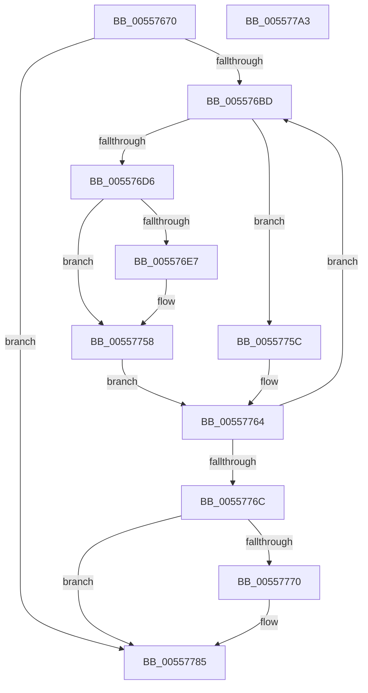

# HalpInterruptBlockSmtSiblings

- RVA: `0x00557670`–`0x005577A4` (길이 `308` bytes)
- VA: `0x0000000140557670`
- 실행 섹션: `.text`
- PDB 이름 있음: `예`; PDB Function 태그: `아니요`
- unwind 정보 RVA: `0x0008C11C`
- 디코드: `84`개 명령, `308/308` bytes 표시
- 미해석 바이트: `0` (있으면 어셈블리에 `.byte`로 보존)

> 이 문서는 커널 이미지의 기계어와 PDB 기호를 분석해 생성했습니다. 4번과 5번은 함수 원형과 자료형을 바이너리 사용 방식에서 추정한 C 해석이며 원본 소스 복구 결과는 아닙니다.

## 1. Dependencies

- 직접 호출 지점: **1**; 고유 호출 대상: **1**
- 직접 호출자로 확인된 함수: **1**
- RIP 상대 이미지 참조: **5**

### Outgoing calls
- `0x00557721` → [memcpy](../6C/memcpy_function_006C6840.md) (function, `0x006C6840`)

### Direct callers
- [HalpInterruptParseMadt](HalpInterruptParseMadt_function_00557E74.md) at `0x00558665`

### Static image references
- `0x0055768C` → RVA `0x00E10200` (`.data`; read)
- `0x005576A2` → RVA `0x00FC3E30` (`.data`; read)
- `0x00557772` → RVA `0x00F906F8` (`.data`; write)
- `0x00557779` → RVA `0x00F90690` (`.data`; write)
- `0x0055777F` → RVA `0x00F9069C` (`.data`; write)

## 2. Other-region calls and transfers

- 다른 실행 섹션으로 향하는 call: **0**
- 별도 외부 분기/꼬리 이동을 확인하지 못했습니다.

## 3. Assembly (complete function range)

```asm
00557670  48 89 5C 24 08                  mov qword ptr [rsp + 8], rbx
00557675  48 89 6C 24 10                  mov qword ptr [rsp + 0x10], rbp
0055767A  48 89 74 24 18                  mov qword ptr [rsp + 0x18], rsi
0055767F  57                              push rdi
00557680  41 54                           push r12
00557682  41 55                           push r13
00557684  41 56                           push r14
00557686  41 57                           push r15
00557688  48 83 EC 60                     sub rsp, 0x60
0055768C  8B 1D 6E 8B 8B 00               mov ebx, dword ptr [rip + 0x8b8b6e]
00557692  45 33 F6                        xor r14d, r14d
00557695  65 48 8B 04 25 20 00 00 00      mov rax, qword ptr gs:[0x20]
0055769E  41 83 CF FF                     or r15d, 0xffffffff
005576A2  4C 8B 25 87 C7 A6 00            mov r12, qword ptr [rip + 0xa6c787]
005576A9  33 F6                           xor esi, esi
005576AB  8B FB                           mov edi, ebx
005576AD  8B A8 A4 00 00 00               mov ebp, dword ptr [rax + 0xa4]
005576B3  F7 DD                           neg ebp
005576B5  85 DB                           test ebx, ebx
005576B7  0F 84 C8 00 00 00               je 0x140557785
005576BD  8B CE                           mov ecx, esi
005576BF  8B C5                           mov eax, ebp
005576C1  48 C1 E1 06                     shl rcx, 6
005576C5  49 03 CC                        add rcx, r12
005576C8  8B 51 08                        mov edx, dword ptr [rcx + 8]
005576CB  23 C2                           and eax, edx
005576CD  41 3B C7                        cmp eax, r15d
005576D0  0F 85 86 00 00 00               jne 0x14055775c
005576D6  44 8D 6B FF                     lea r13d, [rbx - 1]
005576DA  C6 41 38 01                     mov byte ptr [rcx + 0x38], 1
005576DE  44 89 71 3C                     mov dword ptr [rcx + 0x3c], r14d
005576E2  41 3B F5                        cmp esi, r13d
005576E5  74 71                           je 0x140557758
005576E7  0F 10 01                        movups xmm0, xmmword ptr [rcx]
005576EA  44 8B C3                        mov r8d, ebx
005576ED  8D 56 01                        lea edx, [rsi + 1]
005576F0  44 2B C6                        sub r8d, esi
005576F3  48 C1 E2 06                     shl rdx, 6
005576F7  0F 11 44 24 20                  movups xmmword ptr [rsp + 0x20], xmm0
005576FC  41 FF C8                        dec r8d
005576FF  49 03 D4                        add rdx, r12
00557702  0F 10 41 10                     movups xmm0, xmmword ptr [rcx + 0x10]
00557706  49 C1 E0 06                     shl r8, 6
0055770A  0F 11 44 24 30                  movups xmmword ptr [rsp + 0x30], xmm0
0055770F  0F 10 41 20                     movups xmm0, xmmword ptr [rcx + 0x20]
00557713  0F 11 44 24 40                  movups xmmword ptr [rsp + 0x40], xmm0
00557718  0F 10 41 30                     movups xmm0, xmmword ptr [rcx + 0x30]
0055771C  0F 11 44 24 50                  movups xmmword ptr [rsp + 0x50], xmm0
00557721  E8 1A F1 16 00                  call 0x1406c6840
00557726  0F 10 44 24 20                  movups xmm0, xmmword ptr [rsp + 0x20]
0055772B  41 8B C5                        mov eax, r13d
0055772E  0F 10 4C 24 30                  movups xmm1, xmmword ptr [rsp + 0x30]
00557733  48 C1 E0 06                     shl rax, 6
00557737  42 0F 11 04 20                  movups xmmword ptr [rax + r12], xmm0
0055773C  0F 10 44 24 40                  movups xmm0, xmmword ptr [rsp + 0x40]
00557741  42 0F 11 4C 20 10               movups xmmword ptr [rax + r12 + 0x10], xmm1
00557747  0F 10 4C 24 50                  movups xmm1, xmmword ptr [rsp + 0x50]
0055774C  42 0F 11 44 20 20               movups xmmword ptr [rax + r12 + 0x20], xmm0
00557752  42 0F 11 4C 20 30               movups xmmword ptr [rax + r12 + 0x30], xmm1
00557758  FF CF                           dec edi
0055775A  EB 08                           jmp 0x140557764
0055775C  44 8B F2                        mov r14d, edx
0055775F  44 8B F8                        mov r15d, eax
00557762  FF C6                           inc esi
00557764  3B F7                           cmp esi, edi
00557766  0F 82 51 FF FF FF               jb 0x1405576bd
0055776C  3B FB                           cmp edi, ebx
0055776E  74 15                           je 0x140557785
00557770  2B DF                           sub ebx, edi
00557772  C6 05 7F 8F A3 00 00            mov byte ptr [rip + 0xa38f7f], 0
00557779  89 1D 11 8F A3 00               mov dword ptr [rip + 0xa38f11], ebx
0055777F  89 3D 17 8F A3 00               mov dword ptr [rip + 0xa38f17], edi
00557785  4C 8D 5C 24 60                  lea r11, [rsp + 0x60]
0055778A  49 8B 5B 30                     mov rbx, qword ptr [r11 + 0x30]
0055778E  49 8B 6B 38                     mov rbp, qword ptr [r11 + 0x38]
00557792  49 8B 73 40                     mov rsi, qword ptr [r11 + 0x40]
00557796  49 8B E3                        mov rsp, r11
00557799  41 5F                           pop r15
0055779B  41 5E                           pop r14
0055779D  41 5D                           pop r13
0055779F  41 5C                           pop r12
005577A1  5F                              pop rdi
005577A2  C3                              ret
005577A3  CC                              int3
```

## 4. C-style interpretation (structured pseudocode)

```c
__int64 __fastcall HalpInterruptBlockSmtSiblings(void)
{
    __int64 result;
    __int64 v_r14;
    __int64 v_r15;
    __int64 v_rbp;
    __int64 v_rbx;
    __int64 v_rdi;
    __int64 v_rsi;
    __int64 v_rsp;
    unsigned __int64 v_stack_m28;
    unsigned __int64 v_stack_m38;
    unsigned __int64 v_stack_m48;
    unsigned __int64 v_stack_m58;
    unsigned __int64 v_stack_m68;
    unsigned __int64 v_stack_p10;
    unsigned __int64 v_stack_p18;
    unsigned __int64 v_stack_p8;

    v_stack_p8 = v_rbx;
    v_stack_p10 = v_rbp;
    v_stack_p18 = v_rsi;
    v_rsp = (v_rsp) - (96);
    v_r14 = 0;
    v_r15 = (unsigned int)((v_r15) | (0xFFFFFFFFULL));
    v_rsi = 0;
    v_rbp = (unsigned int)(-((unsigned int)(*(unsigned int *)(*(unsigned __int64 *)(gs_base + (0 + 32)) + 164))));
    if ((unsigned int)((unsigned int)(*(unsigned int *)(v_rip + 9145198))) == 0) goto loc_00557785;
loc_005576BD:
    a1 = (0) << (6);
    a1 = (a1) + (*(unsigned __int64 *)(v_rip + 10930055));
    result = (unsigned int)(((unsigned int)((unsigned int)(v_rbp))) & ((unsigned int)((unsigned int)(*(unsigned int *)(a1 + 8)))));
    if (((unsigned int)(result)) != ((unsigned int)(v_r15))) goto loc_0055775C;
    *(unsigned __int8 *)(a1 + 56) = 1;
    *(unsigned int *)(a1 + 60) = 0;
    if (0 != ((unsigned int)((unsigned int)(*(unsigned int *)(v_rip + 9145198)) - 1))) {
        a3 = (unsigned int)((unsigned int)(*(unsigned int *)(v_rip + 9145198)));
        a2 = v_rsi + 1;
        a3 = (unsigned int)((a3) - (0));
        a2 = (a2) << (6);
        v_stack_m68 = v_xmm0;
        a3 = (unsigned int)((a3) - 1);
        a2 = (a2) + (*(unsigned __int64 *)(v_rip + 10930055));
        a3 = (a3) << (6);
        v_stack_m58 = v_xmm0;
        v_stack_m48 = v_xmm0;
        v_stack_m38 = v_xmm0;
        result = memcpy(a1, a2, a3, a4);
        result = (unsigned int)((unsigned int)(*(unsigned int *)(v_rip + 9145198)) - 1);
        result = (result) << (6);
        *(unsigned __int64 *)(result + *(unsigned __int64 *)(v_rip + 10930055) * 1) = v_xmm0;
        *(unsigned __int64 *)(result + *(unsigned __int64 *)(v_rip + 10930055) * 1 + 16) = v_xmm1;
        *(unsigned __int64 *)(result + *(unsigned __int64 *)(v_rip + 10930055) * 1 + 32) = v_xmm0;
        *(unsigned __int64 *)(result + *(unsigned __int64 *)(v_rip + 10930055) * 1 + 48) = v_xmm1;
    }
    v_rdi = (unsigned int)(((unsigned int)((unsigned int)((unsigned int)(*(unsigned int *)(v_rip + 9145198))))) - 1);
    goto loc_00557764;
loc_0055775C:
    v_rsi = (unsigned int)((v_rsi) + 1);
loc_00557764:
    if (((unsigned int)(v_rsi)) < ((unsigned int)(v_rdi))) goto loc_005576BD;
    v_rbx = (unsigned int)(*(unsigned int *)(v_rip + 9145198));
    if (((unsigned int)(v_rdi)) != ((unsigned int)((unsigned int)(*(unsigned int *)(v_rip + 9145198))))) {
        v_rbx = (unsigned int)(((unsigned int)(*(unsigned int *)(v_rip + 9145198))) - ((unsigned int)(v_rdi)));
        *(unsigned __int8 *)(v_rip + 10719103) = 0;
        *(unsigned int *)(v_rip + 10718993) = (unsigned int)(v_rbx);
        *(unsigned int *)(v_rip + 10718999) = (unsigned int)(v_rdi);
    }
    return result;
}
```

## 5. (Beta) C Style

```c
void HalpInterruptBlockSmtSiblings(void)
{
    int64_t result;
    int64_t local_r14;
    int64_t local_r15;
    int64_t local_rbp;
    int64_t local_rbx;
    int64_t local_rdi;
    int64_t local_rsi;
    int64_t local_rsp;
    uint64_t v_stack_m28;
    uint64_t v_stack_m38;
    uint64_t v_stack_m48;
    uint64_t v_stack_m58;
    uint64_t v_stack_m68;
    uint64_t v_stack_p10;
    uint64_t v_stack_p18;
    uint64_t v_stack_p8;

    v_stack_p8 = local_rbx;
    v_stack_p10 = local_rbp;
    v_stack_p18 = local_rsi;
    local_rsp = (local_rsp) - (96);
    local_r14 = 0;
    local_r15 = (uint32_t)((local_r15) | (0xFFFFFFFFULL));
    local_rsi = 0;
    local_rbp = (uint32_t)(-((uint32_t)(*(uint32_t *)(*(uint64_t *)(gs_base + (0 + 0x20)) + 0xA4))));
    if ((uint32_t)((uint32_t)(*(uint32_t *)(v_rip + 0x8B8B6E))) == 0) goto loc_00557785;
loc_005576BD:
    a1 = (0) << (6);
    a1 = (a1) + (*(uint64_t *)(v_rip + 0xA6C787));
    result = (uint32_t)(((uint32_t)((uint32_t)(local_rbp))) & ((uint32_t)((uint32_t)(*(uint32_t *)(a1 + 0x8)))));
    if (((uint32_t)(result)) != ((uint32_t)(local_r15))) goto loc_0055775C;
    *(uint8_t *)(a1 + 0x38) = 1;
    *(uint32_t *)(a1 + 0x3C) = 0;
    if (0 != ((uint32_t)((uint32_t)(*(uint32_t *)(v_rip + 0x8B8B6E)) - 1))) {
        a3 = (uint32_t)((uint32_t)(*(uint32_t *)(v_rip + 0x8B8B6E)));
        a2 = local_rsi + 1;
        a3 = (uint32_t)((a3) - (0));
        a2 = (a2) << (6);
        v_stack_m68 = v_xmm0;
        a3 = (uint32_t)((a3) - 1);
        a2 = (a2) + (*(uint64_t *)(v_rip + 0xA6C787));
        a3 = (a3) << (6);
        v_stack_m58 = v_xmm0;
        v_stack_m48 = v_xmm0;
        v_stack_m38 = v_xmm0;
        result = memcpy(a1, a2, a3, a4);
        result = (uint32_t)((uint32_t)(*(uint32_t *)(v_rip + 0x8B8B6E)) - 1);
        result = (result) << (6);
        *(uint64_t *)(result + *(uint64_t *)(v_rip + 0xA6C787) * 1) = v_xmm0;
        *(uint64_t *)(result + *(uint64_t *)(v_rip + 0xA6C787) * 1 + 0x10) = v_xmm1;
        *(uint64_t *)(result + *(uint64_t *)(v_rip + 0xA6C787) * 1 + 0x20) = v_xmm0;
        *(uint64_t *)(result + *(uint64_t *)(v_rip + 0xA6C787) * 1 + 0x30) = v_xmm1;
    }
    local_rdi = (uint32_t)(((uint32_t)((uint32_t)((uint32_t)(*(uint32_t *)(v_rip + 0x8B8B6E))))) - 1);
    goto loc_00557764;
loc_0055775C:
    local_rsi = (uint32_t)((local_rsi) + 1);
loc_00557764:
    if (((uint32_t)(local_rsi)) < ((uint32_t)(local_rdi))) goto loc_005576BD;
    local_rbx = (uint32_t)(*(uint32_t *)(v_rip + 0x8B8B6E));
    if (((uint32_t)(local_rdi)) != ((uint32_t)((uint32_t)(*(uint32_t *)(v_rip + 0x8B8B6E))))) {
        local_rbx = (uint32_t)(((uint32_t)(*(uint32_t *)(v_rip + 0x8B8B6E))) - ((uint32_t)(local_rdi)));
        *(uint8_t *)(v_rip + 0xA38F7F) = 0;
        *(uint32_t *)(v_rip + 0xA38F11) = (uint32_t)(local_rbx);
        *(uint32_t *)(v_rip + 0xA38F17) = (uint32_t)(local_rdi);
    }
    return result;
}
```

## 6. Execution-region graph

[열기: 2D/3D 그래프와 함수 탐색 컨트롤 패널](../../../control-panel.html?section=text&rva=0x00557670&view=graph)

- 2D 그래프는 위에서 아래로 흐르고, 3D 그래프는 빈 공간을 드래그해 회전합니다. Shift+드래그는 이동, 휠은 확대·축소, 함수 노드 선택은 대상 보고서 이동입니다.

### Static fallback


