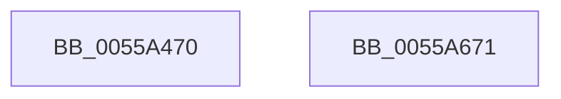

# HalpInterruptBuildStartupStub

- RVA: `0x0055A470`–`0x0055A672` (길이 `514` bytes)
- VA: `0x000000014055A470`
- 실행 섹션: `.text`
- PDB 이름 있음: `예`; PDB Function 태그: `아니요`
- unwind 정보 RVA: `0x00066400`
- 디코드: `114`개 명령, `514/514` bytes 표시
- 미해석 바이트: `0` (있으면 어셈블리에 `.byte`로 보존)

> 이 문서는 커널 이미지의 기계어와 PDB 기호를 분석해 생성했습니다. 4번과 5번은 함수 원형과 자료형을 바이너리 사용 방식에서 추정한 C 해석이며 원본 소스 복구 결과는 아닙니다.

## 1. Dependencies

- 직접 호출 지점: **6**; 고유 호출 대상: **3**
- 직접 호출자로 확인된 함수: **1**
- RIP 상대 이미지 참조: **7**

### Outgoing calls
- `0x0055A48B` → [MmGetPhysicalAddress](../23/MmGetPhysicalAddress_function_0023A500.md) (function, `0x0023A500`)
- `0x0055A4AA` → [memcpy](../6C/memcpy_function_006C6840.md) (function, `0x006C6840`)
- `0x0055A54C` → [memcpy](../6C/memcpy_function_006C6840.md) (function, `0x006C6840`)
- `0x0055A5AC` → [HalpInterruptCreateGdtEntry32](HalpInterruptCreateGdtEntry32_function_0055A7EC.md) (function, `0x0055A7EC`)
- `0x0055A5CF` → [HalpInterruptCreateGdtEntry32](HalpInterruptCreateGdtEntry32_function_0055A7EC.md) (function, `0x0055A7EC`)
- `0x0055A5EE` → [HalpInterruptCreateGdtEntry32](HalpInterruptCreateGdtEntry32_function_0055A7EC.md) (function, `0x0055A7EC`)

### Direct callers
- [HalpInterruptBuildGlobalStartupStub](../54/HalpInterruptBuildGlobalStartupStub_function_0054343C.md) at `0x005434D7`

### Static image references
- `0x0055A484` → RVA `0x00FC3E40` (`.data`; read)
- `0x0055A497` → RVA `0x000250D0` (`.rdata`; read)
- `0x0055A4B6` → RVA `0x00025750` (`.rdata`; read)
- `0x0055A4C5` → RVA `0x006AC803` (`HalpLMIdentityStubEnd`; read)
- `0x0055A52D` → RVA `0x006AC7F0` (`HalpLMIdentityStub`; read)
- `0x0055A558` → RVA `0x006AC820` (`HalpLMStub`; read)
- `0x0055A65F` → RVA `0x00FC3E08` (`.data`; write)

## 2. Other-region calls and transfers

- 다른 실행 섹션으로 향하는 call: **0**
- 별도 외부 분기/꼬리 이동을 확인하지 못했습니다.

## 3. Assembly (complete function range)

```asm
0055A470  48 89 5C 24 08                  mov qword ptr [rsp + 8], rbx
0055A475  48 89 6C 24 10                  mov qword ptr [rsp + 0x10], rbp
0055A47A  48 89 74 24 18                  mov qword ptr [rsp + 0x18], rsi
0055A47F  57                              push rdi
0055A480  48 83 EC 30                     sub rsp, 0x30
0055A484  48 8B 0D B5 99 A6 00            mov rcx, qword ptr [rip + 0xa699b5]
0055A48B  E8 70 00 CE FF                  call 0x14023a500
0055A490  48 8B 3D A9 99 A6 00            mov rdi, qword ptr [rip + 0xa699a9]
0055A497  48 8D 15 32 AC AC FF            lea rdx, [rip - 0x5353ce]
0055A49E  48 8B CF                        mov rcx, rdi
0055A4A1  41 B8 7C 06 00 00               mov r8d, 0x67c
0055A4A7  48 8B D8                        mov rbx, rax
0055A4AA  E8 91 C3 16 00                  call 0x1406c6840
0055A4AF  48 81 C7 7C 06 00 00            add rdi, 0x67c
0055A4B6  48 8D 0D 93 B2 AC FF            lea rcx, [rip - 0x534d6d]
0055A4BD  0F 10 01                        movups xmm0, xmmword ptr [rcx]
0055A4C0  B8 80 00 00 00                  mov eax, 0x80
0055A4C5  4C 8D 05 37 23 15 00            lea r8, [rip + 0x152337]
0055A4CC  BD 30 00 00 00                  mov ebp, 0x30
0055A4D1  0F 11 07                        movups xmmword ptr [rdi], xmm0
0055A4D4  0F 10 49 10                     movups xmm1, xmmword ptr [rcx + 0x10]
0055A4D8  48 8D 14 38                     lea rdx, [rax + rdi]
0055A4DC  0F 11 4F 10                     movups xmmword ptr [rdi + 0x10], xmm1
0055A4E0  0F 10 41 20                     movups xmm0, xmmword ptr [rcx + 0x20]
0055A4E4  0F 11 47 20                     movups xmmword ptr [rdi + 0x20], xmm0
0055A4E8  0F 10 49 30                     movups xmm1, xmmword ptr [rcx + 0x30]
0055A4EC  0F 11 4F 30                     movups xmmword ptr [rdi + 0x30], xmm1
0055A4F0  0F 10 41 40                     movups xmm0, xmmword ptr [rcx + 0x40]
0055A4F4  0F 11 47 40                     movups xmmword ptr [rdi + 0x40], xmm0
0055A4F8  0F 10 49 50                     movups xmm1, xmmword ptr [rcx + 0x50]
0055A4FC  0F 11 4F 50                     movups xmmword ptr [rdi + 0x50], xmm1
0055A500  0F 10 41 60                     movups xmm0, xmmword ptr [rcx + 0x60]
0055A504  0F 11 47 60                     movups xmmword ptr [rdi + 0x60], xmm0
0055A508  0F 10 41 70                     movups xmm0, xmmword ptr [rcx + 0x70]
0055A50C  48 03 C8                        add rcx, rax
0055A50F  0F 11 42 F0                     movups xmmword ptr [rdx - 0x10], xmm0
0055A513  8B 01                           mov eax, dword ptr [rcx]
0055A515  89 02                           mov dword ptr [rdx], eax
0055A517  8A 41 04                        mov al, byte ptr [rcx + 4]
0055A51A  8B CF                           mov ecx, edi
0055A51C  88 42 04                        mov byte ptr [rdx + 4], al
0055A51F  48 81 C7 85 00 00 00            add rdi, 0x85
0055A526  48 8B 05 13 99 A6 00            mov rax, qword ptr [rip + 0xa69913]
0055A52D  48 8D 15 BC 22 15 00            lea rdx, [rip + 0x1522bc]
0055A534  4C 2B C2                        sub r8, rdx
0055A537  66 89 68 64                     mov word ptr [rax + 0x64], bp
0055A53B  48 8B 05 FE 98 A6 00            mov rax, qword ptr [rip + 0xa698fe]
0055A542  2B C8                           sub ecx, eax
0055A544  03 CB                           add ecx, ebx
0055A546  89 48 60                        mov dword ptr [rax + 0x60], ecx
0055A549  48 8B CF                        mov rcx, rdi
0055A54C  E8 EF C2 16 00                  call 0x1406c6840
0055A551  48 8B 05 E8 98 A6 00            mov rax, qword ptr [rip + 0xa698e8]
0055A558  48 8D 0D C1 22 15 00            lea rcx, [rip + 0x1522c1]
0055A55F  8D 75 E0                        lea esi, [rbp - 0x20]
0055A562  C6 44 24 28 00                  mov byte ptr [rsp + 0x28], 0
0055A567  41 83 CA FF                     or r10d, 0xffffffff
0055A56B  44 8D 5D EB                     lea r11d, [rbp - 0x15]
0055A56F  45 8B CA                        mov r9d, r10d
0055A572  44 89 5C 24 20                  mov dword ptr [rsp + 0x20], r11d
0055A577  66 89 70 6A                     mov word ptr [rax + 0x6a], si
0055A57B  8B D5                           mov edx, ebp
0055A57D  48 8B 05 BC 98 A6 00            mov rax, qword ptr [rip + 0xa698bc]
0055A584  2B F8                           sub edi, eax
0055A586  03 FB                           add edi, ebx
0055A588  89 78 66                        mov dword ptr [rax + 0x66], edi
0055A58B  48 8B 05 AE 98 A6 00            mov rax, qword ptr [rip + 0xa698ae]
0055A592  48 89 40 78                     mov qword ptr [rax + 0x78], rax
0055A596  48 8B 05 A3 98 A6 00            mov rax, qword ptr [rip + 0xa698a3]
0055A59D  48 89 48 70                     mov qword ptr [rax + 0x70], rcx
0055A5A1  48 8B 0D 98 98 A6 00            mov rcx, qword ptr [rip + 0xa69898]
0055A5A8  48 83 C1 18                     add rcx, 0x18
0055A5AC  E8 3B 02 00 00                  call 0x14055a7ec
0055A5B1  48 8B 0D 88 98 A6 00            mov rcx, qword ptr [rip + 0xa69888]
0055A5B8  8D 55 F0                        lea edx, [rbp - 0x10]
0055A5BB  48 83 C1 18                     add rcx, 0x18
0055A5BF  C6 44 24 28 00                  mov byte ptr [rsp + 0x28], 0
0055A5C4  45 8B CA                        mov r9d, r10d
0055A5C7  C7 44 24 20 13 00 00 00         mov dword ptr [rsp + 0x20], 0x13
0055A5CF  E8 18 02 00 00                  call 0x14055a7ec
0055A5D4  48 8B 0D 65 98 A6 00            mov rcx, qword ptr [rip + 0xa69865]
0055A5DB  8B D6                           mov edx, esi
0055A5DD  48 83 C1 18                     add rcx, 0x18
0055A5E1  C6 44 24 28 01                  mov byte ptr [rsp + 0x28], 1
0055A5E6  45 33 C9                        xor r9d, r9d
0055A5E9  44 89 5C 24 20                  mov dword ptr [rsp + 0x20], r11d
0055A5EE  E8 F9 01 00 00                  call 0x14055a7ec
0055A5F3  48 8B 05 46 98 A6 00            mov rax, qword ptr [rip + 0xa69846]
0055A5FA  8D 4B 18                        lea ecx, [rbx + 0x18]
0055A5FD  66 C7 40 0C 3F 00               mov word ptr [rax + 0xc], 0x3f
0055A603  48 8B 05 36 98 A6 00            mov rax, qword ptr [rip + 0xa69836]
0055A60A  89 48 0E                        mov dword ptr [rax + 0xe], ecx
0055A60D  B9 77 02 00 00                  mov ecx, 0x277
0055A612  0F 32                           rdmsr
0055A614  48 8B 0D 25 98 A6 00            mov rcx, qword ptr [rip + 0xa69825]
0055A61B  48 C1 E2 20                     shl rdx, 0x20
0055A61F  48 0B C2                        or rax, rdx
0055A622  48 89 81 80 00 00 00            mov qword ptr [rcx + 0x80], rax
0055A629  B9 80 00 00 C0                  mov ecx, 0xc0000080
0055A62E  0F 32                           rdmsr
0055A630  48 8B 0D 09 98 A6 00            mov rcx, qword ptr [rip + 0xa69809]
0055A637  48 8B 6C 24 48                  mov rbp, qword ptr [rsp + 0x48]
0055A63C  48 8B 74 24 50                  mov rsi, qword ptr [rsp + 0x50]
0055A641  48 C1 E2 20                     shl rdx, 0x20
0055A645  48 0B C2                        or rax, rdx
0055A648  48 89 81 88 00 00 00            mov qword ptr [rcx + 0x88], rax
0055A64F  48 8B 05 EA 97 A6 00            mov rax, qword ptr [rip + 0xa697ea]
0055A656  48 0F BA B0 88 00 00 00 0A      btr qword ptr [rax + 0x88], 0xa
0055A65F  48 89 1D A2 97 A6 00            mov qword ptr [rip + 0xa697a2], rbx
0055A666  48 8B 5C 24 40                  mov rbx, qword ptr [rsp + 0x40]
0055A66B  48 83 C4 30                     add rsp, 0x30
0055A66F  5F                              pop rdi
0055A670  C3                              ret
0055A671  CC                              int3
```

## 4. C-style interpretation (structured pseudocode)

```c
__int64 __fastcall HalpInterruptBuildStartupStub(void)
{
    __int64 result;
    __int64 v_r10;
    __int64 v_rdi;
    __int64 v_rsp;
    unsigned __int8 v_stack_m10;
    unsigned int v_stack_m18;
    unsigned __int64 v_stack_p10;
    unsigned __int64 v_stack_p18;
    unsigned __int64 v_stack_p8;

    v_stack_p8 = v_rbx;
    v_stack_p10 = v_rbp;
    v_stack_p18 = v_rsi;
    v_rsp = (v_rsp) - (48);
    result = MmGetPhysicalAddress(*(unsigned __int64 *)(v_rip + 10918325), a2, a3, a4);
    result = memcpy(*(unsigned __int64 *)(v_rip + 10918313), v_rip - 5460942, (unsigned int)(0x67CULL), a4);
    v_rdi = (*(unsigned __int64 *)(v_rip + 10918313)) + (0x67CULL);
    *(unsigned __int64 *)(v_rdi) = v_xmm0;
    *(unsigned __int64 *)(v_rdi + 16) = v_xmm1;
    *(unsigned __int64 *)(v_rdi + 32) = v_xmm0;
    *(unsigned __int64 *)(v_rdi + 48) = v_xmm1;
    *(unsigned __int64 *)(v_rdi + 64) = v_xmm0;
    *(unsigned __int64 *)(v_rdi + 80) = v_xmm1;
    *(unsigned __int64 *)(v_rdi + 96) = v_xmm0;
    a1 = (v_rip - 5459309) + (128);
    *(unsigned __int64 *)(128 + v_rdi * 1 - 16) = v_xmm0;
    *(unsigned int *)(128 + v_rdi * 1) = (unsigned int)((unsigned int)(*(unsigned int *)(a1)));
    *(unsigned __int8 *)(128 + v_rdi * 1 + 4) = (unsigned __int8)(*(unsigned __int8 *)(a1 + 4));
    v_rdi = (v_rdi) + (133);
    a3 = (v_rip + 1385271) - (v_rip + 1385148);
    *(unsigned __int16 *)(*(unsigned __int64 *)(v_rip + 10918163) + 100) = 48;
    a1 = (unsigned int)(((unsigned int)((unsigned int)(v_rdi))) - ((unsigned int)(*(unsigned __int64 *)(v_rip + 10918142))));
    a1 = (unsigned int)((a1) + ((unsigned int)(result)));
    *(unsigned int *)(*(unsigned __int64 *)(v_rip + 10918142) + 96) = (unsigned int)(a1);
    result = memcpy(v_rdi, v_rip + 1385148, a3, a4);
    v_stack_m10 = 0;
    v_r10 = (unsigned int)((v_r10) | (0xFFFFFFFFULL));
    v_stack_m18 = (unsigned int)(48 - 21);
    *(unsigned __int16 *)(*(unsigned __int64 *)(v_rip + 10918120) + 106) = (unsigned __int16)(48 - 32);
    v_rdi = (unsigned int)((v_rdi) - ((unsigned int)(*(unsigned __int64 *)(v_rip + 10918076))));
    v_rdi = (unsigned int)((v_rdi) + ((unsigned int)(result)));
    *(unsigned int *)(*(unsigned __int64 *)(v_rip + 10918076) + 102) = (unsigned int)(v_rdi);
    *(unsigned __int64 *)(*(unsigned __int64 *)(v_rip + 10918062) + 120) = *(unsigned __int64 *)(v_rip + 10918062);
    *(unsigned __int64 *)(*(unsigned __int64 *)(v_rip + 10918051) + 112) = v_rip + 1385153;
    a1 = (*(unsigned __int64 *)(v_rip + 10918040)) + (24);
    result = HalpInterruptCreateGdtEntry32(a1, 48, a3, (unsigned int)((unsigned int)(v_r10)));
    a1 = (*(unsigned __int64 *)(v_rip + 10918024)) + (24);
    v_stack_m10 = 0;
    v_stack_m18 = 19;
    result = HalpInterruptCreateGdtEntry32(a1, 48 - 16, a3, (unsigned int)((unsigned int)(v_r10)));
    a1 = (*(unsigned __int64 *)(v_rip + 10917989)) + (24);
    v_stack_m10 = 1;
    a4 = 0;
    v_stack_m18 = (unsigned int)(48 - 21);
    result = HalpInterruptCreateGdtEntry32(a1, (unsigned int)((unsigned int)(48 - 32)), a3, a4);
    *(unsigned __int16 *)(*(unsigned __int64 *)(v_rip + 10917958) + 12) = 63;
    *(unsigned int *)(*(unsigned __int64 *)(v_rip + 10917942) + 14) = (unsigned int)(result + 24);
    a2 = ((unsigned int)((unsigned int)(48 - 32))) << (32);
    result = (*(unsigned __int64 *)(v_rip + 10917942)) | (a2);
    *(unsigned __int64 *)(*(unsigned __int64 *)(v_rip + 10917925) + 128) = result;
    a2 = (a2) << (32);
    result = (result) | (a2);
    *(unsigned __int64 *)(*(unsigned __int64 *)(v_rip + 10917897) + 136) = result;
    *(unsigned __int64 *)(v_rip + 10917794) = result;
    v_rsp = (v_rsp) + (48);
    return *(unsigned __int64 *)(v_rip + 10917866);
}
```

## 5. (Beta) C Style

```c
void HalpInterruptBuildStartupStub(void)
{
    int64_t result;
    int64_t local_r10;
    int64_t local_rdi;
    int64_t local_rsp;
    uint8_t v_stack_m10;
    uint32_t v_stack_m18;
    uint64_t v_stack_p10;
    uint64_t v_stack_p18;
    uint64_t v_stack_p8;

    v_stack_p8 = local_rbx;
    v_stack_p10 = local_rbp;
    v_stack_p18 = local_rsi;
    local_rsp = (local_rsp) - (48);
    result = MmGetPhysicalAddress(*(uint64_t *)(v_rip + 0xA699B5), a2, a3, a4);
    result = memcpy(*(uint64_t *)(v_rip + 0xA699A9), v_rip - 5460942, (uint32_t)(0x67CULL), a4);
    local_rdi = (*(uint64_t *)(v_rip + 0xA699A9)) + (0x67CULL);
    *(uint64_t *)(local_rdi) = v_xmm0;
    *(uint64_t *)(local_rdi + 0x10) = v_xmm1;
    *(uint64_t *)(local_rdi + 0x20) = v_xmm0;
    *(uint64_t *)(local_rdi + 0x30) = v_xmm1;
    *(uint64_t *)(local_rdi + 0x40) = v_xmm0;
    *(uint64_t *)(local_rdi + 0x50) = v_xmm1;
    *(uint64_t *)(local_rdi + 0x60) = v_xmm0;
    a1 = (v_rip - 5459309) + (128);
    *(uint64_t *)(128 + local_rdi * 1 - 0x10) = v_xmm0;
    *(uint32_t *)(128 + local_rdi * 1) = (uint32_t)((uint32_t)(*(uint32_t *)(a1)));
    *(uint8_t *)(128 + local_rdi * 1 + 0x4) = (uint8_t)(*(uint8_t *)(a1 + 0x4));
    local_rdi = (local_rdi) + (133);
    a3 = (v_rip + 1385271) - (v_rip + 1385148);
    *(uint16_t *)(*(uint64_t *)(v_rip + 0xA69913) + 0x64) = 48;
    a1 = (uint32_t)(((uint32_t)((uint32_t)(local_rdi))) - ((uint32_t)(*(uint64_t *)(v_rip + 0xA698FE))));
    a1 = (uint32_t)((a1) + ((uint32_t)(result)));
    *(uint32_t *)(*(uint64_t *)(v_rip + 0xA698FE) + 0x60) = (uint32_t)(a1);
    result = memcpy(local_rdi, v_rip + 1385148, a3, a4);
    v_stack_m10 = 0;
    local_r10 = (uint32_t)((local_r10) | (0xFFFFFFFFULL));
    v_stack_m18 = (uint32_t)(48 - 21);
    *(uint16_t *)(*(uint64_t *)(v_rip + 0xA698E8) + 0x6A) = (uint16_t)(48 - 32);
    local_rdi = (uint32_t)((local_rdi) - ((uint32_t)(*(uint64_t *)(v_rip + 0xA698BC))));
    local_rdi = (uint32_t)((local_rdi) + ((uint32_t)(result)));
    *(uint32_t *)(*(uint64_t *)(v_rip + 0xA698BC) + 0x66) = (uint32_t)(local_rdi);
    *(uint64_t *)(*(uint64_t *)(v_rip + 0xA698AE) + 0x78) = *(uint64_t *)(v_rip + 0xA698AE);
    *(uint64_t *)(*(uint64_t *)(v_rip + 0xA698A3) + 0x70) = v_rip + 1385153;
    a1 = (*(uint64_t *)(v_rip + 0xA69898)) + (24);
    result = HalpInterruptCreateGdtEntry32(a1, 48, a3, (uint32_t)((uint32_t)(local_r10)));
    a1 = (*(uint64_t *)(v_rip + 0xA69888)) + (24);
    v_stack_m10 = 0;
    v_stack_m18 = 19;
    result = HalpInterruptCreateGdtEntry32(a1, 48 - 16, a3, (uint32_t)((uint32_t)(local_r10)));
    a1 = (*(uint64_t *)(v_rip + 0xA69865)) + (24);
    v_stack_m10 = 1;
    a4 = 0;
    v_stack_m18 = (uint32_t)(48 - 21);
    result = HalpInterruptCreateGdtEntry32(a1, (uint32_t)((uint32_t)(48 - 32)), a3, a4);
    *(uint16_t *)(*(uint64_t *)(v_rip + 0xA69846) + 0xC) = 63;
    *(uint32_t *)(*(uint64_t *)(v_rip + 0xA69836) + 0xE) = (uint32_t)(result + 24);
    a2 = ((uint32_t)((uint32_t)(48 - 32))) << (32);
    result = (*(uint64_t *)(v_rip + 0xA69836)) | (a2);
    *(uint64_t *)(*(uint64_t *)(v_rip + 0xA69825) + 0x80) = result;
    a2 = (a2) << (32);
    result = (result) | (a2);
    *(uint64_t *)(*(uint64_t *)(v_rip + 0xA69809) + 0x88) = result;
    *(uint64_t *)(v_rip + 0xA697A2) = result;
    local_rsp = (local_rsp) + (48);
    return *(uint64_t *)(v_rip + 0xA697EA);
}
```

## 6. Execution-region graph

[열기: 2D/3D 그래프와 함수 탐색 컨트롤 패널](../../../control-panel.html?section=text&rva=0x0055A470&view=graph)

- 2D 그래프는 위에서 아래로 흐르고, 3D 그래프는 빈 공간을 드래그해 회전합니다. Shift+드래그는 이동, 휠은 확대·축소, 함수 노드 선택은 대상 보고서 이동입니다.

### Static fallback


