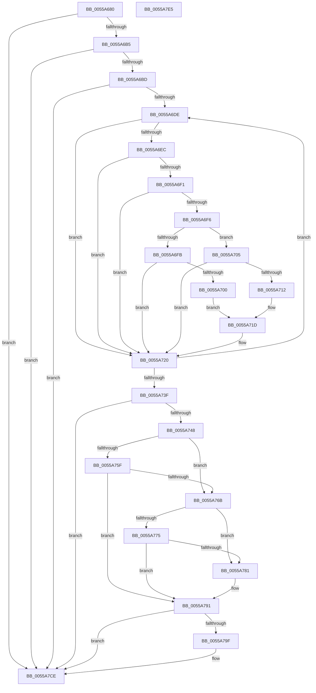

# HalpInterruptCheckProcessorCacheDomainSharing

- RVA: `0x0055A680`–`0x0055A7E6` (길이 `358` bytes)
- VA: `0x000000014055A680`
- 실행 섹션: `.text`
- PDB 이름 있음: `예`; PDB Function 태그: `아니요`
- unwind 정보 RVA: `0x000C477C`
- 디코드: `111`개 명령, `358/358` bytes 표시
- 미해석 바이트: `0` (있으면 어셈블리에 `.byte`로 보존)

> 이 문서는 커널 이미지의 기계어와 PDB 기호를 분석해 생성했습니다. 4번과 5번은 함수 원형과 자료형을 바이너리 사용 방식에서 추정한 C 해석이며 원본 소스 복구 결과는 아닙니다.

## 1. Dependencies

- 직접 호출 지점: **1**; 고유 호출 대상: **1**
- 직접 호출자로 확인된 함수: **1**
- RIP 상대 이미지 참조: **5**

### Outgoing calls
- `0x0055A7D5` → [_security_check_cookie](../6A/_security_check_cookie_function_006AC640.md) (function, `0x006AC640`)

### Direct callers
- [HalpLMStub](../6A/HalpLMStub_function_006AC820.md) at `0x006AC9EF`

### Static image references
- `0x0055A68D` → RVA `0x00E0A740` (`.data`; read)
- `0x0055A791` → RVA `0x00F905F4` (`.data`; read)
- `0x0055A797` → RVA `0x00F905F0` (`.data`; read)
- `0x0055A7AF` → RVA `0x00F905F8` (`.data`; read)
- `0x0055A7C8` → RVA `0x00F905F4` (`.data`; write)

## 2. Other-region calls and transfers

- 다른 실행 섹션으로 향하는 call: **0**
- 별도 외부 분기/꼬리 이동을 확인하지 못했습니다.

## 3. Assembly (complete function range)

```asm
0055A680  48 89 5C 24 08                  mov qword ptr [rsp + 8], rbx
0055A685  55                              push rbp
0055A686  48 8B EC                        mov rbp, rsp
0055A689  48 83 EC 20                     sub rsp, 0x20
0055A68D  48 8B 05 AC 00 8B 00            mov rax, qword ptr [rip + 0x8b00ac]
0055A694  48 33 C4                        xor rax, rsp
0055A697  48 89 45 F8                     mov qword ptr [rbp - 8], rax
0055A69B  8B 41 08                        mov eax, dword ptr [rcx + 8]
0055A69E  45 33 C9                        xor r9d, r9d
0055A6A1  8B C8                           mov ecx, eax
0055A6A3  0F 57 C0                        xorps xmm0, xmm0
0055A6A6  83 E1 10                        and ecx, 0x10
0055A6A9  0F 11 45 E8                     movups xmmword ptr [rbp - 0x18], xmm0
0055A6AD  A8 08                           test al, 8
0055A6AF  0F 84 19 01 00 00               je 0x14055a7ce
0055A6B5  85 C9                           test ecx, ecx
0055A6B7  0F 85 11 01 00 00               jne 0x14055a7ce
0055A6BD  8D 41 04                        lea eax, [rcx + 4]
0055A6C0  45 33 D2                        xor r10d, r10d
0055A6C3  0F A2                           cpuid
0055A6C5  8B C8                           mov ecx, eax
0055A6C7  89 55 F4                        mov dword ptr [rbp - 0xc], edx
0055A6CA  C1 E1 1B                        shl ecx, 0x1b
0055A6CD  45 33 DB                        xor r11d, r11d
0055A6D0  C1 F9 1B                        sar ecx, 0x1b
0055A6D3  44 8B C0                        mov r8d, eax
0055A6D6  85 C9                           test ecx, ecx
0055A6D8  0F 84 F0 00 00 00               je 0x14055a7ce
0055A6DE  41 8B D0                        mov edx, r8d
0055A6E1  C1 EA 05                        shr edx, 5
0055A6E4  83 E2 07                        and edx, 7
0055A6E7  44 3B D2                        cmp r10d, edx
0055A6EA  73 34                           jae 0x14055a720
0055A6EC  83 E9 01                        sub ecx, 1
0055A6EF  74 2F                           je 0x14055a720
0055A6F1  83 E9 01                        sub ecx, 1
0055A6F4  74 2A                           je 0x14055a720
0055A6F6  83 E9 01                        sub ecx, 1
0055A6F9  74 0A                           je 0x14055a705
0055A6FB  83 F9 02                        cmp ecx, 2
0055A6FE  74 20                           je 0x14055a720
0055A700  45 33 C9                        xor r9d, r9d
0055A703  EB 18                           jmp 0x14055a71d
0055A705  41 C1 E8 0E                     shr r8d, 0xe
0055A709  41 81 E0 FF 0F 00 00            and r8d, 0xfff
0055A710  76 0E                           jbe 0x14055a720
0055A712  45 33 C9                        xor r9d, r9d
0055A715  F6 45 F4 01                     test byte ptr [rbp - 0xc], 1
0055A719  45 0F 44 C8                     cmove r9d, r8d
0055A71D  44 8B D2                        mov r10d, edx
0055A720  41 FF C3                        inc r11d
0055A723  B8 04 00 00 00                  mov eax, 4
0055A728  41 8B CB                        mov ecx, r11d
0055A72B  0F A2                           cpuid
0055A72D  8B C8                           mov ecx, eax
0055A72F  89 55 F4                        mov dword ptr [rbp - 0xc], edx
0055A732  C1 E1 1B                        shl ecx, 0x1b
0055A735  44 8B C0                        mov r8d, eax
0055A738  C1 F9 1B                        sar ecx, 0x1b
0055A73B  85 C9                           test ecx, ecx
0055A73D  75 9F                           jne 0x14055a6de
0055A73F  45 85 C9                        test r9d, r9d
0055A742  0F 84 86 00 00 00               je 0x14055a7ce
0055A748  33 C0                           xor eax, eax
0055A74A  41 BB 00 FF 00 00               mov r11d, 0xff00
0055A750  0F A2                           cpuid
0055A752  44 8B D0                        mov r10d, eax
0055A755  B8 1F 00 00 00                  mov eax, 0x1f
0055A75A  44 3B D0                        cmp r10d, eax
0055A75D  72 0C                           jb 0x14055a76b
0055A75F  33 C9                           xor ecx, ecx
0055A761  0F A2                           cpuid
0055A763  44 8B C2                        mov r8d, edx
0055A766  41 85 CB                        test r11d, ecx
0055A769  75 26                           jne 0x14055a791
0055A76B  B8 0B 00 00 00                  mov eax, 0xb
0055A770  44 3B D0                        cmp r10d, eax
0055A773  72 0C                           jb 0x14055a781
0055A775  33 C9                           xor ecx, ecx
0055A777  0F A2                           cpuid
0055A779  44 8B C2                        mov r8d, edx
0055A77C  41 85 CB                        test r11d, ecx
0055A77F  75 10                           jne 0x14055a791
0055A781  33 C9                           xor ecx, ecx
0055A783  B8 01 00 00 00                  mov eax, 1
0055A788  0F A2                           cpuid
0055A78A  44 8B C3                        mov r8d, ebx
0055A78D  41 C1 E8 18                     shr r8d, 0x18
0055A791  8B 1D 5D 5E A3 00               mov ebx, dword ptr [rip + 0xa35e5d]
0055A797  3B 1D 53 5E A3 00               cmp ebx, dword ptr [rip + 0xa35e53]
0055A79D  73 2F                           jae 0x14055a7ce
0055A79F  42 8D 04 4D 01 00 00 00         lea eax, [r9*2 + 1]
0055A7A7  BA 01 00 00 00                  mov edx, 1
0055A7AC  0F BD C8                        bsr ecx, eax
0055A7AF  48 8B 05 42 5E A3 00            mov rax, qword ptr [rip + 0xa35e42]
0055A7B6  D3 E2                           shl edx, cl
0055A7B8  FF CA                           dec edx
0055A7BA  F7 D2                           not edx
0055A7BC  89 54 D8 04                     mov dword ptr [rax + rbx*8 + 4], edx
0055A7C0  41 23 D0                        and edx, r8d
0055A7C3  89 14 D8                        mov dword ptr [rax + rbx*8], edx
0055A7C6  FF C3                           inc ebx
0055A7C8  89 1D 26 5E A3 00               mov dword ptr [rip + 0xa35e26], ebx
0055A7CE  48 8B 4D F8                     mov rcx, qword ptr [rbp - 8]
0055A7D2  48 33 CC                        xor rcx, rsp
0055A7D5  E8 66 1E 15 00                  call 0x1406ac640
0055A7DA  48 8B 5C 24 30                  mov rbx, qword ptr [rsp + 0x30]
0055A7DF  48 83 C4 20                     add rsp, 0x20
0055A7E3  5D                              pop rbp
0055A7E4  C3                              ret
0055A7E5  CC                              int3
```

## 4. C-style interpretation (structured pseudocode)

```c
__int64 __fastcall HalpInterruptCheckProcessorCacheDomainSharing(__int64 a1, int a2, __int64 a3, int a4)
{
    __int64 result;
    __int64 v_r10;
    __int64 v_r11;
    __int64 v_rbx;
    __int64 v_rsp;
    unsigned __int64 v_stack_m10;
    unsigned int v_stack_m14;
    unsigned __int64 v_stack_m20;
    unsigned __int64 v_stack_p8;

    v_stack_p8 = v_rbx;
    v_rsp = (v_rsp) - (32);
    result = (*(unsigned __int64 *)(v_rip + 9109676)) ^ (v_rsp);
    v_stack_m10 = result;
    a4 = 0;
    a1 = (unsigned int)(((unsigned int)((unsigned int)((unsigned int)(*(unsigned int *)(a1 + 8))))) & (16));
    v_stack_m20 = v_xmm0;
    if ((((unsigned __int8)((unsigned int)(*(unsigned int *)(a1 + 8)))) & (8)) == 0) goto loc_0055A7CE;
    if ((unsigned int)(a1) != 0) goto loc_0055A7CE;
    v_r10 = 0;
    v_stack_m14 = a2;
    a1 = (unsigned int)(((unsigned int)((unsigned int)(a1 + 4))) << (27));
    v_r11 = 0;
    a1 = (unsigned int)((a1) >> (27));
    if ((unsigned int)(a1) == 0) goto loc_0055A7CE;
loc_0055A6DE:
    a2 = (unsigned int)(((unsigned int)((unsigned int)((unsigned int)((unsigned int)(a1 + 4))))) >> (5));
    a2 = (unsigned int)((a2) & (7));
    if (0 >= a2) goto loc_0055A720;
    a1 = (unsigned int)((a1) - (1));
    if (condition_is_equal) goto loc_0055A720;
    a1 = (unsigned int)((a1) - (1));
    if (condition_is_equal) goto loc_0055A720;
    a1 = (unsigned int)((a1) - (1));
    if (condition_is_equal) goto loc_0055A705;
    if (((unsigned int)(a1)) == 2) goto loc_0055A720;
    a4 = 0;
    goto loc_0055A71D;
loc_0055A705:
    a3 = (unsigned int)(((unsigned int)((unsigned int)(a1 + 4))) >> (14));
    a3 = (unsigned int)((a3) & (0xFFFULL));
    if (condition_is_below_or_equal) goto loc_0055A720;
    a4 = 0;
    if (((v_stack_m14) & (1)) == 0) { a4 = (unsigned int)(a3); }
loc_0055A71D:
loc_0055A720:
    v_r11 = (unsigned int)((v_r11) + 1);
    v_stack_m14 = a2;
    a1 = (unsigned int)((4) << (27));
    a1 = (unsigned int)((a1) >> (27));
    if ((unsigned int)(a1) != 0) goto loc_0055A6DE;
    if (a4 == 0) goto loc_0055A7CE;
    result = 0;
    if (0 < 31) goto loc_0055A76B;
    a1 = 0;
    if ((((unsigned int)((unsigned int)(0xFF00ULL))) & (0)) != 0) goto loc_0055A791;
loc_0055A76B:
    if (0 < 11) goto loc_0055A781;
    a1 = 0;
    result = 11;
    if ((((unsigned int)((unsigned int)(0xFF00ULL))) & (0)) == 0) {
        a1 = 0;
        result = 1;
        a3 = (unsigned int)(v_rbx);
        a3 = (unsigned int)((a3) >> (24));
    }
    v_rbx = (unsigned int)(*(unsigned int *)(v_rip + 10706525));
    if (((unsigned int)((unsigned int)(*(unsigned int *)(v_rip + 10706525)))) < (*(unsigned int *)(v_rip + 10706515))) {
        result = a4 * 2 + 1;
        a2 = 1;
        result = *(unsigned __int64 *)(v_rip + 10706498);
        a2 = (unsigned int)((a2) << (0));
        a2 = (unsigned int)((a2) - 1);
        a2 = (unsigned int)(~(a2));
        *(unsigned int *)(result + (unsigned int)(*(unsigned int *)(v_rip + 10706525)) * 8 + 4) = a2;
        a2 = (unsigned int)((a2) & ((unsigned int)(a3)));
        *(unsigned int *)(result + (unsigned int)(*(unsigned int *)(v_rip + 10706525)) * 8) = a2;
        v_rbx = (unsigned int)(((unsigned int)(*(unsigned int *)(v_rip + 10706525))) + 1);
        *(unsigned int *)(v_rip + 10706470) = (unsigned int)(v_rbx);
    }
    a1 = (v_stack_m10) ^ (v_rsp);
    result = _security_check_cookie(a1, a2, a3, a4);
    v_rsp = (v_rsp) + (32);
    return result;
}
```

## 5. (Beta) C Style

```c
int64_t HalpInterruptCheckProcessorCacheDomainSharing(void *Arg1, int32_t Arg2, int64_t Arg3, int32_t Arg4)
{
    uint8_t *arg1 = (uint8_t *)Arg1;

    int64_t result;
    int64_t local_r10;
    int64_t local_r11;
    int64_t local_rbx;
    int64_t local_rsp;
    uint64_t v_stack_m10;
    uint32_t v_stack_m14;
    uint64_t v_stack_m20;
    uint64_t v_stack_p8;

    v_stack_p8 = local_rbx;
    local_rsp = (local_rsp) - (32);
    result = (*(uint64_t *)(v_rip + 0x8B00AC)) ^ (local_rsp);
    v_stack_m10 = result;
    Arg4 = 0;
    Arg1 = (uint32_t)(((uint32_t)((uint32_t)((uint32_t)(*(uint32_t *)(arg1 + 0x8))))) & (16));
    v_stack_m20 = v_xmm0;
    if ((((uint8_t)((uint32_t)(*(uint32_t *)(arg1 + 0x8)))) & (8)) == 0) goto loc_0055A7CE;
    if ((uint32_t)(Arg1) != 0) goto loc_0055A7CE;
    local_r10 = 0;
    v_stack_m14 = Arg2;
    Arg1 = (uint32_t)(((uint32_t)((uint32_t)(Arg1 + 4))) << (27));
    local_r11 = 0;
    Arg1 = (uint32_t)((Arg1) >> (27));
    if ((uint32_t)(Arg1) == 0) goto loc_0055A7CE;
loc_0055A6DE:
    Arg2 = (uint32_t)(((uint32_t)((uint32_t)((uint32_t)((uint32_t)(Arg1 + 4))))) >> (5));
    Arg2 = (uint32_t)((Arg2) & (7));
    if (0 >= Arg2) goto loc_0055A720;
    Arg1 = (uint32_t)((Arg1) - (1));
    if (condition_is_equal) goto loc_0055A720;
    Arg1 = (uint32_t)((Arg1) - (1));
    if (condition_is_equal) goto loc_0055A720;
    Arg1 = (uint32_t)((Arg1) - (1));
    if (condition_is_equal) goto loc_0055A705;
    if (((uint32_t)(Arg1)) == 2) goto loc_0055A720;
    Arg4 = 0;
    goto loc_0055A71D;
loc_0055A705:
    Arg3 = (uint32_t)(((uint32_t)((uint32_t)(Arg1 + 4))) >> (14));
    Arg3 = (uint32_t)((Arg3) & (0xFFFULL));
    if (condition_is_below_or_equal) goto loc_0055A720;
    Arg4 = 0;
    if (((v_stack_m14) & (1)) == 0) { Arg4 = (uint32_t)(Arg3); }
loc_0055A71D:
loc_0055A720:
    local_r11 = (uint32_t)((local_r11) + 1);
    v_stack_m14 = Arg2;
    Arg1 = (uint32_t)((4) << (27));
    Arg1 = (uint32_t)((Arg1) >> (27));
    if ((uint32_t)(Arg1) != 0) goto loc_0055A6DE;
    if (Arg4 == 0) goto loc_0055A7CE;
    result = 0;
    if (0 < 31) goto loc_0055A76B;
    Arg1 = 0;
    if ((((uint32_t)((uint32_t)(0xFF00ULL))) & (0)) != 0) goto loc_0055A791;
loc_0055A76B:
    if (0 < 11) goto loc_0055A781;
    Arg1 = 0;
    result = 11;
    if ((((uint32_t)((uint32_t)(0xFF00ULL))) & (0)) == 0) {
        Arg1 = 0;
        result = 1;
        Arg3 = (uint32_t)(local_rbx);
        Arg3 = (uint32_t)((Arg3) >> (24));
    }
    local_rbx = (uint32_t)(*(uint32_t *)(v_rip + 0xA35E5D));
    if (((uint32_t)((uint32_t)(*(uint32_t *)(v_rip + 0xA35E5D)))) < (*(uint32_t *)(v_rip + 0xA35E53))) {
        result = Arg4 * 2 + 1;
        Arg2 = 1;
        result = *(uint64_t *)(v_rip + 0xA35E42);
        Arg2 = (uint32_t)((Arg2) << (0));
        Arg2 = (uint32_t)((Arg2) - 1);
        Arg2 = (uint32_t)(~(Arg2));
        *(uint32_t *)(result + (uint32_t)(*(uint32_t *)(v_rip + 0xA35E5D)) * 8 + 0x4) = Arg2;
        Arg2 = (uint32_t)((Arg2) & ((uint32_t)(Arg3)));
        *(uint32_t *)(result + (uint32_t)(*(uint32_t *)(v_rip + 0xA35E5D)) * 8) = Arg2;
        local_rbx = (uint32_t)(((uint32_t)(*(uint32_t *)(v_rip + 0xA35E5D))) + 1);
        *(uint32_t *)(v_rip + 0xA35E26) = (uint32_t)(local_rbx);
    }
    Arg1 = (v_stack_m10) ^ (local_rsp);
    result = _security_check_cookie(Arg1, Arg2, Arg3, Arg4);
    local_rsp = (local_rsp) + (32);
    return result;
}
```

### 관측된 메모리 오프셋

구조체 형식이 확인되지 않은 접근은 인자 기준의 오프셋으로만 기록했습니다.

| 기준 인자 | 오프셋 표현 | 폭 (bit) | 접근 |
|---|---:|---:|---|
| `Arg1` | `+ 0x8` | `32` | `R` |

## 6. Execution-region graph

[열기: 2D/3D 그래프와 함수 탐색 컨트롤 패널](../../../control-panel.html?section=text&rva=0x0055A680&view=graph)

- 2D 그래프는 위에서 아래로 흐르고, 3D 그래프는 빈 공간을 드래그해 회전합니다. Shift+드래그는 이동, 휠은 확대·축소, 함수 노드 선택은 대상 보고서 이동입니다.

### Static fallback


