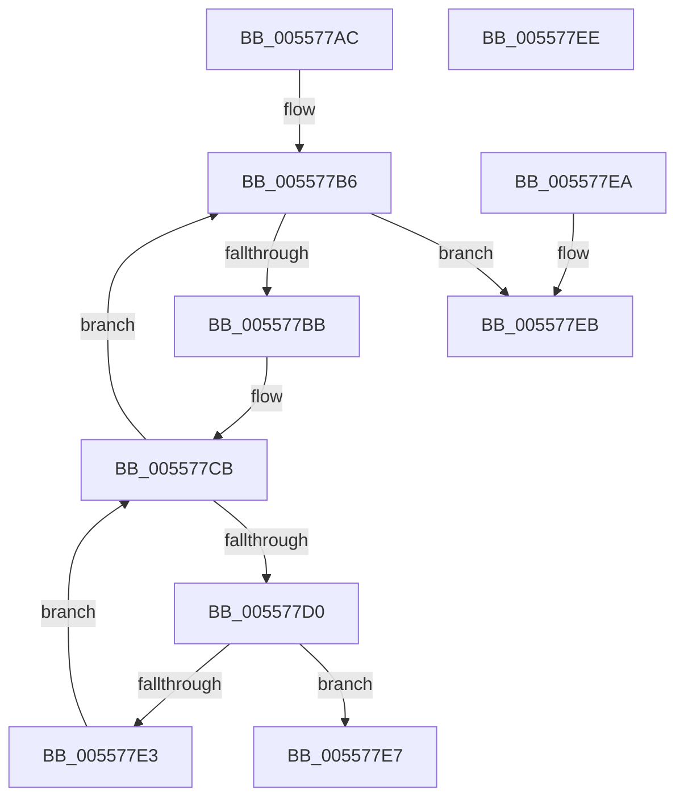

# HalpInterruptControllerInUse

- RVA: `0x005577AC`–`0x005577EF` (길이 `67` bytes)
- VA: `0x00000001405577AC`
- 실행 섹션: `.text`
- PDB 이름 있음: `예`; PDB Function 태그: `아니요`
- unwind 정보 RVA: `0x000DB714`
- 디코드: `25`개 명령, `67/67` bytes 표시
- 미해석 바이트: `0` (있으면 어셈블리에 `.byte`로 보존)

> 이 문서는 커널 이미지의 기계어와 PDB 기호를 분석해 생성했습니다. 4번과 5번은 함수 원형과 자료형을 바이너리 사용 방식에서 추정한 C 해석이며 원본 소스 복구 결과는 아닙니다.

## 1. Dependencies

- 직접 호출 지점: **0**; 고유 호출 대상: **0**
- 직접 호출자로 확인된 함수: **1**
- RIP 상대 이미지 참조: **0**

### Outgoing calls
- 직접 디코드된 call 명령이 없습니다.

### Direct callers
- [HalpInterruptReinitialize](../../pagelk/B7/HalpInterruptReinitialize_function_00B79BEC.md) at `0x00B79C4A`

### Static image references
- 디코드된 RIP-relative 메모리 참조가 없습니다.

## 2. Other-region calls and transfers

- 다른 실행 섹션으로 향하는 call: **0**
- 별도 외부 분기/꼬리 이동을 확인하지 못했습니다.

## 3. Assembly (complete function range)

```asm
005577AC  4C 8D 89 08 01 00 00            lea r9, [rcx + 0x108]
005577B3  4D 8B 01                        mov r8, qword ptr [r9]
005577B6  4D 3B C1                        cmp r8, r9
005577B9  74 30                           je 0x1405577eb
005577BB  4D 8B D8                        mov r11, r8
005577BE  4D 8B 00                        mov r8, qword ptr [r8]
005577C1  45 8B 53 18                     mov r10d, dword ptr [r11 + 0x18]
005577C5  45 2B 53 14                     sub r10d, dword ptr [r11 + 0x14]
005577C9  33 D2                           xor edx, edx
005577CB  41 3B D2                        cmp edx, r10d
005577CE  73 E6                           jae 0x1405577b6
005577D0  8B C2                           mov eax, edx
005577D2  48 6B C8 38                     imul rcx, rax, 0x38
005577D6  49 8B 43 28                     mov rax, qword ptr [r11 + 0x28]
005577DA  8B 4C 01 0C                     mov ecx, dword ptr [rcx + rax + 0xc]
005577DE  F6 C1 10                        test cl, 0x10
005577E1  75 04                           jne 0x1405577e7
005577E3  FF C2                           inc edx
005577E5  EB E4                           jmp 0x1405577cb
005577E7  B0 01                           mov al, 1
005577E9  C3                              ret
005577EA  CC                              int3
005577EB  32 C0                           xor al, al
005577ED  C3                              ret
005577EE  CC                              int3
```

## 4. C-style interpretation (structured pseudocode)

```c
__int64 __fastcall HalpInterruptControllerInUse(__int64 a1, int a2)
{
    __int64 result;
    __int64 v_r10;

loc_005577B6:
    if ((*(unsigned __int64 *)(a1 + 264)) == (a1 + 264)) goto loc_005577EB;
    v_r10 = (unsigned int)(((unsigned int)(*(unsigned int *)(*(unsigned __int64 *)(a1 + 264) + 24))) - (*(unsigned int *)(*(unsigned __int64 *)(a1 + 264) + 20)));
    a2 = 0;
loc_005577CB:
    if (0 >= ((unsigned int)(v_r10))) goto loc_005577B6;
    a1 = (a1) * (0);
    if ((((unsigned __int8)((unsigned int)(*(unsigned int *)(a1 + *(unsigned __int64 *)(*(unsigned __int64 *)(a1 + 264) + 40) * 1 + 12)))) & (16)) != 0) goto loc_005577E7;
    a2 = (unsigned int)((a2) + 1);
    goto loc_005577CB;
loc_005577E7:
    return 1;
loc_005577EB:
    result = 0;
    return result;
}
```

## 5. (Beta) C Style

```c
int64_t HalpInterruptControllerInUse(void *Arg1, int32_t Arg2)
{
    uint8_t *arg1 = (uint8_t *)Arg1;

    int64_t result;
    int64_t local_r10;

loc_005577B6:
    if ((*(uint64_t *)(arg1 + 0x108)) == (Arg1 + 264)) goto loc_005577EB;
    local_r10 = (uint32_t)(((uint32_t)(*(uint32_t *)(*(uint64_t *)(arg1 + 0x108) + 0x18))) - (*(uint32_t *)(*(uint64_t *)(arg1 + 0x108) + 0x14)));
    Arg2 = 0;
loc_005577CB:
    if (0 >= ((uint32_t)(local_r10))) goto loc_005577B6;
    Arg1 = (Arg1) * (0);
    if ((((uint8_t)((uint32_t)(*(uint32_t *)(arg1 + *(uint64_t *)(*(uint64_t *)(arg1 + 0x108) + 0x28) * 1 + 0xC)))) & (16)) != 0) goto loc_005577E7;
    Arg2 = (uint32_t)((Arg2) + 1);
    goto loc_005577CB;
loc_005577E7:
    return 1;
loc_005577EB:
    result = 0;
    return result;
}
```

### 관측된 메모리 오프셋

구조체 형식이 확인되지 않은 접근은 인자 기준의 오프셋으로만 기록했습니다.

| 기준 인자 | 오프셋 표현 | 폭 (bit) | 접근 |
|---|---:|---:|---|
| `Arg1` | `+ 0x0` | `64` | `R` |
| `Arg1` | `+ 0x108` | `64` | `R` |

## 6. Execution-region graph

[열기: 2D/3D 그래프와 함수 탐색 컨트롤 패널](../../../control-panel.html?section=text&rva=0x005577AC&view=graph)

- 2D 그래프는 위에서 아래로 흐르고, 3D 그래프는 빈 공간을 드래그해 회전합니다. Shift+드래그는 이동, 휠은 확대·축소, 함수 노드 선택은 대상 보고서 이동입니다.

### Static fallback


