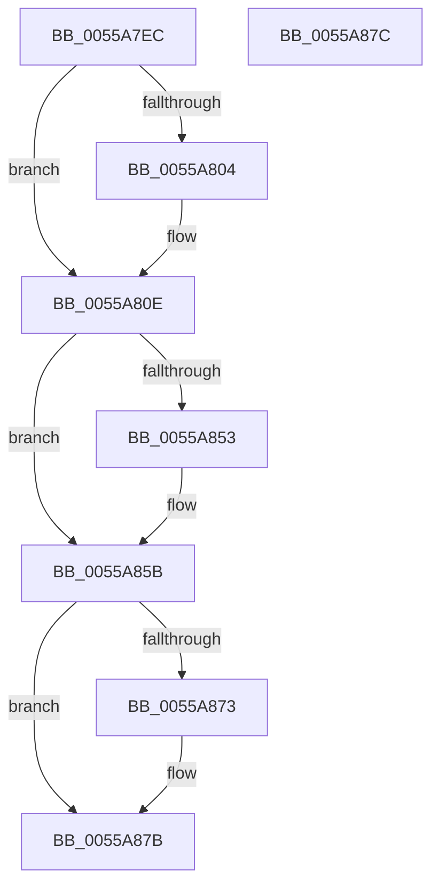

# HalpInterruptCreateGdtEntry32

- RVA: `0x0055A7EC`–`0x0055A87D` (길이 `145` bytes)
- VA: `0x000000014055A7EC`
- 실행 섹션: `.text`
- PDB 이름 있음: `예`; PDB Function 태그: `아니요`
- unwind 정보 RVA: `0x000DB714`
- 디코드: `41`개 명령, `145/145` bytes 표시
- 미해석 바이트: `0` (있으면 어셈블리에 `.byte`로 보존)

> 이 문서는 커널 이미지의 기계어와 PDB 기호를 분석해 생성했습니다. 4번과 5번은 함수 원형과 자료형을 바이너리 사용 방식에서 추정한 C 해석이며 원본 소스 복구 결과는 아닙니다.

## 1. Dependencies

- 직접 호출 지점: **0**; 고유 호출 대상: **0**
- 직접 호출자로 확인된 함수: **1**
- RIP 상대 이미지 참조: **0**

### Outgoing calls
- 직접 디코드된 call 명령이 없습니다.

### Direct callers
- [HalpInterruptBuildStartupStub](HalpInterruptBuildStartupStub_function_0055A470.md) at `0x0055A5AC`
- [HalpInterruptBuildStartupStub](HalpInterruptBuildStartupStub_function_0055A470.md) at `0x0055A5CF`
- [HalpInterruptBuildStartupStub](HalpInterruptBuildStartupStub_function_0055A470.md) at `0x0055A5EE`

### Static image references
- 디코드된 RIP-relative 메모리 참조가 없습니다.

## 2. Other-region calls and transfers

- 다른 실행 섹션으로 향하는 call: **0**
- 별도 외부 분기/꼬리 이동을 확인하지 못했습니다.

## 3. Assembly (complete function range)

```asm
0055A7EC  33 C0                           xor eax, eax
0055A7EE  44 8B C2                        mov r8d, edx
0055A7F1  49 83 E0 F0                     and r8, 0xfffffffffffffff0
0055A7F5  4C 03 C1                        add r8, rcx
0055A7F8  49 89 00                        mov qword ptr [r8], rax
0055A7FB  41 81 F9 FF FF 0F 00            cmp r9d, 0xfffff
0055A802  76 0A                           jbe 0x14055a80e
0055A804  41 0F BA 68 04 17               bts dword ptr [r8 + 4], 0x17
0055A80A  41 C1 E9 0C                     shr r9d, 0xc
0055A80E  41 8B 40 04                     mov eax, dword ptr [r8 + 4]
0055A812  8B C8                           mov ecx, eax
0055A814  8A 54 24 30                     mov dl, byte ptr [rsp + 0x30]
0055A818  41 33 C9                        xor ecx, r9d
0055A81B  81 E1 00 00 0F 00               and ecx, 0xf0000
0055A821  66 45 89 08                     mov word ptr [r8], r9w
0055A825  33 C8                           xor ecx, eax
0055A827  45 33 C9                        xor r9d, r9d
0055A82A  41 89 48 04                     mov dword ptr [r8 + 4], ecx
0055A82E  45 88 48 04                     mov byte ptr [r8 + 4], r9b
0055A832  45 88 48 07                     mov byte ptr [r8 + 7], r9b
0055A836  41 0F BA 68 04 0F               bts dword ptr [r8 + 4], 0xf
0055A83C  41 8B 48 04                     mov ecx, dword ptr [r8 + 4]
0055A840  81 E1 FF 9F FF FF               and ecx, 0xffff9fff
0055A846  66 45 89 48 02                  mov word ptr [r8 + 2], r9w
0055A84B  41 89 48 04                     mov dword ptr [r8 + 4], ecx
0055A84F  84 D2                           test dl, dl
0055A851  75 08                           jne 0x14055a85b
0055A853  0F BA E9 16                     bts ecx, 0x16
0055A857  41 89 48 04                     mov dword ptr [r8 + 4], ecx
0055A85B  8B 44 24 28                     mov eax, dword ptr [rsp + 0x28]
0055A85F  C1 E0 08                        shl eax, 8
0055A862  33 C1                           xor eax, ecx
0055A864  25 00 1F 00 00                  and eax, 0x1f00
0055A869  33 C1                           xor eax, ecx
0055A86B  41 89 40 04                     mov dword ptr [r8 + 4], eax
0055A86F  84 D2                           test dl, dl
0055A871  74 08                           je 0x14055a87b
0055A873  0F BA E8 15                     bts eax, 0x15
0055A877  41 89 40 04                     mov dword ptr [r8 + 4], eax
0055A87B  C3                              ret
0055A87C  CC                              int3
```

## 4. C-style interpretation (structured pseudocode)

```c
__int64 __fastcall HalpInterruptCreateGdtEntry32(__int64 a1, int a2, __int64 a3, int a4, unsigned int a5, unsigned __int8 a6)
{
    __int64 result;

    result = 0;
    a3 = ((unsigned int)(a2)) & (-16);
    a3 = (a3) + (a1);
    *(unsigned __int64 *)(a3) = 0;
    if (a4 >= = 0xFFFFFULL) {
        a4 = (unsigned int)((a4) >> (12));
    }
    a1 = (unsigned int)(((unsigned int)((unsigned int)((unsigned int)(*(unsigned int *)(a3 + 4))))) ^ (a4));
    a1 = (unsigned int)((a1) & (0xF0000ULL));
    *(unsigned __int16 *)(a3) = (unsigned __int16)(a4);
    a1 = (unsigned int)((a1) ^ ((unsigned int)((unsigned int)(*(unsigned int *)(a3 + 4)))));
    a4 = 0;
    *(unsigned int *)(a3 + 4) = (unsigned int)(a1);
    *(unsigned __int8 *)(a3 + 4) = 0;
    *(unsigned __int8 *)(a3 + 7) = 0;
    a1 = (unsigned int)(((unsigned int)(*(unsigned int *)(a3 + 4))) & (0xFFFF9FFFULL));
    *(unsigned __int16 *)(a3 + 2) = 0;
    *(unsigned int *)(a3 + 4) = (unsigned int)(a1);
    if (a6 == 0) {
        *(unsigned int *)(a3 + 4) = (unsigned int)(a1);
    }
    result = (unsigned int)(((unsigned int)(a5)) << (8));
    result = (unsigned int)((result) ^ ((unsigned int)(a1)));
    result = (unsigned int)((result) & (0x1F00ULL));
    result = (unsigned int)((result) ^ ((unsigned int)(a1)));
    *(unsigned int *)(a3 + 4) = (unsigned int)(result);
    if (a6 != 0) {
        *(unsigned int *)(a3 + 4) = (unsigned int)(result);
    }
    return result;
}
```

## 5. (Beta) C Style

```c
int64_t HalpInterruptCreateGdtEntry32(int64_t Arg1, void *Arg2, int64_t Arg3, int32_t Arg4, uint32_t Arg5, uint8_t Arg6)
{
    uint8_t *arg2 = (uint8_t *)Arg2;

    int64_t result;

    result = 0;
    Arg3 = ((uint32_t)(Arg2)) & (-16);
    Arg3 = (Arg3) + (Arg1);
    *(uint64_t *)(Arg3) = 0;
    if (Arg4 >= = 0xFFFFFULL) {
        Arg4 = (uint32_t)((Arg4) >> (12));
    }
    Arg1 = (uint32_t)(((uint32_t)((uint32_t)((uint32_t)(*(uint32_t *)(Arg3 + 0x4))))) ^ (Arg4));
    Arg1 = (uint32_t)((Arg1) & (0xF0000ULL));
    *(uint16_t *)(Arg3) = (uint16_t)(Arg4);
    Arg1 = (uint32_t)((Arg1) ^ ((uint32_t)((uint32_t)(*(uint32_t *)(Arg3 + 0x4)))));
    Arg4 = 0;
    *(uint32_t *)(Arg3 + 0x4) = (uint32_t)(Arg1);
    *(uint8_t *)(Arg3 + 0x4) = 0;
    *(uint8_t *)(Arg3 + 0x7) = 0;
    Arg1 = (uint32_t)(((uint32_t)(*(uint32_t *)(Arg3 + 0x4))) & (0xFFFF9FFFULL));
    *(uint16_t *)(Arg3 + 0x2) = 0;
    *(uint32_t *)(Arg3 + 0x4) = (uint32_t)(Arg1);
    if (Arg6 == 0) {
        *(uint32_t *)(Arg3 + 0x4) = (uint32_t)(Arg1);
    }
    result = (uint32_t)(((uint32_t)(Arg5)) << (8));
    result = (uint32_t)((result) ^ ((uint32_t)(Arg1)));
    result = (uint32_t)((result) & (0x1F00ULL));
    result = (uint32_t)((result) ^ ((uint32_t)(Arg1)));
    *(uint32_t *)(Arg3 + 0x4) = (uint32_t)(result);
    if (Arg6 != 0) {
        *(uint32_t *)(Arg3 + 0x4) = (uint32_t)(result);
    }
    return result;
}
```

### 관측된 메모리 오프셋

구조체 형식이 확인되지 않은 접근은 인자 기준의 오프셋으로만 기록했습니다.

| 기준 인자 | 오프셋 표현 | 폭 (bit) | 접근 |
|---|---:|---:|---|
| `Arg2` | `+ 0x0` | `16` | `W` |
| `Arg2` | `+ 0x0` | `64` | `W` |
| `Arg2` | `+ 0x2` | `16` | `W` |
| `Arg2` | `+ 0x4` | `8` | `W` |
| `Arg2` | `+ 0x4` | `32` | `R` |
| `Arg2` | `+ 0x4` | `32` | `R/W` |
| `Arg2` | `+ 0x4` | `32` | `W` |
| `Arg2` | `+ 0x7` | `8` | `W` |

## 6. Execution-region graph

[열기: 2D/3D 그래프와 함수 탐색 컨트롤 패널](../../../control-panel.html?section=text&rva=0x0055A7EC&view=graph)

- 2D 그래프는 위에서 아래로 흐르고, 3D 그래프는 빈 공간을 드래그해 회전합니다. Shift+드래그는 이동, 휠은 확대·축소, 함수 노드 선택은 대상 보고서 이동입니다.

### Static fallback


