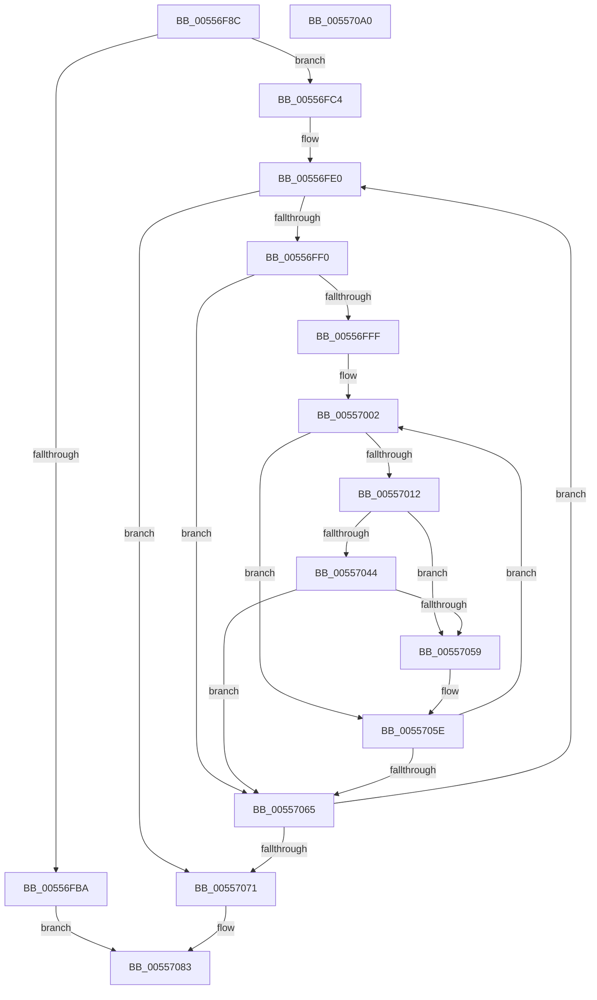

# HalpInterruptEnumerateUnmaskedSecondaryInterrupts

- RVA: `0x00556F8C`–`0x005570A1` (길이 `277` bytes)
- VA: `0x0000000140556F8C`
- 실행 섹션: `.text`
- PDB 이름 있음: `예`; PDB Function 태그: `아니요`
- unwind 정보 RVA: `0x0008C20C`
- 디코드: `79`개 명령, `277/277` bytes 표시
- 미해석 바이트: `0` (있으면 어셈블리에 `.byte`로 보존)

> 이 문서는 커널 이미지의 기계어와 PDB 기호를 분석해 생성했습니다. 4번과 5번은 함수 원형과 자료형을 바이너리 사용 방식에서 추정한 C 해석이며 원본 소스 복구 결과는 아닙니다.

## 1. Dependencies

- 직접 호출 지점: **4**; 고유 호출 대상: **3**
- 직접 호출자로 확인된 함수: **1**
- RIP 상대 이미지 참조: **3**

### Outgoing calls
- `0x00556FD0` → [HalpAcquireHighLevelLock](../2D/HalpAcquireHighLevelLock_function_002D2390.md) (function, `0x002D2390`)
- `0x0055703B` → [guard_dispatch_icall](../6B/guard_dispatch_icall_function_006BAAD0.md) (function, `0x006BAAD0`)
- `0x0055704D` → [guard_dispatch_icall](../6B/guard_dispatch_icall_function_006BAAD0.md) (function, `0x006BAAD0`)
- `0x0055707C` → [HalpReleaseHighLevelLock](../2D/HalpReleaseHighLevelLock_function_002D1C58.md) (function, `0x002D1C58`)

### Direct callers
- [HalpInterruptEnumerateUnmaskedInterrupts](../54/HalpInterruptEnumerateUnmaskedInterrupts_function_00542590.md) at `0x005426CD`

### Static image references
- `0x00556FA8` → RVA `0x00E10424` (`.data`; read)
- `0x00556FC4` → RVA `0x00F909D0` (`.data`; read)
- `0x00556FD5` → RVA `0x00F909C0` (`.data`; read)

## 2. Other-region calls and transfers

- 다른 실행 섹션으로 향하는 call: **0**
- 별도 외부 분기/꼬리 이동을 확인하지 못했습니다.

## 3. Assembly (complete function range)

```asm
00556F8C  48 89 5C 24 08                  mov qword ptr [rsp + 8], rbx
00556F91  48 89 6C 24 10                  mov qword ptr [rsp + 0x10], rbp
00556F96  48 89 74 24 18                  mov qword ptr [rsp + 0x18], rsi
00556F9B  57                              push rdi
00556F9C  41 54                           push r12
00556F9E  41 55                           push r13
00556FA0  41 56                           push r14
00556FA2  41 57                           push r15
00556FA4  48 83 EC 30                     sub rsp, 0x30
00556FA8  80 3D 75 94 8B 00 00            cmp byte ptr [rip + 0x8b9475], 0
00556FAF  49 8B E8                        mov rbp, r8
00556FB2  4C 8B FA                        mov r15, rdx
00556FB5  4C 8B E1                        mov r12, rcx
00556FB8  75 0A                           jne 0x140556fc4
00556FBA  B8 BB 00 00 C0                  mov eax, 0xc00000bb
00556FBF  E9 BF 00 00 00                  jmp 0x140557083
00556FC4  48 8D 0D 05 9A A3 00            lea rcx, [rip + 0xa39a05]
00556FCB  BE 01 00 00 00                  mov esi, 1
00556FD0  E8 BB B3 D7 FF                  call 0x1402d2390
00556FD5  48 8B 1D E4 99 A3 00            mov rbx, qword ptr [rip + 0xa399e4]
00556FDC  88 44 24 78                     mov byte ptr [rsp + 0x78], al
00556FE0  48 8D 05 D9 99 A3 00            lea rax, [rip + 0xa399d9]
00556FE7  48 3B D8                        cmp rbx, rax
00556FEA  0F 84 81 00 00 00               je 0x140557071
00556FF0  4C 8B 6B 68                     mov r13, qword ptr [rbx + 0x68]
00556FF4  33 FF                           xor edi, edi
00556FF6  4C 8B 73 20                     mov r14, qword ptr [rbx + 0x20]
00556FFA  39 7B 14                        cmp dword ptr [rbx + 0x14], edi
00556FFD  76 66                           jbe 0x140557065
00556FFF  8D 47 01                        lea eax, [rdi + 1]
00557002  8B CF                           mov ecx, edi
00557004  48 83 C1 0A                     add rcx, 0xa
00557008  48 03 C9                        add rcx, rcx
0055700B  80 7C CB 0C 00                  cmp byte ptr [rbx + rcx*8 + 0xc], 0
00557010  74 4C                           je 0x14055705e
00557012  8B 53 10                        mov edx, dword ptr [rbx + 0x10]
00557015  4C 8D 4D 18                     lea r9, [rbp + 0x18]
00557019  66 C7 45 04 01 00               mov word ptr [rbp + 4], 1
0055701F  4C 8D 45 14                     lea r8, [rbp + 0x14]
00557023  03 D7                           add edx, edi
00557025  89 55 10                        mov dword ptr [rbp + 0x10], edx
00557028  8B 44 CB 04                     mov eax, dword ptr [rbx + rcx*8 + 4]
0055702C  89 45 08                        mov dword ptr [rbp + 8], eax
0055702F  8B 04 CB                        mov eax, dword ptr [rbx + rcx*8]
00557032  49 8B CE                        mov rcx, r14
00557035  89 45 0C                        mov dword ptr [rbp + 0xc], eax
00557038  49 8B C5                        mov rax, r13
0055703B  E8 90 3A 16 00                  call 0x1406baad0
00557040  85 C0                           test eax, eax
00557042  78 15                           js 0x140557059
00557044  48 8B D5                        mov rdx, rbp
00557047  49 8B CF                        mov rcx, r15
0055704A  49 8B C4                        mov rax, r12
0055704D  E8 7E 3A 16 00                  call 0x1406baad0
00557052  40 8A F0                        mov sil, al
00557055  84 C0                           test al, al
00557057  74 0C                           je 0x140557065
00557059  B8 01 00 00 00                  mov eax, 1
0055705E  03 F8                           add edi, eax
00557060  3B 7B 14                        cmp edi, dword ptr [rbx + 0x14]
00557063  72 9D                           jb 0x140557002
00557065  48 8B 1B                        mov rbx, qword ptr [rbx]
00557068  40 84 F6                        test sil, sil
0055706B  0F 85 6F FF FF FF               jne 0x140556fe0
00557071  8A 54 24 78                     mov dl, byte ptr [rsp + 0x78]
00557075  48 8D 0D 54 99 A3 00            lea rcx, [rip + 0xa39954]
0055707C  E8 D7 AB D7 FF                  call 0x1402d1c58
00557081  33 C0                           xor eax, eax
00557083  48 8B 5C 24 60                  mov rbx, qword ptr [rsp + 0x60]
00557088  48 8B 6C 24 68                  mov rbp, qword ptr [rsp + 0x68]
0055708D  48 8B 74 24 70                  mov rsi, qword ptr [rsp + 0x70]
00557092  48 83 C4 30                     add rsp, 0x30
00557096  41 5F                           pop r15
00557098  41 5E                           pop r14
0055709A  41 5D                           pop r13
0055709C  41 5C                           pop r12
0055709E  5F                              pop rdi
0055709F  C3                              ret
005570A0  CC                              int3
```

## 4. C-style interpretation (structured pseudocode)

```c
__int64 __fastcall HalpInterruptEnumerateUnmaskedSecondaryInterrupts(__int64 a1, __int64 a2, __int64 a3)
{
    __int64 result;
    __int64 v_rdi;
    __int64 v_rsp;
    unsigned __int64 v_stack_p10;
    unsigned __int64 v_stack_p18;
    unsigned __int8 v_stack_p20;
    unsigned __int64 v_stack_p8;

    v_stack_p8 = v_rbx;
    v_stack_p10 = v_rbp;
    v_stack_p18 = v_rsi;
    v_rsp = (v_rsp) - (48);
    if ((*(unsigned __int8 *)(v_rip + 9147509)) != 0) goto loc_00556FC4;
    goto loc_00557083;
loc_00556FC4:
    result = HalpAcquireHighLevelLock(v_rip + 10721797, a2, a3, a4);
    v_stack_p20 = (unsigned __int8)(result);
loc_00556FE0:
    if ((*(unsigned __int64 *)(v_rip + 10721764)) == (v_rip + 10721753)) goto loc_00557071;
    v_rdi = 0;
    if ((*(unsigned int *)(*(unsigned __int64 *)(v_rip + 10721764) + 20)) <= 0) goto loc_00557065;
loc_00557002:
    a1 = (0) + (10);
    a1 = (a1) + (a1);
    if ((*(unsigned __int8 *)(*(unsigned __int64 *)(v_rip + 10721764) + a1 * 8 + 12)) == 0) goto loc_0055705E;
    *(unsigned __int16 *)(a3 + 4) = 1;
    a2 = (unsigned int)(((unsigned int)(*(unsigned int *)(*(unsigned __int64 *)(v_rip + 10721764) + 16))) + (0));
    *(unsigned int *)(a3 + 16) = (unsigned int)(a2);
    *(unsigned int *)(a3 + 8) = (unsigned int)((unsigned int)(*(unsigned int *)(*(unsigned __int64 *)(v_rip + 10721764) + a1 * 8 + 4)));
    *(unsigned int *)(a3 + 12) = (unsigned int)((unsigned int)(*(unsigned int *)(*(unsigned __int64 *)(v_rip + 10721764) + a1 * 8)));
    result = guard_dispatch_icall(*(unsigned __int64 *)(*(unsigned __int64 *)(v_rip + 10721764) + 32), a2, a3 + 20, a3 + 24);
    if (sign_flag) goto loc_00557059;
    result = guard_dispatch_icall(a2, a3, a3 + 20, a3 + 24);
    if ((unsigned __int8)(result) == 0) goto loc_00557065;
loc_00557059:
loc_0055705E:
    v_rdi = (unsigned int)((v_rdi) + (1));
    if (((unsigned int)(v_rdi)) < (*(unsigned int *)(*(unsigned __int64 *)(v_rip + 10721764) + 20))) goto loc_00557002;
loc_00557065:
    if ((unsigned __int8)((unsigned __int8)(result)) != 0) goto loc_00556FE0;
loc_00557071:
    result = HalpReleaseHighLevelLock(v_rip + 10721620, v_stack_p20, a3 + 20, a3 + 24);
    result = 0;
loc_00557083:
    v_rsp = (v_rsp) + (48);
    return result;
}
```

## 5. (Beta) C Style

```c
int64_t HalpInterruptEnumerateUnmaskedSecondaryInterrupts(int64_t Arg1, int64_t Arg2, void *Arg3)
{
    uint8_t *arg3 = (uint8_t *)Arg3;

    int64_t result;
    int64_t local_rdi;
    int64_t local_rsp;
    uint64_t v_stack_p10;
    uint64_t v_stack_p18;
    uint8_t v_stack_p20;
    uint64_t v_stack_p8;

    v_stack_p8 = local_rbx;
    v_stack_p10 = local_rbp;
    v_stack_p18 = local_rsi;
    local_rsp = (local_rsp) - (48);
    if ((*(uint8_t *)(v_rip + 0x8B9475)) != 0) goto loc_00556FC4;
    goto loc_00557083;
loc_00556FC4:
    result = HalpAcquireHighLevelLock(v_rip + 10721797, Arg2, Arg3, a4);
    v_stack_p20 = (uint8_t)(result);
loc_00556FE0:
    if ((*(uint64_t *)(v_rip + 0xA399E4)) == (v_rip + 10721753)) goto loc_00557071;
    local_rdi = 0;
    if ((*(uint32_t *)(*(uint64_t *)(v_rip + 0xA399E4) + 0x14)) <= 0) goto loc_00557065;
loc_00557002:
    Arg1 = (0) + (10);
    Arg1 = (Arg1) + (Arg1);
    if ((*(uint8_t *)(*(uint64_t *)(v_rip + 0xA399E4) + Arg1 * 8 + 0xC)) == 0) goto loc_0055705E;
    *(uint16_t *)(arg3 + 0x4) = 1;
    Arg2 = (uint32_t)(((uint32_t)(*(uint32_t *)(*(uint64_t *)(v_rip + 0xA399E4) + 0x10))) + (0));
    *(uint32_t *)(arg3 + 0x10) = (uint32_t)(Arg2);
    *(uint32_t *)(arg3 + 0x8) = (uint32_t)((uint32_t)(*(uint32_t *)(*(uint64_t *)(v_rip + 0xA399E4) + Arg1 * 8 + 0x4)));
    *(uint32_t *)(arg3 + 0xC) = (uint32_t)((uint32_t)(*(uint32_t *)(*(uint64_t *)(v_rip + 0xA399E4) + Arg1 * 8)));
    result = guard_dispatch_icall(*(uint64_t *)(*(uint64_t *)(v_rip + 0xA399E4) + 0x20), Arg2, Arg3 + 20, Arg3 + 24);
    if (sign_flag) goto loc_00557059;
    result = guard_dispatch_icall(Arg2, Arg3, Arg3 + 20, Arg3 + 24);
    if ((uint8_t)(result) == 0) goto loc_00557065;
loc_00557059:
loc_0055705E:
    local_rdi = (uint32_t)((local_rdi) + (1));
    if (((uint32_t)(local_rdi)) < (*(uint32_t *)(*(uint64_t *)(v_rip + 0xA399E4) + 0x14))) goto loc_00557002;
loc_00557065:
    if ((uint8_t)((uint8_t)(result)) != 0) goto loc_00556FE0;
loc_00557071:
    result = HalpReleaseHighLevelLock(v_rip + 10721620, v_stack_p20, Arg3 + 20, Arg3 + 24);
    result = 0;
loc_00557083:
    local_rsp = (local_rsp) + (48);
    return result;
}
```

### 관측된 메모리 오프셋

구조체 형식이 확인되지 않은 접근은 인자 기준의 오프셋으로만 기록했습니다.

| 기준 인자 | 오프셋 표현 | 폭 (bit) | 접근 |
|---|---:|---:|---|
| `Arg3` | `+ 0x4` | `16` | `W` |
| `Arg3` | `+ 0x8` | `32` | `W` |
| `Arg3` | `+ 0xC` | `32` | `W` |
| `Arg3` | `+ 0x10` | `32` | `W` |
| `Arg3` | `+ 0x14` | `64` | `R` |
| `Arg3` | `+ 0x18` | `64` | `R` |

## 6. Execution-region graph

[열기: 2D/3D 그래프와 함수 탐색 컨트롤 패널](../../../control-panel.html?section=text&rva=0x00556F8C&view=graph)

- 2D 그래프는 위에서 아래로 흐르고, 3D 그래프는 빈 공간을 드래그해 회전합니다. Shift+드래그는 이동, 휠은 확대·축소, 함수 노드 선택은 대상 보고서 이동입니다.

### Static fallback


