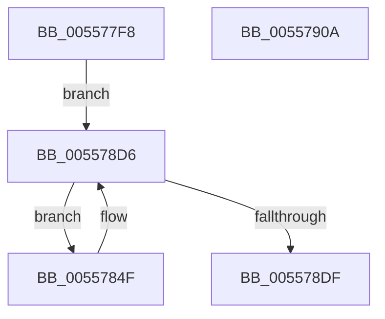

# HalpInterruptInitPowerManagement

- RVA: `0x005577F8`–`0x0055790B` (길이 `275` bytes)
- VA: `0x00000001405577F8`
- 실행 섹션: `.text`
- PDB 이름 있음: `예`; PDB Function 태그: `아니요`
- unwind 정보 RVA: `0x000C3E9C`
- 디코드: `63`개 명령, `275/275` bytes 표시
- 미해석 바이트: `0` (있으면 어셈블리에 `.byte`로 보존)

> 이 문서는 커널 이미지의 기계어와 PDB 기호를 분석해 생성했습니다. 4번과 5번은 함수 원형과 자료형을 바이너리 사용 방식에서 추정한 C 해석이며 원본 소스 복구 결과는 아닙니다.

## 1. Dependencies

- 직접 호출 지점: **4**; 고유 호출 대상: **4**
- 직접 호출자로 확인된 함수: **1**
- RIP 상대 이미지 참조: **5**

### Outgoing calls
- `0x005578B7` → [PoFxRegisterCoreDevice](../../page/75/PoFxRegisterCoreDevice_function_00758800.md) (function, `0x00758800`)
- `0x005578C6` → [PoFxActivateComponent](../2D/PoFxActivateComponent_function_002D9D30.md) (function, `0x002D9D30`)
- `0x005578CE` → [PoFxStartDevicePowerManagement](../4B/PoFxStartDevicePowerManagement_function_004B5740.md) (function, `0x004B5740`)
- `0x005578E8` → [_security_check_cookie](../6A/_security_check_cookie_function_006AC640.md) (function, `0x006AC640`)

### Direct callers
- [HalpInterruptInitSystem](../../pagelk/B5/HalpInterruptInitSystem_function_00B5D550.md) at `0x00B5D630`

### Static image references
- `0x00557817` → RVA `0x00E0A740` (`.data`; read)
- `0x00557829` → RVA `0x00FC38F0` (`.data`; read)
- `0x0055786E` → RVA `0x00558730` (`HalpInterruptPowerComponentActiveCallback`; read)
- `0x00557884` → RVA `0x00558750` (`HalpInterruptPowerComponentIdleCallback`; read)
- `0x00557899` → RVA `0x00558790` (`HalpInterruptPowerCriticalTransitionCallback`; read)

## 2. Other-region calls and transfers

- 다른 실행 섹션으로 향하는 call: **1**
  - `0x005578B7` → [PoFxRegisterCoreDevice](../../page/75/PoFxRegisterCoreDevice_function_00758800.md) (`.text` → `PAGE`)
- 별도 외부 분기/꼬리 이동을 확인하지 못했습니다.

## 3. Assembly (complete function range)

```asm
005577F8  48 8B C4                        mov rax, rsp
005577FB  48 89 58 08                     mov qword ptr [rax + 8], rbx
005577FF  48 89 70 10                     mov qword ptr [rax + 0x10], rsi
00557803  48 89 78 18                     mov qword ptr [rax + 0x18], rdi
00557807  4C 89 78 20                     mov qword ptr [rax + 0x20], r15
0055780B  55                              push rbp
0055780C  48 8D 68 A1                     lea rbp, [rax - 0x5f]
00557810  48 81 EC 90 00 00 00            sub rsp, 0x90
00557817  48 8B 05 22 2F 8B 00            mov rax, qword ptr [rip + 0x8b2f22]
0055781E  48 33 C4                        xor rax, rsp
00557821  48 89 45 4F                     mov qword ptr [rbp + 0x4f], rax
00557825  83 65 4B 00                     and dword ptr [rbp + 0x4b], 0
00557829  4C 8D 3D C0 C0 A6 00            lea r15, [rip + 0xa6c0c0]
00557830  48 83 65 37 00                  and qword ptr [rbp + 0x37], 0
00557835  48 83 65 3F 00                  and qword ptr [rbp + 0x3f], 0
0055783A  48 8B 3D AF C0 A6 00            mov rdi, qword ptr [rip + 0xa6c0af]
00557841  33 F6                           xor esi, esi
00557843  C7 45 47 0A 00 00 00            mov dword ptr [rbp + 0x47], 0xa
0055784A  E9 87 00 00 00                  jmp 0x1405578d6
0055784F  48 83 65 07 00                  and qword ptr [rbp + 7], 0
00557854  48 8D 45 37                     lea rax, [rbp + 0x37]
00557858  83 65 2B 00                     and dword ptr [rbp + 0x2b], 0
0055785C  48 8D 9F 70 01 00 00            lea rbx, [rdi + 0x170]
00557863  48 89 45 2F                     mov qword ptr [rbp + 0x2f], rax
00557867  48 8D 8F 60 01 00 00            lea rcx, [rdi + 0x160]
0055786E  48 8D 05 BB 0E 00 00            lea rax, [rip + 0xebb]
00557875  C7 45 E7 01 00 00 00            mov dword ptr [rbp - 0x19], 1
0055787C  48 89 45 EF                     mov qword ptr [rbp - 0x11], rax
00557880  48 8D 55 E7                     lea rdx, [rbp - 0x19]
00557884  48 8D 05 C5 0E 00 00            lea rax, [rip + 0xec5]
0055788B  C7 45 EB 01 00 00 00            mov dword ptr [rbp - 0x15], 1
00557892  48 89 45 F7                     mov qword ptr [rbp - 9], rax
00557896  0F 57 C0                        xorps xmm0, xmm0
00557899  48 8D 05 F0 0E 00 00            lea rax, [rip + 0xef0]
005578A0  66 0F 7F 45 17                  movdqa xmmword ptr [rbp + 0x17], xmm0
005578A5  4C 8B C3                        mov r8, rbx
005578A8  48 89 45 FF                     mov qword ptr [rbp - 1], rax
005578AC  C7 45 27 01 00 00 00            mov dword ptr [rbp + 0x27], 1
005578B3  48 89 7D 0F                     mov qword ptr [rbp + 0xf], rdi
005578B7  E8 44 0F 20 00                  call 0x140758800
005578BC  48 8B 0B                        mov rcx, qword ptr [rbx]
005578BF  45 33 C0                        xor r8d, r8d
005578C2  33 D2                           xor edx, edx
005578C4  8B F0                           mov esi, eax
005578C6  E8 65 24 D8 FF                  call 0x1402d9d30
005578CB  48 8B 0B                        mov rcx, qword ptr [rbx]
005578CE  E8 6D DE F5 FF                  call 0x1404b5740
005578D3  48 8B 3F                        mov rdi, qword ptr [rdi]
005578D6  49 3B FF                        cmp rdi, r15
005578D9  0F 85 70 FF FF FF               jne 0x14055784f
005578DF  8B C6                           mov eax, esi
005578E1  48 8B 4D 4F                     mov rcx, qword ptr [rbp + 0x4f]
005578E5  48 33 CC                        xor rcx, rsp
005578E8  E8 53 4D 15 00                  call 0x1406ac640
005578ED  4C 8D 9C 24 90 00 00 00         lea r11, [rsp + 0x90]
005578F5  49 8B 5B 10                     mov rbx, qword ptr [r11 + 0x10]
005578F9  49 8B 73 18                     mov rsi, qword ptr [r11 + 0x18]
005578FD  49 8B 7B 20                     mov rdi, qword ptr [r11 + 0x20]
00557901  4D 8B 7B 28                     mov r15, qword ptr [r11 + 0x28]
00557905  49 8B E3                        mov rsp, r11
00557908  5D                              pop rbp
00557909  C3                              ret
0055790A  CC                              int3
```

## 4. C-style interpretation (structured pseudocode)

```c
__int64 __fastcall HalpInterruptInitPowerManagement(void)
{
    __int64 result;
    __int64 v_rsi;
    __int64 v_rsp;
    unsigned __int64 v_stack_m8;

    *(unsigned __int64 *)(v_rsp + 8) = v_rbx;
    *(unsigned __int64 *)(v_rsp + 16) = v_rsi;
    *(unsigned __int64 *)(v_rsp + 24) = v_rdi;
    *(unsigned __int64 *)(v_rsp + 32) = v_r15;
    v_rsp = (v_rsp) - (144);
    result = (*(unsigned __int64 *)(v_rip + 9121570)) ^ (v_rsp);
    *(unsigned __int64 *)(v_rsp - 95 + 79) = result;
    v_rsi = 0;
    *(unsigned int *)(v_rsp - 95 + 71) = 10;
    goto loc_005578D6;
loc_0055784F:
    *(unsigned __int64 *)(v_rsp - 95 + 47) = v_rsp - 95 + 55;
    *(unsigned int *)(v_rsp - 95 - 25) = 1;
    *(unsigned __int64 *)(v_rsp - 95 - 17) = v_rip + 3771;
    *(unsigned int *)(v_rsp - 95 - 21) = 1;
    *(unsigned __int64 *)(v_rsp - 95 - 9) = v_rip + 3781;
    *(unsigned __int64 *)(v_rsp - 95 + 23) = v_xmm0;
    *(unsigned __int64 *)(v_rsp - 95 - 1) = v_rip + 3824;
    *(unsigned int *)(v_rsp - 95 + 39) = 1;
    *(unsigned __int64 *)(v_rsp - 95 + 15) = *(unsigned __int64 *)(v_rip + 10928303);
    result = PoFxRegisterCoreDevice(*(unsigned __int64 *)(v_rip + 10928303) + 352, v_rsp - 95 - 25, *(unsigned __int64 *)(v_rip + 10928303) + 368, a4);
    a3 = 0;
    a2 = 0;
    result = PoFxActivateComponent(*(unsigned __int64 *)(*(unsigned __int64 *)(v_rip + 10928303) + 368), a2, a3, a4);
    result = PoFxStartDevicePowerManagement(*(unsigned __int64 *)(*(unsigned __int64 *)(v_rip + 10928303) + 368), a2, a3, a4);
loc_005578D6:
    if ((*(unsigned __int64 *)(*(unsigned __int64 *)(v_rip + 10928303))) != (v_rip + 10928320)) goto loc_0055784F;
    a1 = (*(unsigned __int64 *)(v_rsp - 95 + 79)) ^ (v_rsp);
    result = _security_check_cookie(a1, a2, a3, a4);
    return result;
}
```

## 5. (Beta) C Style

```c
void HalpInterruptInitPowerManagement(void)
{
    int64_t result;
    int64_t local_rsi;
    int64_t local_rsp;
    uint64_t v_stack_m8;

    *(uint64_t *)(local_rsp + 0x8) = local_rbx;
    *(uint64_t *)(local_rsp + 0x10) = local_rsi;
    *(uint64_t *)(local_rsp + 0x18) = local_rdi;
    *(uint64_t *)(local_rsp + 0x20) = local_r15;
    local_rsp = (local_rsp) - (144);
    result = (*(uint64_t *)(v_rip + 0x8B2F22)) ^ (local_rsp);
    *(uint64_t *)(local_rsp - 0x5F + 0x4F) = result;
    local_rsi = 0;
    *(uint32_t *)(local_rsp - 0x5F + 0x47) = 10;
    goto loc_005578D6;
loc_0055784F:
    *(uint64_t *)(local_rsp - 0x5F + 0x2F) = local_rsp - 95 + 55;
    *(uint32_t *)(local_rsp - 0x5F - 0x19) = 1;
    *(uint64_t *)(local_rsp - 0x5F - 0x11) = v_rip + 3771;
    *(uint32_t *)(local_rsp - 0x5F - 0x15) = 1;
    *(uint64_t *)(local_rsp - 0x5F - 0x9) = v_rip + 3781;
    *(uint64_t *)(local_rsp - 0x5F + 0x17) = v_xmm0;
    *(uint64_t *)(local_rsp - 0x5F - 0x1) = v_rip + 3824;
    *(uint32_t *)(local_rsp - 0x5F + 0x27) = 1;
    *(uint64_t *)(local_rsp - 0x5F + 0xF) = *(uint64_t *)(v_rip + 0xA6C0AF);
    result = PoFxRegisterCoreDevice(*(uint64_t *)(v_rip + 0xA6C0AF) + 352, local_rsp - 95 - 25, *(uint64_t *)(v_rip + 0xA6C0AF) + 368, a4);
    a3 = 0;
    a2 = 0;
    result = PoFxActivateComponent(*(uint64_t *)(*(uint64_t *)(v_rip + 0xA6C0AF) + 0x170), a2, a3, a4);
    result = PoFxStartDevicePowerManagement(*(uint64_t *)(*(uint64_t *)(v_rip + 0xA6C0AF) + 0x170), a2, a3, a4);
loc_005578D6:
    if ((*(uint64_t *)(*(uint64_t *)(v_rip + 0xA6C0AF))) != (v_rip + 10928320)) goto loc_0055784F;
    a1 = (*(uint64_t *)(local_rsp - 0x5F + 0x4F)) ^ (local_rsp);
    result = _security_check_cookie(a1, a2, a3, a4);
    return result;
}
```

## 6. Execution-region graph

[열기: 2D/3D 그래프와 함수 탐색 컨트롤 패널](../../../control-panel.html?section=text&rva=0x005577F8&view=graph)

- 2D 그래프는 위에서 아래로 흐르고, 3D 그래프는 빈 공간을 드래그해 회전합니다. Shift+드래그는 이동, 휠은 확대·축소, 함수 노드 선택은 대상 보고서 이동입니다.

### Static fallback


