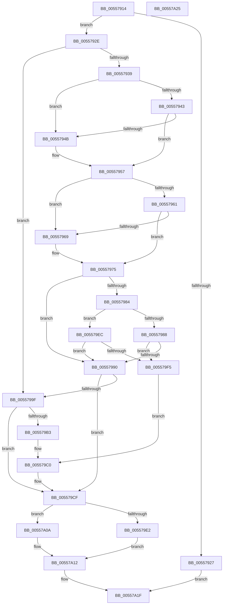

# HalpInterruptInitializeController

- RVA: `0x00557914`–`0x00557A26` (길이 `274` bytes)
- VA: `0x0000000140557914`
- 실행 섹션: `.text`
- PDB 이름 있음: `예`; PDB Function 태그: `아니요`
- unwind 정보 RVA: `0x00064C80`
- 디코드: `73`개 명령, `274/274` bytes 표시
- 미해석 바이트: `0` (있으면 어셈블리에 `.byte`로 보존)

> 이 문서는 커널 이미지의 기계어와 PDB 기호를 분석해 생성했습니다. 4번과 5번은 함수 원형과 자료형을 바이너리 사용 방식에서 추정한 C 해석이며 원본 소스 복구 결과는 아닙니다.

## 1. Dependencies

- 직접 호출 지점: **3**; 고유 호출 대상: **3**
- 직접 호출자로 확인된 함수: **5**
- RIP 상대 이미지 참조: **7**

### Outgoing calls
- `0x00557993` → [HalpInterruptInitializeLocalUnit](HalpInterruptInitializeLocalUnit_function_00557A2C.md) (function, `0x00557A2C`)
- `0x005579A7` → [guard_dispatch_icall](../6B/guard_dispatch_icall_function_006BAAD0.md) (function, `0x006BAAD0`)
- `0x005579CA` → [HalpInterruptSetProblemEx](../48/HalpInterruptSetProblemEx_function_0048AC8C.md) (function, `0x0048AC8C`)

### Direct callers
- [HalpInterruptResetThisProcessor](../54/HalpInterruptResetThisProcessor_function_00543930.md) at `0x005439D0`
- [HalpInterruptPowerChange](HalpInterruptPowerChange_function_00558690.md) at `0x005586B0`
- [HalpInterruptSelectController](HalpInterruptSelectController_function_005587A8.md) at `0x005587CA`
- [HalpInterruptSelectController](HalpInterruptSelectController_function_005587A8.md) at `0x005587E8`
- [HalpInterruptReinitialize](../../pagelk/B7/HalpInterruptReinitialize_function_00B79BEC.md) at `0x00B79C3B`
- [HalpInitializeInterrupts](../../init/C1/HalpInitializeInterrupts_function_00C1E4F8.md) at `0x00C1E829`

### Static image references
- `0x00557939` → RVA `0x00E101DC` (`.data`; read)
- `0x00557951` → RVA `0x00E101DC` (`.data`; write)
- `0x00557957` → RVA `0x00E101D8` (`.data`; read)
- `0x0055796F` → RVA `0x00E101D8` (`.data`; write)
- `0x0055797B` → RVA `0x00F906B0` (`.data`; read)
- `0x00557988` → RVA `0x00F906D4` (`.data`; read)
- `0x005579C0` → RVA `0x000250A0` (`.rdata`; read)

## 2. Other-region calls and transfers

- 다른 실행 섹션으로 향하는 call: **0**
- 별도 외부 분기/꼬리 이동을 확인하지 못했습니다.

## 3. Assembly (complete function range)

```asm
00557914  40 53                           push rbx
00557916  48 83 EC 30                     sub rsp, 0x30
0055791A  8B 81 F8 00 00 00               mov eax, dword ptr [rcx + 0xf8]
00557920  48 8B D9                        mov rbx, rcx
00557923  A8 01                           test al, 1
00557925  74 07                           je 0x14055792e
00557927  33 C0                           xor eax, eax
00557929  E9 F1 00 00 00                  jmp 0x140557a1f
0055792E  8B 89 F4 00 00 00               mov ecx, dword ptr [rcx + 0xf4]
00557934  F6 C1 01                        test cl, 1
00557937  74 66                           je 0x14055799f
00557939  8B 05 9D 88 8B 00               mov eax, dword ptr [rip + 0x8b889d]
0055793F  85 C0                           test eax, eax
00557941  74 08                           je 0x14055794b
00557943  3B 83 30 01 00 00               cmp eax, dword ptr [rbx + 0x130]
00557949  76 0C                           jbe 0x140557957
0055794B  8B 83 30 01 00 00               mov eax, dword ptr [rbx + 0x130]
00557951  89 05 85 88 8B 00               mov dword ptr [rip + 0x8b8885], eax
00557957  8B 05 7B 88 8B 00               mov eax, dword ptr [rip + 0x8b887b]
0055795D  85 C0                           test eax, eax
0055795F  74 08                           je 0x140557969
00557961  3B 83 34 01 00 00               cmp eax, dword ptr [rbx + 0x134]
00557967  76 0C                           jbe 0x140557975
00557969  8B 83 34 01 00 00               mov eax, dword ptr [rbx + 0x134]
0055796F  89 05 63 88 8B 00               mov dword ptr [rip + 0x8b8863], eax
00557975  81 E1 00 04 00 00               and ecx, 0x400
0055797B  80 3D 2E 8D A3 00 00            cmp byte ptr [rip + 0xa38d2e], 0
00557982  74 0C                           je 0x140557990
00557984  85 C9                           test ecx, ecx
00557986  75 64                           jne 0x1405579ec
00557988  38 0D 46 8D A3 00               cmp byte ptr [rip + 0xa38d46], cl
0055798E  75 65                           jne 0x1405579f5
00557990  48 8B CB                        mov rcx, rbx
00557993  E8 94 00 00 00                  call 0x140557a2c
00557998  44 8B C0                        mov r8d, eax
0055799B  85 C0                           test eax, eax
0055799D  78 30                           js 0x1405579cf
0055799F  48 8B 43 28                     mov rax, qword ptr [rbx + 0x28]
005579A3  48 8B 4B 10                     mov rcx, qword ptr [rbx + 0x10]
005579A7  E8 24 31 16 00                  call 0x1406baad0
005579AC  44 8B C0                        mov r8d, eax
005579AF  85 C0                           test eax, eax
005579B1  79 1C                           jns 0x1405579cf
005579B3  C7 44 24 20 FF 01 00 00         mov dword ptr [rsp + 0x20], 0x1ff
005579BB  BA 05 00 00 00                  mov edx, 5
005579C0  4C 8D 0D D9 D6 AC FF            lea r9, [rip - 0x532927]
005579C7  48 8B CB                        mov rcx, rbx
005579CA  E8 BD 32 F3 FF                  call 0x14048ac8c
005579CF  8B 83 F8 00 00 00               mov eax, dword ptr [rbx + 0xf8]
005579D5  4C 8B CB                        mov r9, rbx
005579D8  BA F8 00 00 00                  mov edx, 0xf8
005579DD  45 85 C0                        test r8d, r8d
005579E0  78 28                           js 0x140557a0a
005579E2  83 C8 01                        or eax, 1
005579E5  8B C8                           mov ecx, eax
005579E7  83 E1 FD                        and ecx, 0xfffffffd
005579EA  EB 26                           jmp 0x140557a12
005579EC  80 3D E1 8C A3 00 00            cmp byte ptr [rip + 0xa38ce1], 0
005579F3  75 9B                           jne 0x140557990
005579F5  41 B8 0D 00 00 C0               mov r8d, 0xc000000d
005579FB  C7 44 24 20 E6 01 00 00         mov dword ptr [rsp + 0x20], 0x1e6
00557A03  BA 19 00 00 00                  mov edx, 0x19
00557A08  EB B6                           jmp 0x1405579c0
00557A0A  83 C8 02                        or eax, 2
00557A0D  8B C8                           mov ecx, eax
00557A0F  83 E1 FE                        and ecx, 0xfffffffe
00557A12  42 89 04 0A                     mov dword ptr [rdx + r9], eax
00557A16  41 8B C0                        mov eax, r8d
00557A19  89 8B F8 00 00 00               mov dword ptr [rbx + 0xf8], ecx
00557A1F  48 83 C4 30                     add rsp, 0x30
00557A23  5B                              pop rbx
00557A24  C3                              ret
00557A25  CC                              int3
```

## 4. C-style interpretation (structured pseudocode)

```c
__int64 __fastcall HalpInterruptInitializeController(__int64 a1)
{
    __int64 result;
    __int64 v_rsp;
    unsigned int v_stack_m18;

    v_rsp = (v_rsp) - (48);
    if ((((unsigned __int8)((unsigned int)(*(unsigned int *)(a1 + 248)))) & (1)) == 0) goto loc_0055792E;
    result = 0;
    goto loc_00557A1F;
loc_0055792E:
    if ((((unsigned __int8)((unsigned int)(*(unsigned int *)(a1 + 244)))) & (1)) == 0) goto loc_0055799F;
    if ((unsigned int)((unsigned int)(*(unsigned int *)(v_rip + 9144477))) == 0) goto loc_0055794B;
    result = (unsigned int)(*(unsigned int *)(v_rip + 9144477));
    if (((unsigned int)((unsigned int)(*(unsigned int *)(v_rip + 9144477)))) >= = (*(unsigned int *)(a1 + 304))) {
        result = *(unsigned int *)(a1 + 304);
        *(unsigned int *)(v_rip + 9144453) = (unsigned int)(result);
    }
    if ((unsigned int)((unsigned int)(*(unsigned int *)(v_rip + 9144443))) == 0) goto loc_00557969;
    result = (unsigned int)(*(unsigned int *)(v_rip + 9144443));
    if (((unsigned int)((unsigned int)(*(unsigned int *)(v_rip + 9144443)))) >= = (*(unsigned int *)(a1 + 308))) {
        result = *(unsigned int *)(a1 + 308);
        *(unsigned int *)(v_rip + 9144419) = (unsigned int)(result);
    }
    a1 = (unsigned int)(((unsigned int)(*(unsigned int *)(a1 + 244))) & (0x400ULL));
    if ((*(unsigned __int8 *)(v_rip + 10718510)) == 0) goto loc_00557990;
    if ((unsigned int)(a1) != 0) goto loc_005579EC;
    if ((*(unsigned __int8 *)(v_rip + 10718534)) != ((unsigned __int8)(a1))) goto loc_005579F5;
loc_00557990:
    result = HalpInterruptInitializeLocalUnit(a1, a2, a3, a4);
    if (sign_flag) goto loc_005579CF;
loc_0055799F:
    result = guard_dispatch_icall(*(unsigned __int64 *)(a1 + 16), a2, (unsigned int)((unsigned int)(result)), a4);
    if (!sign_flag) goto loc_005579CF;
    v_stack_m18 = 511;
loc_005579C0:
    result = HalpInterruptSetProblemEx(a1, 5, (unsigned int)((unsigned int)(result)), v_rip - 5450023);
loc_005579CF:
    if (sign_flag) goto loc_00557A0A;
    result = (unsigned int)(((unsigned int)(*(unsigned int *)(a1 + 248))) | (1));
    a1 = (unsigned int)(((unsigned int)((unsigned int)(result))) & (0xFFFFFFFDULL));
    goto loc_00557A12;
loc_005579EC:
    if ((*(unsigned __int8 *)(v_rip + 10718433)) != 0) goto loc_00557990;
loc_005579F5:
    v_stack_m18 = 486;
    goto loc_005579C0;
loc_00557A0A:
    result = (unsigned int)((result) | (2));
    a1 = (unsigned int)(((unsigned int)((unsigned int)(result))) & (0xFFFFFFFEULL));
loc_00557A12:
    *(unsigned int *)(25 + a1 * 1) = (unsigned int)(result);
    *(unsigned int *)(a1 + 248) = (unsigned int)(a1);
loc_00557A1F:
    v_rsp = (v_rsp) + (48);
    return (unsigned int)((unsigned int)((unsigned int)(0xC000000DULL)));
}
```

## 5. (Beta) C Style

```c
int64_t HalpInterruptInitializeController(void *Arg1)
{
    uint8_t *arg1 = (uint8_t *)Arg1;

    int64_t result;
    int64_t local_rsp;
    uint32_t v_stack_m18;

    local_rsp = (local_rsp) - (48);
    if ((((uint8_t)((uint32_t)(*(uint32_t *)(arg1 + 0xF8)))) & (1)) == 0) goto loc_0055792E;
    result = 0;
    goto loc_00557A1F;
loc_0055792E:
    if ((((uint8_t)((uint32_t)(*(uint32_t *)(arg1 + 0xF4)))) & (1)) == 0) goto loc_0055799F;
    if ((uint32_t)((uint32_t)(*(uint32_t *)(v_rip + 0x8B889D))) == 0) goto loc_0055794B;
    result = (uint32_t)(*(uint32_t *)(v_rip + 0x8B889D));
    if (((uint32_t)((uint32_t)(*(uint32_t *)(v_rip + 0x8B889D)))) >= = (*(uint32_t *)(arg1 + 0x130))) {
        result = *(uint32_t *)(arg1 + 0x130);
        *(uint32_t *)(v_rip + 0x8B8885) = (uint32_t)(result);
    }
    if ((uint32_t)((uint32_t)(*(uint32_t *)(v_rip + 0x8B887B))) == 0) goto loc_00557969;
    result = (uint32_t)(*(uint32_t *)(v_rip + 0x8B887B));
    if (((uint32_t)((uint32_t)(*(uint32_t *)(v_rip + 0x8B887B)))) >= = (*(uint32_t *)(arg1 + 0x134))) {
        result = *(uint32_t *)(arg1 + 0x134);
        *(uint32_t *)(v_rip + 0x8B8863) = (uint32_t)(result);
    }
    Arg1 = (uint32_t)(((uint32_t)(*(uint32_t *)(arg1 + 0xF4))) & (0x400ULL));
    if ((*(uint8_t *)(v_rip + 0xA38D2E)) == 0) goto loc_00557990;
    if ((uint32_t)(Arg1) != 0) goto loc_005579EC;
    if ((*(uint8_t *)(v_rip + 0xA38D46)) != ((uint8_t)(Arg1))) goto loc_005579F5;
loc_00557990:
    result = HalpInterruptInitializeLocalUnit(Arg1, a2, a3, a4);
    if (sign_flag) goto loc_005579CF;
loc_0055799F:
    result = guard_dispatch_icall(*(uint64_t *)(arg1 + 0x10), a2, (uint32_t)((uint32_t)(result)), a4);
    if (!sign_flag) goto loc_005579CF;
    v_stack_m18 = 511;
loc_005579C0:
    result = HalpInterruptSetProblemEx(Arg1, 5, (uint32_t)((uint32_t)(result)), v_rip - 5450023);
loc_005579CF:
    if (sign_flag) goto loc_00557A0A;
    result = (uint32_t)(((uint32_t)(*(uint32_t *)(arg1 + 0xF8))) | (1));
    Arg1 = (uint32_t)(((uint32_t)((uint32_t)(result))) & (0xFFFFFFFDULL));
    goto loc_00557A12;
loc_005579EC:
    if ((*(uint8_t *)(v_rip + 0xA38CE1)) != 0) goto loc_00557990;
loc_005579F5:
    v_stack_m18 = 486;
    goto loc_005579C0;
loc_00557A0A:
    result = (uint32_t)((result) | (2));
    Arg1 = (uint32_t)(((uint32_t)((uint32_t)(result))) & (0xFFFFFFFEULL));
loc_00557A12:
    *(uint32_t *)(25 + arg1 * 1) = (uint32_t)(result);
    *(uint32_t *)(arg1 + 0xF8) = (uint32_t)(Arg1);
loc_00557A1F:
    local_rsp = (local_rsp) + (48);
    return (uint32_t)((uint32_t)((uint32_t)(0xC000000DULL)));
}
```

### 관측된 메모리 오프셋

구조체 형식이 확인되지 않은 접근은 인자 기준의 오프셋으로만 기록했습니다.

| 기준 인자 | 오프셋 표현 | 폭 (bit) | 접근 |
|---|---:|---:|---|
| `Arg1` | `+ 0x10` | `64` | `R` |
| `Arg1` | `+ 0x28` | `64` | `R` |
| `Arg1` | `+ 0xF4` | `32` | `R` |
| `Arg1` | `+ 0xF8` | `32` | `R` |
| `Arg1` | `+ 0xF8` | `32` | `W` |
| `Arg1` | `+ 0x130` | `32` | `R` |
| `Arg1` | `+ 0x134` | `32` | `R` |

## 6. Execution-region graph

[열기: 2D/3D 그래프와 함수 탐색 컨트롤 패널](../../../control-panel.html?section=text&rva=0x00557914&view=graph)

- 2D 그래프는 위에서 아래로 흐르고, 3D 그래프는 빈 공간을 드래그해 회전합니다. Shift+드래그는 이동, 휠은 확대·축소, 함수 노드 선택은 대상 보고서 이동입니다.

### Static fallback


