# HalpInterruptInitializeLocalUnit

- RVA: `0x00557A2C`–`0x00557DCC` (길이 `928` bytes)
- VA: `0x0000000140557A2C`
- 실행 섹션: `.text`
- PDB 이름 있음: `예`; PDB Function 태그: `아니요`
- unwind 정보 RVA: `0x000C4634`
- 디코드: `223`개 명령, `928/928` bytes 표시
- 미해석 바이트: `0` (있으면 어셈블리에 `.byte`로 보존)

> 이 문서는 커널 이미지의 기계어와 PDB 기호를 분석해 생성했습니다. 4번과 5번은 함수 원형과 자료형을 바이너리 사용 방식에서 추정한 C 해석이며 원본 소스 복구 결과는 아닙니다.

## 1. Dependencies

- 직접 호출 지점: **15**; 고유 호출 대상: **9**
- 직접 호출자로 확인된 함수: **3**
- RIP 상대 이미지 참조: **20**

### Outgoing calls
- `0x00557A63` → [HalpDisableInterrupts](../25/HalpDisableInterrupts_function_002521A0.md) (function, `0x002521A0`)
- `0x00557A91` → [guard_dispatch_icall](../6B/guard_dispatch_icall_function_006BAAD0.md) (function, `0x006BAAD0`)
- `0x00557AB6` → [HalpInterruptSetProblemEx](../48/HalpInterruptSetProblemEx_function_0048AC8C.md) (function, `0x0048AC8C`)
- `0x00557AEF` → [HalpInterruptMarkProcessorStarted](../54/HalpInterruptMarkProcessorStarted_function_005436A8.md) (function, `0x005436A8`)
- `0x00557BB8` → [guard_dispatch_icall](../6B/guard_dispatch_icall_function_006BAAD0.md) (function, `0x006BAAD0`)
- `0x00557C3C` → [HalpInitializeCmciVector](HalpInitializeCmciVector_function_00557510.md) (function, `0x00557510`)
- `0x00557C7D` → [guard_dispatch_icall](../6B/guard_dispatch_icall_function_006BAAD0.md) (function, `0x006BAAD0`)
- `0x00557CCB` → [KeAddProcessorAffinityEx](../25/KeAddProcessorAffinityEx_function_0025B6F0.md) (function, `0x0025B6F0`)
- `0x00557CF3` → [guard_dispatch_icall](../6B/guard_dispatch_icall_function_006BAAD0.md) (function, `0x006BAAD0`)
- `0x00557D1A` → [HalpInterruptSetProblemEx](../48/HalpInterruptSetProblemEx_function_0048AC8C.md) (function, `0x0048AC8C`)
- `0x00557D3B` → [KeBugCheckEx](../4F/KeBugCheckEx_function_004FD660.md) (function, `0x004FD660`)
- `0x00557D41` → [HalpInitializeDeferredErrorVector](HalpInitializeDeferredErrorVector_function_005575C0.md) (function, `0x005575C0`)
- `0x00557D72` → [guard_dispatch_icall](../6B/guard_dispatch_icall_function_006BAAD0.md) (function, `0x006BAAD0`)
- `0x00557D9C` → [HalpInterruptRestoreController](../4A/HalpInterruptRestoreController_function_004A75A8.md) (function, `0x004A75A8`)
- `0x00557DC6` → [KeBugCheckEx](../4F/KeBugCheckEx_function_004FD660.md) (function, `0x004FD660`)

### Direct callers
- [HalpInterruptReinitializeThisProcessor](../4E/HalpInterruptReinitializeThisProcessor_function_004E29E0.md) at `0x004E29FA`
- [HalpInterruptResetThisProcessor](../54/HalpInterruptResetThisProcessor_function_00543930.md) at `0x00543959`
- [HalpInterruptInitializeController](HalpInterruptInitializeController_function_00557914.md) at `0x00557993`

### Static image references
- `0x00557AAC` → RVA `0x000250A0` (`.rdata`; read)
- `0x00557AE1` → RVA `0x00E101F8` (`.data`; read)
- `0x00557AF4` → RVA `0x00E101E8` (`.data`; read)
- `0x00557B18` → RVA `0x00E10204` (`.data`; read)
- `0x00557B25` → RVA `0x00E101D6` (`.data`; read)
- `0x00557B2D` → RVA `0x00F90698` (`.data`; read)
- `0x00557B35` → RVA `0x00E101DC` (`.data`; read)
- `0x00557B3E` → RVA `0x00E0A818` (`.data`; read)
- `0x00557B44` → RVA `0x00E10200` (`.data`; read)
- `0x00557B5D` → RVA `0x00F906A4` (`.data`; read)
- `0x00557B63` → RVA `0x00E101D8` (`.data`; read)
- `0x00557B6F` → RVA `0x00F906C0` (`.data`; read)
- `0x00557BCB` → RVA `0x00F90708` (`.data`; write)
- `0x00557BDD` → RVA `0x00F90698` (`.data`; write)
- `0x00557BE6` → RVA `0x00F906A4` (`.data`; write)
- `0x00557BFE` → RVA `0x00F906C0` (`.data`; write)
- `0x00557C06` → RVA `0x00F906C0` (`.data`; read/write)
- `0x00557C0D` → RVA `0x00F906A4` (`.data`; read/write)
- `0x00557CC4` → RVA `0x00FC3900` (`.data`; read)
- `0x00557D25` → RVA `0x00F90694` (`.data`; read)

## 2. Other-region calls and transfers

- 다른 실행 섹션으로 향하는 call: **0**
- 별도 외부 분기/꼬리 이동을 확인하지 못했습니다.

## 3. Assembly (complete function range)

```asm
00557A2C  48 89 5C 24 10                  mov qword ptr [rsp + 0x10], rbx
00557A31  48 89 7C 24 18                  mov qword ptr [rsp + 0x18], rdi
00557A36  4C 89 64 24 20                  mov qword ptr [rsp + 0x20], r12
00557A3B  55                              push rbp
00557A3C  41 56                           push r14
00557A3E  41 57                           push r15
00557A40  48 8B EC                        mov rbp, rsp
00557A43  48 83 EC 60                     sub rsp, 0x60
00557A47  83 65 20 00                     and dword ptr [rbp + 0x20], 0
00557A4B  33 C0                           xor eax, eax
00557A4D  89 45 F0                        mov dword ptr [rbp - 0x10], eax
00557A50  0F 57 C0                        xorps xmm0, xmm0
00557A53  0F 11 45 E0                     movups xmmword ptr [rbp - 0x20], xmm0
00557A57  65 44 8B 3C 25 A4 01 00 00      mov r15d, dword ptr gs:[0x1a4]
00557A60  48 8B F9                        mov rdi, rcx
00557A63  E8 38 A7 CF FF                  call 0x1402521a0
00557A68  41 B9 D8 00 00 00               mov r9d, 0xd8
00557A6E  48 8D 4D 20                     lea rcx, [rbp + 0x20]
00557A72  48 89 4C 24 28                  mov qword ptr [rsp + 0x28], rcx
00557A77  44 8A E0                        mov r12b, al
00557A7A  48 8B 47 20                     mov rax, qword ptr [rdi + 0x20]
00557A7E  41 8B D7                        mov edx, r15d
00557A81  48 8B 4F 10                     mov rcx, qword ptr [rdi + 0x10]
00557A85  45 8D 41 07                     lea r8d, [r9 + 7]
00557A89  C7 44 24 20 E2 00 00 00         mov dword ptr [rsp + 0x20], 0xe2
00557A91  E8 3A 30 16 00                  call 0x1406baad0
00557A96  8B D8                           mov ebx, eax
00557A98  85 C0                           test eax, eax
00557A9A  79 42                           jns 0x140557ade
00557A9C  C7 44 24 20 49 02 00 00         mov dword ptr [rsp + 0x20], 0x249
00557AA4  BA 04 00 00 00                  mov edx, 4
00557AA9  48 8B CF                        mov rcx, rdi
00557AAC  4C 8D 0D ED D5 AC FF            lea r9, [rip - 0x532a13]
00557AB3  44 8B C0                        mov r8d, eax
00557AB6  E8 D1 31 F3 FF                  call 0x14048ac8c
00557ABB  45 84 E4                        test r12b, r12b
00557ABE  74 01                           je 0x140557ac1
00557AC0  FB                              sti
00557AC1  4C 8D 5C 24 60                  lea r11, [rsp + 0x60]
00557AC6  8B C3                           mov eax, ebx
00557AC8  49 8B 5B 28                     mov rbx, qword ptr [r11 + 0x28]
00557ACC  49 8B 7B 30                     mov rdi, qword ptr [r11 + 0x30]
00557AD0  4D 8B 63 38                     mov r12, qword ptr [r11 + 0x38]
00557AD4  49 8B E3                        mov rsp, r11
00557AD7  41 5F                           pop r15
00557AD9  41 5E                           pop r14
00557ADB  5D                              pop rbp
00557ADC  C3                              ret
00557ADD  CC                              int3
00557ADE  8B 4D 20                        mov ecx, dword ptr [rbp + 0x20]
00557AE1  48 8B 05 10 87 8B 00            mov rax, qword ptr [rip + 0x8b8710]
00557AE8  42 89 0C B8                     mov dword ptr [rax + r15*4], ecx
00557AEC  8B 4D 20                        mov ecx, dword ptr [rbp + 0x20]
00557AEF  E8 B4 BB FE FF                  call 0x1405436a8
00557AF4  48 8B 05 ED 86 8B 00            mov rax, qword ptr [rip + 0x8b86ed]
00557AFB  4F 8D 34 7F                     lea r14, [r15 + r15*2]
00557AFF  41 B8 01 00 00 00               mov r8d, 1
00557B05  4A 8D 14 F0                     lea rdx, [rax + r14*8]
00557B09  83 3A 00                        cmp dword ptr [rdx], 0
00557B0C  0F 85 C3 01 00 00               jne 0x140557cd5
00557B12  8B 8F F4 00 00 00               mov ecx, dword ptr [rdi + 0xf4]
00557B18  8A 15 E6 86 8B 00               mov dl, byte ptr [rip + 0x8b86e6]
00557B1E  83 E1 08                        and ecx, 8
00557B21  84 D2                           test dl, dl
00557B23  75 67                           jne 0x140557b8c
00557B25  38 15 AB 86 8B 00               cmp byte ptr [rip + 0x8b86ab], dl
00557B2B  75 30                           jne 0x140557b5d
00557B2D  38 15 65 8B A3 00               cmp byte ptr [rip + 0xa38b65], dl
00557B33  75 28                           jne 0x140557b5d
00557B35  83 3D A0 86 8B 00 00            cmp dword ptr [rip + 0x8b86a0], 0
00557B3C  74 0E                           je 0x140557b4c
00557B3E  8B 05 D4 2C 8B 00               mov eax, dword ptr [rip + 0x8b2cd4]
00557B44  39 05 B6 86 8B 00               cmp dword ptr [rip + 0x8b86b6], eax
00557B4A  77 11                           ja 0x140557b5d
00557B4C  41 8B CF                        mov ecx, r15d
00557B4F  C7 45 E0 05 00 00 00            mov dword ptr [rbp - 0x20], 5
00557B56  41 8B C0                        mov eax, r8d
00557B59  D3 E0                           shl eax, cl
00557B5B  EB 39                           jmp 0x140557b96
00557B5D  8B 05 41 8B A3 00               mov eax, dword ptr [rip + 0xa38b41]
00557B63  3B 05 6F 86 8B 00               cmp eax, dword ptr [rip + 0x8b866f]
00557B69  73 21                           jae 0x140557b8c
00557B6B  85 C9                           test ecx, ecx
00557B6D  74 1D                           je 0x140557b8c
00557B6F  8B 0D 4B 8B A3 00               mov ecx, dword ptr [rip + 0xa38b4b]
00557B75  41 8A D8                        mov bl, r8b
00557B78  89 45 E8                        mov dword ptr [rbp - 0x18], eax
00557B7B  41 8B C0                        mov eax, r8d
00557B7E  D3 E0                           shl eax, cl
00557B80  89 45 EC                        mov dword ptr [rbp - 0x14], eax
00557B83  C7 45 E0 06 00 00 00            mov dword ptr [rbp - 0x20], 6
00557B8A  EB 17                           jmp 0x140557ba3
00557B8C  8B 45 20                        mov eax, dword ptr [rbp + 0x20]
00557B8F  C7 45 E0 04 00 00 00            mov dword ptr [rbp - 0x20], 4
00557B96  32 DB                           xor bl, bl
00557B98  89 45 E8                        mov dword ptr [rbp - 0x18], eax
00557B9B  84 D2                           test dl, dl
00557B9D  0F 85 07 01 00 00               jne 0x140557caa
00557BA3  48 8B 47 50                     mov rax, qword ptr [rdi + 0x50]
00557BA7  48 85 C0                        test rax, rax
00557BAA  0F 84 B0 00 00 00               je 0x140557c60
00557BB0  48 8B 4F 10                     mov rcx, qword ptr [rdi + 0x10]
00557BB4  48 8D 55 E0                     lea rdx, [rbp - 0x20]
00557BB8  E8 13 2F 16 00                  call 0x1406baad0
00557BBD  8B 55 E0                        mov edx, dword ptr [rbp - 0x20]
00557BC0  8B 4D E8                        mov ecx, dword ptr [rbp - 0x18]
00557BC3  85 C0                           test eax, eax
00557BC5  0F 88 DF 00 00 00               js 0x140557caa
00557BCB  C6 05 36 8B A3 00 01            mov byte ptr [rip + 0xa38b36], 1
00557BD2  83 FA 06                        cmp edx, 6
00557BD5  75 15                           jne 0x140557bec
00557BD7  3B 0D C7 8A A3 00               cmp ecx, dword ptr [rip + 0xa38ac7]
00557BDD  C6 05 B4 8A A3 00 01            mov byte ptr [rip + 0xa38ab4], 1
00557BE4  76 06                           jbe 0x140557bec
00557BE6  89 0D B8 8A A3 00               mov dword ptr [rip + 0xa38ab8], ecx
00557BEC  84 DB                           test bl, bl
00557BEE  74 23                           je 0x140557c13
00557BF0  8B 05 CA 8A A3 00               mov eax, dword ptr [rip + 0xa38aca]
00557BF6  FF C0                           inc eax
00557BF8  3B 05 DE 85 8B 00               cmp eax, dword ptr [rip + 0x8b85de]
00557BFE  89 05 BC 8A A3 00               mov dword ptr [rip + 0xa38abc], eax
00557C04  72 0D                           jb 0x140557c13
00557C06  83 25 B3 8A A3 00 00            and dword ptr [rip + 0xa38ab3], 0
00557C0D  FF 05 91 8A A3 00               inc dword ptr [rip + 0xa38a91]
00557C13  48 8B 05 CE 85 8B 00            mov rax, qword ptr [rip + 0x8b85ce]
00557C1A  0F 10 45 E0                     movups xmm0, xmmword ptr [rbp - 0x20]
00557C1E  42 0F 11 04 F0                  movups xmmword ptr [rax + r14*8], xmm0
00557C23  F2 0F 10 4D F0                  movsd xmm1, qword ptr [rbp - 0x10]
00557C28  F2 42 0F 11 4C F0 10            movsd qword ptr [rax + r14*8 + 0x10], xmm1
00557C2F  83 7D E0 04                     cmp dword ptr [rbp - 0x20], 4
00557C33  0F 84 88 00 00 00               je 0x140557cc1
00557C39  48 8B CF                        mov rcx, rdi
00557C3C  E8 CF F8 FF FF                  call 0x140557510
00557C41  8B D8                           mov ebx, eax
00557C43  48 8B CF                        mov rcx, rdi
00557C46  85 C0                           test eax, eax
00557C48  0F 89 F3 00 00 00               jns 0x140557d41
00557C4E  C7 44 24 20 2E 03 00 00         mov dword ptr [rsp + 0x20], 0x32e
00557C56  BA 0A 00 00 00                  mov edx, 0xa
00557C5B  E9 4C FE FF FF                  jmp 0x140557aac
00557C60  48 8B 87 90 00 00 00            mov rax, qword ptr [rdi + 0x90]
00557C67  48 85 C0                        test rax, rax
00557C6A  74 3E                           je 0x140557caa
00557C6C  48 8B 4F 10                     mov rcx, qword ptr [rdi + 0x10]
00557C70  48 8D 55 20                     lea rdx, [rbp + 0x20]
00557C74  45 8A C8                        mov r9b, r8b
00557C77  32 DB                           xor bl, bl
00557C79  4C 8D 45 E0                     lea r8, [rbp - 0x20]
00557C7D  E8 4E 2E 16 00                  call 0x1406baad0
00557C82  8B 55 E0                        mov edx, dword ptr [rbp - 0x20]
00557C85  83 FA 06                        cmp edx, 6
00557C88  0F 85 32 FF FF FF               jne 0x140557bc0
00557C8E  8B 4D E8                        mov ecx, dword ptr [rbp - 0x18]
00557C91  3B 0D 41 85 8B 00               cmp ecx, dword ptr [rip + 0x8b8541]
00557C97  0F 82 26 FF FF FF               jb 0x140557bc3
00557C9D  8B 45 20                        mov eax, dword ptr [rbp + 0x20]
00557CA0  89 45 E8                        mov dword ptr [rbp - 0x18], eax
00557CA3  C7 45 E0 04 00 00 00            mov dword ptr [rbp - 0x20], 4
00557CAA  48 8B 0D 37 85 8B 00            mov rcx, qword ptr [rip + 0x8b8537]
00557CB1  42 C7 04 F1 04 00 00 00         mov dword ptr [rcx + r14*8], 4
00557CB9  8B 45 20                        mov eax, dword ptr [rbp + 0x20]
00557CBC  42 89 44 F1 08                  mov dword ptr [rcx + r14*8 + 8], eax
00557CC1  41 8B D7                        mov edx, r15d
00557CC4  48 8D 0D 35 BC A6 00            lea rcx, [rip + 0xa6bc35]
00557CCB  E8 20 3A D0 FF                  call 0x14025b6f0
00557CD0  E9 64 FF FF FF                  jmp 0x140557c39
00557CD5  80 3D 28 85 8B 00 00            cmp byte ptr [rip + 0x8b8528], 0
00557CDC  0F 85 57 FF FF FF               jne 0x140557c39
00557CE2  48 8B 47 50                     mov rax, qword ptr [rdi + 0x50]
00557CE6  48 85 C0                        test rax, rax
00557CE9  0F 84 4A FF FF FF               je 0x140557c39
00557CEF  48 8B 4F 10                     mov rcx, qword ptr [rdi + 0x10]
00557CF3  E8 D8 2D 16 00                  call 0x1406baad0
00557CF8  4C 63 C0                        movsxd r8, eax
00557CFB  85 C0                           test eax, eax
00557CFD  0F 89 36 FF FF FF               jns 0x140557c39
00557D03  4C 8D 0D 96 D3 AC FF            lea r9, [rip - 0x532c6a]
00557D0A  C7 44 24 20 19 03 00 00         mov dword ptr [rsp + 0x20], 0x319
00557D12  BA 06 00 00 00                  mov edx, 6
00557D17  48 8B CF                        mov rcx, rdi
00557D1A  E8 6D 2F F3 FF                  call 0x14048ac8c
00557D1F  49 8B C8                        mov rcx, r8
00557D22  4C 8B CF                        mov r9, rdi
00557D25  4C 63 05 68 89 A3 00            movsxd r8, dword ptr [rip + 0xa38968]
00557D2C  BA 00 02 00 00                  mov edx, 0x200
00557D31  48 89 4C 24 20                  mov qword ptr [rsp + 0x20], rcx
00557D36  B9 5C 00 00 00                  mov ecx, 0x5c
00557D3B  E8 20 59 FA FF                  call 0x1404fd660
00557D40  CC                              int3
00557D41  E8 7A F8 FF FF                  call 0x1405575c0
00557D46  8B D8                           mov ebx, eax
00557D48  85 C0                           test eax, eax
00557D4A  79 12                           jns 0x140557d5e
00557D4C  C7 44 24 20 3B 03 00 00         mov dword ptr [rsp + 0x20], 0x33b
00557D54  BA 26 00 00 00                  mov edx, 0x26
00557D59  E9 4B FD FF FF                  jmp 0x140557aa9
00557D5E  8B 87 F4 00 00 00               mov eax, dword ptr [rdi + 0xf4]
00557D64  A8 02                           test al, 2
00557D66  74 0F                           je 0x140557d77
00557D68  48 8B 47 30                     mov rax, qword ptr [rdi + 0x30]
00557D6C  33 D2                           xor edx, edx
00557D6E  48 8B 4F 10                     mov rcx, qword ptr [rdi + 0x10]
00557D72  E8 59 2D 16 00                  call 0x1406baad0
00557D77  8B 87 F0 00 00 00               mov eax, dword ptr [rdi + 0xf0]
00557D7D  83 E8 03                        sub eax, 3
00557D80  83 F8 01                        cmp eax, 1
00557D83  0F 87 32 FD FF FF               ja 0x140557abb
00557D89  8B 87 F8 00 00 00               mov eax, dword ptr [rdi + 0xf8]
00557D8F  A8 01                           test al, 1
00557D91  0F 84 24 FD FF FF               je 0x140557abb
00557D97  B2 01                           mov dl, 1
00557D99  48 8B CF                        mov rcx, rdi
00557D9C  E8 07 F8 F4 FF                  call 0x1404a75a8
00557DA1  48 63 D8                        movsxd rbx, eax
00557DA4  85 C0                           test eax, eax
00557DA6  0F 89 0F FD FF FF               jns 0x140557abb
00557DAC  4C 63 05 E1 88 A3 00            movsxd r8, dword ptr [rip + 0xa388e1]
00557DB3  B9 5C 00 00 00                  mov ecx, 0x5c
00557DB8  BA 00 02 00 00                  mov edx, 0x200
00557DBD  48 89 5C 24 20                  mov qword ptr [rsp + 0x20], rbx
00557DC2  44 8D 49 A8                     lea r9d, [rcx - 0x58]
00557DC6  E8 95 58 FA FF                  call 0x1404fd660
00557DCB  CC                              int3
```

## 4. C-style interpretation (structured pseudocode)

```c
__int64 __fastcall HalpInterruptInitializeLocalUnit(__int64 a1)
{
    __int64 result;
    __int64 v_rbx;
    __int64 v_rsp;
    unsigned __int64 v_stack_m18;
    unsigned int v_stack_m28;
    unsigned int v_stack_m2C;
    unsigned int v_stack_m30;
    unsigned __int64 v_stack_m38;
    unsigned int v_stack_m40;
    unsigned __int64 v_stack_m50;
    unsigned int v_stack_m58;
    unsigned __int64 v_stack_p10;
    unsigned __int64 v_stack_p18;
    unsigned __int64 v_stack_p20;
    unsigned int v_stack_p8;

    v_stack_p10 = v_rbx;
    v_stack_p18 = v_rdi;
    v_stack_p20 = v_r12;
    v_rsp = (v_rsp) - (96);
    result = 0;
    v_stack_m28 = 0;
    v_stack_m38 = v_xmm0;
    result = HalpDisableInterrupts(a1, a2, a3, a4);
    v_stack_m50 = v_stack_p8;
    v_stack_m58 = 226;
    result = guard_dispatch_icall(*(unsigned __int64 *)(a1 + 16), (unsigned int)((unsigned int)((unsigned int)(*(unsigned int *)(gs_base + (0 + 420))))), 216 + 7, 216);
    if (!sign_flag) goto loc_00557ADE;
    v_stack_m58 = 585;
loc_00557AA9:
loc_00557AAC:
    result = HalpInterruptSetProblemEx(a1, 4, (unsigned int)((unsigned int)(result)), v_rip - 5450259);
loc_00557ABB:
    if ((unsigned __int8)((unsigned __int8)(result)) != 0) {
    }
    return (unsigned int)((unsigned int)((unsigned int)((unsigned int)(result))));
loc_00557ADE:
    *(unsigned int *)(*(unsigned __int64 *)(v_rip + 9144080) + (unsigned int)(*(unsigned int *)(gs_base + (0 + 420))) * 4) = (unsigned int)((unsigned int)(v_stack_p8));
    result = HalpInterruptMarkProcessorStarted((unsigned int)(v_stack_p8), 4, (unsigned int)((unsigned int)(result)), v_rip - 5450259);
    if ((*(unsigned int *)(*(unsigned __int64 *)(v_rip + 9144045) + (unsigned int)(*(unsigned int *)(gs_base + (0 + 420))) + (unsigned int)(*(unsigned int *)(gs_base + (0 + 420))) * 2 * 8)) != 0) goto loc_00557CD5;
    a1 = (unsigned int)(((unsigned int)(*(unsigned int *)(*(unsigned __int64 *)(v_stack_m18 + 48) + 244))) & (8));
    if ((unsigned __int8)(*(unsigned __int8 *)(v_rip + 9144038)) != 0) goto loc_00557B8C;
    if ((*(unsigned __int8 *)(v_rip + 9143979)) != ((unsigned __int8)(*(unsigned __int8 *)(v_rip + 9144038)))) goto loc_00557B5D;
    if ((*(unsigned __int8 *)(v_rip + 10718053)) != ((unsigned __int8)(*(unsigned __int8 *)(v_rip + 9144038)))) goto loc_00557B5D;
    if ((*(unsigned int *)(v_rip + 9143968)) == 0) goto loc_00557B4C;
    if ((*(unsigned int *)(v_rip + 9143990)) > ((unsigned int)((unsigned int)(*(unsigned int *)(v_rip + 9120980))))) goto loc_00557B5D;
loc_00557B4C:
    v_stack_m38 = 5;
    result = (unsigned int)((1) << ((unsigned __int8)((unsigned int)((unsigned int)((unsigned int)(*(unsigned int *)(gs_base + (0 + 420))))))));
    goto loc_00557B96;
loc_00557B5D:
    if (((unsigned int)((unsigned int)(*(unsigned int *)(v_rip + 10718017)))) >= (*(unsigned int *)(v_rip + 9143919))) goto loc_00557B8C;
    if ((unsigned int)((unsigned int)((unsigned int)((unsigned int)(*(unsigned int *)(gs_base + (0 + 420)))))) == 0) goto loc_00557B8C;
    v_stack_m30 = (unsigned int)((unsigned int)(*(unsigned int *)(v_rip + 10718017)));
    result = (unsigned int)((1) << ((unsigned __int8)((unsigned int)(*(unsigned int *)(v_rip + 10718027)))));
    v_stack_m2C = (unsigned int)(result);
    v_stack_m38 = 6;
    goto loc_00557BA3;
loc_00557B8C:
    v_stack_m38 = 4;
loc_00557B96:
    v_rbx = 0;
    v_stack_m30 = (unsigned int)((unsigned int)(v_stack_p8));
    if ((unsigned __int8)(*(unsigned __int8 *)(v_rip + 9144038)) != 0) goto loc_00557CAA;
loc_00557BA3:
    if (*(unsigned __int64 *)(*(unsigned __int64 *)(v_stack_m18 + 48) + 80) == 0) goto loc_00557C60;
    result = guard_dispatch_icall(*(unsigned __int64 *)(*(unsigned __int64 *)(v_stack_m18 + 48) + 16), v_stack_m38, 1, v_rip - 5450259);
loc_00557BC0:
loc_00557BC3:
    if (sign_flag) goto loc_00557CAA;
    *(unsigned __int8 *)(v_rip + 10718006) = 1;
    if (((unsigned int)((unsigned int)(v_stack_m38))) != 6) goto loc_00557BEC;
    *(unsigned __int8 *)(v_rip + 10717876) = 1;
    if (((unsigned int)((unsigned int)(v_stack_m30))) >= = (*(unsigned int *)(v_rip + 10717895))) {
        *(unsigned int *)(v_rip + 10717880) = (unsigned int)((unsigned int)(v_stack_m30));
    }
    if (0 == 0) goto loc_00557C13;
    result = (unsigned int)(((unsigned int)(*(unsigned int *)(v_rip + 10717898))) + 1);
    *(unsigned int *)(v_rip + 10717884) = (unsigned int)(result);
    if (((unsigned int)(result)) >= (*(unsigned int *)(v_rip + 9143774))) {
    }
    *(unsigned __int64 *)(*(unsigned __int64 *)(v_rip + 9143758) + (unsigned int)(*(unsigned int *)(gs_base + (0 + 420))) + (unsigned int)(*(unsigned int *)(gs_base + (0 + 420))) * 2 * 8) = v_xmm0;
    *(unsigned __int64 *)(*(unsigned __int64 *)(v_rip + 9143758) + (unsigned int)(*(unsigned int *)(gs_base + (0 + 420))) + (unsigned int)(*(unsigned int *)(gs_base + (0 + 420))) * 2 * 8 + 16) = v_xmm1;
    if (v_stack_m38 == 4) goto loc_00557CC1;
loc_00557C39:
    result = HalpInitializeCmciVector(*(unsigned __int64 *)(v_stack_m18 + 48), (unsigned int)(v_stack_m38), 1, v_rip - 5450259);
    if (!sign_flag) goto loc_00557D41;
    v_stack_m40 = 814;
    goto loc_00557AAC;
loc_00557C60:
    if (*(unsigned __int64 *)(*(unsigned __int64 *)(v_stack_m18 + 48) + 144) == 0) goto loc_00557CAA;
    v_rbx = 0;
    result = guard_dispatch_icall(*(unsigned __int64 *)(*(unsigned __int64 *)(v_stack_m18 + 48) + 16), v_stack_p8, v_stack_m38, 1);
    if (((unsigned int)((unsigned int)(v_stack_m38))) != 6) goto loc_00557BC0;
    if (((unsigned int)((unsigned int)(v_stack_m30))) < (*(unsigned int *)(v_rip + 9143617))) goto loc_00557BC3;
    v_stack_m30 = (unsigned int)((unsigned int)(v_stack_p8));
    v_stack_m38 = 4;
loc_00557CAA:
    *(unsigned int *)(*(unsigned __int64 *)(v_rip + 9143607) + (unsigned int)(*(unsigned int *)(gs_base + (0 + 420))) + (unsigned int)(*(unsigned int *)(gs_base + (0 + 420))) * 2 * 8) = 4;
    *(unsigned int *)(*(unsigned __int64 *)(v_rip + 9143607) + (unsigned int)(*(unsigned int *)(gs_base + (0 + 420))) + (unsigned int)(*(unsigned int *)(gs_base + (0 + 420))) * 2 * 8 + 8) = (unsigned int)((unsigned int)(v_stack_p8));
loc_00557CC1:
    result = KeAddProcessorAffinityEx(v_rip + 10927157, (unsigned int)((unsigned int)((unsigned int)(*(unsigned int *)(gs_base + (0 + 420))))), v_stack_m38, 1);
    goto loc_00557C39;
loc_00557CD5:
    if ((*(unsigned __int8 *)(v_rip + 9143592)) != 0) goto loc_00557C39;
    if (*(unsigned __int64 *)(*(unsigned __int64 *)(v_stack_m18 + 48) + 80) == 0) goto loc_00557C39;
    result = guard_dispatch_icall(*(unsigned __int64 *)(*(unsigned __int64 *)(v_stack_m18 + 48) + 16), (unsigned int)((unsigned int)((unsigned int)(*(unsigned int *)(gs_base + (0 + 420))))), v_stack_m38, 1);
    if (!sign_flag) goto loc_00557C39;
    v_stack_m40 = 793;
    result = HalpInterruptSetProblemEx(*(unsigned __int64 *)(v_stack_m18 + 48), 6, (int)((unsigned int)(result)), v_rip - 5450858);
    v_stack_m40 = (int)((unsigned int)(result));
    result = KeBugCheckEx(92, 512, (int)(*(unsigned int *)(v_rip + 10717544)), *(unsigned __int64 *)(v_stack_m18 + 48));
loc_00557D41:
    result = HalpInitializeDeferredErrorVector(92, 512, (int)(*(unsigned int *)(v_rip + 10717544)), *(unsigned __int64 *)(v_stack_m18 + 48));
    if (!sign_flag) goto loc_00557D5E;
    v_stack_m40 = 827;
    goto loc_00557AA9;
loc_00557D5E:
    result = (unsigned int)(*(unsigned int *)(*(unsigned __int64 *)(v_stack_m18 + 48) + 244));
    if ((((unsigned __int8)((unsigned int)(*(unsigned int *)(*(unsigned __int64 *)(v_stack_m18 + 48) + 244)))) & (2)) != 0) {
        result = *(unsigned __int64 *)(*(unsigned __int64 *)(v_stack_m18 + 48) + 48);
        a2 = 0;
        a1 = *(unsigned __int64 *)(*(unsigned __int64 *)(v_stack_m18 + 48) + 16);
        result = guard_dispatch_icall(a1, a2, (int)(*(unsigned int *)(v_rip + 10717544)), *(unsigned __int64 *)(v_stack_m18 + 48));
    }
    result = (unsigned int)(((unsigned int)(*(unsigned int *)(*(unsigned __int64 *)(v_stack_m18 + 48) + 240))) - (3));
    if (((unsigned int)(result)) > 1) goto loc_00557ABB;
    if ((((unsigned __int8)((unsigned int)(*(unsigned int *)(*(unsigned __int64 *)(v_stack_m18 + 48) + 248)))) & (1)) == 0) goto loc_00557ABB;
    result = HalpInterruptRestoreController(*(unsigned __int64 *)(v_stack_m18 + 48), 1, (int)(*(unsigned int *)(v_rip + 10717544)), *(unsigned __int64 *)(v_stack_m18 + 48));
    if (!sign_flag) goto loc_00557ABB;
    v_stack_m40 = (int)((unsigned int)(result));
    result = KeBugCheckEx(92, 512, (int)(*(unsigned int *)(v_rip + 10717409)), 92 - 88);
    return result;
}
```

## 5. (Beta) C Style

```c
int64_t HalpInterruptInitializeLocalUnit(void *Arg1)
{
    uint8_t *arg1 = (uint8_t *)Arg1;

    int64_t result;
    int64_t local_rbx;
    int64_t local_rsp;
    uint64_t v_stack_m18;
    uint32_t v_stack_m28;
    uint32_t v_stack_m2C;
    uint32_t v_stack_m30;
    uint64_t v_stack_m38;
    uint32_t v_stack_m40;
    uint64_t v_stack_m50;
    uint32_t v_stack_m58;
    uint64_t v_stack_p10;
    uint64_t v_stack_p18;
    uint64_t v_stack_p20;
    uint32_t v_stack_p8;

    v_stack_p10 = local_rbx;
    v_stack_p18 = local_rdi;
    v_stack_p20 = local_r12;
    local_rsp = (local_rsp) - (96);
    result = 0;
    v_stack_m28 = 0;
    v_stack_m38 = v_xmm0;
    result = HalpDisableInterrupts(Arg1, a2, a3, a4);
    v_stack_m50 = v_stack_p8;
    v_stack_m58 = 226;
    result = guard_dispatch_icall(*(uint64_t *)(arg1 + 0x10), (uint32_t)((uint32_t)((uint32_t)(*(uint32_t *)(gs_base + (0 + 0x1A4))))), 216 + 7, 216);
    if (!sign_flag) goto loc_00557ADE;
    v_stack_m58 = 585;
loc_00557AA9:
loc_00557AAC:
    result = HalpInterruptSetProblemEx(Arg1, 4, (uint32_t)((uint32_t)(result)), v_rip - 5450259);
loc_00557ABB:
    if ((uint8_t)((uint8_t)(result)) != 0) {
    }
    return (uint32_t)((uint32_t)((uint32_t)((uint32_t)(result))));
loc_00557ADE:
    *(uint32_t *)(*(uint64_t *)(v_rip + 0x8B8710) + (uint32_t)(*(uint32_t *)(gs_base + (0 + 0x1A4))) * 4) = (uint32_t)((uint32_t)(v_stack_p8));
    result = HalpInterruptMarkProcessorStarted((uint32_t)(v_stack_p8), 4, (uint32_t)((uint32_t)(result)), v_rip - 5450259);
    if ((*(uint32_t *)(*(uint64_t *)(v_rip + 0x8B86ED) + (uint32_t)(*(uint32_t *)(gs_base + (0 + 0x1A4))) + (uint32_t)(*(uint32_t *)(gs_base + (0 + 0x1A4))) * 2 * 8)) != 0) goto loc_00557CD5;
    Arg1 = (uint32_t)(((uint32_t)(*(uint32_t *)(*(uint64_t *)(v_stack_m18 + 0x30) + 0xF4))) & (8));
    if ((uint8_t)(*(uint8_t *)(v_rip + 0x8B86E6)) != 0) goto loc_00557B8C;
    if ((*(uint8_t *)(v_rip + 0x8B86AB)) != ((uint8_t)(*(uint8_t *)(v_rip + 0x8B86E6)))) goto loc_00557B5D;
    if ((*(uint8_t *)(v_rip + 0xA38B65)) != ((uint8_t)(*(uint8_t *)(v_rip + 0x8B86E6)))) goto loc_00557B5D;
    if ((*(uint32_t *)(v_rip + 0x8B86A0)) == 0) goto loc_00557B4C;
    if ((*(uint32_t *)(v_rip + 0x8B86B6)) > ((uint32_t)((uint32_t)(*(uint32_t *)(v_rip + 0x8B2CD4))))) goto loc_00557B5D;
loc_00557B4C:
    v_stack_m38 = 5;
    result = (uint32_t)((1) << ((uint8_t)((uint32_t)((uint32_t)((uint32_t)(*(uint32_t *)(gs_base + (0 + 0x1A4))))))));
    goto loc_00557B96;
loc_00557B5D:
    if (((uint32_t)((uint32_t)(*(uint32_t *)(v_rip + 0xA38B41)))) >= (*(uint32_t *)(v_rip + 0x8B866F))) goto loc_00557B8C;
    if ((uint32_t)((uint32_t)((uint32_t)((uint32_t)(*(uint32_t *)(gs_base + (0 + 0x1A4)))))) == 0) goto loc_00557B8C;
    v_stack_m30 = (uint32_t)((uint32_t)(*(uint32_t *)(v_rip + 0xA38B41)));
    result = (uint32_t)((1) << ((uint8_t)((uint32_t)(*(uint32_t *)(v_rip + 0xA38B4B)))));
    v_stack_m2C = (uint32_t)(result);
    v_stack_m38 = 6;
    goto loc_00557BA3;
loc_00557B8C:
    v_stack_m38 = 4;
loc_00557B96:
    local_rbx = 0;
    v_stack_m30 = (uint32_t)((uint32_t)(v_stack_p8));
    if ((uint8_t)(*(uint8_t *)(v_rip + 0x8B86E6)) != 0) goto loc_00557CAA;
loc_00557BA3:
    if (*(uint64_t *)(*(uint64_t *)(v_stack_m18 + 0x30) + 0x50) == 0) goto loc_00557C60;
    result = guard_dispatch_icall(*(uint64_t *)(*(uint64_t *)(v_stack_m18 + 0x30) + 0x10), v_stack_m38, 1, v_rip - 5450259);
loc_00557BC0:
loc_00557BC3:
    if (sign_flag) goto loc_00557CAA;
    *(uint8_t *)(v_rip + 0xA38B36) = 1;
    if (((uint32_t)((uint32_t)(v_stack_m38))) != 6) goto loc_00557BEC;
    *(uint8_t *)(v_rip + 0xA38AB4) = 1;
    if (((uint32_t)((uint32_t)(v_stack_m30))) >= = (*(uint32_t *)(v_rip + 0xA38AC7))) {
        *(uint32_t *)(v_rip + 0xA38AB8) = (uint32_t)((uint32_t)(v_stack_m30));
    }
    if (0 == 0) goto loc_00557C13;
    result = (uint32_t)(((uint32_t)(*(uint32_t *)(v_rip + 0xA38ACA))) + 1);
    *(uint32_t *)(v_rip + 0xA38ABC) = (uint32_t)(result);
    if (((uint32_t)(result)) >= (*(uint32_t *)(v_rip + 0x8B85DE))) {
    }
    *(uint64_t *)(*(uint64_t *)(v_rip + 0x8B85CE) + (uint32_t)(*(uint32_t *)(gs_base + (0 + 0x1A4))) + (uint32_t)(*(uint32_t *)(gs_base + (0 + 0x1A4))) * 2 * 8) = v_xmm0;
    *(uint64_t *)(*(uint64_t *)(v_rip + 0x8B85CE) + (uint32_t)(*(uint32_t *)(gs_base + (0 + 0x1A4))) + (uint32_t)(*(uint32_t *)(gs_base + (0 + 0x1A4))) * 2 * 8 + 0x10) = v_xmm1;
    if (v_stack_m38 == 4) goto loc_00557CC1;
loc_00557C39:
    result = HalpInitializeCmciVector(*(uint64_t *)(v_stack_m18 + 0x30), (uint32_t)(v_stack_m38), 1, v_rip - 5450259);
    if (!sign_flag) goto loc_00557D41;
    v_stack_m40 = 814;
    goto loc_00557AAC;
loc_00557C60:
    if (*(uint64_t *)(*(uint64_t *)(v_stack_m18 + 0x30) + 0x90) == 0) goto loc_00557CAA;
    local_rbx = 0;
    result = guard_dispatch_icall(*(uint64_t *)(*(uint64_t *)(v_stack_m18 + 0x30) + 0x10), v_stack_p8, v_stack_m38, 1);
    if (((uint32_t)((uint32_t)(v_stack_m38))) != 6) goto loc_00557BC0;
    if (((uint32_t)((uint32_t)(v_stack_m30))) < (*(uint32_t *)(v_rip + 0x8B8541))) goto loc_00557BC3;
    v_stack_m30 = (uint32_t)((uint32_t)(v_stack_p8));
    v_stack_m38 = 4;
loc_00557CAA:
    *(uint32_t *)(*(uint64_t *)(v_rip + 0x8B8537) + (uint32_t)(*(uint32_t *)(gs_base + (0 + 0x1A4))) + (uint32_t)(*(uint32_t *)(gs_base + (0 + 0x1A4))) * 2 * 8) = 4;
    *(uint32_t *)(*(uint64_t *)(v_rip + 0x8B8537) + (uint32_t)(*(uint32_t *)(gs_base + (0 + 0x1A4))) + (uint32_t)(*(uint32_t *)(gs_base + (0 + 0x1A4))) * 2 * 8 + 0x8) = (uint32_t)((uint32_t)(v_stack_p8));
loc_00557CC1:
    result = KeAddProcessorAffinityEx(v_rip + 10927157, (uint32_t)((uint32_t)((uint32_t)(*(uint32_t *)(gs_base + (0 + 0x1A4))))), v_stack_m38, 1);
    goto loc_00557C39;
loc_00557CD5:
    if ((*(uint8_t *)(v_rip + 0x8B8528)) != 0) goto loc_00557C39;
    if (*(uint64_t *)(*(uint64_t *)(v_stack_m18 + 0x30) + 0x50) == 0) goto loc_00557C39;
    result = guard_dispatch_icall(*(uint64_t *)(*(uint64_t *)(v_stack_m18 + 0x30) + 0x10), (uint32_t)((uint32_t)((uint32_t)(*(uint32_t *)(gs_base + (0 + 0x1A4))))), v_stack_m38, 1);
    if (!sign_flag) goto loc_00557C39;
    v_stack_m40 = 793;
    result = HalpInterruptSetProblemEx(*(uint64_t *)(v_stack_m18 + 0x30), 6, (int32_t)((uint32_t)(result)), v_rip - 5450858);
    v_stack_m40 = (int32_t)((uint32_t)(result));
    result = KeBugCheckEx(92, 512, (int32_t)(*(uint32_t *)(v_rip + 0xA38968)), *(uint64_t *)(v_stack_m18 + 0x30));
loc_00557D41:
    result = HalpInitializeDeferredErrorVector(92, 512, (int32_t)(*(uint32_t *)(v_rip + 0xA38968)), *(uint64_t *)(v_stack_m18 + 0x30));
    if (!sign_flag) goto loc_00557D5E;
    v_stack_m40 = 827;
    goto loc_00557AA9;
loc_00557D5E:
    result = (uint32_t)(*(uint32_t *)(*(uint64_t *)(v_stack_m18 + 0x30) + 0xF4));
    if ((((uint8_t)((uint32_t)(*(uint32_t *)(*(uint64_t *)(v_stack_m18 + 0x30) + 0xF4)))) & (2)) != 0) {
        result = *(uint64_t *)(*(uint64_t *)(v_stack_m18 + 0x30) + 0x30);
        a2 = 0;
        Arg1 = *(uint64_t *)(*(uint64_t *)(v_stack_m18 + 0x30) + 0x10);
        result = guard_dispatch_icall(Arg1, a2, (int32_t)(*(uint32_t *)(v_rip + 0xA38968)), *(uint64_t *)(v_stack_m18 + 0x30));
    }
    result = (uint32_t)(((uint32_t)(*(uint32_t *)(*(uint64_t *)(v_stack_m18 + 0x30) + 0xF0))) - (3));
    if (((uint32_t)(result)) > 1) goto loc_00557ABB;
    if ((((uint8_t)((uint32_t)(*(uint32_t *)(*(uint64_t *)(v_stack_m18 + 0x30) + 0xF8)))) & (1)) == 0) goto loc_00557ABB;
    result = HalpInterruptRestoreController(*(uint64_t *)(v_stack_m18 + 0x30), 1, (int32_t)(*(uint32_t *)(v_rip + 0xA38968)), *(uint64_t *)(v_stack_m18 + 0x30));
    if (!sign_flag) goto loc_00557ABB;
    v_stack_m40 = (int32_t)((uint32_t)(result));
    result = KeBugCheckEx(92, 512, (int32_t)(*(uint32_t *)(v_rip + 0xA388E1)), 92 - 88);
    return result;
}
```

### 관측된 메모리 오프셋

구조체 형식이 확인되지 않은 접근은 인자 기준의 오프셋으로만 기록했습니다.

| 기준 인자 | 오프셋 표현 | 폭 (bit) | 접근 |
|---|---:|---:|---|
| `Arg1` | `+ 0x10` | `64` | `R` |
| `Arg1` | `+ 0x20` | `64` | `R` |
| `Arg1` | `+ 0x30` | `64` | `R` |
| `Arg1` | `+ 0x50` | `64` | `R` |
| `Arg1` | `+ 0x90` | `64` | `R` |
| `Arg1` | `+ 0xF0` | `32` | `R` |
| `Arg1` | `+ 0xF4` | `32` | `R` |
| `Arg1` | `+ 0xF8` | `32` | `R` |

## 6. Execution-region graph

[열기: 2D/3D 그래프와 함수 탐색 컨트롤 패널](../../../control-panel.html?section=text&rva=0x00557A2C&view=graph)

- 2D 그래프는 위에서 아래로 흐르고, 3D 그래프는 빈 공간을 드래그해 회전합니다. Shift+드래그는 이동, 휠은 확대·축소, 함수 노드 선택은 대상 보고서 이동입니다.

### Static fallback

```mermaid
flowchart TD
  bb_00557A2C[BB_00557A2C]
  bb_00557A9C[BB_00557A9C]
  bb_00557AA9[BB_00557AA9]
  bb_00557AAC[BB_00557AAC]
  bb_00557ABB[BB_00557ABB]
  bb_00557AC0[BB_00557AC0]
  bb_00557AC1[BB_00557AC1]
  bb_00557ADD[BB_00557ADD]
  bb_00557ADE[BB_00557ADE]
  bb_00557B12[BB_00557B12]
  bb_00557B25[BB_00557B25]
  bb_00557B2D[BB_00557B2D]
  bb_00557B35[BB_00557B35]
  bb_00557B3E[BB_00557B3E]
  bb_00557B4C[BB_00557B4C]
  bb_00557B5D[BB_00557B5D]
  bb_00557B6B[BB_00557B6B]
  bb_00557B6F[BB_00557B6F]
  bb_00557B8C[BB_00557B8C]
  bb_00557B96[BB_00557B96]
  bb_00557BA3[BB_00557BA3]
  bb_00557BB0[BB_00557BB0]
  bb_00557BC0[BB_00557BC0]
  bb_00557BC3[BB_00557BC3]
  bb_00557BCB[BB_00557BCB]
  bb_00557BD7[BB_00557BD7]
  bb_00557BE6[BB_00557BE6]
  bb_00557BEC[BB_00557BEC]
  bb_00557BF0[BB_00557BF0]
  bb_00557C06[BB_00557C06]
  bb_00557C13[BB_00557C13]
  bb_00557C39[BB_00557C39]
  bb_00557C4E[BB_00557C4E]
  bb_00557C60[BB_00557C60]
  bb_00557C6C[BB_00557C6C]
  bb_00557C8E[BB_00557C8E]
  bb_00557C9D[BB_00557C9D]
  bb_00557CAA[BB_00557CAA]
  bb_00557CC1[BB_00557CC1]
  bb_00557CD5[BB_00557CD5]
  bb_00557CE2[BB_00557CE2]
  bb_00557CEF[BB_00557CEF]
  bb_00557D03[BB_00557D03]
  bb_00557D41[BB_00557D41]
  bb_00557D4C[BB_00557D4C]
  bb_00557D5E[BB_00557D5E]
  bb_00557D68[BB_00557D68]
  bb_00557D77[BB_00557D77]
  bb_00557D89[BB_00557D89]
  bb_00557D97[BB_00557D97]
  bb_00557DAC[BB_00557DAC]
  bb_00557A2C -->|branch| bb_00557ADE
  bb_00557A2C -->|fallthrough| bb_00557A9C
  bb_00557A9C -->|flow| bb_00557AA9
  bb_00557AA9 -->|flow| bb_00557AAC
  bb_00557AAC -->|flow| bb_00557ABB
  bb_00557ABB -->|branch| bb_00557AC1
  bb_00557ABB -->|fallthrough| bb_00557AC0
  bb_00557AC0 -->|flow| bb_00557AC1
  bb_00557ADD -->|flow| bb_00557ADE
  bb_00557ADE -->|branch| bb_00557CD5
  bb_00557ADE -->|fallthrough| bb_00557B12
  bb_00557B12 -->|branch| bb_00557B8C
  bb_00557B12 -->|fallthrough| bb_00557B25
  bb_00557B25 -->|branch| bb_00557B5D
  bb_00557B25 -->|fallthrough| bb_00557B2D
  bb_00557B2D -->|branch| bb_00557B5D
  bb_00557B2D -->|fallthrough| bb_00557B35
  bb_00557B35 -->|branch| bb_00557B4C
  bb_00557B35 -->|fallthrough| bb_00557B3E
  bb_00557B3E -->|branch| bb_00557B5D
  bb_00557B3E -->|fallthrough| bb_00557B4C
  bb_00557B4C -->|branch| bb_00557B96
  bb_00557B5D -->|branch| bb_00557B8C
  bb_00557B5D -->|fallthrough| bb_00557B6B
  bb_00557B6B -->|branch| bb_00557B8C
  bb_00557B6B -->|fallthrough| bb_00557B6F
  bb_00557B6F -->|branch| bb_00557BA3
  bb_00557B8C -->|flow| bb_00557B96
  bb_00557B96 -->|branch| bb_00557CAA
  bb_00557B96 -->|fallthrough| bb_00557BA3
  bb_00557BA3 -->|branch| bb_00557C60
  bb_00557BA3 -->|fallthrough| bb_00557BB0
  bb_00557BB0 -->|flow| bb_00557BC0
  bb_00557BC0 -->|flow| bb_00557BC3
  bb_00557BC3 -->|branch| bb_00557CAA
  bb_00557BC3 -->|fallthrough| bb_00557BCB
  bb_00557BCB -->|branch| bb_00557BEC
  bb_00557BCB -->|fallthrough| bb_00557BD7
  bb_00557BD7 -->|branch| bb_00557BEC
  bb_00557BD7 -->|fallthrough| bb_00557BE6
  bb_00557BE6 -->|flow| bb_00557BEC
  bb_00557BEC -->|branch| bb_00557C13
  bb_00557BEC -->|fallthrough| bb_00557BF0
  bb_00557BF0 -->|branch| bb_00557C13
  bb_00557BF0 -->|fallthrough| bb_00557C06
  bb_00557C06 -->|flow| bb_00557C13
  bb_00557C13 -->|branch| bb_00557CC1
  bb_00557C13 -->|fallthrough| bb_00557C39
  bb_00557C39 -->|branch| bb_00557D41
  bb_00557C39 -->|fallthrough| bb_00557C4E
  bb_00557C4E -->|branch| bb_00557AAC
  bb_00557C60 -->|branch| bb_00557CAA
  bb_00557C60 -->|fallthrough| bb_00557C6C
  bb_00557C6C -->|branch| bb_00557BC0
  bb_00557C6C -->|fallthrough| bb_00557C8E
  bb_00557C8E -->|branch| bb_00557BC3
  bb_00557C8E -->|fallthrough| bb_00557C9D
  bb_00557C9D -->|flow| bb_00557CAA
  bb_00557CAA -->|flow| bb_00557CC1
  bb_00557CC1 -->|branch| bb_00557C39
  bb_00557CD5 -->|branch| bb_00557C39
  bb_00557CD5 -->|fallthrough| bb_00557CE2
  bb_00557CE2 -->|branch| bb_00557C39
  bb_00557CE2 -->|fallthrough| bb_00557CEF
  bb_00557CEF -->|branch| bb_00557C39
  bb_00557CEF -->|fallthrough| bb_00557D03
  bb_00557D03 -->|flow| bb_00557D41
  bb_00557D41 -->|branch| bb_00557D5E
  bb_00557D41 -->|fallthrough| bb_00557D4C
  bb_00557D4C -->|branch| bb_00557AA9
  bb_00557D5E -->|branch| bb_00557D77
  bb_00557D5E -->|fallthrough| bb_00557D68
  bb_00557D68 -->|flow| bb_00557D77
  bb_00557D77 -->|branch| bb_00557ABB
  bb_00557D77 -->|fallthrough| bb_00557D89
  bb_00557D89 -->|branch| bb_00557ABB
  bb_00557D89 -->|fallthrough| bb_00557D97
  bb_00557D97 -->|branch| bb_00557ABB
  bb_00557D97 -->|fallthrough| bb_00557DAC
```


