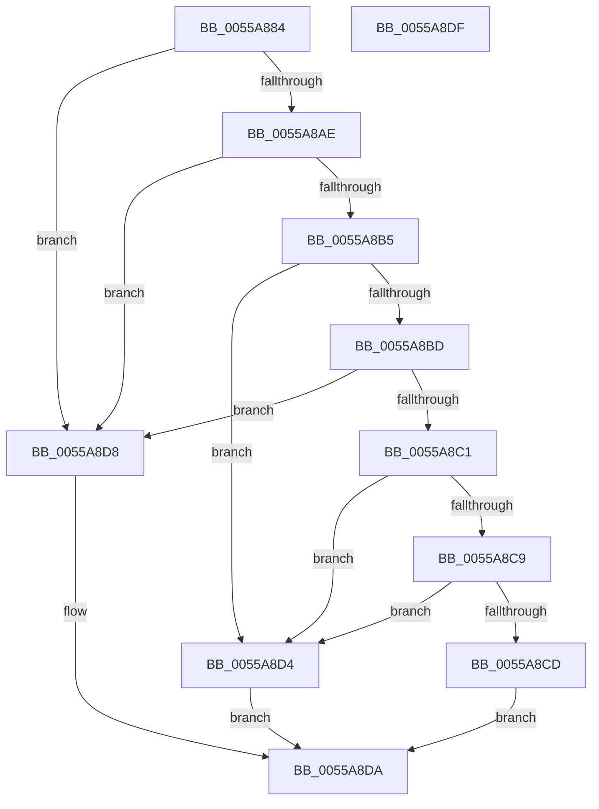

# HalpInterruptIsProcessorCacheFlushOptimizationSupported

- RVA: `0x0055A884`–`0x0055A8E0` (길이 `92` bytes)
- VA: `0x000000014055A884`
- 실행 섹션: `.text`
- PDB 이름 있음: `예`; PDB Function 태그: `아니요`
- unwind 정보 RVA: `0x000C4794`
- 디코드: `33`개 명령, `92/92` bytes 표시
- 미해석 바이트: `0` (있으면 어셈블리에 `.byte`로 보존)

> 이 문서는 커널 이미지의 기계어와 PDB 기호를 분석해 생성했습니다. 4번과 5번은 함수 원형과 자료형을 바이너리 사용 방식에서 추정한 C 해석이며 원본 소스 복구 결과는 아닙니다.

## 1. Dependencies

- 직접 호출 지점: **1**; 고유 호출 대상: **1**
- 직접 호출자로 확인된 함수: **2**
- RIP 상대 이미지 참조: **0**

### Outgoing calls
- `0x0055A8A5` → [HalpGetCpuInfo](../49/HalpGetCpuInfo_function_00498A70.md) (function, `0x00498A70`)

### Direct callers
- [HalpInterruptSetProcessorStartContext](../54/HalpInterruptSetProcessorStartContext_function_00543A90.md) at `0x00543AE4`
- [HalpInterruptAllocateCacheDomainTable](HalpInterruptAllocateCacheDomainTable_function_0055A41C.md) at `0x0055A422`

### Static image references
- 디코드된 RIP-relative 메모리 참조가 없습니다.

## 2. Other-region calls and transfers

- 다른 실행 섹션으로 향하는 call: **0**
- 별도 외부 분기/꼬리 이동을 확인하지 못했습니다.

## 3. Assembly (complete function range)

```asm
0055A884  48 8B C4                        mov rax, rsp
0055A887  48 83 EC 28                     sub rsp, 0x28
0055A88B  4C 8D 48 08                     lea r9, [rax + 8]
0055A88F  C6 40 10 00                     mov byte ptr [rax + 0x10], 0
0055A893  4C 8D 40 18                     lea r8, [rax + 0x18]
0055A897  C6 40 18 00                     mov byte ptr [rax + 0x18], 0
0055A89B  33 D2                           xor edx, edx
0055A89D  C6 40 08 00                     mov byte ptr [rax + 8], 0
0055A8A1  48 8D 48 10                     lea rcx, [rax + 0x10]
0055A8A5  E8 C6 E1 F3 FF                  call 0x140498a70
0055A8AA  84 C0                           test al, al
0055A8AC  74 2A                           je 0x14055a8d8
0055A8AE  80 7C 24 30 02                  cmp byte ptr [rsp + 0x30], 2
0055A8B3  75 23                           jne 0x14055a8d8
0055A8B5  8A 44 24 38                     mov al, byte ptr [rsp + 0x38]
0055A8B9  3C 0F                           cmp al, 0xf
0055A8BB  77 17                           ja 0x14055a8d4
0055A8BD  3C 06                           cmp al, 6
0055A8BF  75 17                           jne 0x14055a8d8
0055A8C1  8A 44 24 40                     mov al, byte ptr [rsp + 0x40]
0055A8C5  3C 8F                           cmp al, 0x8f
0055A8C7  74 0B                           je 0x14055a8d4
0055A8C9  3C AD                           cmp al, 0xad
0055A8CB  74 07                           je 0x14055a8d4
0055A8CD  3C AE                           cmp al, 0xae
0055A8CF  0F 94 C0                        sete al
0055A8D2  EB 06                           jmp 0x14055a8da
0055A8D4  B0 01                           mov al, 1
0055A8D6  EB 02                           jmp 0x14055a8da
0055A8D8  32 C0                           xor al, al
0055A8DA  48 83 C4 28                     add rsp, 0x28
0055A8DE  C3                              ret
0055A8DF  CC                              int3
```

## 4. C-style interpretation (structured pseudocode)

```c
__int64 __fastcall HalpInterruptIsProcessorCacheFlushOptimizationSupported(__int64 a1, int a2)
{
    __int64 result;
    __int64 v_rsp;
    unsigned __int8 v_stack_p10;
    unsigned __int8 v_stack_p18;
    unsigned __int8 v_stack_p8;

    v_rsp = (v_rsp) - (40);
    *(unsigned __int8 *)(v_rsp + 16) = 0;
    *(unsigned __int8 *)(v_rsp + 24) = 0;
    a2 = 0;
    *(unsigned __int8 *)(v_rsp + 8) = 0;
    result = HalpGetCpuInfo(v_rsp + 16, a2, v_rsp + 24, v_rsp + 8);
    if ((unsigned __int8)(result) == 0) goto loc_0055A8D8;
    if (v_stack_p8 != 2) goto loc_0055A8D8;
    if (((unsigned __int8)(v_stack_p10)) > 15) goto loc_0055A8D4;
    if (((unsigned __int8)(v_stack_p10)) != 6) goto loc_0055A8D8;
    if (((unsigned __int8)(v_stack_p18)) == 143) goto loc_0055A8D4;
    if (((unsigned __int8)(v_stack_p18)) == 173) goto loc_0055A8D4;
    result = (((unsigned __int8)(v_stack_p18)) == 174) ? 1 : 0;
    goto loc_0055A8DA;
loc_0055A8D4:
    goto loc_0055A8DA;
loc_0055A8D8:
    result = 0;
loc_0055A8DA:
    v_rsp = (v_rsp) + (40);
    return result;
}
```

## 5. (Beta) C Style

```c
int64_t HalpInterruptIsProcessorCacheFlushOptimizationSupported(int64_t Arg1, int32_t Arg2)
{
    int64_t result;
    int64_t local_rsp;
    uint8_t v_stack_p10;
    uint8_t v_stack_p18;
    uint8_t v_stack_p8;

    local_rsp = (local_rsp) - (40);
    *(uint8_t *)(local_rsp + 0x10) = 0;
    *(uint8_t *)(local_rsp + 0x18) = 0;
    Arg2 = 0;
    *(uint8_t *)(local_rsp + 0x8) = 0;
    result = HalpGetCpuInfo(local_rsp + 16, Arg2, local_rsp + 24, local_rsp + 8);
    if ((uint8_t)(result) == 0) goto loc_0055A8D8;
    if (v_stack_p8 != 2) goto loc_0055A8D8;
    if (((uint8_t)(v_stack_p10)) > 15) goto loc_0055A8D4;
    if (((uint8_t)(v_stack_p10)) != 6) goto loc_0055A8D8;
    if (((uint8_t)(v_stack_p18)) == 143) goto loc_0055A8D4;
    if (((uint8_t)(v_stack_p18)) == 173) goto loc_0055A8D4;
    result = (((uint8_t)(v_stack_p18)) == 174) ? 1 : 0;
    goto loc_0055A8DA;
loc_0055A8D4:
    goto loc_0055A8DA;
loc_0055A8D8:
    result = 0;
loc_0055A8DA:
    local_rsp = (local_rsp) + (40);
    return result;
}
```

## 6. Execution-region graph

[열기: 2D/3D 그래프와 함수 탐색 컨트롤 패널](../../../control-panel.html?section=text&rva=0x0055A884&view=graph)

- 2D 그래프는 위에서 아래로 흐르고, 3D 그래프는 빈 공간을 드래그해 회전합니다. Shift+드래그는 이동, 휠은 확대·축소, 함수 노드 선택은 대상 보고서 이동입니다.

### Static fallback


