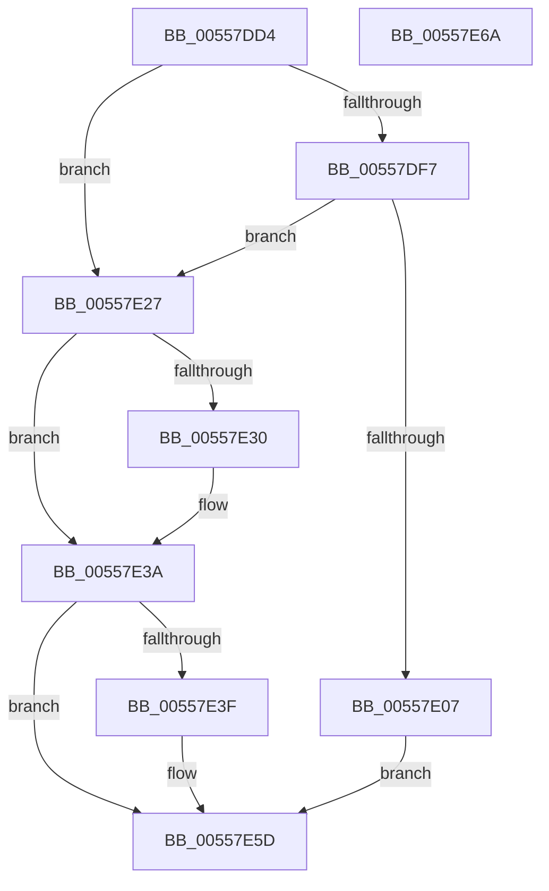

# HalpInterruptParseAcpiTables

- RVA: `0x00557DD4`–`0x00557E6B` (길이 `151` bytes)
- VA: `0x0000000140557DD4`
- 실행 섹션: `.text`
- PDB 이름 있음: `예`; PDB Function 태그: `아니요`
- unwind 정보 RVA: `0x0006E5F8`
- 디코드: `40`개 명령, `151/151` bytes 표시
- 미해석 바이트: `0` (있으면 어셈블리에 `.byte`로 보존)

> 이 문서는 커널 이미지의 기계어와 PDB 기호를 분석해 생성했습니다. 4번과 5번은 함수 원형과 자료형을 바이너리 사용 방식에서 추정한 C 해석이며 원본 소스 복구 결과는 아닙니다.

## 1. Dependencies

- 직접 호출 지점: **3**; 고유 호출 대상: **3**
- 직접 호출자로 확인된 함수: **1**
- RIP 상대 이미지 참조: **6**

### Outgoing calls
- `0x00557DED` → [HalpAcpiGetTable](../3F/HalpAcpiGetTable_function_003F6BF8.md) (function, `0x003F6BF8`)
- `0x00557DFC` → [HalpInterruptParseMadt](HalpInterruptParseMadt_function_00557E74.md) (function, `0x00557E74`)
- `0x00557E20` → [HalpInterruptSetProblemEx](../48/HalpInterruptSetProblemEx_function_0048AC8C.md) (function, `0x0048AC8C`)

### Direct callers
- [HalpInitializeInterrupts](../../init/C1/HalpInitializeInterrupts_function_00C1E4F8.md) at `0x00C1E563`
- [HalpInitializeInterrupts](../../init/C1/HalpInitializeInterrupts_function_00C1E4F8.md) at `0x00C1E843`

### Static image references
- `0x00557E07` → RVA `0x000250A0` (`.rdata`; read)
- `0x00557E27` → RVA `0x00E1020C` (`.data`; read)
- `0x00557E30` → RVA `0x00E1020C` (`.data`; write)
- `0x00557E3F` → RVA `0x00FC3E30` (`.data`; read)
- `0x00557E46` → RVA `0x00FC3E20` (`.data`; read)
- `0x00557E4D` → RVA `0x00FC3E38` (`.data`; write)

## 2. Other-region calls and transfers

- 다른 실행 섹션으로 향하는 call: **0**
- 별도 외부 분기/꼬리 이동을 확인하지 못했습니다.

## 3. Assembly (complete function range)

```asm
00557DD4  48 89 5C 24 08                  mov qword ptr [rsp + 8], rbx
00557DD9  57                              push rdi
00557DDA  48 83 EC 30                     sub rsp, 0x30
00557DDE  8B FA                           mov edi, edx
00557DE0  45 33 C9                        xor r9d, r9d
00557DE3  BA 41 50 49 43                  mov edx, 0x43495041
00557DE8  45 33 C0                        xor r8d, r8d
00557DEB  33 DB                           xor ebx, ebx
00557DED  E8 06 EE E9 FF                  call 0x1403f6bf8
00557DF2  48 85 C0                        test rax, rax
00557DF5  74 30                           je 0x140557e27
00557DF7  8B D7                           mov edx, edi
00557DF9  48 8B C8                        mov rcx, rax
00557DFC  E8 73 00 00 00                  call 0x140557e74
00557E01  8B D8                           mov ebx, eax
00557E03  85 C0                           test eax, eax
00557E05  79 20                           jns 0x140557e27
00557E07  4C 8D 0D 92 D2 AC FF            lea r9, [rip - 0x532d6e]
00557E0E  C7 44 24 20 04 01 00 00         mov dword ptr [rsp + 0x20], 0x104
00557E16  44 8B C0                        mov r8d, eax
00557E19  BA 01 00 00 00                  mov edx, 1
00557E1E  33 C9                           xor ecx, ecx
00557E20  E8 67 2E F3 FF                  call 0x14048ac8c
00557E25  EB 36                           jmp 0x140557e5d
00557E27  83 3D DE 83 8B 00 00            cmp dword ptr [rip + 0x8b83de], 0
00557E2E  75 0A                           jne 0x140557e3a
00557E30  C7 05 D2 83 8B 00 01 00 00 00   mov dword ptr [rip + 0x8b83d2], 1
00557E3A  83 FF 01                        cmp edi, 1
00557E3D  75 1E                           jne 0x140557e5d
00557E3F  48 8B 0D EA BF A6 00            mov rcx, qword ptr [rip + 0xa6bfea]
00557E46  48 8B 05 D3 BF A6 00            mov rax, qword ptr [rip + 0xa6bfd3]
00557E4D  40 88 3D E4 BF A6 00            mov byte ptr [rip + 0xa6bfe4], dil
00557E54  66 C7 41 0C 01 01               mov word ptr [rcx + 0xc], 0x101
00557E5A  48 89 08                        mov qword ptr [rax], rcx
00557E5D  8B C3                           mov eax, ebx
00557E5F  48 8B 5C 24 40                  mov rbx, qword ptr [rsp + 0x40]
00557E64  48 83 C4 30                     add rsp, 0x30
00557E68  5F                              pop rdi
00557E69  C3                              ret
00557E6A  CC                              int3
```

## 4. C-style interpretation (structured pseudocode)

```c
__int64 __fastcall HalpInterruptParseAcpiTables(__int64 a1, int a2, int a3, int a4)
{
    __int64 result;
    __int64 v_rbx;
    __int64 v_rsp;
    unsigned int v_stack_m18;
    unsigned __int64 v_stack_p8;

    v_stack_p8 = v_rbx;
    v_rsp = (v_rsp) - (48);
    a4 = 0;
    a3 = 0;
    v_rbx = 0;
    result = HalpAcpiGetTable(a1, (unsigned int)(0x43495041ULL), a3, a4);
    if (result == 0) goto loc_00557E27;
    result = HalpInterruptParseMadt(result, (unsigned int)((unsigned int)((unsigned int)(a2))), a3, a4);
    if (!sign_flag) goto loc_00557E27;
    v_stack_m18 = 260;
    a1 = 0;
    result = HalpInterruptSetProblemEx(a1, 1, (unsigned int)((unsigned int)(result)), v_rip - 5451118);
    goto loc_00557E5D;
loc_00557E27:
    if ((*(unsigned int *)(v_rip + 9143262)) == 0) {
        *(unsigned int *)(v_rip + 9143250) = 1;
    }
    if (((unsigned int)((unsigned int)(a2))) == 1) {
        a1 = *(unsigned __int64 *)(v_rip + 10928106);
        result = *(unsigned __int64 *)(v_rip + 10928083);
        *(unsigned __int8 *)(v_rip + 10928100) = (unsigned __int8)((unsigned int)(a2));
        *(unsigned __int16 *)(a1 + 12) = 257;
        *(unsigned __int64 *)(result) = a1;
    }
    v_rsp = (v_rsp) + (48);
    return (unsigned int)((unsigned int)((unsigned int)((unsigned int)(result))));
}
```

## 5. (Beta) C Style

```c
int64_t HalpInterruptParseAcpiTables(int64_t Arg1, int32_t Arg2, int32_t Arg3, int32_t Arg4)
{
    int64_t result;
    int64_t local_rbx;
    int64_t local_rsp;
    uint32_t v_stack_m18;
    uint64_t v_stack_p8;

    v_stack_p8 = local_rbx;
    local_rsp = (local_rsp) - (48);
    Arg4 = 0;
    Arg3 = 0;
    local_rbx = 0;
    result = HalpAcpiGetTable(Arg1, (uint32_t)(0x43495041ULL), Arg3, Arg4);
    if (result == 0) goto loc_00557E27;
    result = HalpInterruptParseMadt(result, (uint32_t)((uint32_t)((uint32_t)(Arg2))), Arg3, Arg4);
    if (!sign_flag) goto loc_00557E27;
    v_stack_m18 = 260;
    Arg1 = 0;
    result = HalpInterruptSetProblemEx(Arg1, 1, (uint32_t)((uint32_t)(result)), v_rip - 5451118);
    goto loc_00557E5D;
loc_00557E27:
    if ((*(uint32_t *)(v_rip + 0x8B83DE)) == 0) {
        *(uint32_t *)(v_rip + 0x8B83D2) = 1;
    }
    if (((uint32_t)((uint32_t)(Arg2))) == 1) {
        Arg1 = *(uint64_t *)(v_rip + 0xA6BFEA);
        result = *(uint64_t *)(v_rip + 0xA6BFD3);
        *(uint8_t *)(v_rip + 0xA6BFE4) = (uint8_t)((uint32_t)(Arg2));
        *(uint16_t *)(Arg1 + 0xC) = 257;
        *(uint64_t *)(result) = Arg1;
    }
    local_rsp = (local_rsp) + (48);
    return (uint32_t)((uint32_t)((uint32_t)((uint32_t)(result))));
}
```

## 6. Execution-region graph

[열기: 2D/3D 그래프와 함수 탐색 컨트롤 패널](../../../control-panel.html?section=text&rva=0x00557DD4&view=graph)

- 2D 그래프는 위에서 아래로 흐르고, 3D 그래프는 빈 공간을 드래그해 회전합니다. Shift+드래그는 이동, 휠은 확대·축소, 함수 노드 선택은 대상 보고서 이동입니다.

### Static fallback


