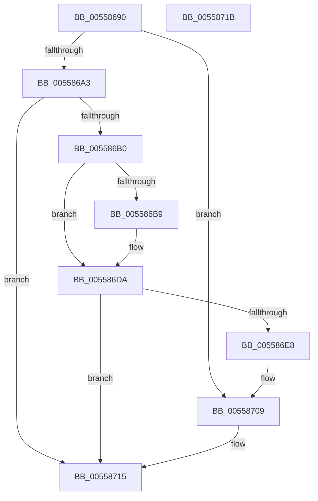

# HalpInterruptPowerChange

- RVA: `0x00558690`–`0x0055871C` (길이 `140` bytes)
- VA: `0x0000000140558690`
- 실행 섹션: `.text`
- PDB 이름 있음: `예`; PDB Function 태그: `아니요`
- unwind 정보 RVA: `0x00064C80`
- 디코드: `41`개 명령, `140/140` bytes 표시
- 미해석 바이트: `0` (있으면 어셈블리에 `.byte`로 보존)

> 이 문서는 커널 이미지의 기계어와 PDB 기호를 분석해 생성했습니다. 4번과 5번은 함수 원형과 자료형을 바이너리 사용 방식에서 추정한 C 해석이며 원본 소스 복구 결과는 아닙니다.

## 1. Dependencies

- 직접 호출 지점: **4**; 고유 호출 대상: **3**
- 직접 호출자로 확인된 함수: **3**
- RIP 상대 이미지 참조: **1**

### Outgoing calls
- `0x005586B0` → [HalpInterruptInitializeController](HalpInterruptInitializeController_function_00557914.md) (function, `0x00557914`)
- `0x005586D4` → [KeBugCheckEx](../4F/KeBugCheckEx_function_004FD660.md) (function, `0x004FD660`)
- `0x005586DF` → [HalpInterruptRestoreController](../4A/HalpInterruptRestoreController_function_004A75A8.md) (function, `0x004A75A8`)
- `0x00558703` → [KeBugCheckEx](../4F/KeBugCheckEx_function_004FD660.md) (function, `0x004FD660`)

### Direct callers
- [HalpInterruptPowerComponentActiveCallback](HalpInterruptPowerComponentActiveCallback_function_00558730.md) at `0x00558736`
- [HalpInterruptPowerComponentIdleCallback](HalpInterruptPowerComponentIdleCallback_function_00558750.md) at `0x00558761`
- [HalpInterruptPowerCriticalTransitionCallback](HalpInterruptPowerCriticalTransitionCallback_function_00558790.md) at `0x00558797`

### Static image references
- `0x005586B9` → RVA `0x00F90694` (`.data`; read)

## 2. Other-region calls and transfers

- 다른 실행 섹션으로 향하는 call: **0**
- 별도 외부 분기/꼬리 이동을 확인하지 못했습니다.

## 3. Assembly (complete function range)

```asm
00558690  40 53                           push rbx
00558692  48 83 EC 30                     sub rsp, 0x30
00558696  8B 81 F8 00 00 00               mov eax, dword ptr [rcx + 0xf8]
0055869C  48 8B D9                        mov rbx, rcx
0055869F  84 D2                           test dl, dl
005586A1  74 66                           je 0x140558709
005586A3  83 E0 FB                        and eax, 0xfffffffb
005586A6  89 81 F8 00 00 00               mov dword ptr [rcx + 0xf8], eax
005586AC  A8 02                           test al, 2
005586AE  75 65                           jne 0x140558715
005586B0  E8 5F F2 FF FF                  call 0x140557914
005586B5  85 C0                           test eax, eax
005586B7  79 21                           jns 0x1405586da
005586B9  4C 63 05 D4 7F A3 00            movsxd r8, dword ptr [rip + 0xa37fd4]
005586C0  4C 8B CB                        mov r9, rbx
005586C3  48 98                           cdqe
005586C5  BA 04 02 00 00                  mov edx, 0x204
005586CA  B9 5C 00 00 00                  mov ecx, 0x5c
005586CF  48 89 44 24 20                  mov qword ptr [rsp + 0x20], rax
005586D4  E8 87 4F FA FF                  call 0x1404fd660
005586D9  CC                              int3
005586DA  33 D2                           xor edx, edx
005586DC  48 8B CB                        mov rcx, rbx
005586DF  E8 C4 EE F4 FF                  call 0x1404a75a8
005586E4  85 C0                           test eax, eax
005586E6  79 2D                           jns 0x140558715
005586E8  4C 63 05 A5 7F A3 00            movsxd r8, dword ptr [rip + 0xa37fa5]
005586EF  4C 8B CB                        mov r9, rbx
005586F2  48 98                           cdqe
005586F4  BA 04 02 00 00                  mov edx, 0x204
005586F9  B9 5C 00 00 00                  mov ecx, 0x5c
005586FE  48 89 44 24 20                  mov qword ptr [rsp + 0x20], rax
00558703  E8 58 4F FA FF                  call 0x1404fd660
00558708  CC                              int3
00558709  83 E0 FE                        and eax, 0xfffffffe
0055870C  83 C8 04                        or eax, 4
0055870F  89 81 F8 00 00 00               mov dword ptr [rcx + 0xf8], eax
00558715  48 83 C4 30                     add rsp, 0x30
00558719  5B                              pop rbx
0055871A  C3                              ret
0055871B  CC                              int3
```

## 4. C-style interpretation (structured pseudocode)

```c
__int64 __fastcall HalpInterruptPowerChange(__int64 a1, unsigned __int8 a2)
{
    __int64 result;
    __int64 v_rsp;
    unsigned __int64 v_stack_m18;

    v_rsp = (v_rsp) - (48);
    if (a2 == 0) goto loc_00558709;
    result = (unsigned int)(((unsigned int)(*(unsigned int *)(a1 + 248))) & (0xFFFFFFFBULL));
    *(unsigned int *)(a1 + 248) = (unsigned int)(result);
    if ((((unsigned __int8)(result)) & (2)) != 0) goto loc_00558715;
    result = HalpInterruptInitializeController(a1, a2, a3, a4);
    if (sign_flag) {
        a3 = (int)(*(unsigned int *)(v_rip + 10715092));
        a4 = a1;
        a2 = 516;
        a1 = 92;
        v_stack_m18 = result;
        result = KeBugCheckEx(a1, a2, a3, a4);
    }
    a2 = 0;
    result = HalpInterruptRestoreController(a1, a2, a3, a4);
    if (!sign_flag) goto loc_00558715;
    v_stack_m18 = result;
    result = KeBugCheckEx(92, 516, (int)(*(unsigned int *)(v_rip + 10715045)), a1);
loc_00558709:
    result = (unsigned int)((result) & (0xFFFFFFFEULL));
    result = (unsigned int)((result) | (4));
    *(unsigned int *)(92 + 248) = (unsigned int)(result);
loc_00558715:
    v_rsp = (v_rsp) + (48);
    return result;
}
```

## 5. (Beta) C Style

```c
int64_t HalpInterruptPowerChange(void *Arg1, uint8_t Arg2)
{
    uint8_t *arg1 = (uint8_t *)Arg1;

    int64_t result;
    int64_t local_rsp;
    uint64_t v_stack_m18;

    local_rsp = (local_rsp) - (48);
    if (Arg2 == 0) goto loc_00558709;
    result = (uint32_t)(((uint32_t)(*(uint32_t *)(arg1 + 0xF8))) & (0xFFFFFFFBULL));
    *(uint32_t *)(arg1 + 0xF8) = (uint32_t)(result);
    if ((((uint8_t)(result)) & (2)) != 0) goto loc_00558715;
    result = HalpInterruptInitializeController(Arg1, Arg2, a3, a4);
    if (sign_flag) {
        a3 = (int32_t)(*(uint32_t *)(v_rip + 0xA37FD4));
        a4 = Arg1;
        Arg2 = 516;
        Arg1 = 92;
        v_stack_m18 = result;
        result = KeBugCheckEx(Arg1, Arg2, a3, a4);
    }
    Arg2 = 0;
    result = HalpInterruptRestoreController(Arg1, Arg2, a3, a4);
    if (!sign_flag) goto loc_00558715;
    v_stack_m18 = result;
    result = KeBugCheckEx(92, 516, (int32_t)(*(uint32_t *)(v_rip + 0xA37FA5)), Arg1);
loc_00558709:
    result = (uint32_t)((result) & (0xFFFFFFFEULL));
    result = (uint32_t)((result) | (4));
    *(uint32_t *)(92 + 0xF8) = (uint32_t)(result);
loc_00558715:
    local_rsp = (local_rsp) + (48);
    return result;
}
```

### 관측된 메모리 오프셋

구조체 형식이 확인되지 않은 접근은 인자 기준의 오프셋으로만 기록했습니다.

| 기준 인자 | 오프셋 표현 | 폭 (bit) | 접근 |
|---|---:|---:|---|
| `Arg1` | `+ 0xF8` | `32` | `R` |
| `Arg1` | `+ 0xF8` | `32` | `W` |

## 6. Execution-region graph

[열기: 2D/3D 그래프와 함수 탐색 컨트롤 패널](../../../control-panel.html?section=text&rva=0x00558690&view=graph)

- 2D 그래프는 위에서 아래로 흐르고, 3D 그래프는 빈 공간을 드래그해 회전합니다. Shift+드래그는 이동, 휠은 확대·축소, 함수 노드 선택은 대상 보고서 이동입니다.

### Static fallback


