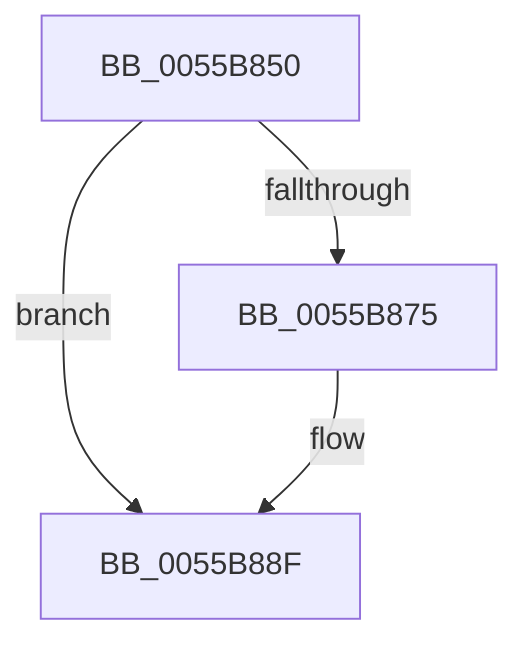

# HalpInterruptRebootService

- RVA: `0x0055B850`–`0x0055B895` (길이 `69` bytes)
- VA: `0x000000014055B850`
- 실행 섹션: `.text`
- PDB 이름 있음: `예`; PDB Function 태그: `아니요`
- unwind 정보 RVA: `0x0007E574`
- 디코드: `19`개 명령, `69/69` bytes 표시
- 미해석 바이트: `0` (있으면 어셈블리에 `.byte`로 보존)

> 이 문서는 커널 이미지의 기계어와 PDB 기호를 분석해 생성했습니다. 4번과 5번은 함수 원형과 자료형을 바이너리 사용 방식에서 추정한 C 해석이며 원본 소스 복구 결과는 아닙니다.

## 1. Dependencies

- 직접 호출 지점: **1**; 고유 호출 대상: **1**
- 직접 호출자로 확인된 함수: **2**
- RIP 상대 이미지 참조: **0**

### Outgoing calls
- `0x0055B88F` → [HalpInterruptResetThisProcessor](../54/HalpInterruptResetThisProcessor_function_00543930.md) (function, `0x00543930`)

### Direct callers
- [HalpNmiReboot](HalpNmiReboot_function_0055B2D4.md) at `0x0055B3C4`
- [HalpPreprocessNmi](HalpPreprocessNmi_function_0055B400.md) at `0x0055B426`

### Static image references
- 디코드된 RIP-relative 메모리 참조가 없습니다.

## 2. Other-region calls and transfers

- 다른 실행 섹션으로 향하는 call: **0**
- 별도 외부 분기/꼬리 이동을 확인하지 못했습니다.

## 3. Assembly (complete function range)

```asm
0055B850  48 83 EC 28                     sub rsp, 0x28
0055B854  41 B8 01 01 00 C0               mov r8d, 0xc0000101
0055B85A  41 8B C8                        mov ecx, r8d
0055B85D  0F 32                           rdmsr
0055B85F  48 C1 E2 20                     shl rdx, 0x20
0055B863  48 0B C2                        or rax, rdx
0055B866  48 BA 00 00 00 00 00 80 FF FF   movabs rdx, 0xffff800000000000
0055B870  48 3B C2                        cmp rax, rdx
0055B873  73 1A                           jae 0x14055b88f
0055B875  B9 02 01 00 C0                  mov ecx, 0xc0000102
0055B87A  0F 32                           rdmsr
0055B87C  48 C1 E2 20                     shl rdx, 0x20
0055B880  41 8B C8                        mov ecx, r8d
0055B883  48 0B C2                        or rax, rdx
0055B886  48 8B D0                        mov rdx, rax
0055B889  48 C1 EA 20                     shr rdx, 0x20
0055B88D  0F 30                           wrmsr
0055B88F  E8 9C 80 FE FF                  call 0x140543930
0055B894  CC                              int3
```

## 4. C-style interpretation (structured pseudocode)

```c
__int64 __fastcall HalpInterruptRebootService(__int64 a1, __int64 a2)
{
    __int64 result;
    __int64 v_rsp;

    v_rsp = (v_rsp) - (40);
    a2 = (a2) << (32);
    result = (result) | (a2);
    if (result < a2) {
        a1 = 0xC0000102ULL;
        a2 = (a2) << (32);
        a1 = (unsigned int)((unsigned int)(0xC0000101ULL));
        result = (result) | (a2);
        a2 = result;
        a2 = (a2) >> (32);
    }
    result = HalpInterruptResetThisProcessor(a1, a2, (unsigned int)(0xC0000101ULL), a4);
    return result;
}
```

## 5. (Beta) C Style

```c
int64_t HalpInterruptRebootService(int64_t Arg1, int64_t Arg2)
{
    int64_t result;
    int64_t local_rsp;

    local_rsp = (local_rsp) - (40);
    Arg2 = (Arg2) << (32);
    result = (result) | (Arg2);
    if (result < Arg2) {
        Arg1 = 0xC0000102ULL;
        Arg2 = (Arg2) << (32);
        Arg1 = (uint32_t)((uint32_t)(0xC0000101ULL));
        result = (result) | (Arg2);
        Arg2 = result;
        Arg2 = (Arg2) >> (32);
    }
    result = HalpInterruptResetThisProcessor(Arg1, Arg2, (uint32_t)(0xC0000101ULL), a4);
    return result;
}
```

## 6. Execution-region graph

[열기: 2D/3D 그래프와 함수 탐색 컨트롤 패널](../../../control-panel.html?section=text&rva=0x0055B850&view=graph)

- 2D 그래프는 위에서 아래로 흐르고, 3D 그래프는 빈 공간을 드래그해 회전합니다. Shift+드래그는 이동, 휠은 확대·축소, 함수 노드 선택은 대상 보고서 이동입니다.

### Static fallback


