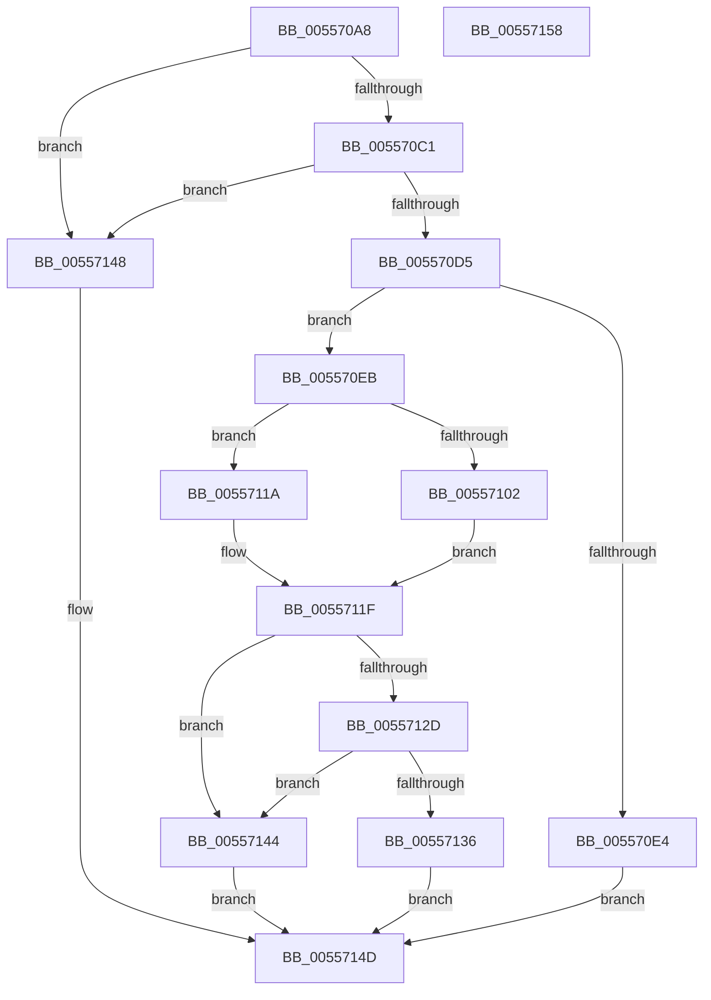

# HalpInterruptRequestSecondaryInterrupt

- RVA: `0x005570A8`–`0x00557159` (길이 `177` bytes)
- VA: `0x00000001405570A8`
- 실행 섹션: `.text`
- PDB 이름 있음: `예`; PDB Function 태그: `아니요`
- unwind 정보 RVA: `0x0005CAAC`
- 디코드: `52`개 명령, `177/177` bytes 표시
- 미해석 바이트: `0` (있으면 어셈블리에 `.byte`로 보존)

> 이 문서는 커널 이미지의 기계어와 PDB 기호를 분석해 생성했습니다. 4번과 5번은 함수 원형과 자료형을 바이너리 사용 방식에서 추정한 C 해석이며 원본 소스 복구 결과는 아닙니다.

## 1. Dependencies

- 직접 호출 지점: **5**; 고유 호출 대상: **3**
- 직접 호출자로 확인된 함수: **1**
- RIP 상대 이미지 참조: **3**

### Outgoing calls
- `0x005570CC` → [guard_dispatch_icall](../6B/guard_dispatch_icall_function_006BAAD0.md) (function, `0x006BAAD0`)
- `0x005570D7` → [HalpFindSecondaryIcEntry](../2D/HalpFindSecondaryIcEntry_function_002D219C.md) (function, `0x002D219C`)
- `0x00557111` → [guard_dispatch_icall](../6B/guard_dispatch_icall_function_006BAAD0.md) (function, `0x006BAAD0`)
- `0x00557124` → [HalpReleaseSecondaryIcEntryShared](../48/HalpReleaseSecondaryIcEntryShared_function_00488FD0.md) (function, `0x00488FD0`)
- `0x0055713D` → [guard_dispatch_icall](../6B/guard_dispatch_icall_function_006BAAD0.md) (function, `0x006BAAD0`)

### Direct callers
- [HalpInterruptRequestInterrupt](../54/HalpInterruptRequestInterrupt_function_00544460.md) at `0x005444A1`

### Static image references
- `0x005570B2` → RVA `0x00E10424` (`.data`; read)
- `0x005570C1` → RVA `0x00E009E0` (`.data`; read)
- `0x00557136` → RVA `0x00E00A70` (`.data`; read)

## 2. Other-region calls and transfers

- 다른 실행 섹션으로 향하는 call: **0**
- 별도 외부 분기/꼬리 이동을 확인하지 못했습니다.

## 3. Assembly (complete function range)

```asm
005570A8  48 89 5C 24 08                  mov qword ptr [rsp + 8], rbx
005570AD  57                              push rdi
005570AE  48 83 EC 20                     sub rsp, 0x20
005570B2  80 3D 6B 93 8B 00 00            cmp byte ptr [rip + 0x8b936b], 0
005570B9  8B F9                           mov edi, ecx
005570BB  0F 84 87 00 00 00               je 0x140557148
005570C1  48 8B 05 18 99 8A 00            mov rax, qword ptr [rip + 0x8a9918]
005570C8  8B D1                           mov edx, ecx
005570CA  33 C9                           xor ecx, ecx
005570CC  E8 FF 39 16 00                  call 0x1406baad0
005570D1  84 C0                           test al, al
005570D3  74 73                           je 0x140557148
005570D5  8B CF                           mov ecx, edi
005570D7  E8 C0 B0 D7 FF                  call 0x1402d219c
005570DC  48 8B D8                        mov rbx, rax
005570DF  48 85 C0                        test rax, rax
005570E2  75 07                           jne 0x1405570eb
005570E4  B8 21 A1 00 C0                  mov eax, 0xc000a121
005570E9  EB 62                           jmp 0x14055714d
005570EB  83 4C 24 38 FF                  or dword ptr [rsp + 0x38], 0xffffffff
005570F0  8B CF                           mov ecx, edi
005570F2  2B 48 10                        sub ecx, dword ptr [rax + 0x10]
005570F5  48 03 C9                        add rcx, rcx
005570F8  80 BC C8 AC 00 00 00 00         cmp byte ptr [rax + rcx*8 + 0xac], 0
00557100  74 18                           je 0x14055711a
00557102  48 8B 40 60                     mov rax, qword ptr [rax + 0x60]
00557106  4C 8D 44 24 38                  lea r8, [rsp + 0x38]
0055710B  48 8B 4B 20                     mov rcx, qword ptr [rbx + 0x20]
0055710F  8B D7                           mov edx, edi
00557111  E8 BA 39 16 00                  call 0x1406baad0
00557116  8B F8                           mov edi, eax
00557118  EB 05                           jmp 0x14055711f
0055711A  BF 01 00 00 C0                  mov edi, 0xc0000001
0055711F  B2 01                           mov dl, 1
00557121  48 8B CB                        mov rcx, rbx
00557124  E8 A7 1E F3 FF                  call 0x140488fd0
00557129  85 FF                           test edi, edi
0055712B  78 17                           js 0x140557144
0055712D  8B 4C 24 38                     mov ecx, dword ptr [rsp + 0x38]
00557131  83 F9 FF                        cmp ecx, -1
00557134  74 0E                           je 0x140557144
00557136  48 8B 05 33 99 8A 00            mov rax, qword ptr [rip + 0x8a9933]
0055713D  E8 8E 39 16 00                  call 0x1406baad0
00557142  EB 09                           jmp 0x14055714d
00557144  8B C7                           mov eax, edi
00557146  EB 05                           jmp 0x14055714d
00557148  B8 0D 00 00 C0                  mov eax, 0xc000000d
0055714D  48 8B 5C 24 30                  mov rbx, qword ptr [rsp + 0x30]
00557152  48 83 C4 20                     add rsp, 0x20
00557156  5F                              pop rdi
00557157  C3                              ret
00557158  CC                              int3
```

## 4. C-style interpretation (structured pseudocode)

```c
__int64 __fastcall HalpInterruptRequestSecondaryInterrupt(int a1)
{
    __int64 result;
    __int64 v_rsp;
    unsigned int v_stack_p10;
    unsigned __int64 v_stack_p8;

    v_stack_p8 = v_rbx;
    v_rsp = (v_rsp) - (32);
    if ((*(unsigned __int8 *)(v_rip + 9147243)) == 0) goto loc_00557148;
    a1 = 0;
    result = guard_dispatch_icall(a1, (unsigned int)(a1), a3, a4);
    if ((unsigned __int8)(result) == 0) goto loc_00557148;
    result = HalpFindSecondaryIcEntry((unsigned int)((unsigned int)((unsigned int)(a1))), (unsigned int)(a1), a3, a4);
    if (result != 0) goto loc_005570EB;
    goto loc_0055714D;
loc_005570EB:
    a1 = (unsigned int)(((unsigned int)((unsigned int)((unsigned int)(a1)))) - (*(unsigned int *)((unsigned int)(0xC000A121ULL) + 16)));
    a1 = (a1) + (a1);
    if ((*(unsigned __int8 *)((unsigned int)(0xC000A121ULL) + a1 * 8 + 172)) == 0) goto loc_0055711A;
    result = guard_dispatch_icall(*(unsigned __int64 *)(result + 32), (unsigned int)((unsigned int)((unsigned int)(a1))), v_stack_p10, a4);
    goto loc_0055711F;
loc_0055711A:
loc_0055711F:
    result = HalpReleaseSecondaryIcEntryShared(result, 1, v_stack_p10, a4);
    if (sign_flag) goto loc_00557144;
    if (((unsigned int)((unsigned int)(v_stack_p10))) == -1) goto loc_00557144;
    result = guard_dispatch_icall((unsigned int)(v_stack_p10), 1, v_stack_p10, a4);
    goto loc_0055714D;
loc_00557144:
    goto loc_0055714D;
loc_00557148:
loc_0055714D:
    v_rsp = (v_rsp) + (32);
    return (unsigned int)(0xC000000DULL);
}
```

## 5. (Beta) C Style

```c
int64_t HalpInterruptRequestSecondaryInterrupt(int32_t Arg1)
{
    int64_t result;
    int64_t local_rsp;
    uint32_t v_stack_p10;
    uint64_t v_stack_p8;

    v_stack_p8 = local_rbx;
    local_rsp = (local_rsp) - (32);
    if ((*(uint8_t *)(v_rip + 0x8B936B)) == 0) goto loc_00557148;
    Arg1 = 0;
    result = guard_dispatch_icall(Arg1, (uint32_t)(Arg1), a3, a4);
    if ((uint8_t)(result) == 0) goto loc_00557148;
    result = HalpFindSecondaryIcEntry((uint32_t)((uint32_t)((uint32_t)(Arg1))), (uint32_t)(Arg1), a3, a4);
    if (result != 0) goto loc_005570EB;
    goto loc_0055714D;
loc_005570EB:
    Arg1 = (uint32_t)(((uint32_t)((uint32_t)((uint32_t)(Arg1)))) - (*(uint32_t *)((uint32_t)(0xC000A121ULL) + 0x10)));
    Arg1 = (Arg1) + (Arg1);
    if ((*(uint8_t *)((uint32_t)(0xC000A121ULL) + Arg1 * 8 + 0xAC)) == 0) goto loc_0055711A;
    result = guard_dispatch_icall(*(uint64_t *)(result + 0x20), (uint32_t)((uint32_t)((uint32_t)(Arg1))), v_stack_p10, a4);
    goto loc_0055711F;
loc_0055711A:
loc_0055711F:
    result = HalpReleaseSecondaryIcEntryShared(result, 1, v_stack_p10, a4);
    if (sign_flag) goto loc_00557144;
    if (((uint32_t)((uint32_t)(v_stack_p10))) == -1) goto loc_00557144;
    result = guard_dispatch_icall((uint32_t)(v_stack_p10), 1, v_stack_p10, a4);
    goto loc_0055714D;
loc_00557144:
    goto loc_0055714D;
loc_00557148:
loc_0055714D:
    local_rsp = (local_rsp) + (32);
    return (uint32_t)(0xC000000DULL);
}
```

## 6. Execution-region graph

[열기: 2D/3D 그래프와 함수 탐색 컨트롤 패널](../../../control-panel.html?section=text&rva=0x005570A8&view=graph)

- 2D 그래프는 위에서 아래로 흐르고, 3D 그래프는 빈 공간을 드래그해 회전합니다. Shift+드래그는 이동, 휠은 확대·축소, 함수 노드 선택은 대상 보고서 이동입니다.

### Static fallback


