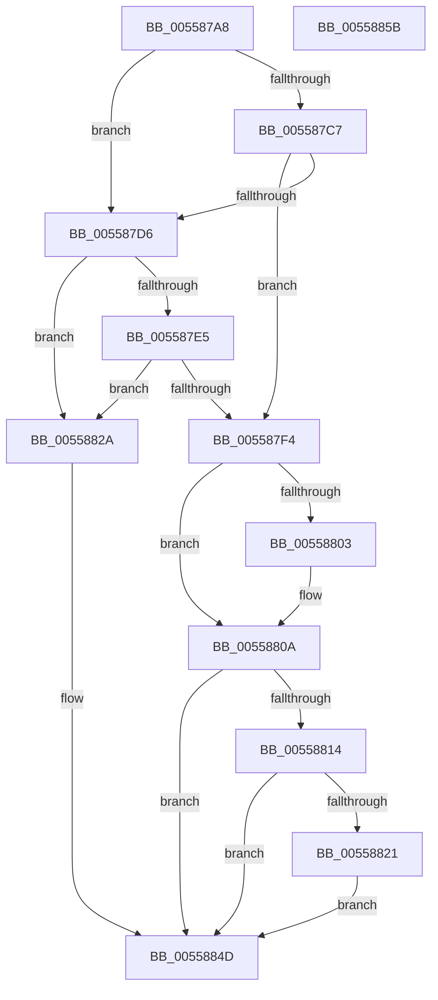

# HalpInterruptSelectController

- RVA: `0x005587A8`–`0x0055885C` (길이 `180` bytes)
- VA: `0x00000001405587A8`
- 실행 섹션: `.text`
- PDB 이름 있음: `예`; PDB Function 태그: `아니요`
- unwind 정보 RVA: `0x0006E5F8`
- 디코드: `51`개 명령, `180/180` bytes 표시
- 미해석 바이트: `0` (있으면 어셈블리에 `.byte`로 보존)

> 이 문서는 커널 이미지의 기계어와 PDB 기호를 분석해 생성했습니다. 4번과 5번은 함수 원형과 자료형을 바이너리 사용 방식에서 추정한 C 해석이며 원본 소스 복구 결과는 아닙니다.

## 1. Dependencies

- 직접 호출 지점: **5**; 고유 호출 대상: **3**
- 직접 호출자로 확인된 함수: **1**
- RIP 상대 이미지 참조: **4**

### Outgoing calls
- `0x005587BA` → [HalpFindInterruptController](HalpFindInterruptController_function_005574D4.md) (function, `0x005574D4`)
- `0x005587CA` → [HalpInterruptInitializeController](HalpInterruptInitializeController_function_00557914.md) (function, `0x00557914`)
- `0x005587D8` → [HalpFindInterruptController](HalpFindInterruptController_function_005574D4.md) (function, `0x005574D4`)
- `0x005587E8` → [HalpInterruptInitializeController](HalpInterruptInitializeController_function_00557914.md) (function, `0x00557914`)
- `0x00558848` → [HalpInterruptSetProblemEx](../48/HalpInterruptSetProblemEx_function_0048AC8C.md) (function, `0x0048AC8C`)

### Direct callers
- [HalpInitializeInterrupts](../../init/C1/HalpInitializeInterrupts_function_00C1E4F8.md) at `0x00C1E804`

### Static image references
- `0x00558803` → RVA `0x00E002D0` (`.data`; write)
- `0x00558814` → RVA `0x00F906B0` (`.data`; write)
- `0x00558821` → RVA `0x00F906D4` (`.data`; write)
- `0x00558835` → RVA `0x000250A0` (`.rdata`; read)

## 2. Other-region calls and transfers

- 다른 실행 섹션으로 향하는 call: **0**
- 별도 외부 분기/꼬리 이동을 확인하지 못했습니다.

## 3. Assembly (complete function range)

```asm
005587A8  48 89 5C 24 08                  mov qword ptr [rsp + 8], rbx
005587AD  57                              push rdi
005587AE  48 83 EC 30                     sub rsp, 0x30
005587B2  48 8B F9                        mov rdi, rcx
005587B5  B9 02 00 00 00                  mov ecx, 2
005587BA  E8 15 ED FF FF                  call 0x1405574d4
005587BF  48 8B D8                        mov rbx, rax
005587C2  48 85 C0                        test rax, rax
005587C5  74 0F                           je 0x1405587d6
005587C7  48 8B C8                        mov rcx, rax
005587CA  E8 45 F1 FF FF                  call 0x140557914
005587CF  44 8B D0                        mov r10d, eax
005587D2  85 C0                           test eax, eax
005587D4  79 1E                           jns 0x1405587f4
005587D6  33 C9                           xor ecx, ecx
005587D8  E8 F7 EC FF FF                  call 0x1405574d4
005587DD  48 8B D8                        mov rbx, rax
005587E0  48 85 C0                        test rax, rax
005587E3  74 45                           je 0x14055882a
005587E5  48 8B C8                        mov rcx, rax
005587E8  E8 27 F1 FF FF                  call 0x140557914
005587ED  44 8B D0                        mov r10d, eax
005587F0  85 C0                           test eax, eax
005587F2  78 36                           js 0x14055882a
005587F4  48 8B 4B 68                     mov rcx, qword ptr [rbx + 0x68]
005587F8  48 8B C3                        mov rax, rbx
005587FB  48 89 1F                        mov qword ptr [rdi], rbx
005587FE  48 85 C9                        test rcx, rcx
00558801  74 07                           je 0x14055880a
00558803  48 89 0D C6 7A 8A 00            mov qword ptr [rip + 0x8a7ac6], rcx
0055880A  8B 83 F4 00 00 00               mov eax, dword ptr [rbx + 0xf4]
00558810  A8 01                           test al, 1
00558812  74 39                           je 0x14055884d
00558814  C6 05 95 7E A3 00 01            mov byte ptr [rip + 0xa37e95], 1
0055881B  0F BA E0 0A                     bt eax, 0xa
0055881F  73 2C                           jae 0x14055884d
00558821  C6 05 AC 7E A3 00 01            mov byte ptr [rip + 0xa37eac], 1
00558828  EB 23                           jmp 0x14055884d
0055882A  45 33 C0                        xor r8d, r8d
0055882D  C7 44 24 20 6B 01 00 00         mov dword ptr [rsp + 0x20], 0x16b
00558835  4C 8D 0D 64 C8 AC FF            lea r9, [rip - 0x53379c]
0055883C  33 C9                           xor ecx, ecx
0055883E  41 BA 0E 00 00 C0               mov r10d, 0xc000000e
00558844  41 8D 50 02                     lea edx, [r8 + 2]
00558848  E8 3F 24 F3 FF                  call 0x14048ac8c
0055884D  48 8B 5C 24 40                  mov rbx, qword ptr [rsp + 0x40]
00558852  41 8B C2                        mov eax, r10d
00558855  48 83 C4 30                     add rsp, 0x30
00558859  5F                              pop rdi
0055885A  C3                              ret
0055885B  CC                              int3
```

## 4. C-style interpretation (structured pseudocode)

```c
__int64 __fastcall HalpInterruptSelectController(__int64 a1, __int64 a2, int a3)
{
    __int64 result;
    __int64 v_rsp;
    unsigned int v_stack_m18;
    unsigned __int64 v_stack_p8;

    v_stack_p8 = v_rbx;
    v_rsp = (v_rsp) - (48);
    result = HalpFindInterruptController(2, a2, a3, a4);
    if (result == 0) goto loc_005587D6;
    result = HalpInterruptInitializeController(result, a2, a3, a4);
    if (!sign_flag) goto loc_005587F4;
loc_005587D6:
    a1 = 0;
    result = HalpFindInterruptController(a1, a2, a3, a4);
    if (result == 0) goto loc_0055882A;
    result = HalpInterruptInitializeController(result, a2, a3, a4);
    if (sign_flag) goto loc_0055882A;
loc_005587F4:
    *(unsigned __int64 *)(a1) = result;
    if (*(unsigned __int64 *)(result + 104) != 0) {
        *(unsigned __int64 *)(v_rip + 9075398) = *(unsigned __int64 *)(result + 104);
    }
    if ((((unsigned __int8)((unsigned int)(*(unsigned int *)(result + 244)))) & (1)) == 0) goto loc_0055884D;
    *(unsigned __int8 *)(v_rip + 10714773) = 1;
    if (condition_is_above_or_equal) goto loc_0055884D;
    *(unsigned __int8 *)(v_rip + 10714796) = 1;
    goto loc_0055884D;
loc_0055882A:
    a3 = 0;
    v_stack_m18 = 363;
    a1 = 0;
    result = HalpInterruptSetProblemEx(a1, a3 + 2, a3, v_rip - 5453724);
loc_0055884D:
    v_rsp = (v_rsp) + (48);
    return (unsigned int)((unsigned int)((unsigned int)(0xC000000EULL)));
}
```

## 5. (Beta) C Style

```c
int64_t HalpInterruptSelectController(void *Arg1, int64_t Arg2, int32_t Arg3)
{
    uint8_t *arg1 = (uint8_t *)Arg1;

    int64_t result;
    int64_t local_rsp;
    uint32_t v_stack_m18;
    uint64_t v_stack_p8;

    v_stack_p8 = local_rbx;
    local_rsp = (local_rsp) - (48);
    result = HalpFindInterruptController(2, Arg2, Arg3, a4);
    if (result == 0) goto loc_005587D6;
    result = HalpInterruptInitializeController(result, Arg2, Arg3, a4);
    if (!sign_flag) goto loc_005587F4;
loc_005587D6:
    Arg1 = 0;
    result = HalpFindInterruptController(Arg1, Arg2, Arg3, a4);
    if (result == 0) goto loc_0055882A;
    result = HalpInterruptInitializeController(result, Arg2, Arg3, a4);
    if (sign_flag) goto loc_0055882A;
loc_005587F4:
    *(uint64_t *)(arg1) = result;
    if (*(uint64_t *)(result + 0x68) != 0) {
        *(uint64_t *)(v_rip + 0x8A7AC6) = *(uint64_t *)(result + 0x68);
    }
    if ((((uint8_t)((uint32_t)(*(uint32_t *)(result + 0xF4)))) & (1)) == 0) goto loc_0055884D;
    *(uint8_t *)(v_rip + 0xA37E95) = 1;
    if (condition_is_above_or_equal) goto loc_0055884D;
    *(uint8_t *)(v_rip + 0xA37EAC) = 1;
    goto loc_0055884D;
loc_0055882A:
    Arg3 = 0;
    v_stack_m18 = 363;
    Arg1 = 0;
    result = HalpInterruptSetProblemEx(Arg1, Arg3 + 2, Arg3, v_rip - 5453724);
loc_0055884D:
    local_rsp = (local_rsp) + (48);
    return (uint32_t)((uint32_t)((uint32_t)(0xC000000EULL)));
}
```

### 관측된 메모리 오프셋

구조체 형식이 확인되지 않은 접근은 인자 기준의 오프셋으로만 기록했습니다.

| 기준 인자 | 오프셋 표현 | 폭 (bit) | 접근 |
|---|---:|---:|---|
| `Arg1` | `+ 0x0` | `64` | `W` |

## 6. Execution-region graph

[열기: 2D/3D 그래프와 함수 탐색 컨트롤 패널](../../../control-panel.html?section=text&rva=0x005587A8&view=graph)

- 2D 그래프는 위에서 아래로 흐르고, 3D 그래프는 빈 공간을 드래그해 회전합니다. Shift+드래그는 이동, 휠은 확대·축소, 함수 노드 선택은 대상 보고서 이동입니다.

### Static fallback


