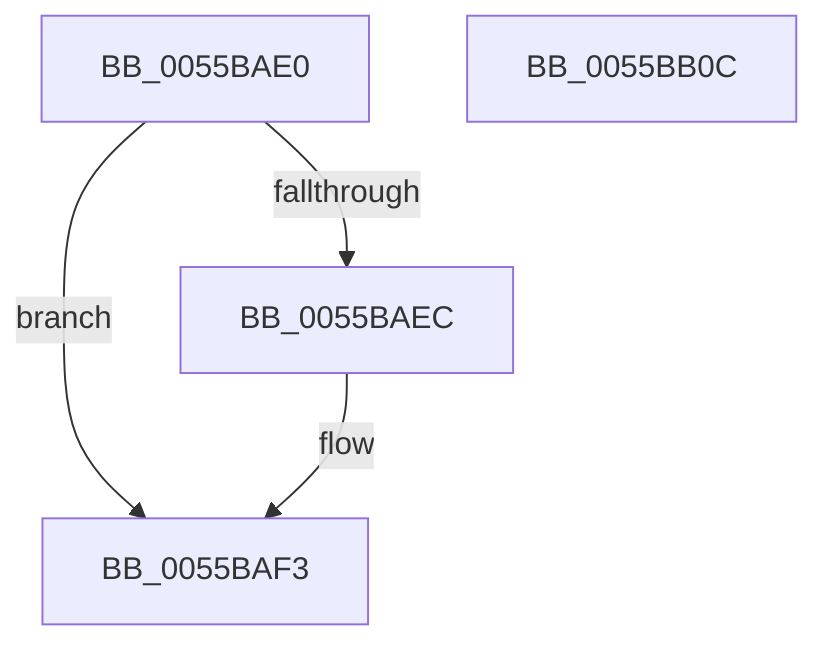

# HalpInterruptSetIdtEntry

- RVA: `0x0055BAE0`–`0x0055BB0D` (길이 `45` bytes)
- VA: `0x000000014055BAE0`
- 실행 섹션: `.text`
- PDB 이름 있음: `예`; PDB Function 태그: `아니요`
- unwind 정보 RVA: `0x00063458`
- 디코드: `14`개 명령, `45/45` bytes 표시
- 미해석 바이트: `0` (있으면 어셈블리에 `.byte`로 보존)

> 이 문서는 커널 이미지의 기계어와 PDB 기호를 분석해 생성했습니다. 4번과 5번은 함수 원형과 자료형을 바이너리 사용 방식에서 추정한 C 해석이며 원본 소스 복구 결과는 아닙니다.

## 1. Dependencies

- 직접 호출 지점: **1**; 고유 호출 대상: **1**
- 직접 호출자로 확인된 함수: **11**
- RIP 상대 이미지 참조: **0**

### Outgoing calls
- `0x0055BB02` → [HalpCreateInterrupt](HalpCreateInterrupt_function_0055BA00.md) (function, `0x0055BA00`)

### Direct callers
- [HalpInitializeInterruptsPn](../54/HalpInitializeInterruptsPn_function_00543E38.md) at `0x00543E72`
- [HalpInitializeInterruptsPn](../54/HalpInitializeInterruptsPn_function_00543E38.md) at `0x00543E89`
- [HalpInitializeInterruptsPn](../54/HalpInitializeInterruptsPn_function_00543E38.md) at `0x00543EA6`
- [HalpInitializeInterruptsPn](../54/HalpInitializeInterruptsPn_function_00543E38.md) at `0x00543EBF`
- [HalpInitializeInterruptsPn](../54/HalpInitializeInterruptsPn_function_00543E38.md) at `0x00543ED8`
- [HalpInitializeInterruptsPn](../54/HalpInitializeInterruptsPn_function_00543E38.md) at `0x00543EF1`
- [HalpInitializeInterruptsPn](../54/HalpInitializeInterruptsPn_function_00543E38.md) at `0x00543F0E`
- [HalpInitializeInterruptsPn](../54/HalpInitializeInterruptsPn_function_00543E38.md) at `0x00543F27`
- [HalpTimerClockActivate](../54/HalpTimerClockActivate_function_005480B0.md) at `0x005480DE`
- [HalpTimerInitializeClock](../54/HalpTimerInitializeClock_function_00548424.md) at `0x0054845D`
- [HalpTimerInitializeClockPn](../54/HalpTimerInitializeClockPn_function_00548614.md) at `0x00548639`
- [HalpTimerInitializeClockPn](../54/HalpTimerInitializeClockPn_function_00548614.md) at `0x00548663`
- [HalpTimerInitializeClockPn](../54/HalpTimerInitializeClockPn_function_00548614.md) at `0x005486BC`
- [HalpTimerConfigureInterrupt](../54/HalpTimerConfigureInterrupt_function_00548AB0.md) at `0x00548BA3`
- [HalpTimerConfigureInterrupt](../54/HalpTimerConfigureInterrupt_function_00548AB0.md) at `0x00548BF0`
- [HalpTimerConfigureInterrupt](../54/HalpTimerConfigureInterrupt_function_00548AB0.md) at `0x00548D6F`
- [HalpTimerInitializeProfiling](../54/HalpTimerInitializeProfiling_function_0054B4FC.md) at `0x0054B5FE`
- [HalpTimerTestHypervisorTimer](../54/HalpTimerTestHypervisorTimer_function_0054BBC0.md) at `0x0054BC7D`
- [HalpConnectThermalInterrupt](HalpConnectThermalInterrupt_function_00557310.md) at `0x005573CD`
- [HalpIommuInitInterrupts](../../pagelk/B5/HalpIommuInitInterrupts_function_00B5DCB8.md) at `0x00B5DCDA`
- [HalpInitializeInterrupts](../../init/C1/HalpInitializeInterrupts_function_00C1E4F8.md) at `0x00C1E71F`
- [HalpInitializeInterrupts](../../init/C1/HalpInitializeInterrupts_function_00C1E4F8.md) at `0x00C1E738`
- [HalpInitializeInterrupts](../../init/C1/HalpInitializeInterrupts_function_00C1E4F8.md) at `0x00C1E74F`
- [HalpInitializeInterrupts](../../init/C1/HalpInitializeInterrupts_function_00C1E4F8.md) at `0x00C1E76E`
- [HalpInitializeInterrupts](../../init/C1/HalpInitializeInterrupts_function_00C1E4F8.md) at `0x00C1E785`
- [HalpInitializeInterrupts](../../init/C1/HalpInitializeInterrupts_function_00C1E4F8.md) at `0x00C1E79C`
- [HalpInitializeInterrupts](../../init/C1/HalpInitializeInterrupts_function_00C1E4F8.md) at `0x00C1E7B3`
- [HalpInitializeInterrupts](../../init/C1/HalpInitializeInterrupts_function_00C1E4F8.md) at `0x00C1E7CE`
- [IommupHvInitializeLibrary](../../init/C2/IommupHvInitializeLibrary_function_00C25024.md) at `0x00C25274`

### Static image references
- 디코드된 RIP-relative 메모리 참조가 없습니다.

## 2. Other-region calls and transfers

- 다른 실행 섹션으로 향하는 call: **0**
- 별도 외부 분기/꼬리 이동을 확인하지 못했습니다.

## 3. Assembly (complete function range)

```asm
0055BAE0  48 83 EC 48                     sub rsp, 0x48
0055BAE4  4C 8B CA                        mov r9, rdx
0055BAE7  45 84 C0                        test r8b, r8b
0055BAEA  75 07                           jne 0x14055baf3
0055BAEC  44 8A C1                        mov r8b, cl
0055BAEF  41 C0 E8 04                     shr r8b, 4
0055BAF3  48 8B 44 24 70                  mov rax, qword ptr [rsp + 0x70]
0055BAF8  8B D1                           mov edx, ecx
0055BAFA  49 8B C9                        mov rcx, r9
0055BAFD  48 89 44 24 20                  mov qword ptr [rsp + 0x20], rax
0055BB02  E8 F9 FE FF FF                  call 0x14055ba00
0055BB07  48 83 C4 48                     add rsp, 0x48
0055BB0B  C3                              ret
0055BB0C  CC                              int3
```

## 4. C-style interpretation (structured pseudocode)

```c
__int64 __fastcall HalpInterruptSetIdtEntry(int a1, __int64 a2, unsigned __int8 a3, __int64 a4, __int64 a5)
{
    __int64 result;
    __int64 v_rsp;
    unsigned __int64 v_stack_m28;

    v_rsp = (v_rsp) - (72);
    if (a3 == 0) {
        a3 = (unsigned __int8)(a1);
        a3 = (unsigned __int8)((a3) >> (4));
    }
    v_stack_m28 = a5;
    result = HalpCreateInterrupt(a2, (unsigned int)(a1), a3, a2);
    v_rsp = (v_rsp) + (72);
    return result;
}
```

## 5. (Beta) C Style

```c
int64_t HalpInterruptSetIdtEntry(int32_t Arg1, int64_t Arg2, uint8_t Arg3, int64_t Arg4, int64_t Arg5)
{
    int64_t result;
    int64_t local_rsp;
    uint64_t v_stack_m28;

    local_rsp = (local_rsp) - (72);
    if (Arg3 == 0) {
        Arg3 = (uint8_t)(Arg1);
        Arg3 = (uint8_t)((Arg3) >> (4));
    }
    v_stack_m28 = Arg5;
    result = HalpCreateInterrupt(Arg2, (uint32_t)(Arg1), Arg3, Arg2);
    local_rsp = (local_rsp) + (72);
    return result;
}
```

## 6. Execution-region graph

[열기: 2D/3D 그래프와 함수 탐색 컨트롤 패널](../../../control-panel.html?section=text&rva=0x0055BAE0&view=graph)

- 2D 그래프는 위에서 아래로 흐르고, 3D 그래프는 빈 공간을 드래그해 회전합니다. Shift+드래그는 이동, 휠은 확대·축소, 함수 노드 선택은 대상 보고서 이동입니다.

### Static fallback


