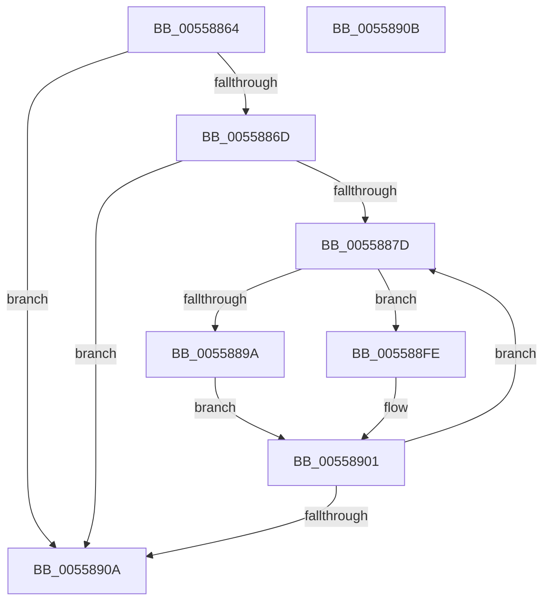

# HalpInterruptSortProcessorTable

- RVA: `0x00558864`–`0x0055890C` (길이 `168` bytes)
- VA: `0x0000000140558864`
- 실행 섹션: `.text`
- PDB 이름 있음: `예`; PDB Function 태그: `아니요`
- unwind 정보 RVA: `0x000DB714`
- 디코드: `40`개 명령, `168/168` bytes 표시
- 미해석 바이트: `0` (있으면 어셈블리에 `.byte`로 보존)

> 이 문서는 커널 이미지의 기계어와 PDB 기호를 분석해 생성했습니다. 4번과 5번은 함수 원형과 자료형을 바이너리 사용 방식에서 추정한 C 해석이며 원본 소스 복구 결과는 아닙니다.

## 1. Dependencies

- 직접 호출 지점: **0**; 고유 호출 대상: **0**
- 직접 호출자로 확인된 함수: **1**
- RIP 상대 이미지 참조: **0**

### Outgoing calls
- 직접 디코드된 call 명령이 없습니다.

### Direct callers
- [HalpInterruptParseMadt](HalpInterruptParseMadt_function_00557E74.md) at `0x00558572`
- [HalpInterruptParseMadt](HalpInterruptParseMadt_function_00557E74.md) at `0x00558634`
- [HalpInterruptParseMadt](HalpInterruptParseMadt_function_00557E74.md) at `0x0055864E`

### Static image references
- 디코드된 RIP-relative 메모리 참조가 없습니다.

## 2. Other-region calls and transfers

- 다른 실행 섹션으로 향하는 call: **0**
- 별도 외부 분기/꼬리 이동을 확인하지 못했습니다.

## 3. Assembly (complete function range)

```asm
00558864  83 FA 01                        cmp edx, 1
00558867  0F 86 9D 00 00 00               jbe 0x14055890a
0055886D  45 33 C0                        xor r8d, r8d
00558870  44 8D 52 FF                     lea r10d, [rdx - 1]
00558874  45 85 D2                        test r10d, r10d
00558877  0F 84 8D 00 00 00               je 0x14055890a
0055887D  45 8D 58 01                     lea r11d, [r8 + 1]
00558881  45 8B C8                        mov r9d, r8d
00558884  41 8B D3                        mov edx, r11d
00558887  48 C1 E2 06                     shl rdx, 6
0055888B  49 C1 E1 06                     shl r9, 6
0055888F  8B 44 0A 08                     mov eax, dword ptr [rdx + rcx + 8]
00558893  41 39 44 09 08                  cmp dword ptr [r9 + rcx + 8], eax
00558898  76 64                           jbe 0x1405588fe
0055889A  0F 10 04 0A                     movups xmm0, xmmword ptr [rdx + rcx]
0055889E  45 85 C0                        test r8d, r8d
005588A1  41 8D 40 FF                     lea eax, [r8 - 1]
005588A5  0F 10 4C 0A 10                  movups xmm1, xmmword ptr [rdx + rcx + 0x10]
005588AA  41 0F 44 C0                     cmove eax, r8d
005588AE  41 0F 10 14 09                  movups xmm2, xmmword ptr [r9 + rcx]
005588B3  44 8B C0                        mov r8d, eax
005588B6  41 0F 10 5C 09 10               movups xmm3, xmmword ptr [r9 + rcx + 0x10]
005588BC  41 0F 10 64 09 20               movups xmm4, xmmword ptr [r9 + rcx + 0x20]
005588C2  41 0F 10 6C 09 30               movups xmm5, xmmword ptr [r9 + rcx + 0x30]
005588C8  41 0F 11 04 09                  movups xmmword ptr [r9 + rcx], xmm0
005588CD  0F 10 44 0A 20                  movups xmm0, xmmword ptr [rdx + rcx + 0x20]
005588D2  41 0F 11 4C 09 10               movups xmmword ptr [r9 + rcx + 0x10], xmm1
005588D8  0F 10 4C 0A 30                  movups xmm1, xmmword ptr [rdx + rcx + 0x30]
005588DD  0F 11 14 0A                     movups xmmword ptr [rdx + rcx], xmm2
005588E1  0F 11 5C 0A 10                  movups xmmword ptr [rdx + rcx + 0x10], xmm3
005588E6  41 0F 11 44 09 20               movups xmmword ptr [r9 + rcx + 0x20], xmm0
005588EC  0F 11 64 0A 20                  movups xmmword ptr [rdx + rcx + 0x20], xmm4
005588F1  41 0F 11 4C 09 30               movups xmmword ptr [r9 + rcx + 0x30], xmm1
005588F7  0F 11 6C 0A 30                  movups xmmword ptr [rdx + rcx + 0x30], xmm5
005588FC  EB 03                           jmp 0x140558901
005588FE  45 8B C3                        mov r8d, r11d
00558901  45 3B C2                        cmp r8d, r10d
00558904  0F 82 73 FF FF FF               jb 0x14055887d
0055890A  C3                              ret
0055890B  CC                              int3
```

## 4. C-style interpretation (structured pseudocode)

```c
__int64 __fastcall HalpInterruptSortProcessorTable(__int64 a1, __int64 a2, int a3)
{
    __int64 result;

    if (((unsigned int)(a2)) <= 1) goto loc_0055890A;
    a3 = 0;
    if ((unsigned int)(a2 - 1) == 0) goto loc_0055890A;
loc_0055887D:
    a2 = ((unsigned int)((unsigned int)(a3 + 1))) << (6);
    a4 = (0) << (6);
    if ((*(unsigned int *)(a4 + a1 * 1 + 8)) <= ((unsigned int)((unsigned int)(*(unsigned int *)(a2 + a1 * 1 + 8))))) goto loc_005588FE;
    result = a3 - 1;
    if (0 == 0) { result = 0; }
    *(unsigned __int64 *)(a4 + a1 * 1) = v_xmm0;
    *(unsigned __int64 *)(a4 + a1 * 1 + 16) = v_xmm1;
    *(unsigned __int64 *)(a2 + a1 * 1) = v_xmm2;
    *(unsigned __int64 *)(a2 + a1 * 1 + 16) = v_xmm3;
    *(unsigned __int64 *)(a4 + a1 * 1 + 32) = v_xmm0;
    *(unsigned __int64 *)(a2 + a1 * 1 + 32) = v_xmm4;
    *(unsigned __int64 *)(a4 + a1 * 1 + 48) = v_xmm1;
    *(unsigned __int64 *)(a2 + a1 * 1 + 48) = v_xmm5;
    goto loc_00558901;
loc_005588FE:
loc_00558901:
    if (((unsigned int)((unsigned int)((unsigned int)(a3 + 1)))) < ((unsigned int)(a2 - 1))) goto loc_0055887D;
loc_0055890A:
    return result;
}
```

## 5. (Beta) C Style

```c
int64_t HalpInterruptSortProcessorTable(int64_t Arg1, int64_t Arg2, int32_t Arg3)
{
    int64_t result;

    if (((uint32_t)(Arg2)) <= 1) goto loc_0055890A;
    Arg3 = 0;
    if ((uint32_t)(Arg2 - 1) == 0) goto loc_0055890A;
loc_0055887D:
    Arg2 = ((uint32_t)((uint32_t)(Arg3 + 1))) << (6);
    a4 = (0) << (6);
    if ((*(uint32_t *)(a4 + Arg1 * 1 + 0x8)) <= ((uint32_t)((uint32_t)(*(uint32_t *)(Arg2 + Arg1 * 1 + 0x8))))) goto loc_005588FE;
    result = Arg3 - 1;
    if (0 == 0) { result = 0; }
    *(uint64_t *)(a4 + Arg1 * 1) = v_xmm0;
    *(uint64_t *)(a4 + Arg1 * 1 + 0x10) = v_xmm1;
    *(uint64_t *)(Arg2 + Arg1 * 1) = v_xmm2;
    *(uint64_t *)(Arg2 + Arg1 * 1 + 0x10) = v_xmm3;
    *(uint64_t *)(a4 + Arg1 * 1 + 0x20) = v_xmm0;
    *(uint64_t *)(Arg2 + Arg1 * 1 + 0x20) = v_xmm4;
    *(uint64_t *)(a4 + Arg1 * 1 + 0x30) = v_xmm1;
    *(uint64_t *)(Arg2 + Arg1 * 1 + 0x30) = v_xmm5;
    goto loc_00558901;
loc_005588FE:
loc_00558901:
    if (((uint32_t)((uint32_t)((uint32_t)(Arg3 + 1)))) < ((uint32_t)(Arg2 - 1))) goto loc_0055887D;
loc_0055890A:
    return result;
}
```

## 6. Execution-region graph

[열기: 2D/3D 그래프와 함수 탐색 컨트롤 패널](../../../control-panel.html?section=text&rva=0x00558864&view=graph)

- 2D 그래프는 위에서 아래로 흐르고, 3D 그래프는 빈 공간을 드래그해 회전합니다. Shift+드래그는 이동, 휠은 확대·축소, 함수 노드 선택은 대상 보고서 이동입니다.

### Static fallback


