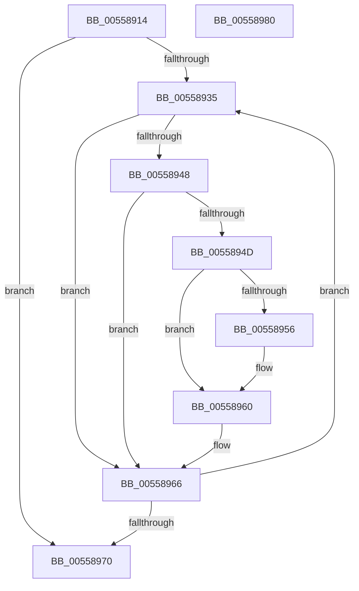

# HalpInterruptStartBlockedProcessors

- RVA: `0x00558914`–`0x00558981` (길이 `109` bytes)
- VA: `0x0000000140558914`
- 실행 섹션: `.text`
- PDB 이름 있음: `예`; PDB Function 태그: `아니요`
- unwind 정보 RVA: `0x00060BC4`
- 디코드: `31`개 명령, `109/109` bytes 표시
- 미해석 바이트: `0` (있으면 어셈블리에 `.byte`로 보존)

> 이 문서는 커널 이미지의 기계어와 PDB 기호를 분석해 생성했습니다. 4번과 5번은 함수 원형과 자료형을 바이너리 사용 방식에서 추정한 C 해석이며 원본 소스 복구 결과는 아닙니다.

## 1. Dependencies

- 직접 호출 지점: **2**; 고유 호출 대상: **2**
- 직접 호출자로 확인된 함수: **3**
- RIP 상대 이미지 참조: **3**

### Outgoing calls
- `0x00558923` → [HalpGetProcessorStateByNtIndex](../2D/HalpGetProcessorStateByNtIndex_function_002D5598.md) (function, `0x002D5598`)
- `0x0055895B` → [HalpBlkStartBlockedProcessor](../../pagelk/B6/HalpBlkStartBlockedProcessor_function_00B60E10.md) (function, `0x00B60E10`)

### Direct callers
- [HalStartNextProcessor](../54/HalStartNextProcessor_function_005479B0.md) at `0x005479FD`
- [HalpProcInitSystem](../../pagelk/B5/HalpProcInitSystem_function_00B5D440.md) at `0x00B5D4AC`
- [HalpInterruptReinitialize](../../pagelk/B7/HalpInterruptReinitialize_function_00B79BEC.md) at `0x00B79CEB`

### Static image references
- `0x0055892A` → RVA `0x00E10200` (`.data`; read)
- `0x0055893B` → RVA `0x00FC3E30` (`.data`; read)
- `0x0055894D` → RVA `0x00F90709` (`.data`; read)

## 2. Other-region calls and transfers

- 다른 실행 섹션으로 향하는 call: **1**
  - `0x0055895B` → [HalpBlkStartBlockedProcessor](../../pagelk/B6/HalpBlkStartBlockedProcessor_function_00B60E10.md) (`.text` → `PAGELK`)
- 별도 외부 분기/꼬리 이동을 확인하지 못했습니다.

## 3. Assembly (complete function range)

```asm
00558914  48 89 5C 24 08                  mov qword ptr [rsp + 8], rbx
00558919  48 89 74 24 10                  mov qword ptr [rsp + 0x10], rsi
0055891E  57                              push rdi
0055891F  48 83 EC 20                     sub rsp, 0x20
00558923  E8 70 CC D7 FF                  call 0x1402d5598
00558928  33 FF                           xor edi, edi
0055892A  39 3D D0 78 8B 00               cmp dword ptr [rip + 0x8b78d0], edi
00558930  8B 70 08                        mov esi, dword ptr [rax + 8]
00558933  74 3B                           je 0x140558970
00558935  8B DF                           mov ebx, edi
00558937  48 C1 E3 06                     shl rbx, 6
0055893B  48 03 1D EE B4 A6 00            add rbx, qword ptr [rip + 0xa6b4ee]
00558942  80 7B 38 00                     cmp byte ptr [rbx + 0x38], 0
00558946  74 1E                           je 0x140558966
00558948  39 73 3C                        cmp dword ptr [rbx + 0x3c], esi
0055894B  75 19                           jne 0x140558966
0055894D  80 3D B5 7D A3 00 00            cmp byte ptr [rip + 0xa37db5], 0
00558954  74 0A                           je 0x140558960
00558956  8B 53 08                        mov edx, dword ptr [rbx + 8]
00558959  8B CF                           mov ecx, edi
0055895B  E8 B0 84 60 00                  call 0x140b60e10
00558960  66 C7 43 0C 01 01               mov word ptr [rbx + 0xc], 0x101
00558966  FF C7                           inc edi
00558968  3B 3D 92 78 8B 00               cmp edi, dword ptr [rip + 0x8b7892]
0055896E  72 C5                           jb 0x140558935
00558970  48 8B 5C 24 30                  mov rbx, qword ptr [rsp + 0x30]
00558975  48 8B 74 24 38                  mov rsi, qword ptr [rsp + 0x38]
0055897A  48 83 C4 20                     add rsp, 0x20
0055897E  5F                              pop rdi
0055897F  C3                              ret
00558980  CC                              int3
```

## 4. C-style interpretation (structured pseudocode)

```c
__int64 __fastcall HalpInterruptStartBlockedProcessors(void)
{
    __int64 result;
    __int64 v_rbx;
    __int64 v_rdi;
    __int64 v_rsp;
    unsigned __int64 v_stack_p10;
    unsigned __int64 v_stack_p8;

    v_stack_p8 = v_rbx;
    v_stack_p10 = v_rsi;
    v_rsp = (v_rsp) - (32);
    result = HalpGetProcessorStateByNtIndex(a1, a2, a3, a4);
    v_rdi = 0;
    if ((*(unsigned int *)(v_rip + 9140432)) == 0) goto loc_00558970;
loc_00558935:
    v_rbx = (0) << (6);
    v_rbx = (v_rbx) + (*(unsigned __int64 *)(v_rip + 10925294));
    if ((*(unsigned __int8 *)(v_rbx + 56)) == 0) goto loc_00558966;
    if ((*(unsigned int *)(v_rbx + 60)) != ((unsigned int)((unsigned int)(*(unsigned int *)(result + 8))))) goto loc_00558966;
    if ((*(unsigned __int8 *)(v_rip + 10714549)) != 0) {
        a2 = *(unsigned int *)(v_rbx + 8);
        a1 = 0;
        result = HalpBlkStartBlockedProcessor(a1, a2, a3, a4);
    }
    *(unsigned __int16 *)(v_rbx + 12) = 257;
loc_00558966:
    v_rdi = (unsigned int)((v_rdi) + 1);
    if (((unsigned int)(v_rdi)) < (*(unsigned int *)(v_rip + 9140370))) goto loc_00558935;
loc_00558970:
    v_rsp = (v_rsp) + (32);
    return result;
}
```

## 5. (Beta) C Style

```c
void HalpInterruptStartBlockedProcessors(void)
{
    int64_t result;
    int64_t local_rbx;
    int64_t local_rdi;
    int64_t local_rsp;
    uint64_t v_stack_p10;
    uint64_t v_stack_p8;

    v_stack_p8 = local_rbx;
    v_stack_p10 = local_rsi;
    local_rsp = (local_rsp) - (32);
    result = HalpGetProcessorStateByNtIndex(a1, a2, a3, a4);
    local_rdi = 0;
    if ((*(uint32_t *)(v_rip + 0x8B78D0)) == 0) goto loc_00558970;
loc_00558935:
    local_rbx = (0) << (6);
    local_rbx = (local_rbx) + (*(uint64_t *)(v_rip + 0xA6B4EE));
    if ((*(uint8_t *)(local_rbx + 0x38)) == 0) goto loc_00558966;
    if ((*(uint32_t *)(local_rbx + 0x3C)) != ((uint32_t)((uint32_t)(*(uint32_t *)(result + 0x8))))) goto loc_00558966;
    if ((*(uint8_t *)(v_rip + 0xA37DB5)) != 0) {
        a2 = *(uint32_t *)(local_rbx + 0x8);
        a1 = 0;
        result = HalpBlkStartBlockedProcessor(a1, a2, a3, a4);
    }
    *(uint16_t *)(local_rbx + 0xC) = 257;
loc_00558966:
    local_rdi = (uint32_t)((local_rdi) + 1);
    if (((uint32_t)(local_rdi)) < (*(uint32_t *)(v_rip + 0x8B7892))) goto loc_00558935;
loc_00558970:
    local_rsp = (local_rsp) + (32);
    return result;
}
```

## 6. Execution-region graph

[열기: 2D/3D 그래프와 함수 탐색 컨트롤 패널](../../../control-panel.html?section=text&rva=0x00558914&view=graph)

- 2D 그래프는 위에서 아래로 흐르고, 3D 그래프는 빈 공간을 드래그해 회전합니다. Shift+드래그는 이동, 휠은 확대·축소, 함수 노드 선택은 대상 보고서 이동입니다.

### Static fallback


