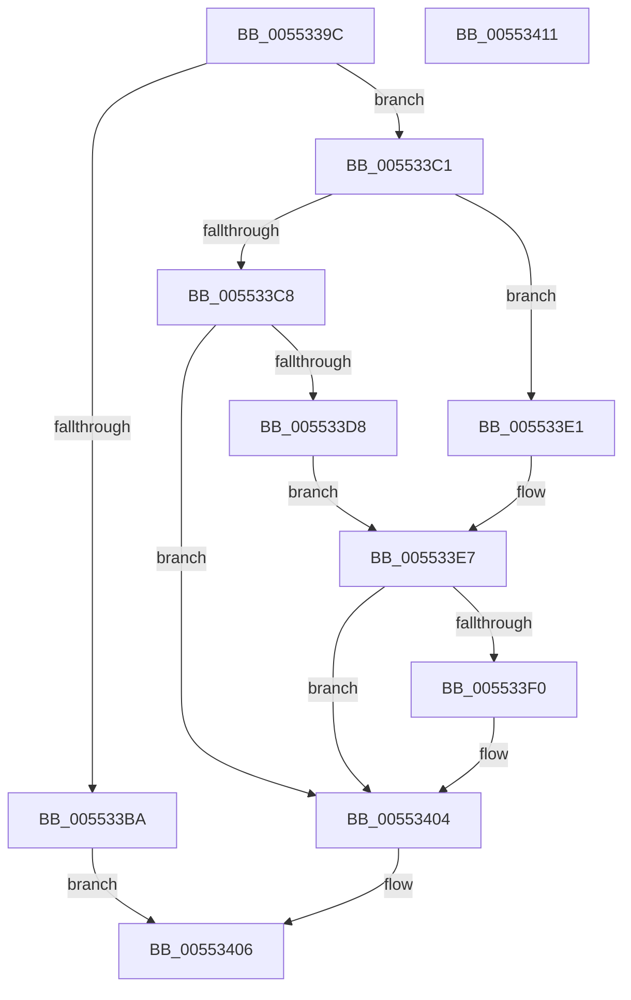

# HalpIommuAcquireNewDomain

- RVA: `0x0055339C`–`0x00553412` (길이 `118` bytes)
- VA: `0x000000014055339C`
- 실행 섹션: `.text`
- PDB 이름 있음: `예`; PDB Function 태그: `아니요`
- unwind 정보 RVA: `0x0006E5F8`
- 디코드: `38`개 명령, `118/118` bytes 표시
- 미해석 바이트: `0` (있으면 어셈블리에 `.byte`로 보존)

> 이 문서는 커널 이미지의 기계어와 PDB 기호를 분석해 생성했습니다. 4번과 5번은 함수 원형과 자료형을 바이너리 사용 방식에서 추정한 C 해석이며 원본 소스 복구 결과는 아닙니다.

## 1. Dependencies

- 직접 호출 지점: **2**; 고유 호출 대상: **2**
- 직접 호출자로 확인된 함수: **1**
- RIP 상대 이미지 참조: **1**

### Outgoing calls
- `0x005533CD` → [HalpIommuGetDomainId](HalpIommuGetDomainId_function_005537E4.md) (function, `0x005537E4`)
- `0x005533FD` → [guard_dispatch_icall](../6B/guard_dispatch_icall_function_006BAAD0.md) (function, `0x006BAAD0`)

### Direct callers
- [HalpIommuGetHardwareDomain](../4D/HalpIommuGetHardwareDomain_function_004D7BCC.md) at `0x004D7D03`

### Static image references
- `0x005533AE` → RVA `0x00FC1710` (`.data`; read)

## 2. Other-region calls and transfers

- 다른 실행 섹션으로 향하는 call: **0**
- 별도 외부 분기/꼬리 이동을 확인하지 못했습니다.

## 3. Assembly (complete function range)

```asm
0055339C  48 89 5C 24 08                  mov qword ptr [rsp + 8], rbx
005533A1  57                              push rdi
005533A2  48 83 EC 30                     sub rsp, 0x30
005533A6  83 64 24 58 00                  and dword ptr [rsp + 0x58], 0
005533AB  48 8B DA                        mov rbx, rdx
005533AE  80 3D 5B E3 A6 00 00            cmp byte ptr [rip + 0xa6e35b], 0
005533B5  48 8B F9                        mov rdi, rcx
005533B8  74 07                           je 0x1405533c1
005533BA  B8 BB 00 00 C0                  mov eax, 0xc00000bb
005533BF  EB 45                           jmp 0x140553406
005533C1  33 D2                           xor edx, edx
005533C3  4D 85 C0                        test r8, r8
005533C6  75 19                           jne 0x1405533e1
005533C8  48 8D 54 24 58                  lea rdx, [rsp + 0x58]
005533CD  E8 12 04 00 00                  call 0x1405537e4
005533D2  8B D0                           mov edx, eax
005533D4  85 C0                           test eax, eax
005533D6  78 2C                           js 0x140553404
005533D8  8B 4C 24 58                     mov ecx, dword ptr [rsp + 0x58]
005533DC  89 4B 30                        mov dword ptr [rbx + 0x30], ecx
005533DF  EB 06                           jmp 0x1405533e7
005533E1  41 8B 00                        mov eax, dword ptr [r8]
005533E4  89 43 30                        mov dword ptr [rbx + 0x30], eax
005533E7  48 8B 47 48                     mov rax, qword ptr [rdi + 0x48]
005533EB  48 85 C0                        test rax, rax
005533EE  74 14                           je 0x140553404
005533F0  48 8B 4F 10                     mov rcx, qword ptr [rdi + 0x10]
005533F4  45 33 C9                        xor r9d, r9d
005533F7  45 33 C0                        xor r8d, r8d
005533FA  48 8B D3                        mov rdx, rbx
005533FD  E8 CE 76 16 00                  call 0x1406baad0
00553402  8B D0                           mov edx, eax
00553404  8B C2                           mov eax, edx
00553406  48 8B 5C 24 40                  mov rbx, qword ptr [rsp + 0x40]
0055340B  48 83 C4 30                     add rsp, 0x30
0055340F  5F                              pop rdi
00553410  C3                              ret
00553411  CC                              int3
```

## 4. C-style interpretation (structured pseudocode)

```c
__int64 __fastcall HalpIommuAcquireNewDomain(__int64 a1, __int64 a2, __int64 a3, int a4)
{
    __int64 result;
    __int64 v_rsp;
    unsigned int v_stack_p20;
    unsigned __int64 v_stack_p8;

    v_stack_p8 = v_rbx;
    v_rsp = (v_rsp) - (48);
    if ((*(unsigned __int8 *)(v_rip + 10937179)) == 0) goto loc_005533C1;
    goto loc_00553406;
loc_005533C1:
    a2 = 0;
    if (a3 != 0) goto loc_005533E1;
    result = HalpIommuGetDomainId(a1, v_stack_p20, a3, a4);
    if (sign_flag) goto loc_00553404;
    *(unsigned int *)(a2 + 48) = (unsigned int)((unsigned int)(v_stack_p20));
    goto loc_005533E7;
loc_005533E1:
    *(unsigned int *)(a2 + 48) = (unsigned int)((unsigned int)(*(unsigned int *)(a3)));
loc_005533E7:
    result = *(unsigned __int64 *)(a1 + 72);
    if (*(unsigned __int64 *)(a1 + 72) != 0) {
        a1 = *(unsigned __int64 *)(a1 + 16);
        a4 = 0;
        a3 = 0;
        a2 = 0;
        result = guard_dispatch_icall(a1, a2, a3, a4);
        a2 = (unsigned int)(result);
    }
loc_00553406:
    v_rsp = (v_rsp) + (48);
    return (unsigned int)((unsigned int)(a2));
}
```

## 5. (Beta) C Style

```c
int64_t HalpIommuAcquireNewDomain(void *Arg1, void *Arg2, int64_t Arg3, int32_t Arg4)
{
    uint8_t *arg1 = (uint8_t *)Arg1;
    uint8_t *arg2 = (uint8_t *)Arg2;

    int64_t result;
    int64_t local_rsp;
    uint32_t v_stack_p20;
    uint64_t v_stack_p8;

    v_stack_p8 = local_rbx;
    local_rsp = (local_rsp) - (48);
    if ((*(uint8_t *)(v_rip + 0xA6E35B)) == 0) goto loc_005533C1;
    goto loc_00553406;
loc_005533C1:
    Arg2 = 0;
    if (Arg3 != 0) goto loc_005533E1;
    result = HalpIommuGetDomainId(Arg1, v_stack_p20, Arg3, Arg4);
    if (sign_flag) goto loc_00553404;
    *(uint32_t *)(arg2 + 0x30) = (uint32_t)((uint32_t)(v_stack_p20));
    goto loc_005533E7;
loc_005533E1:
    *(uint32_t *)(arg2 + 0x30) = (uint32_t)((uint32_t)(*(uint32_t *)(Arg3)));
loc_005533E7:
    result = *(uint64_t *)(arg1 + 0x48);
    if (*(uint64_t *)(arg1 + 0x48) != 0) {
        Arg1 = *(uint64_t *)(arg1 + 0x10);
        Arg4 = 0;
        Arg3 = 0;
        Arg2 = 0;
        result = guard_dispatch_icall(Arg1, Arg2, Arg3, Arg4);
        Arg2 = (uint32_t)(result);
    }
loc_00553406:
    local_rsp = (local_rsp) + (48);
    return (uint32_t)((uint32_t)(Arg2));
}
```

### 관측된 메모리 오프셋

구조체 형식이 확인되지 않은 접근은 인자 기준의 오프셋으로만 기록했습니다.

| 기준 인자 | 오프셋 표현 | 폭 (bit) | 접근 |
|---|---:|---:|---|
| `Arg1` | `+ 0x10` | `64` | `R` |
| `Arg1` | `+ 0x48` | `64` | `R` |
| `Arg2` | `+ 0x30` | `32` | `W` |

## 6. Execution-region graph

[열기: 2D/3D 그래프와 함수 탐색 컨트롤 패널](../../../control-panel.html?section=text&rva=0x0055339C&view=graph)

- 2D 그래프는 위에서 아래로 흐르고, 3D 그래프는 빈 공간을 드래그해 회전합니다. Shift+드래그는 이동, 휠은 확대·축소, 함수 노드 선택은 대상 보고서 이동입니다.

### Static fallback


