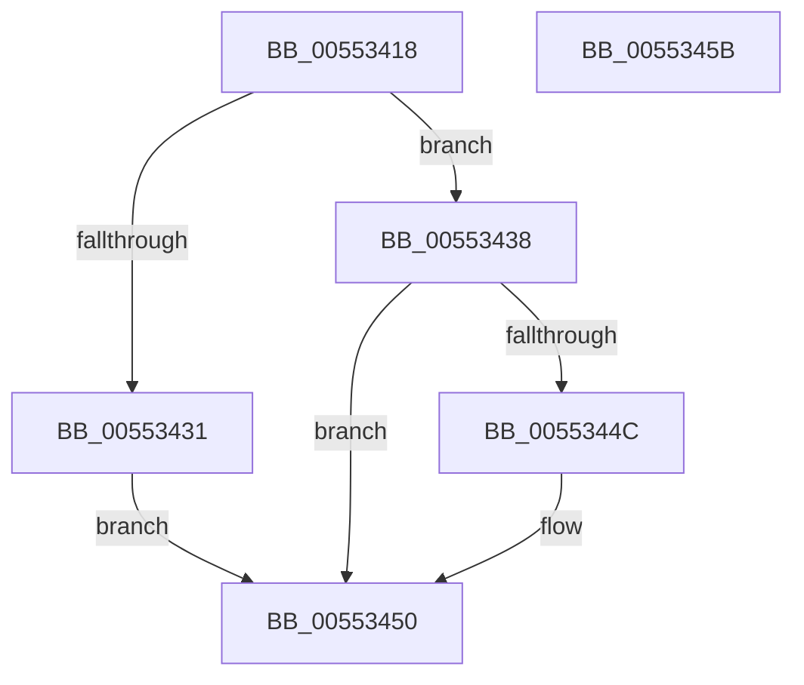

# HalpIommuAttachDeviceDomain

- RVA: `0x00553418`–`0x0055345C` (길이 `68` bytes)
- VA: `0x0000000140553418`
- 실행 섹션: `.text`
- PDB 이름 있음: `예`; PDB Function 태그: `아니요`
- unwind 정보 RVA: `0x0006E5F8`
- 디코드: `21`개 명령, `68/68` bytes 표시
- 미해석 바이트: `0` (있으면 어셈블리에 `.byte`로 보존)

> 이 문서는 커널 이미지의 기계어와 PDB 기호를 분석해 생성했습니다. 4번과 5번은 함수 원형과 자료형을 바이너리 사용 방식에서 추정한 C 해석이며 원본 소스 복구 결과는 아닙니다.

## 1. Dependencies

- 직접 호출 지점: **1**; 고유 호출 대상: **1**
- 직접 호출자로 확인된 함수: **2**
- RIP 상대 이미지 참조: **1**

### Outgoing calls
- `0x00553443` → [guard_dispatch_icall](../6B/guard_dispatch_icall_function_006BAAD0.md) (function, `0x006BAAD0`)

### Direct callers
- [HalpIommuLeaveDmaDomain](../4B/HalpIommuLeaveDmaDomain_function_004BF220.md) at `0x004BF311`
- [HalpIommuJoinDmaDomain](HalpIommuJoinDmaDomain_function_005554E8.md) at `0x005555CC`

### Static image references
- `0x00553422` → RVA `0x00FC1710` (`.data`; read)

## 2. Other-region calls and transfers

- 다른 실행 섹션으로 향하는 call: **0**
- 별도 외부 분기/꼬리 이동을 확인하지 못했습니다.

## 3. Assembly (complete function range)

```asm
00553418  48 89 5C 24 08                  mov qword ptr [rsp + 8], rbx
0055341D  57                              push rdi
0055341E  48 83 EC 30                     sub rsp, 0x30
00553422  80 3D E7 E2 A6 00 00            cmp byte ptr [rip + 0xa6e2e7], 0
00553429  49 8B D8                        mov rbx, r8
0055342C  48 8B FA                        mov rdi, rdx
0055342F  74 07                           je 0x140553438
00553431  B8 BB 00 00 C0                  mov eax, 0xc00000bb
00553436  EB 18                           jmp 0x140553450
00553438  48 8B 41 78                     mov rax, qword ptr [rcx + 0x78]
0055343C  45 33 C9                        xor r9d, r9d
0055343F  48 8B 49 10                     mov rcx, qword ptr [rcx + 0x10]
00553443  E8 88 76 16 00                  call 0x1406baad0
00553448  85 C0                           test eax, eax
0055344A  78 04                           js 0x140553450
0055344C  48 89 5F 10                     mov qword ptr [rdi + 0x10], rbx
00553450  48 8B 5C 24 40                  mov rbx, qword ptr [rsp + 0x40]
00553455  48 83 C4 30                     add rsp, 0x30
00553459  5F                              pop rdi
0055345A  C3                              ret
0055345B  CC                              int3
```

## 4. C-style interpretation (structured pseudocode)

```c
__int64 __fastcall HalpIommuAttachDeviceDomain(__int64 a1, __int64 a2, __int64 a3, int a4)
{
    __int64 result;
    __int64 v_rsp;
    unsigned __int64 v_stack_p8;

    v_stack_p8 = v_rbx;
    v_rsp = (v_rsp) - (48);
    if ((*(unsigned __int8 *)(v_rip + 10937063)) == 0) goto loc_00553438;
    goto loc_00553450;
loc_00553438:
    a4 = 0;
    result = guard_dispatch_icall(*(unsigned __int64 *)(a1 + 16), a2, a3, a4);
    if (!(sign_flag)) {
        *(unsigned __int64 *)(a2 + 16) = a3;
    }
    v_rsp = (v_rsp) + (48);
    return result;
}
```

## 5. (Beta) C Style

```c
int64_t HalpIommuAttachDeviceDomain(void *Arg1, void *Arg2, int64_t Arg3, int32_t Arg4)
{
    uint8_t *arg1 = (uint8_t *)Arg1;
    uint8_t *arg2 = (uint8_t *)Arg2;

    int64_t result;
    int64_t local_rsp;
    uint64_t v_stack_p8;

    v_stack_p8 = local_rbx;
    local_rsp = (local_rsp) - (48);
    if ((*(uint8_t *)(v_rip + 0xA6E2E7)) == 0) goto loc_00553438;
    goto loc_00553450;
loc_00553438:
    Arg4 = 0;
    result = guard_dispatch_icall(*(uint64_t *)(arg1 + 0x10), Arg2, Arg3, Arg4);
    if (!(sign_flag)) {
        *(uint64_t *)(arg2 + 0x10) = Arg3;
    }
    local_rsp = (local_rsp) + (48);
    return result;
}
```

### 관측된 메모리 오프셋

구조체 형식이 확인되지 않은 접근은 인자 기준의 오프셋으로만 기록했습니다.

| 기준 인자 | 오프셋 표현 | 폭 (bit) | 접근 |
|---|---:|---:|---|
| `Arg1` | `+ 0x10` | `64` | `R` |
| `Arg1` | `+ 0x78` | `64` | `R` |
| `Arg2` | `+ 0x10` | `64` | `W` |

## 6. Execution-region graph

[열기: 2D/3D 그래프와 함수 탐색 컨트롤 패널](../../../control-panel.html?section=text&rva=0x00553418&view=graph)

- 2D 그래프는 위에서 아래로 흐르고, 3D 그래프는 빈 공간을 드래그해 회전합니다. Shift+드래그는 이동, 휠은 확대·축소, 함수 노드 선택은 대상 보고서 이동입니다.

### Static fallback


