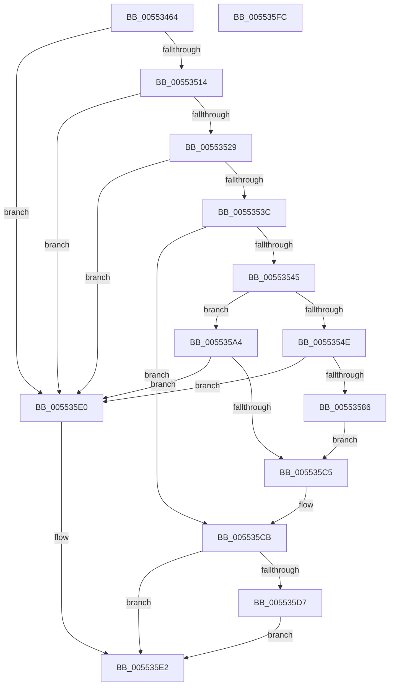

# HalpIommuConfigureInterrupt

- RVA: `0x00553464`–`0x005535FD` (길이 `409` bytes)
- VA: `0x0000000140553464`
- 실행 섹션: `.text`
- PDB 이름 있음: `예`; PDB Function 태그: `아니요`
- unwind 정보 RVA: `0x000C447C`
- 디코드: `108`개 명령, `409/409` bytes 표시
- 미해석 바이트: `0` (있으면 어셈블리에 `.byte`로 보존)

> 이 문서는 커널 이미지의 기계어와 PDB 기호를 분석해 생성했습니다. 4번과 5번은 함수 원형과 자료형을 바이너리 사용 방식에서 추정한 C 해석이며 원본 소스 복구 결과는 아닙니다.

## 1. Dependencies

- 직접 호출 지점: **7**; 고유 호출 대상: **7**
- 직접 호출자로 확인된 함수: **1**
- RIP 상대 이미지 참조: **1**

### Outgoing calls
- `0x005534AF` → [memset](../6C/memset_function_006C6C40.md) (function, `0x006C6C40`)
- `0x005534E4` → [KeFindFirstSetRightGroupAffinity](../2C/KeFindFirstSetRightGroupAffinity_function_002CFB10.md) (function, `0x002CFB10`)
- `0x0055351C` → [HalpInterruptIsMsiSupported](../4C/HalpInterruptIsMsiSupported_function_004C225C.md) (function, `0x004C225C`)
- `0x0055357B` → [HalpInterruptRemap](../54/HalpInterruptRemap_function_00542AE4.md) (function, `0x00542AE4`)
- `0x005535BA` → [HalpInterruptGenerateMessage](../54/HalpInterruptGenerateMessage_function_005428F0.md) (function, `0x005428F0`)
- `0x005535CE` → [HalpIommuSetupMessageInterruptRouting](../../pagelk/B5/HalpIommuSetupMessageInterruptRouting_function_00B5DCF0.md) (function, `0x00B5DCF0`)
- `0x005535E9` → [_security_check_cookie](../6A/_security_check_cookie_function_006AC640.md) (function, `0x006AC640`)

### Direct callers
- [HalpIommuInitializeAll](../../pagelk/B7/HalpIommuInitializeAll_function_00B7A684.md) at `0x00B7A8C5`

### Static image references
- `0x00553477` → RVA `0x00E0A740` (`.data`; read)

## 2. Other-region calls and transfers

- 다른 실행 섹션으로 향하는 call: **1**
  - `0x005535CE` → [HalpIommuSetupMessageInterruptRouting](../../pagelk/B5/HalpIommuSetupMessageInterruptRouting_function_00B5DCF0.md) (`.text` → `PAGELK`)
- 별도 외부 분기/꼬리 이동을 확인하지 못했습니다.

## 3. Assembly (complete function range)

```asm
00553464  40 55                           push rbp
00553466  53                              push rbx
00553467  56                              push rsi
00553468  57                              push rdi
00553469  41 56                           push r14
0055346B  48 8D 6C 24 C9                  lea rbp, [rsp - 0x37]
00553470  48 81 EC D0 00 00 00            sub rsp, 0xd0
00553477  48 8B 05 C2 72 8B 00            mov rax, qword ptr [rip + 0x8b72c2]
0055347E  48 33 C4                        xor rax, rsp
00553481  48 89 45 27                     mov qword ptr [rbp + 0x27], rax
00553485  83 65 A3 00                     and dword ptr [rbp - 0x5d], 0
00553489  44 8B F2                        mov r14d, edx
0055348C  33 D2                           xor edx, edx
0055348E  48 C7 45 97 06 00 00 00         mov qword ptr [rbp - 0x69], 6
00553496  83 65 9B 00                     and dword ptr [rbp - 0x65], 0
0055349A  49 8B F8                        mov rdi, r8
0055349D  48 8B F1                        mov rsi, rcx
005534A0  0F 57 C0                        xorps xmm0, xmm0
005534A3  48 8D 4D C7                     lea rcx, [rbp - 0x39]
005534A7  44 8D 42 58                     lea r8d, [rdx + 0x58]
005534AB  0F 11 45 AF                     movups xmmword ptr [rbp - 0x51], xmm0
005534AF  E8 8C 37 17 00                  call 0x1406c6c40
005534B4  8B 45 EF                        mov eax, dword ptr [rbp - 0x11]
005534B7  41 8B DE                        mov ebx, r14d
005534BA  0F 10 07                        movups xmm0, xmmword ptr [rdi]
005534BD  25 00 00 00 C0                  and eax, 0xc0000000
005534C2  C7 45 CB CE 00 00 00            mov dword ptr [rbp - 0x35], 0xce
005534C9  81 E3 FF FF FF 3F               and ebx, 0x3fffffff
005534CF  C6 45 CF 0C                     mov byte ptr [rbp - 0x31], 0xc
005534D3  0B C3                           or eax, ebx
005534D5  48 8B CF                        mov rcx, rdi
005534D8  0F BA E8 1E                     bts eax, 0x1e
005534DC  89 45 EF                        mov dword ptr [rbp - 0x11], eax
005534DF  F3 0F 7F 45 DF                  movdqu xmmword ptr [rbp - 0x21], xmm0
005534E4  E8 27 C6 D7 FF                  call 0x1402cfb10
005534E9  89 45 9F                        mov dword ptr [rbp - 0x61], eax
005534EC  48 8D 45 AF                     lea rax, [rbp - 0x51]
005534F0  48 89 45 A7                     mov qword ptr [rbp - 0x59], rax
005534F4  8B 45 AF                        mov eax, dword ptr [rbp - 0x51]
005534F7  25 00 00 00 C0                  and eax, 0xc0000000
005534FC  0B C3                           or eax, ebx
005534FE  BB BB 00 00 C0                  mov ebx, 0xc00000bb
00553503  89 45 AF                        mov dword ptr [rbp - 0x51], eax
00553506  8B 86 D8 01 00 00               mov eax, dword ptr [rsi + 0x1d8]
0055350C  A8 02                           test al, 2
0055350E  0F 84 CC 00 00 00               je 0x1405535e0
00553514  BF 01 00 00 00                  mov edi, 1
00553519  40 8A CF                        mov cl, dil
0055351C  E8 3B ED F6 FF                  call 0x1404c225c
00553521  84 C0                           test al, al
00553523  0F 84 B7 00 00 00               je 0x1405535e0
00553529  8B 8E 88 01 00 00               mov ecx, dword ptr [rsi + 0x188]
0055352F  8B C1                           mov eax, ecx
00553531  24 03                           and al, 3
00553533  40 3A C7                        cmp al, dil
00553536  0F 84 A4 00 00 00               je 0x1405535e0
0055353C  40 84 CF                        test dil, cl
0055353F  0F 85 86 00 00 00               jne 0x1405535cb
00553545  41 81 FE FE FF FF 3F            cmp r14d, 0x3ffffffe
0055354C  74 56                           je 0x1405535a4
0055354E  8B 96 E8 01 00 00               mov edx, dword ptr [rsi + 0x1e8]
00553554  48 8D 45 C7                     lea rax, [rbp - 0x39]
00553558  8B 8E E4 01 00 00               mov ecx, dword ptr [rsi + 0x1e4]
0055355E  45 33 C9                        xor r9d, r9d
00553561  83 65 D3 00                     and dword ptr [rbp - 0x2d], 0
00553565  45 33 C0                        xor r8d, r8d
00553568  89 7C 24 28                     mov dword ptr [rsp + 0x28], edi
0055356C  48 89 44 24 20                  mov qword ptr [rsp + 0x20], rax
00553571  C7 45 C7 03 00 00 00            mov dword ptr [rbp - 0x39], 3
00553578  89 7D D7                        mov dword ptr [rbp - 0x29], edi
0055357B  E8 64 F5 FE FF                  call 0x140542ae4
00553580  8B D8                           mov ebx, eax
00553582  85 C0                           test eax, eax
00553584  78 5A                           js 0x1405535e0
00553586  8B 45 F3                        mov eax, dword ptr [rbp - 0xd]
00553589  89 86 F4 01 00 00               mov dword ptr [rsi + 0x1f4], eax
0055358F  8B 45 F7                        mov eax, dword ptr [rbp - 9]
00553592  89 86 F0 01 00 00               mov dword ptr [rsi + 0x1f0], eax
00553598  8B 45 FB                        mov eax, dword ptr [rbp - 5]
0055359B  48 89 86 F8 01 00 00            mov qword ptr [rsi + 0x1f8], rax
005535A2  EB 21                           jmp 0x1405535c5
005535A4  4C 8D 8E F8 01 00 00            lea r9, [rsi + 0x1f8]
005535AB  4C 8D 86 F0 01 00 00            lea r8, [rsi + 0x1f0]
005535B2  48 8D 55 C7                     lea rdx, [rbp - 0x39]
005535B6  48 8D 4D 97                     lea rcx, [rbp - 0x69]
005535BA  E8 31 F3 FE FF                  call 0x1405428f0
005535BF  8B D8                           mov ebx, eax
005535C1  85 C0                           test eax, eax
005535C3  78 1B                           js 0x1405535e0
005535C5  09 BE 88 01 00 00               or dword ptr [rsi + 0x188], edi
005535CB  48 8B CE                        mov rcx, rsi
005535CE  E8 1D A7 60 00                  call 0x140b5dcf0
005535D3  85 C0                           test eax, eax
005535D5  78 0B                           js 0x1405535e2
005535D7  83 8E 88 01 00 00 02            or dword ptr [rsi + 0x188], 2
005535DE  EB 02                           jmp 0x1405535e2
005535E0  8B C3                           mov eax, ebx
005535E2  48 8B 4D 27                     mov rcx, qword ptr [rbp + 0x27]
005535E6  48 33 CC                        xor rcx, rsp
005535E9  E8 52 90 15 00                  call 0x1406ac640
005535EE  48 81 C4 D0 00 00 00            add rsp, 0xd0
005535F5  41 5E                           pop r14
005535F7  5F                              pop rdi
005535F8  5E                              pop rsi
005535F9  5B                              pop rbx
005535FA  5D                              pop rbp
005535FB  C3                              ret
005535FC  CC                              int3
```

## 4. C-style interpretation (structured pseudocode)

```c
__int64 __fastcall HalpIommuConfigureInterrupt(__int64 a1, int a2, __int64 a3, int a4)
{
    __int64 result;
    __int64 v_rbx;
    __int64 v_rsp;
    unsigned __int64 v_stack_m38;
    unsigned __int64 v_stack_m5F;
    unsigned int v_stack_m64;
    unsigned int v_stack_m68;
    unsigned int v_stack_m6C;
    unsigned int v_stack_m70;
    unsigned __int64 v_stack_m80;
    unsigned int v_stack_m88;
    unsigned int v_stack_m8C;
    unsigned __int8 v_stack_m90;
    unsigned int v_stack_m94;
    unsigned __int64 v_stack_m98;
    unsigned __int64 v_stack_mB0;
    unsigned __int64 v_stack_mB8;
    unsigned int v_stack_mBC;
    unsigned int v_stack_mC0;
    unsigned int v_stack_mC4;
    unsigned __int64 v_stack_mC8;
    unsigned int v_stack_mD0;
    unsigned __int64 v_stack_mD8;

    v_rsp = (v_rsp) - (208);
    result = (*(unsigned __int64 *)(v_rip + 9138882)) ^ (v_rsp);
    v_stack_m38 = result;
    a2 = 0;
    v_stack_mC8 = 6;
    v_stack_mB0 = v_xmm0;
    result = memset(v_stack_m98, a2, a2 + 88, a4);
    result = (unsigned int)(((unsigned int)(v_stack_m70)) & (0xC0000000ULL));
    v_stack_m94 = 206;
    v_rbx = (unsigned int)(((unsigned int)((unsigned int)((unsigned int)(a2)))) & (0x3FFFFFFFULL));
    v_stack_m90 = 12;
    result = (unsigned int)((result) | ((unsigned int)(v_rbx)));
    v_stack_m70 = (unsigned int)(result);
    v_stack_m80 = v_xmm0;
    result = KeFindFirstSetRightGroupAffinity(a3, a2, a2 + 88, a4);
    v_stack_mC0 = (unsigned int)(result);
    v_stack_mB8 = v_stack_mB0;
    result = (unsigned int)(((unsigned int)(v_stack_mB0)) & (0xC0000000ULL));
    result = (unsigned int)((result) | ((unsigned int)(v_rbx)));
    v_stack_mB0 = (unsigned int)(result);
    if ((((unsigned __int8)((unsigned int)(*(unsigned int *)(a1 + 472)))) & (2)) == 0) goto loc_005535E0;
    result = HalpInterruptIsMsiSupported(1, a2, a2 + 88, a4);
    if ((unsigned __int8)(result) == 0) goto loc_005535E0;
    result = (unsigned __int8)(((unsigned int)((unsigned int)((unsigned int)(*(unsigned int *)(a1 + 392))))) & (3));
    if (((unsigned __int8)(result)) == 1) goto loc_005535E0;
    if (((1) & ((unsigned __int8)((unsigned int)(*(unsigned int *)(a1 + 392))))) != 0) goto loc_005535CB;
    if (((unsigned int)((unsigned int)(a2))) == 0x3FFFFFFEULL) goto loc_005535A4;
    a4 = 0;
    a3 = 0;
    v_stack_mD0 = 1;
    v_stack_mD8 = v_stack_m98;
    v_stack_m98 = 3;
    v_stack_m88 = 1;
    result = HalpInterruptRemap((unsigned int)(*(unsigned int *)(a1 + 484)), (unsigned int)(*(unsigned int *)(a1 + 488)), a3, a4);
    if (sign_flag) goto loc_005535E0;
    *(unsigned int *)(a1 + 500) = (unsigned int)((unsigned int)(v_stack_m6C));
    *(unsigned int *)(a1 + 496) = (unsigned int)((unsigned int)(v_stack_m68));
    *(unsigned __int64 *)(a1 + 504) = (unsigned int)(v_stack_m64);
    goto loc_005535C5;
loc_005535A4:
    result = HalpInterruptGenerateMessage(v_stack_mC8, v_stack_m98, a1 + 496, a1 + 504);
    if (sign_flag) goto loc_005535E0;
loc_005535C5:
loc_005535CB:
    result = HalpIommuSetupMessageInterruptRouting(a1, v_stack_m98, a1 + 496, a1 + 504);
    if (sign_flag) goto loc_005535E2;
    goto loc_005535E2;
loc_005535E0:
loc_005535E2:
    a1 = (v_stack_m38) ^ (v_rsp);
    result = _security_check_cookie(a1, v_stack_m98, a1 + 496, a1 + 504);
    v_rsp = (v_rsp) + (208);
    return result;
}
```

## 5. (Beta) C Style

```c
int64_t HalpIommuConfigureInterrupt(void *Arg1, int32_t Arg2, void *Arg3, int32_t Arg4)
{
    uint8_t *arg1 = (uint8_t *)Arg1;
    uint8_t *arg3 = (uint8_t *)Arg3;

    int64_t result;
    int64_t local_rbx;
    int64_t local_rsp;
    uint64_t v_stack_m38;
    uint64_t v_stack_m5F;
    uint32_t v_stack_m64;
    uint32_t v_stack_m68;
    uint32_t v_stack_m6C;
    uint32_t v_stack_m70;
    uint64_t v_stack_m80;
    uint32_t v_stack_m88;
    uint32_t v_stack_m8C;
    uint8_t v_stack_m90;
    uint32_t v_stack_m94;
    uint64_t v_stack_m98;
    uint64_t v_stack_mB0;
    uint64_t v_stack_mB8;
    uint32_t v_stack_mBC;
    uint32_t v_stack_mC0;
    uint32_t v_stack_mC4;
    uint64_t v_stack_mC8;
    uint32_t v_stack_mD0;
    uint64_t v_stack_mD8;

    local_rsp = (local_rsp) - (208);
    result = (*(uint64_t *)(v_rip + 0x8B72C2)) ^ (local_rsp);
    v_stack_m38 = result;
    Arg2 = 0;
    v_stack_mC8 = 6;
    v_stack_mB0 = v_xmm0;
    result = memset(v_stack_m98, Arg2, Arg2 + 88, Arg4);
    result = (uint32_t)(((uint32_t)(v_stack_m70)) & (0xC0000000ULL));
    v_stack_m94 = 206;
    local_rbx = (uint32_t)(((uint32_t)((uint32_t)((uint32_t)(Arg2)))) & (0x3FFFFFFFULL));
    v_stack_m90 = 12;
    result = (uint32_t)((result) | ((uint32_t)(local_rbx)));
    v_stack_m70 = (uint32_t)(result);
    v_stack_m80 = v_xmm0;
    result = KeFindFirstSetRightGroupAffinity(Arg3, Arg2, Arg2 + 88, Arg4);
    v_stack_mC0 = (uint32_t)(result);
    v_stack_mB8 = v_stack_mB0;
    result = (uint32_t)(((uint32_t)(v_stack_mB0)) & (0xC0000000ULL));
    result = (uint32_t)((result) | ((uint32_t)(local_rbx)));
    v_stack_mB0 = (uint32_t)(result);
    if ((((uint8_t)((uint32_t)(*(uint32_t *)(arg1 + 0x1D8)))) & (2)) == 0) goto loc_005535E0;
    result = HalpInterruptIsMsiSupported(1, Arg2, Arg2 + 88, Arg4);
    if ((uint8_t)(result) == 0) goto loc_005535E0;
    result = (uint8_t)(((uint32_t)((uint32_t)((uint32_t)(*(uint32_t *)(arg1 + 0x188))))) & (3));
    if (((uint8_t)(result)) == 1) goto loc_005535E0;
    if (((1) & ((uint8_t)((uint32_t)(*(uint32_t *)(arg1 + 0x188))))) != 0) goto loc_005535CB;
    if (((uint32_t)((uint32_t)(Arg2))) == 0x3FFFFFFEULL) goto loc_005535A4;
    Arg4 = 0;
    Arg3 = 0;
    v_stack_mD0 = 1;
    v_stack_mD8 = v_stack_m98;
    v_stack_m98 = 3;
    v_stack_m88 = 1;
    result = HalpInterruptRemap((uint32_t)(*(uint32_t *)(arg1 + 0x1E4)), (uint32_t)(*(uint32_t *)(arg1 + 0x1E8)), Arg3, Arg4);
    if (sign_flag) goto loc_005535E0;
    *(uint32_t *)(arg1 + 0x1F4) = (uint32_t)((uint32_t)(v_stack_m6C));
    *(uint32_t *)(arg1 + 0x1F0) = (uint32_t)((uint32_t)(v_stack_m68));
    *(uint64_t *)(arg1 + 0x1F8) = (uint32_t)(v_stack_m64);
    goto loc_005535C5;
loc_005535A4:
    result = HalpInterruptGenerateMessage(v_stack_mC8, v_stack_m98, Arg1 + 496, Arg1 + 504);
    if (sign_flag) goto loc_005535E0;
loc_005535C5:
loc_005535CB:
    result = HalpIommuSetupMessageInterruptRouting(Arg1, v_stack_m98, Arg1 + 496, Arg1 + 504);
    if (sign_flag) goto loc_005535E2;
    goto loc_005535E2;
loc_005535E0:
loc_005535E2:
    Arg1 = (v_stack_m38) ^ (local_rsp);
    result = _security_check_cookie(Arg1, v_stack_m98, Arg1 + 496, Arg1 + 504);
    local_rsp = (local_rsp) + (208);
    return result;
}
```

### 관측된 메모리 오프셋

구조체 형식이 확인되지 않은 접근은 인자 기준의 오프셋으로만 기록했습니다.

| 기준 인자 | 오프셋 표현 | 폭 (bit) | 접근 |
|---|---:|---:|---|
| `Arg1` | `+ 0x188` | `32` | `R` |
| `Arg1` | `+ 0x188` | `32` | `R/W` |
| `Arg1` | `+ 0x1D8` | `32` | `R` |
| `Arg1` | `+ 0x1E4` | `32` | `R` |
| `Arg1` | `+ 0x1E8` | `32` | `R` |
| `Arg1` | `+ 0x1F0` | `32` | `W` |
| `Arg1` | `+ 0x1F0` | `64` | `R` |
| `Arg1` | `+ 0x1F4` | `32` | `W` |
| `Arg1` | `+ 0x1F8` | `64` | `R` |
| `Arg1` | `+ 0x1F8` | `64` | `W` |
| `Arg3` | `+ 0x0` | `128` | `R` |

## 6. Execution-region graph

[열기: 2D/3D 그래프와 함수 탐색 컨트롤 패널](../../../control-panel.html?section=text&rva=0x00553464&view=graph)

- 2D 그래프는 위에서 아래로 흐르고, 3D 그래프는 빈 공간을 드래그해 회전합니다. Shift+드래그는 이동, 휠은 확대·축소, 함수 노드 선택은 대상 보고서 이동입니다.

### Static fallback


