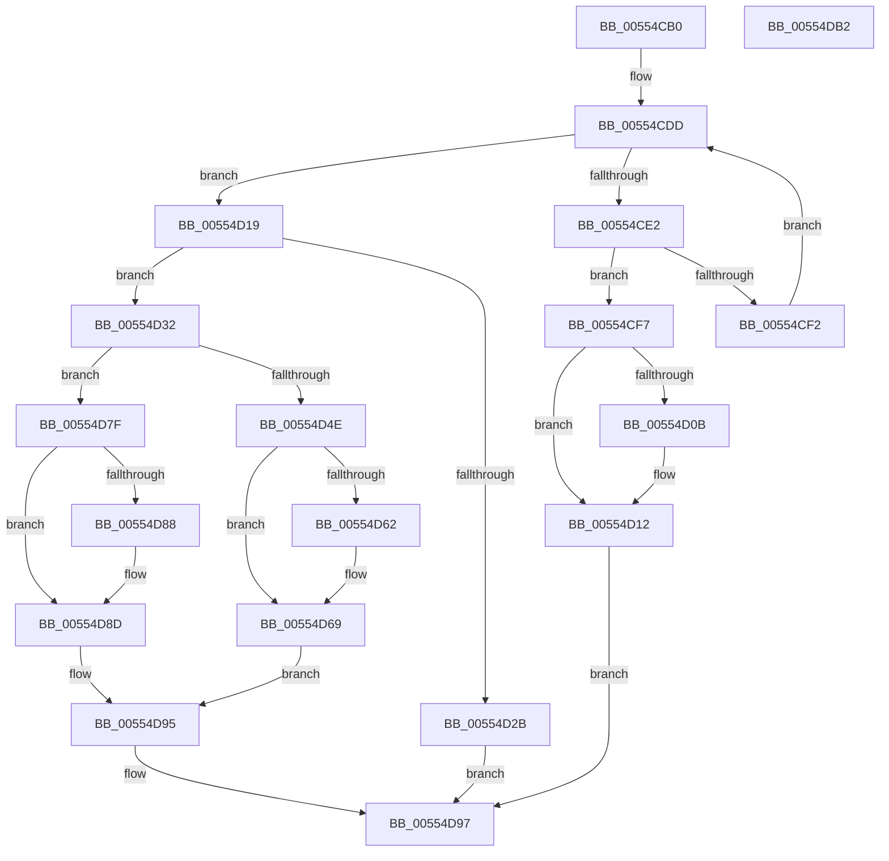

# HalpIommuCreateIncreaseAliasTrack

- RVA: `0x00554CB0`–`0x00554DB3` (길이 `259` bytes)
- VA: `0x0000000140554CB0`
- 실행 섹션: `.text`
- PDB 이름 있음: `예`; PDB Function 태그: `아니요`
- unwind 정보 RVA: `0x0005E6B4`
- 디코드: `73`개 명령, `259/259` bytes 표시
- 미해석 바이트: `0` (있으면 어셈블리에 `.byte`로 보존)

> 이 문서는 커널 이미지의 기계어와 PDB 기호를 분석해 생성했습니다. 4번과 5번은 함수 원형과 자료형을 바이너리 사용 방식에서 추정한 C 해석이며 원본 소스 복구 결과는 아닙니다.

## 1. Dependencies

- 직접 호출 지점: **5**; 고유 호출 대상: **4**
- 직접 호출자로 확인된 함수: **1**
- RIP 상대 이미지 참조: **3**

### Outgoing calls
- `0x00554CE9` → [IidAreIdsStrictlyEqual](../6A/IidAreIdsStrictlyEqual_function_006A2BE4.md) (function, `0x006A2BE4`)
- `0x00554D1E` → [HalpMmAllocCtxAlloc](../3E/HalpMmAllocCtxAlloc_function_003E10B8.md) (function, `0x003E10B8`)
- `0x00554D43` → [HalpIommuCloneDeviceId](../4E/HalpIommuCloneDeviceId_function_004E4228.md) (function, `0x004E4228`)
- `0x00554D88` → [HalpMmAllocCtxFree](../3E/HalpMmAllocCtxFree_function_003E1904.md) (function, `0x003E1904`)
- `0x00554D90` → [HalpMmAllocCtxFree](../3E/HalpMmAllocCtxFree_function_003E1904.md) (function, `0x003E1904`)

### Direct callers
- [HalpIommuUnblockDevice](../4C/HalpIommuUnblockDevice_function_004C6250.md) at `0x004C637C`

### Static image references
- `0x00554CC9` → RVA `0x00FC1970` (`.data`; read)
- `0x00554D56` → RVA `0x00FC1978` (`.data`; read)
- `0x00554D73` → RVA `0x00FC1978` (`.data`; write)

## 2. Other-region calls and transfers

- 다른 실행 섹션으로 향하는 call: **0**
- 별도 외부 분기/꼬리 이동을 확인하지 못했습니다.

## 3. Assembly (complete function range)

```asm
00554CB0  48 8B C4                        mov rax, rsp
00554CB3  48 89 58 08                     mov qword ptr [rax + 8], rbx
00554CB7  48 89 68 10                     mov qword ptr [rax + 0x10], rbp
00554CBB  48 89 70 18                     mov qword ptr [rax + 0x18], rsi
00554CBF  48 89 78 20                     mov qword ptr [rax + 0x20], rdi
00554CC3  41 56                           push r14
00554CC5  48 83 EC 20                     sub rsp, 0x20
00554CC9  4C 8B 1D A0 CC A6 00            mov r11, qword ptr [rip + 0xa6cca0]
00554CD0  48 8D 2D 99 CC A6 00            lea rbp, [rip + 0xa6cc99]
00554CD7  48 8B FA                        mov rdi, rdx
00554CDA  48 8B F1                        mov rsi, rcx
00554CDD  4C 3B DD                        cmp r11, rbp
00554CE0  74 37                           je 0x140554d19
00554CE2  49 8B 4B 10                     mov rcx, qword ptr [r11 + 0x10]
00554CE6  48 8B D6                        mov rdx, rsi
00554CE9  E8 F6 DE 14 00                  call 0x1406a2be4
00554CEE  84 C0                           test al, al
00554CF0  75 05                           jne 0x140554cf7
00554CF2  4D 8B 1B                        mov r11, qword ptr [r11]
00554CF5  EB E6                           jmp 0x140554cdd
00554CF7  B8 01 00 00 00                  mov eax, 1
00554CFC  F0 49 0F C1 43 18               lock xadd qword ptr [r11 + 0x18], rax
00554D02  48 FF C0                        inc rax
00554D05  48 83 F8 01                     cmp rax, 1
00554D09  7F 07                           jg 0x140554d12
00554D0B  B9 0E 00 00 00                  mov ecx, 0xe
00554D10  CD 29                           int 0x29
00554D12  4C 89 1F                        mov qword ptr [rdi], r11
00554D15  33 C0                           xor eax, eax
00554D17  EB 7E                           jmp 0x140554d97
00554D19  BA 20 00 00 00                  mov edx, 0x20
00554D1E  E8 95 C3 E8 FF                  call 0x1403e10b8
00554D23  48 8B D8                        mov rbx, rax
00554D26  48 85 C0                        test rax, rax
00554D29  75 07                           jne 0x140554d32
00554D2B  B8 9A 00 00 C0                  mov eax, 0xc000009a
00554D30  EB 65                           jmp 0x140554d97
00554D32  0F 57 C0                        xorps xmm0, xmm0
00554D35  48 8D 50 10                     lea rdx, [rax + 0x10]
00554D39  0F 11 00                        movups xmmword ptr [rax], xmm0
00554D3C  48 8B CE                        mov rcx, rsi
00554D3F  0F 11 40 10                     movups xmmword ptr [rax + 0x10], xmm0
00554D43  E8 E0 F4 F8 FF                  call 0x1404e4228
00554D48  8B F0                           mov esi, eax
00554D4A  85 C0                           test eax, eax
00554D4C  78 31                           js 0x140554d7f
00554D4E  48 C7 43 18 01 00 00 00         mov qword ptr [rbx + 0x18], 1
00554D56  48 8B 0D 1B CC A6 00            mov rcx, qword ptr [rip + 0xa6cc1b]
00554D5D  48 39 29                        cmp qword ptr [rcx], rbp
00554D60  74 07                           je 0x140554d69
00554D62  B9 03 00 00 00                  mov ecx, 3
00554D67  CD 29                           int 0x29
00554D69  48 89 2B                        mov qword ptr [rbx], rbp
00554D6C  48 89 4B 08                     mov qword ptr [rbx + 8], rcx
00554D70  48 89 19                        mov qword ptr [rcx], rbx
00554D73  48 89 1D FE CB A6 00            mov qword ptr [rip + 0xa6cbfe], rbx
00554D7A  48 89 1F                        mov qword ptr [rdi], rbx
00554D7D  EB 16                           jmp 0x140554d95
00554D7F  48 8B 53 10                     mov rdx, qword ptr [rbx + 0x10]
00554D83  48 85 D2                        test rdx, rdx
00554D86  74 05                           je 0x140554d8d
00554D88  E8 77 CB E8 FF                  call 0x1403e1904
00554D8D  48 8B D3                        mov rdx, rbx
00554D90  E8 6F CB E8 FF                  call 0x1403e1904
00554D95  8B C6                           mov eax, esi
00554D97  48 8B 5C 24 30                  mov rbx, qword ptr [rsp + 0x30]
00554D9C  48 8B 6C 24 38                  mov rbp, qword ptr [rsp + 0x38]
00554DA1  48 8B 74 24 40                  mov rsi, qword ptr [rsp + 0x40]
00554DA6  48 8B 7C 24 48                  mov rdi, qword ptr [rsp + 0x48]
00554DAB  48 83 C4 20                     add rsp, 0x20
00554DAF  41 5E                           pop r14
00554DB1  C3                              ret
00554DB2  CC                              int3
```

## 4. C-style interpretation (structured pseudocode)

```c
__int64 __fastcall HalpIommuCreateIncreaseAliasTrack(__int64 a1, __int64 a2)
{
    __int64 result;
    __int64 v_rsp;
    unsigned __int64 v_stack_p10;
    unsigned __int64 v_stack_p18;
    unsigned __int64 v_stack_p20;
    unsigned __int64 v_stack_p8;

    *(unsigned __int64 *)(v_rsp + 8) = v_rbx;
    *(unsigned __int64 *)(v_rsp + 16) = v_rbp;
    *(unsigned __int64 *)(v_rsp + 24) = v_rsi;
    *(unsigned __int64 *)(v_rsp + 32) = v_rdi;
    v_rsp = (v_rsp) - (32);
loc_00554CDD:
    if ((*(unsigned __int64 *)(v_rip + 10931360)) == (v_rip + 10931353)) goto loc_00554D19;
    result = IidAreIdsStrictlyEqual(*(unsigned __int64 *)(*(unsigned __int64 *)(v_rip + 10931360) + 16), a1, a3, a4);
    if ((unsigned __int8)(result) != 0) goto loc_00554CF7;
    goto loc_00554CDD;
loc_00554CF7:
    result = (1) + 1;
    if (result <= 1) {
        a1 = 14;
    }
    *(unsigned __int64 *)(a2) = *(unsigned __int64 *)(*(unsigned __int64 *)(v_rip + 10931360));
    result = 0;
    goto loc_00554D97;
loc_00554D19:
    result = HalpMmAllocCtxAlloc(a1, 32, a3, a4);
    if (result != 0) goto loc_00554D32;
    goto loc_00554D97;
loc_00554D32:
    *(unsigned __int64 *)((unsigned int)(0xC000009AULL)) = v_xmm0;
    *(unsigned __int64 *)((unsigned int)(0xC000009AULL) + 16) = v_xmm0;
    result = HalpIommuCloneDeviceId(a1, (unsigned int)(0xC000009AULL) + 16, a3, a4);
    if (sign_flag) goto loc_00554D7F;
    *(unsigned __int64 *)(result + 24) = 1;
    if ((*(unsigned __int64 *)(*(unsigned __int64 *)(v_rip + 10931227))) != (v_rip + 10931353)) {
        a1 = 3;
    }
    *(unsigned __int64 *)(result) = v_rip + 10931353;
    *(unsigned __int64 *)(result + 8) = a1;
    *(unsigned __int64 *)(a1) = result;
    *(unsigned __int64 *)(v_rip + 10931198) = result;
    *(unsigned __int64 *)(a2) = result;
    goto loc_00554D95;
loc_00554D7F:
    if (*(unsigned __int64 *)(result + 16) != 0) {
        result = HalpMmAllocCtxFree(a1, *(unsigned __int64 *)(result + 16), a3, a4);
    }
    result = HalpMmAllocCtxFree(a1, result, a3, a4);
loc_00554D95:
loc_00554D97:
    v_rsp = (v_rsp) + (32);
    return (unsigned int)((unsigned int)((unsigned int)((unsigned int)(result))));
}
```

## 5. (Beta) C Style

```c
int64_t HalpIommuCreateIncreaseAliasTrack(int64_t Arg1, void *Arg2)
{
    uint8_t *arg2 = (uint8_t *)Arg2;

    int64_t result;
    int64_t local_rsp;
    uint64_t v_stack_p10;
    uint64_t v_stack_p18;
    uint64_t v_stack_p20;
    uint64_t v_stack_p8;

    *(uint64_t *)(local_rsp + 0x8) = local_rbx;
    *(uint64_t *)(local_rsp + 0x10) = local_rbp;
    *(uint64_t *)(local_rsp + 0x18) = local_rsi;
    *(uint64_t *)(local_rsp + 0x20) = local_rdi;
    local_rsp = (local_rsp) - (32);
loc_00554CDD:
    if ((*(uint64_t *)(v_rip + 0xA6CCA0)) == (v_rip + 10931353)) goto loc_00554D19;
    result = IidAreIdsStrictlyEqual(*(uint64_t *)(*(uint64_t *)(v_rip + 0xA6CCA0) + 0x10), Arg1, a3, a4);
    if ((uint8_t)(result) != 0) goto loc_00554CF7;
    goto loc_00554CDD;
loc_00554CF7:
    result = (1) + 1;
    if (result <= 1) {
        Arg1 = 14;
    }
    *(uint64_t *)(arg2) = *(uint64_t *)(*(uint64_t *)(v_rip + 0xA6CCA0));
    result = 0;
    goto loc_00554D97;
loc_00554D19:
    result = HalpMmAllocCtxAlloc(Arg1, 32, a3, a4);
    if (result != 0) goto loc_00554D32;
    goto loc_00554D97;
loc_00554D32:
    *(uint64_t *)((uint32_t)(0xC000009AULL)) = v_xmm0;
    *(uint64_t *)((uint32_t)(0xC000009AULL) + 0x10) = v_xmm0;
    result = HalpIommuCloneDeviceId(Arg1, (uint32_t)(0xC000009AULL) + 16, a3, a4);
    if (sign_flag) goto loc_00554D7F;
    *(uint64_t *)(result + 0x18) = 1;
    if ((*(uint64_t *)(*(uint64_t *)(v_rip + 0xA6CC1B))) != (v_rip + 10931353)) {
        Arg1 = 3;
    }
    *(uint64_t *)(result) = v_rip + 10931353;
    *(uint64_t *)(result + 0x8) = Arg1;
    *(uint64_t *)(Arg1) = result;
    *(uint64_t *)(v_rip + 0xA6CBFE) = result;
    *(uint64_t *)(arg2) = result;
    goto loc_00554D95;
loc_00554D7F:
    if (*(uint64_t *)(result + 0x10) != 0) {
        result = HalpMmAllocCtxFree(Arg1, *(uint64_t *)(result + 0x10), a3, a4);
    }
    result = HalpMmAllocCtxFree(Arg1, result, a3, a4);
loc_00554D95:
loc_00554D97:
    local_rsp = (local_rsp) + (32);
    return (uint32_t)((uint32_t)((uint32_t)((uint32_t)(result))));
}
```

### 관측된 메모리 오프셋

구조체 형식이 확인되지 않은 접근은 인자 기준의 오프셋으로만 기록했습니다.

| 기준 인자 | 오프셋 표현 | 폭 (bit) | 접근 |
|---|---:|---:|---|
| `Arg2` | `+ 0x0` | `64` | `W` |

## 6. Execution-region graph

[열기: 2D/3D 그래프와 함수 탐색 컨트롤 패널](../../../control-panel.html?section=text&rva=0x00554CB0&view=graph)

- 2D 그래프는 위에서 아래로 흐르고, 3D 그래프는 빈 공간을 드래그해 회전합니다. Shift+드래그는 이동, 휠은 확대·축소, 함수 노드 선택은 대상 보고서 이동입니다.

### Static fallback


