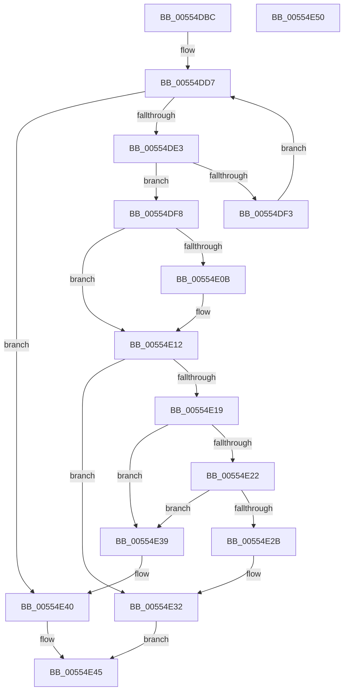

# HalpIommuDecreaseAliasTrack

- RVA: `0x00554DBC`–`0x00554E51` (길이 `149` bytes)
- VA: `0x0000000140554DBC`
- 실행 섹션: `.text`
- PDB 이름 있음: `예`; PDB Function 태그: `아니요`
- unwind 정보 RVA: `0x0005CAAC`
- 디코드: `45`개 명령, `149/149` bytes 표시
- 미해석 바이트: `0` (있으면 어셈블리에 `.byte`로 보존)

> 이 문서는 커널 이미지의 기계어와 PDB 기호를 분석해 생성했습니다. 4번과 5번은 함수 원형과 자료형을 바이너리 사용 방식에서 추정한 C 해석이며 원본 소스 복구 결과는 아닙니다.

## 1. Dependencies

- 직접 호출 지점: **1**; 고유 호출 대상: **1**
- 직접 호출자로 확인된 함수: **1**
- RIP 상대 이미지 참조: **1**

### Outgoing calls
- `0x00554DEA` → [IidAreIdsStrictlyEqual](../6A/IidAreIdsStrictlyEqual_function_006A2BE4.md) (function, `0x006A2BE4`)

### Direct callers
- [HalpIommuBlockDevice](../4C/HalpIommuBlockDevice_function_004CA150.md) at `0x004CA1ED`

### Static image references
- `0x00554DCD` → RVA `0x00FC1970` (`.data`; read)

## 2. Other-region calls and transfers

- 다른 실행 섹션으로 향하는 call: **0**
- 별도 외부 분기/꼬리 이동을 확인하지 못했습니다.

## 3. Assembly (complete function range)

```asm
00554DBC  48 89 5C 24 08                  mov qword ptr [rsp + 8], rbx
00554DC1  57                              push rdi
00554DC2  48 83 EC 20                     sub rsp, 0x20
00554DC6  48 83 22 00                     and qword ptr [rdx], 0
00554DCA  48 8B DA                        mov rbx, rdx
00554DCD  4C 8B 1D 9C CB A6 00            mov r11, qword ptr [rip + 0xa6cb9c]
00554DD4  48 8B F9                        mov rdi, rcx
00554DD7  48 8D 05 92 CB A6 00            lea rax, [rip + 0xa6cb92]
00554DDE  4C 3B D8                        cmp r11, rax
00554DE1  74 5D                           je 0x140554e40
00554DE3  49 8B 4B 10                     mov rcx, qword ptr [r11 + 0x10]
00554DE7  48 8B D7                        mov rdx, rdi
00554DEA  E8 F5 DD 14 00                  call 0x1406a2be4
00554DEF  84 C0                           test al, al
00554DF1  75 05                           jne 0x140554df8
00554DF3  4D 8B 1B                        mov r11, qword ptr [r11]
00554DF6  EB DF                           jmp 0x140554dd7
00554DF8  48 83 C8 FF                     or rax, 0xffffffffffffffff
00554DFC  F0 49 0F C1 43 18               lock xadd qword ptr [r11 + 0x18], rax
00554E02  48 FF C8                        dec rax
00554E05  48 83 F8 FF                     cmp rax, -1
00554E09  7F 07                           jg 0x140554e12
00554E0B  B9 0E 00 00 00                  mov ecx, 0xe
00554E10  CD 29                           int 0x29
00554E12  49 83 7B 18 00                  cmp qword ptr [r11 + 0x18], 0
00554E17  75 19                           jne 0x140554e32
00554E19  49 8B 0B                        mov rcx, qword ptr [r11]
00554E1C  4C 39 59 08                     cmp qword ptr [rcx + 8], r11
00554E20  75 17                           jne 0x140554e39
00554E22  49 8B 43 08                     mov rax, qword ptr [r11 + 8]
00554E26  4C 39 18                        cmp qword ptr [rax], r11
00554E29  75 0E                           jne 0x140554e39
00554E2B  48 89 08                        mov qword ptr [rax], rcx
00554E2E  48 89 41 08                     mov qword ptr [rcx + 8], rax
00554E32  4C 89 1B                        mov qword ptr [rbx], r11
00554E35  33 C0                           xor eax, eax
00554E37  EB 0C                           jmp 0x140554e45
00554E39  B9 03 00 00 00                  mov ecx, 3
00554E3E  CD 29                           int 0x29
00554E40  B8 25 02 00 C0                  mov eax, 0xc0000225
00554E45  48 8B 5C 24 30                  mov rbx, qword ptr [rsp + 0x30]
00554E4A  48 83 C4 20                     add rsp, 0x20
00554E4E  5F                              pop rdi
00554E4F  C3                              ret
00554E50  CC                              int3
```

## 4. C-style interpretation (structured pseudocode)

```c
__int64 __fastcall HalpIommuDecreaseAliasTrack(__int64 a1, __int64 a2)
{
    __int64 result;
    __int64 v_rsp;
    unsigned __int64 v_stack_p8;

    v_stack_p8 = v_rbx;
    v_rsp = (v_rsp) - (32);
loc_00554DD7:
    if ((*(unsigned __int64 *)(v_rip + 10931100)) == (v_rip + 10931090)) goto loc_00554E40;
    result = IidAreIdsStrictlyEqual(*(unsigned __int64 *)(*(unsigned __int64 *)(v_rip + 10931100) + 16), a1, a3, a4);
    if ((unsigned __int8)(result) != 0) goto loc_00554DF8;
    goto loc_00554DD7;
loc_00554DF8:
    result = (result) | (-1);
    result = (result) - 1;
    if (result <= -1) {
        a1 = 14;
    }
    if ((*(unsigned __int64 *)(*(unsigned __int64 *)(*(unsigned __int64 *)(v_rip + 10931100)) + 24)) != 0) goto loc_00554E32;
    if ((*(unsigned __int64 *)(*(unsigned __int64 *)(*(unsigned __int64 *)(*(unsigned __int64 *)(v_rip + 10931100))) + 8)) != (*(unsigned __int64 *)(*(unsigned __int64 *)(v_rip + 10931100)))) goto loc_00554E39;
    if ((*(unsigned __int64 *)(*(unsigned __int64 *)(*(unsigned __int64 *)(*(unsigned __int64 *)(v_rip + 10931100)) + 8))) != (*(unsigned __int64 *)(*(unsigned __int64 *)(v_rip + 10931100)))) goto loc_00554E39;
    *(unsigned __int64 *)(*(unsigned __int64 *)(*(unsigned __int64 *)(*(unsigned __int64 *)(v_rip + 10931100)) + 8)) = *(unsigned __int64 *)(*(unsigned __int64 *)(*(unsigned __int64 *)(v_rip + 10931100)));
    *(unsigned __int64 *)(*(unsigned __int64 *)(*(unsigned __int64 *)(*(unsigned __int64 *)(v_rip + 10931100))) + 8) = *(unsigned __int64 *)(*(unsigned __int64 *)(*(unsigned __int64 *)(v_rip + 10931100)) + 8);
loc_00554E32:
    *(unsigned __int64 *)(a2) = *(unsigned __int64 *)(*(unsigned __int64 *)(v_rip + 10931100));
    result = 0;
    goto loc_00554E45;
loc_00554E39:
loc_00554E40:
loc_00554E45:
    v_rsp = (v_rsp) + (32);
    return (unsigned int)(0xC0000225ULL);
}
```

## 5. (Beta) C Style

```c
int64_t HalpIommuDecreaseAliasTrack(int64_t Arg1, void *Arg2)
{
    uint8_t *arg2 = (uint8_t *)Arg2;

    int64_t result;
    int64_t local_rsp;
    uint64_t v_stack_p8;

    v_stack_p8 = local_rbx;
    local_rsp = (local_rsp) - (32);
loc_00554DD7:
    if ((*(uint64_t *)(v_rip + 0xA6CB9C)) == (v_rip + 10931090)) goto loc_00554E40;
    result = IidAreIdsStrictlyEqual(*(uint64_t *)(*(uint64_t *)(v_rip + 0xA6CB9C) + 0x10), Arg1, a3, a4);
    if ((uint8_t)(result) != 0) goto loc_00554DF8;
    goto loc_00554DD7;
loc_00554DF8:
    result = (result) | (-1);
    result = (result) - 1;
    if (result <= -1) {
        Arg1 = 14;
    }
    if ((*(uint64_t *)(*(uint64_t *)(*(uint64_t *)(v_rip + 0xA6CB9C)) + 0x18)) != 0) goto loc_00554E32;
    if ((*(uint64_t *)(*(uint64_t *)(*(uint64_t *)(*(uint64_t *)(v_rip + 0xA6CB9C))) + 0x8)) != (*(uint64_t *)(*(uint64_t *)(v_rip + 0xA6CB9C)))) goto loc_00554E39;
    if ((*(uint64_t *)(*(uint64_t *)(*(uint64_t *)(*(uint64_t *)(v_rip + 0xA6CB9C)) + 0x8))) != (*(uint64_t *)(*(uint64_t *)(v_rip + 0xA6CB9C)))) goto loc_00554E39;
    *(uint64_t *)(*(uint64_t *)(*(uint64_t *)(*(uint64_t *)(v_rip + 0xA6CB9C)) + 0x8)) = *(uint64_t *)(*(uint64_t *)(*(uint64_t *)(v_rip + 0xA6CB9C)));
    *(uint64_t *)(*(uint64_t *)(*(uint64_t *)(*(uint64_t *)(v_rip + 0xA6CB9C))) + 0x8) = *(uint64_t *)(*(uint64_t *)(*(uint64_t *)(v_rip + 0xA6CB9C)) + 0x8);
loc_00554E32:
    *(uint64_t *)(arg2) = *(uint64_t *)(*(uint64_t *)(v_rip + 0xA6CB9C));
    result = 0;
    goto loc_00554E45;
loc_00554E39:
loc_00554E40:
loc_00554E45:
    local_rsp = (local_rsp) + (32);
    return (uint32_t)(0xC0000225ULL);
}
```

### 관측된 메모리 오프셋

구조체 형식이 확인되지 않은 접근은 인자 기준의 오프셋으로만 기록했습니다.

| 기준 인자 | 오프셋 표현 | 폭 (bit) | 접근 |
|---|---:|---:|---|
| `Arg2` | `+ 0x0` | `64` | `R/W` |
| `Arg2` | `+ 0x0` | `64` | `W` |

## 6. Execution-region graph

[열기: 2D/3D 그래프와 함수 탐색 컨트롤 패널](../../../control-panel.html?section=text&rva=0x00554DBC&view=graph)

- 2D 그래프는 위에서 아래로 흐르고, 3D 그래프는 빈 공간을 드래그해 회전합니다. Shift+드래그는 이동, 휠은 확대·축소, 함수 노드 선택은 대상 보고서 이동입니다.

### Static fallback


