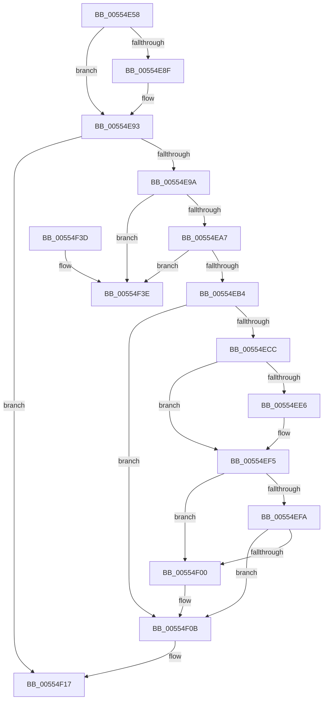

# HalpIommuDereferenceHardwareDomain

- RVA: `0x00554E58`–`0x00554F45` (길이 `237` bytes)
- VA: `0x0000000140554E58`
- 실행 섹션: `.text`
- PDB 이름 있음: `예`; PDB Function 태그: `아니요`
- unwind 정보 RVA: `0x0006B020`
- 디코드: `65`개 명령, `237/237` bytes 표시
- 미해석 바이트: `0` (있으면 어셈블리에 `.byte`로 보존)

> 이 문서는 커널 이미지의 기계어와 PDB 기호를 분석해 생성했습니다. 4번과 5번은 함수 원형과 자료형을 바이너리 사용 방식에서 추정한 C 해석이며 원본 소스 복구 결과는 아닙니다.

## 1. Dependencies

- 직접 호출 지점: **6**; 고유 호출 대상: **6**
- 직접 호출자로 확인된 함수: **4**
- RIP 상대 이미지 참조: **2**

### Outgoing calls
- `0x00554E7E` → [KeAcquireSpinLockRaiseToDpc](../20/KeAcquireSpinLockRaiseToDpc_function_00208470.md) (function, `0x00208470`)
- `0x00554ED8` → [HalpIommuFlushDomainTB](../49/HalpIommuFlushDomainTB_function_00494C64.md) (function, `0x00494C64`)
- `0x00554EF0` → [guard_dispatch_icall](../6B/guard_dispatch_icall_function_006BAAD0.md) (function, `0x006BAAD0`)
- `0x00554F06` → [HalpIommuFreeDomainId](HalpIommuFreeDomainId_function_00553658.md) (function, `0x00553658`)
- `0x00554F0E` → [HalpMmAllocCtxFree](../3E/HalpMmAllocCtxFree_function_003E1904.md) (function, `0x003E1904`)
- `0x00554F1D` → [KeReleaseSpinLock](../39/KeReleaseSpinLock_function_00392BA0.md) (function, `0x00392BA0`)

### Direct callers
- [HalpIommuLeaveDmaDomain](../4B/HalpIommuLeaveDmaDomain_function_004BF220.md) at `0x004BF353`
- [IommupDomainAttachPasidDevice](../54/IommupDomainAttachPasidDevice_function_0054F984.md) at `0x0054FD27`
- [IommupDomainDetachPasidDevice](../54/IommupDomainDetachPasidDevice_function_0054FD50.md) at `0x0054FEA2`
- [HalpIommuJoinDmaDomain](HalpIommuJoinDmaDomain_function_005554E8.md) at `0x005555DD`
- [HalpIommuJoinDmaDomain](HalpIommuJoinDmaDomain_function_005554E8.md) at `0x00555618`

### Static image references
- `0x00554E83` → RVA `0x00FC16B0` (`.data`; read)
- `0x00554EB4` → RVA `0x00FC1710` (`.data`; read)

## 2. Other-region calls and transfers

- 다른 실행 섹션으로 향하는 call: **0**
- 별도 외부 분기/꼬리 이동을 확인하지 못했습니다.

## 3. Assembly (complete function range)

```asm
00554E58  48 8B C4                        mov rax, rsp
00554E5B  48 89 58 08                     mov qword ptr [rax + 8], rbx
00554E5F  48 89 68 10                     mov qword ptr [rax + 0x10], rbp
00554E63  48 89 70 18                     mov qword ptr [rax + 0x18], rsi
00554E67  48 89 78 20                     mov qword ptr [rax + 0x20], rdi
00554E6B  41 56                           push r14
00554E6D  48 83 EC 20                     sub rsp, 0x20
00554E71  48 8D 79 20                     lea rdi, [rcx + 0x20]
00554E75  48 8B E9                        mov rbp, rcx
00554E78  48 8B CF                        mov rcx, rdi
00554E7B  48 8B DA                        mov rbx, rdx
00554E7E  E8 ED 35 CB FF                  call 0x140208470
00554E83  48 3B 2D 26 C8 A6 00            cmp rbp, qword ptr [rip + 0xa6c826]
00554E8A  44 8A F0                        mov r14b, al
00554E8D  74 04                           je 0x140554e93
00554E8F  48 FF 4B 10                     dec qword ptr [rbx + 0x10]
00554E93  48 83 7B 10 00                  cmp qword ptr [rbx + 0x10], 0
00554E98  75 7D                           jne 0x140554f17
00554E9A  48 8B 0B                        mov rcx, qword ptr [rbx]
00554E9D  48 39 59 08                     cmp qword ptr [rcx + 8], rbx
00554EA1  0F 85 97 00 00 00               jne 0x140554f3e
00554EA7  48 8B 43 08                     mov rax, qword ptr [rbx + 8]
00554EAB  48 39 18                        cmp qword ptr [rax], rbx
00554EAE  0F 85 8A 00 00 00               jne 0x140554f3e
00554EB4  80 3D 55 C8 A6 00 00            cmp byte ptr [rip + 0xa6c855], 0
00554EBB  48 8D 7B 20                     lea rdi, [rbx + 0x20]
00554EBF  48 89 08                        mov qword ptr [rax], rcx
00554EC2  48 89 41 08                     mov qword ptr [rcx + 8], rax
00554EC6  48 8B 73 18                     mov rsi, qword ptr [rbx + 0x18]
00554ECA  75 3F                           jne 0x140554f0b
00554ECC  45 33 C9                        xor r9d, r9d
00554ECF  45 33 C0                        xor r8d, r8d
00554ED2  48 8B D7                        mov rdx, rdi
00554ED5  48 8B CE                        mov rcx, rsi
00554ED8  E8 87 FD F3 FF                  call 0x140494c64
00554EDD  48 8B 46 50                     mov rax, qword ptr [rsi + 0x50]
00554EE1  48 85 C0                        test rax, rax
00554EE4  74 0F                           je 0x140554ef5
00554EE6  48 8B 4E 10                     mov rcx, qword ptr [rsi + 0x10]
00554EEA  45 33 C0                        xor r8d, r8d
00554EED  48 8B D7                        mov rdx, rdi
00554EF0  E8 DB 5B 16 00                  call 0x1406baad0
00554EF5  83 3F 03                        cmp dword ptr [rdi], 3
00554EF8  75 06                           jne 0x140554f00
00554EFA  F6 47 10 04                     test byte ptr [rdi + 0x10], 4
00554EFE  75 0B                           jne 0x140554f0b
00554F00  8B 57 30                        mov edx, dword ptr [rdi + 0x30]
00554F03  48 8B CE                        mov rcx, rsi
00554F06  E8 4D E7 FF FF                  call 0x140553658
00554F0B  48 8B D3                        mov rdx, rbx
00554F0E  E8 F1 C9 E8 FF                  call 0x1403e1904
00554F13  48 8D 7D 20                     lea rdi, [rbp + 0x20]
00554F17  41 8A D6                        mov dl, r14b
00554F1A  48 8B CF                        mov rcx, rdi
00554F1D  E8 7E DC E3 FF                  call 0x140392ba0
00554F22  48 8B 5C 24 30                  mov rbx, qword ptr [rsp + 0x30]
00554F27  48 8B 6C 24 38                  mov rbp, qword ptr [rsp + 0x38]
00554F2C  48 8B 74 24 40                  mov rsi, qword ptr [rsp + 0x40]
00554F31  48 8B 7C 24 48                  mov rdi, qword ptr [rsp + 0x48]
00554F36  48 83 C4 20                     add rsp, 0x20
00554F3A  41 5E                           pop r14
00554F3C  C3                              ret
00554F3D  CC                              int3
00554F3E  B9 03 00 00 00                  mov ecx, 3
00554F43  CD 29                           int 0x29
```

## 4. C-style interpretation (structured pseudocode)

```c
__int64 __fastcall HalpIommuDereferenceHardwareDomain(__int64 a1, __int64 a2, int a3, int a4)
{
    __int64 result;
    __int64 v_rsp;
    unsigned __int64 v_stack_p10;
    unsigned __int64 v_stack_p18;
    unsigned __int64 v_stack_p20;
    unsigned __int64 v_stack_p8;

    *(unsigned __int64 *)(v_rsp + 8) = v_rbx;
    *(unsigned __int64 *)(v_rsp + 16) = v_rbp;
    *(unsigned __int64 *)(v_rsp + 24) = v_rsi;
    *(unsigned __int64 *)(v_rsp + 32) = v_rdi;
    v_rsp = (v_rsp) - (32);
    result = KeAcquireSpinLockRaiseToDpc(a1 + 32, a2, a3, a4);
    if (a1 != (*(unsigned __int64 *)(v_rip + 10930214))) {
    }
    if ((*(unsigned __int64 *)(a2 + 16)) != 0) goto loc_00554F17;
    if ((*(unsigned __int64 *)(*(unsigned __int64 *)(a2) + 8)) != a2) goto loc_00554F3E;
    if ((*(unsigned __int64 *)(*(unsigned __int64 *)(a2 + 8))) != a2) goto loc_00554F3E;
    *(unsigned __int64 *)(*(unsigned __int64 *)(a2 + 8)) = *(unsigned __int64 *)(a2);
    *(unsigned __int64 *)(*(unsigned __int64 *)(a2) + 8) = *(unsigned __int64 *)(a2 + 8);
    if ((*(unsigned __int8 *)(v_rip + 10930261)) != 0) goto loc_00554F0B;
    a4 = 0;
    a3 = 0;
    result = HalpIommuFlushDomainTB(*(unsigned __int64 *)(a2 + 24), a2 + 32, a3, a4);
    result = *(unsigned __int64 *)(*(unsigned __int64 *)(a2 + 24) + 80);
    if (*(unsigned __int64 *)(*(unsigned __int64 *)(a2 + 24) + 80) != 0) {
        a1 = *(unsigned __int64 *)(*(unsigned __int64 *)(a2 + 24) + 16);
        a3 = 0;
        a2 = a2 + 32;
        result = guard_dispatch_icall(a1, a2, a3, a4);
    }
    if ((*(unsigned int *)(a2 + 32)) != 3) goto loc_00554F00;
    if (((*(unsigned __int8 *)(a2 + 32 + 16)) & (4)) == 0) {
        a2 = *(unsigned int *)(a2 + 32 + 48);
        a1 = *(unsigned __int64 *)(a2 + 24);
        result = HalpIommuFreeDomainId(a1, a2, a3, a4);
    }
    result = HalpMmAllocCtxFree(a1, a2, a3, a4);
loc_00554F17:
    result = KeReleaseSpinLock(a1 + 32, (unsigned __int8)((unsigned __int8)(result)), a3, a4);
    v_rsp = (v_rsp) + (32);
    return result;
loc_00554F3E:
    return result;
}
```

## 5. (Beta) C Style

```c
int64_t HalpIommuDereferenceHardwareDomain(void *Arg1, void *Arg2, int32_t Arg3, int32_t Arg4)
{
    uint8_t *arg1 = (uint8_t *)Arg1;
    uint8_t *arg2 = (uint8_t *)Arg2;

    int64_t result;
    int64_t local_rsp;
    uint64_t v_stack_p10;
    uint64_t v_stack_p18;
    uint64_t v_stack_p20;
    uint64_t v_stack_p8;

    *(uint64_t *)(local_rsp + 0x8) = local_rbx;
    *(uint64_t *)(local_rsp + 0x10) = local_rbp;
    *(uint64_t *)(local_rsp + 0x18) = local_rsi;
    *(uint64_t *)(local_rsp + 0x20) = local_rdi;
    local_rsp = (local_rsp) - (32);
    result = KeAcquireSpinLockRaiseToDpc(Arg1 + 32, Arg2, Arg3, Arg4);
    if (Arg1 != (*(uint64_t *)(v_rip + 0xA6C826))) {
    }
    if ((*(uint64_t *)(arg2 + 0x10)) != 0) goto loc_00554F17;
    if ((*(uint64_t *)(*(uint64_t *)(arg2) + 0x8)) != Arg2) goto loc_00554F3E;
    if ((*(uint64_t *)(*(uint64_t *)(arg2 + 0x8))) != Arg2) goto loc_00554F3E;
    *(uint64_t *)(*(uint64_t *)(arg2 + 0x8)) = *(uint64_t *)(arg2);
    *(uint64_t *)(*(uint64_t *)(arg2) + 0x8) = *(uint64_t *)(arg2 + 0x8);
    if ((*(uint8_t *)(v_rip + 0xA6C855)) != 0) goto loc_00554F0B;
    Arg4 = 0;
    Arg3 = 0;
    result = HalpIommuFlushDomainTB(*(uint64_t *)(arg2 + 0x18), Arg2 + 32, Arg3, Arg4);
    result = *(uint64_t *)(*(uint64_t *)(arg2 + 0x18) + 0x50);
    if (*(uint64_t *)(*(uint64_t *)(arg2 + 0x18) + 0x50) != 0) {
        Arg1 = *(uint64_t *)(*(uint64_t *)(arg2 + 0x18) + 0x10);
        Arg3 = 0;
        Arg2 = Arg2 + 32;
        result = guard_dispatch_icall(Arg1, Arg2, Arg3, Arg4);
    }
    if ((*(uint32_t *)(arg2 + 0x20)) != 3) goto loc_00554F00;
    if (((*(uint8_t *)(arg2 + 0x20 + 0x10)) & (4)) == 0) {
        Arg2 = *(uint32_t *)(arg2 + 0x20 + 0x30);
        Arg1 = *(uint64_t *)(arg2 + 0x18);
        result = HalpIommuFreeDomainId(Arg1, Arg2, Arg3, Arg4);
    }
    result = HalpMmAllocCtxFree(Arg1, Arg2, Arg3, Arg4);
loc_00554F17:
    result = KeReleaseSpinLock(Arg1 + 32, (uint8_t)((uint8_t)(result)), Arg3, Arg4);
    local_rsp = (local_rsp) + (32);
    return result;
loc_00554F3E:
    return result;
}
```

### 관측된 메모리 오프셋

구조체 형식이 확인되지 않은 접근은 인자 기준의 오프셋으로만 기록했습니다.

| 기준 인자 | 오프셋 표현 | 폭 (bit) | 접근 |
|---|---:|---:|---|
| `Arg1` | `+ 0x20` | `64` | `R` |
| `Arg2` | `+ 0x0` | `32` | `R` |
| `Arg2` | `+ 0x0` | `64` | `R` |
| `Arg2` | `+ 0x8` | `64` | `R` |
| `Arg2` | `+ 0x10` | `8` | `R` |
| `Arg2` | `+ 0x10` | `64` | `R` |
| `Arg2` | `+ 0x10` | `64` | `R/W` |
| `Arg2` | `+ 0x18` | `64` | `R` |
| `Arg2` | `+ 0x20` | `64` | `R` |
| `Arg2` | `+ 0x30` | `32` | `R` |

## 6. Execution-region graph

[열기: 2D/3D 그래프와 함수 탐색 컨트롤 패널](../../../control-panel.html?section=text&rva=0x00554E58&view=graph)

- 2D 그래프는 위에서 아래로 흐르고, 3D 그래프는 빈 공간을 드래그해 회전합니다. Shift+드래그는 이동, 휠은 확대·축소, 함수 노드 선택은 대상 보고서 이동입니다.

### Static fallback


