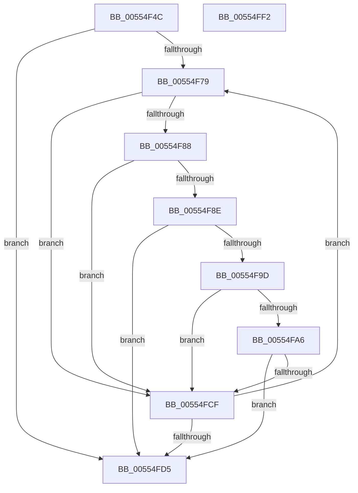

# HalpIommuDetermineReservedPciRid

- RVA: `0x00554F4C`–`0x00554FF3` (길이 `167` bytes)
- VA: `0x0000000140554F4C`
- 실행 섹션: `.text`
- PDB 이름 있음: `예`; PDB Function 태그: `아니요`
- unwind 정보 RVA: `0x00060130`
- 디코드: `52`개 명령, `167/167` bytes 표시
- 미해석 바이트: `0` (있으면 어셈블리에 `.byte`로 보존)

> 이 문서는 커널 이미지의 기계어와 PDB 기호를 분석해 생성했습니다. 4번과 5번은 함수 원형과 자료형을 바이너리 사용 방식에서 추정한 C 해석이며 원본 소스 복구 결과는 아닙니다.

## 1. Dependencies

- 직접 호출 지점: **2**; 고유 호출 대상: **2**
- 직접 호출자로 확인된 함수: **1**
- RIP 상대 이미지 참조: **0**

### Outgoing calls
- `0x00554F92` → [HalpPciConvertDevicePathToRid](HalpPciConvertDevicePathToRid_function_00553C68.md) (function, `0x00553C68`)
- `0x00554FC4` → [guard_dispatch_icall](../6B/guard_dispatch_icall_function_006BAAD0.md) (function, `0x006BAAD0`)

### Direct callers
- [HalpIommuProcessReservationsInternal](HalpIommuProcessReservationsInternal_function_00555900.md) at `0x005559A7`

### Static image references
- 디코드된 RIP-relative 메모리 참조가 없습니다.

## 2. Other-region calls and transfers

- 다른 실행 섹션으로 향하는 call: **0**
- 별도 외부 분기/꼬리 이동을 확인하지 못했습니다.

## 3. Assembly (complete function range)

```asm
00554F4C  48 8B C4                        mov rax, rsp
00554F4F  48 89 58 08                     mov qword ptr [rax + 8], rbx
00554F53  48 89 68 10                     mov qword ptr [rax + 0x10], rbp
00554F57  48 89 70 18                     mov qword ptr [rax + 0x18], rsi
00554F5B  48 89 78 20                     mov qword ptr [rax + 0x20], rdi
00554F5F  41 56                           push r14
00554F61  48 83 EC 40                     sub rsp, 0x40
00554F65  48 8B B9 18 02 00 00            mov rdi, qword ptr [rcx + 0x218]
00554F6C  33 ED                           xor ebp, ebp
00554F6E  48 8B F1                        mov rsi, rcx
00554F71  8B D5                           mov edx, ebp
00554F73  8B DD                           mov ebx, ebp
00554F75  39 2F                           cmp dword ptr [rdi], ebp
00554F77  76 5C                           jbe 0x140554fd5
00554F79  8B C3                           mov eax, ebx
00554F7B  4C 8B 74 C7 08                  mov r14, qword ptr [rdi + rax*8 + 8]
00554F80  49 8B 0E                        mov rcx, qword ptr [r14]
00554F83  83 39 01                        cmp dword ptr [rcx], 1
00554F86  75 47                           jne 0x140554fcf
00554F88  66 39 69 0E                     cmp word ptr [rcx + 0xe], bp
00554F8C  74 41                           je 0x140554fcf
00554F8E  48 83 C1 08                     add rcx, 8
00554F92  E8 D1 EC FF FF                  call 0x140553c68
00554F97  8B D0                           mov edx, eax
00554F99  85 C0                           test eax, eax
00554F9B  78 38                           js 0x140554fd5
00554F9D  48 8B 46 58                     mov rax, qword ptr [rsi + 0x58]
00554FA1  48 85 C0                        test rax, rax
00554FA4  74 29                           je 0x140554fcf
00554FA6  49 8B 16                        mov rdx, qword ptr [r14]
00554FA9  49 8D 4E 18                     lea rcx, [r14 + 0x18]
00554FAD  48 89 6C 24 28                  mov qword ptr [rsp + 0x28], rbp
00554FB2  4D 8B CE                        mov r9, r14
00554FB5  48 89 4C 24 20                  mov qword ptr [rsp + 0x20], rcx
00554FBA  41 B8 08 00 00 00               mov r8d, 8
00554FC0  48 8B 4E 10                     mov rcx, qword ptr [rsi + 0x10]
00554FC4  E8 07 5B 16 00                  call 0x1406baad0
00554FC9  8B D0                           mov edx, eax
00554FCB  85 C0                           test eax, eax
00554FCD  78 06                           js 0x140554fd5
00554FCF  FF C3                           inc ebx
00554FD1  3B 1F                           cmp ebx, dword ptr [rdi]
00554FD3  72 A4                           jb 0x140554f79
00554FD5  48 8B 5C 24 50                  mov rbx, qword ptr [rsp + 0x50]
00554FDA  8B C2                           mov eax, edx
00554FDC  48 8B 6C 24 58                  mov rbp, qword ptr [rsp + 0x58]
00554FE1  48 8B 74 24 60                  mov rsi, qword ptr [rsp + 0x60]
00554FE6  48 8B 7C 24 68                  mov rdi, qword ptr [rsp + 0x68]
00554FEB  48 83 C4 40                     add rsp, 0x40
00554FEF  41 5E                           pop r14
00554FF1  C3                              ret
00554FF2  CC                              int3
```

## 4. C-style interpretation (structured pseudocode)

```c
__int64 __fastcall HalpIommuDetermineReservedPciRid(__int64 a1)
{
    __int64 result;
    __int64 v_rbp;
    __int64 v_rbx;
    __int64 v_rsp;
    unsigned __int64 v_stack_m20;
    unsigned __int64 v_stack_m28;
    unsigned __int64 v_stack_p10;
    unsigned __int64 v_stack_p18;
    unsigned __int64 v_stack_p20;
    unsigned __int64 v_stack_p8;

    *(unsigned __int64 *)(v_rsp + 8) = v_rbx;
    *(unsigned __int64 *)(v_rsp + 16) = v_rbp;
    *(unsigned __int64 *)(v_rsp + 24) = v_rsi;
    *(unsigned __int64 *)(v_rsp + 32) = v_rdi;
    v_rsp = (v_rsp) - (64);
    v_rbp = 0;
    if ((*(unsigned int *)(*(unsigned __int64 *)(a1 + 536))) <= 0) goto loc_00554FD5;
loc_00554F79:
    if ((*(unsigned int *)(*(unsigned __int64 *)(*(unsigned __int64 *)(*(unsigned __int64 *)(a1 + 536) + 0 * 8 + 8)))) != 1) goto loc_00554FCF;
    if ((*(unsigned __int16 *)(*(unsigned __int64 *)(*(unsigned __int64 *)(*(unsigned __int64 *)(a1 + 536) + 0 * 8 + 8)) + 14)) == 0) goto loc_00554FCF;
    a1 = (*(unsigned __int64 *)(*(unsigned __int64 *)(*(unsigned __int64 *)(a1 + 536) + 0 * 8 + 8))) + (8);
    result = HalpPciConvertDevicePathToRid(a1, 0, a3, a4);
    if (sign_flag) goto loc_00554FD5;
    if (*(unsigned __int64 *)(a1 + 88) == 0) goto loc_00554FCF;
    v_stack_m20 = 0;
    v_stack_m28 = *(unsigned __int64 *)(*(unsigned __int64 *)(a1 + 536) + 0 * 8 + 8) + 24;
    result = guard_dispatch_icall(*(unsigned __int64 *)(a1 + 16), *(unsigned __int64 *)(*(unsigned __int64 *)(*(unsigned __int64 *)(a1 + 536) + 0 * 8 + 8)), 8, *(unsigned __int64 *)(*(unsigned __int64 *)(a1 + 536) + 0 * 8 + 8));
    if (sign_flag) goto loc_00554FD5;
loc_00554FCF:
    v_rbx = (unsigned int)((0) + 1);
    if (((unsigned int)(v_rbx)) < (*(unsigned int *)(*(unsigned __int64 *)(a1 + 536)))) goto loc_00554F79;
loc_00554FD5:
    v_rsp = (v_rsp) + (64);
    return (unsigned int)((unsigned int)((unsigned int)((unsigned int)(result))));
}
```

## 5. (Beta) C Style

```c
int64_t HalpIommuDetermineReservedPciRid(void *Arg1)
{
    uint8_t *arg1 = (uint8_t *)Arg1;

    int64_t result;
    int64_t local_rbp;
    int64_t local_rbx;
    int64_t local_rsp;
    uint64_t v_stack_m20;
    uint64_t v_stack_m28;
    uint64_t v_stack_p10;
    uint64_t v_stack_p18;
    uint64_t v_stack_p20;
    uint64_t v_stack_p8;

    *(uint64_t *)(local_rsp + 0x8) = local_rbx;
    *(uint64_t *)(local_rsp + 0x10) = local_rbp;
    *(uint64_t *)(local_rsp + 0x18) = local_rsi;
    *(uint64_t *)(local_rsp + 0x20) = local_rdi;
    local_rsp = (local_rsp) - (64);
    local_rbp = 0;
    if ((*(uint32_t *)(*(uint64_t *)(arg1 + 0x218))) <= 0) goto loc_00554FD5;
loc_00554F79:
    if ((*(uint32_t *)(*(uint64_t *)(*(uint64_t *)(*(uint64_t *)(arg1 + 0x218) + 0x0 * 8 + 0x8)))) != 1) goto loc_00554FCF;
    if ((*(uint16_t *)(*(uint64_t *)(*(uint64_t *)(*(uint64_t *)(arg1 + 0x218) + 0x0 * 8 + 0x8)) + 0xE)) == 0) goto loc_00554FCF;
    Arg1 = (*(uint64_t *)(*(uint64_t *)(*(uint64_t *)(arg1 + 0x218) + 0x0 * 8 + 0x8))) + (8);
    result = HalpPciConvertDevicePathToRid(Arg1, 0, a3, a4);
    if (sign_flag) goto loc_00554FD5;
    if (*(uint64_t *)(arg1 + 0x58) == 0) goto loc_00554FCF;
    v_stack_m20 = 0;
    v_stack_m28 = *(uint64_t *)(*(uint64_t *)(arg1 + 0x218) + 0x0 * 8 + 0x8) + 24;
    result = guard_dispatch_icall(*(uint64_t *)(arg1 + 0x10), *(uint64_t *)(*(uint64_t *)(*(uint64_t *)(arg1 + 0x218) + 0x0 * 8 + 0x8)), 8, *(uint64_t *)(*(uint64_t *)(arg1 + 0x218) + 0x0 * 8 + 0x8));
    if (sign_flag) goto loc_00554FD5;
loc_00554FCF:
    local_rbx = (uint32_t)((0) + 1);
    if (((uint32_t)(local_rbx)) < (*(uint32_t *)(*(uint64_t *)(arg1 + 0x218)))) goto loc_00554F79;
loc_00554FD5:
    local_rsp = (local_rsp) + (64);
    return (uint32_t)((uint32_t)((uint32_t)((uint32_t)(result))));
}
```

### 관측된 메모리 오프셋

구조체 형식이 확인되지 않은 접근은 인자 기준의 오프셋으로만 기록했습니다.

| 기준 인자 | 오프셋 표현 | 폭 (bit) | 접근 |
|---|---:|---:|---|
| `Arg1` | `+ 0x10` | `64` | `R` |
| `Arg1` | `+ 0x58` | `64` | `R` |
| `Arg1` | `+ 0x218` | `64` | `R` |

## 6. Execution-region graph

[열기: 2D/3D 그래프와 함수 탐색 컨트롤 패널](../../../control-panel.html?section=text&rva=0x00554F4C&view=graph)

- 2D 그래프는 위에서 아래로 흐르고, 3D 그래프는 빈 공간을 드래그해 회전합니다. Shift+드래그는 이동, 휠은 확대·축소, 함수 노드 선택은 대상 보고서 이동입니다.

### Static fallback


