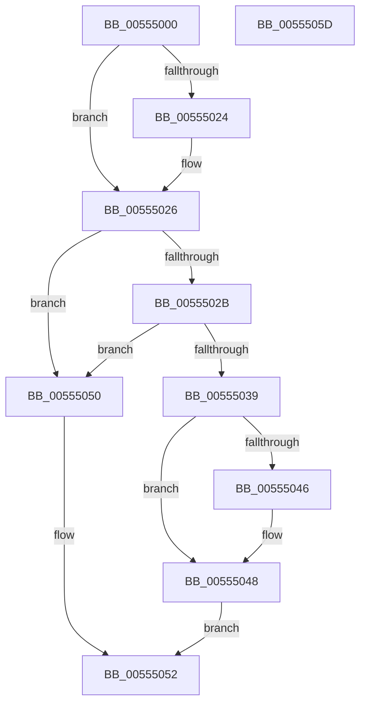

# HalpIommuDmaRemappingCapable

- RVA: `0x00555000`–`0x0055505E` (길이 `94` bytes)
- VA: `0x0000000140555000`
- 실행 섹션: `.text`
- PDB 이름 있음: `예`; PDB Function 태그: `아니요`
- unwind 정보 RVA: `0x00065960`
- 디코드: `32`개 명령, `94/94` bytes 표시
- 미해석 바이트: `0` (있으면 어셈블리에 `.byte`로 보존)

> 이 문서는 커널 이미지의 기계어와 PDB 기호를 분석해 생성했습니다. 4번과 5번은 함수 원형과 자료형을 바이너리 사용 방식에서 추정한 C 해석이며 원본 소스 복구 결과는 아닙니다.

## 1. Dependencies

- 직접 호출 지점: **2**; 고유 호출 대상: **2**
- 직접 호출자로 확인된 함수: **0**
- RIP 상대 이미지 참조: **0**

### Outgoing calls
- `0x00555030` → [HalpIommuQueryAcpiDeviceMapping](../4B/HalpIommuQueryAcpiDeviceMapping_function_004BC784.md) (function, `0x004BC784`)
- `0x0055503C` → [HalpIommuGetAcpiDeviceMapCount](HalpIommuGetAcpiDeviceMapCount_function_005551BC.md) (function, `0x005551BC`)

### Direct callers
- 이 함수 시작 RVA로 연결되는 직접 call은 확인되지 않았습니다. 간접 호출은 완전히 역산할 수 없습니다.

### Static image references
- 디코드된 RIP-relative 메모리 참조가 없습니다.

## 2. Other-region calls and transfers

- 다른 실행 섹션으로 향하는 call: **0**
- 별도 외부 분기/꼬리 이동을 확인하지 못했습니다.

## 3. Assembly (complete function range)

```asm
00555000  48 89 5C 24 08                  mov qword ptr [rsp + 8], rbx
00555005  57                              push rdi
00555006  48 83 EC 40                     sub rsp, 0x40
0055500A  33 C0                           xor eax, eax
0055500C  0F 57 C0                        xorps xmm0, xmm0
0055500F  48 89 44 24 30                  mov qword ptr [rsp + 0x30], rax
00555014  48 8B DA                        mov rbx, rdx
00555017  48 8B F9                        mov rdi, rcx
0055501A  0F 11 44 24 20                  movups xmmword ptr [rsp + 0x20], xmm0
0055501F  48 85 D2                        test rdx, rdx
00555022  74 02                           je 0x140555026
00555024  21 02                           and dword ptr [rdx], eax
00555026  83 39 02                        cmp dword ptr [rcx], 2
00555029  75 25                           jne 0x140555050
0055502B  48 8D 54 24 20                  lea rdx, [rsp + 0x20]
00555030  E8 4F 77 F6 FF                  call 0x1404bc784
00555035  85 C0                           test eax, eax
00555037  78 17                           js 0x140555050
00555039  48 8B CF                        mov rcx, rdi
0055503C  E8 7B 01 00 00                  call 0x1405551bc
00555041  48 85 DB                        test rbx, rbx
00555044  74 02                           je 0x140555048
00555046  89 03                           mov dword ptr [rbx], eax
00555048  83 F8 01                        cmp eax, 1
0055504B  0F 96 C0                        setbe al
0055504E  EB 02                           jmp 0x140555052
00555050  B0 01                           mov al, 1
00555052  48 8B 5C 24 50                  mov rbx, qword ptr [rsp + 0x50]
00555057  48 83 C4 40                     add rsp, 0x40
0055505B  5F                              pop rdi
0055505C  C3                              ret
0055505D  CC                              int3
```

## 4. C-style interpretation (structured pseudocode)

```c
__int64 __fastcall HalpIommuDmaRemappingCapable(__int64 a1, __int64 a2)
{
    __int64 result;
    __int64 v_rsp;
    unsigned __int64 v_stack_m18;
    unsigned __int64 v_stack_m28;
    unsigned __int64 v_stack_p8;

    v_stack_p8 = v_rbx;
    v_rsp = (v_rsp) - (64);
    result = 0;
    v_stack_m18 = 0;
    v_stack_m28 = v_xmm0;
    if (a2 != 0) {
    }
    if ((*(unsigned int *)(a1)) != 2) goto loc_00555050;
    result = HalpIommuQueryAcpiDeviceMapping(a1, v_stack_m28, a3, a4);
    if (sign_flag) goto loc_00555050;
    result = HalpIommuGetAcpiDeviceMapCount(a1, v_stack_m28, a3, a4);
    if (a2 != 0) {
        *(unsigned int *)(a2) = (unsigned int)(result);
    }
    result = (((unsigned int)(result)) <= 1) ? 1 : 0;
    goto loc_00555052;
loc_00555050:
loc_00555052:
    v_rsp = (v_rsp) + (64);
    return 1;
}
```

## 5. (Beta) C Style

```c
int64_t HalpIommuDmaRemappingCapable(void *Arg1, int64_t Arg2)
{
    uint8_t *arg1 = (uint8_t *)Arg1;

    int64_t result;
    int64_t local_rsp;
    uint64_t v_stack_m18;
    uint64_t v_stack_m28;
    uint64_t v_stack_p8;

    v_stack_p8 = local_rbx;
    local_rsp = (local_rsp) - (64);
    result = 0;
    v_stack_m18 = 0;
    v_stack_m28 = v_xmm0;
    if (Arg2 != 0) {
    }
    if ((*(uint32_t *)(arg1)) != 2) goto loc_00555050;
    result = HalpIommuQueryAcpiDeviceMapping(Arg1, v_stack_m28, a3, a4);
    if (sign_flag) goto loc_00555050;
    result = HalpIommuGetAcpiDeviceMapCount(Arg1, v_stack_m28, a3, a4);
    if (Arg2 != 0) {
        *(uint32_t *)(Arg2) = (uint32_t)(result);
    }
    result = (((uint32_t)(result)) <= 1) ? 1 : 0;
    goto loc_00555052;
loc_00555050:
loc_00555052:
    local_rsp = (local_rsp) + (64);
    return 1;
}
```

### 관측된 메모리 오프셋

구조체 형식이 확인되지 않은 접근은 인자 기준의 오프셋으로만 기록했습니다.

| 기준 인자 | 오프셋 표현 | 폭 (bit) | 접근 |
|---|---:|---:|---|
| `Arg1` | `+ 0x0` | `32` | `R` |

## 6. Execution-region graph

[열기: 2D/3D 그래프와 함수 탐색 컨트롤 패널](../../../control-panel.html?section=text&rva=0x00555000&view=graph)

- 2D 그래프는 위에서 아래로 흐르고, 3D 그래프는 빈 공간을 드래그해 회전합니다. Shift+드래그는 이동, 휠은 확대·축소, 함수 노드 선택은 대상 보고서 이동입니다.

### Static fallback


